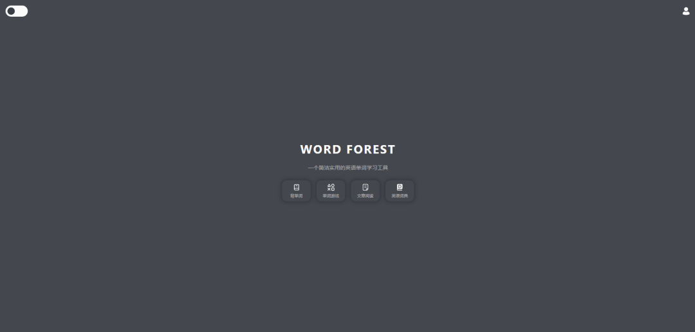
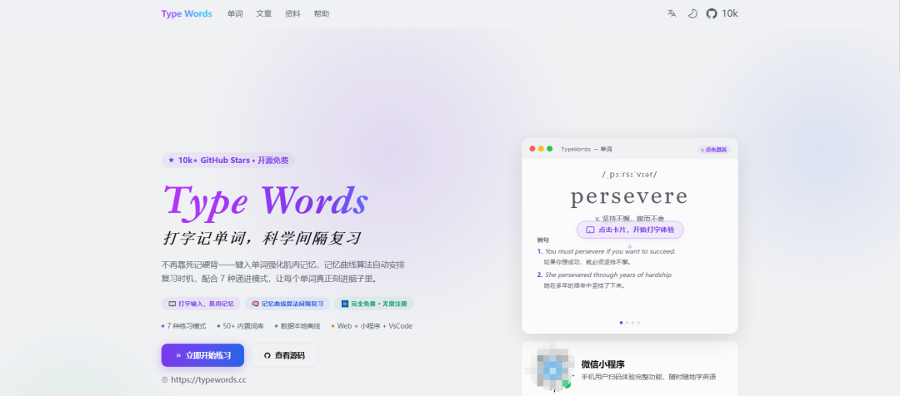
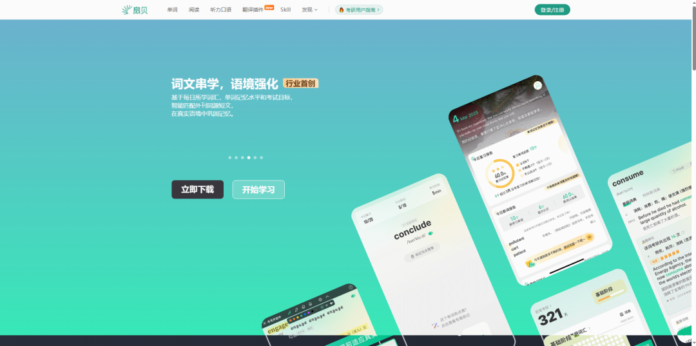

# 英语不好的人，请把这6个学习网站焊在收藏夹里
> 💡 备注属性未写入，可能是备注属性名称或者类型被修改了，建议将字段类型设置为 rich_text，可以在小程序-操作-修改文章数据库页面进行调整
> 原文链接:[https://mp.weixin.qq.com/s/IkAxZvT_zWZ40iWYgF9pNA](https://mp.weixin.qq.com/s/IkAxZvT_zWZ40iWYgF9pNA)
英语不好，不丢人，丢人的是收藏夹里存了一堆“下次一定学”的链接，然后继续躺平。
**背单词这件事，最怕的不是记不住，而是你还没开始就觉得它难。**
其实，工具选对了，每天碎片时间刷一刷，单词量真的会悄悄往上爬。
今天这6个网站，不搞花里胡哨的付费套路，主打一个“打开就能用”。英语基础差没关系，先把这几个焊在收藏夹里，从今天开始，每天十分钟，慢慢来，会比较快。
**一、单词森林**
**网址：https://wordforest.cn/**
**主打“碎片时间背单词”的轻量工具**，网页端加微信小程序双端打通，不用下载APP，打开就能背。
界面走的是清爽路线，没有弹窗广告，也没有“限时优惠”往你脸上怼。
**词库覆盖从初高中到四六级、考研**，每天刷一组，几分钟就能过一遍。
特别适合通勤路上、排队等餐这种“掏手机不知道干嘛”的场景——与其刷短视频，不如顺手过十个词。
家长想给孩子找个不伤眼的背词入口，这个也合适，小程序点开就学，不用折腾注册。

**二、TypeWords**
**网址：typewords.cc**
这个有点意思——**边打字边记单词**，顺便把打字速度也练了。
逻辑很简单：屏幕上给出单词和释义，你照着敲一遍，手脑并用，记忆的钩子比单纯“看+点”要深。
**完全免费，不用注册就能上手，电脑上打开网页直接开练。**
适合那些坐在电脑前学习、但总觉得“光看记不住”的人。键盘敲着敲着，单词就进脑子了，比干瞪着词表走神强太多。

**三、背单词365**
**网址：https://www.beidanci365.com/**
**在线背词工具，覆盖四六级、考研、雅思等主流考试词书。**
它最实在的地方是复习机制：根据你的掌握情况智能安排复习节奏，选“认识”就拉长间隔（1、3、7、14、30天），选“模糊/不认识”就当天再练、明天再复习——说白了就是帮你把“背了就忘”这个死循环给堵上。
注册后学习记录自动保存，换设备也不丢进度。还支持从自己的英文文章里收集生词、带着原句学，备考党拿来啃真题阅读里的生词挺顺手。

**四、wordbot**
**网址：https://wordbot.souty.cn/**
界面干净到近乎苛刻，打开就是单词，没有社交、没有打卡排行榜、没有花哨的皮肤。
适合那种“**我就想安安静静记几个词，别整那些有的没的**”的人。
专注记单词这件事本身，操作路径短，学习成本几乎为零。**自控力一般、容易被各种功能带偏的，用这个反而效率高。**

**五、扇贝**
**网址：https://www.shanbay.com/**
**老牌背词平台了，体系成熟，词书覆盖广，打卡、复习、测试一条龙。**
很多人从大学用到工作，词库和复习算法都经过多年打磨。
如果你想要一个“稳”字，扇贝是那种不会出错的选项。**当然，它也有付费内容，但免费功能拿来日常刷词完全够用。**

**六、词光 Word Atlas**
**网址：https://0xlei.tech/words/**
**雅思词汇图鉴，颜值和设计都在线。**
把单词按主题、场景做成可视化图鉴，看着不累，适合视觉型学习者。
如果你啃腻了传统词表、想换个赏心悦目的方式过雅思词汇，这个值得一试。**小众但用心，属于那种“打开会哇一下”的工具。**

**写在最后：**
说到底，背单词没有捷径，但有顺手的工具。
**这5个网站各有各的脾气：**想随时随地用碎片时间，就打开单词森林；想边练打字边记词，TypeWords适合你；备考四六级、考研、雅思，背单词365 的词汇覆盖够用；喜欢简洁专注，wordbot不打扰你；想系统刷词，扇贝是老朋友；想换个赏心悦目的方式啃雅思词汇，词光Word Atlas值得一试。
别贪多，先挑一个最顺手的用起来，坚持两周，你会发现自己看英文没那么怵了。
**收藏不等于学会，打开才算数**——现在就点开第一个，背五个词，今天就算赢。
如果这篇帮你省下了翻应用商店的时间，**点个赞让我知道，再转发给那个总说“英语不好”的朋友**——收藏夹里多一个能打开的链接，就少一句“下次一定”。
**您可能还喜欢：**
[国家偷偷给你开了9个免费图书馆，很多人一个都没点开过](https://mp.weixin.qq.com/s?__biz=MzA3NDU2Njc4Nw%3D%3D&mid=2652234767&idx=1&sn=27f007c08aa4ddf80b86b520e4c9fe98&scene=21#wechat_redirect)
[8个免费刷题网站，第3个是真的香!](https://mp.weixin.qq.com/s?__biz=MzA3NDU2Njc4Nw%3D%3D&mid=2652234703&idx=1&sn=18df9ed3ee5f72cb361cee3feaaa2f49&scene=21#wechat_redirect)
[这10个优质英语学习网站，竟然全免费!(亲测可用,附中文指南)](https://mp.weixin.qq.com/s?__biz=MzA3NDU2Njc4Nw%3D%3D&mid=2652234672&idx=1&sn=b81b0c71bd6aa1830881496bef47abf0&scene=21#wechat_redirect)
[8个出类拔萃学习网站，免费的就是香！](https://mp.weixin.qq.com/s?__biz=MzA3NDU2Njc4Nw%3D%3D&mid=2652234679&idx=1&sn=9fdc2b221da1bee8e7b110ab7b6bccf9&scene=21#wechat_redirect)
[比B站还好用的6个学习网站，知道的人还不多！](https://mp.weixin.qq.com/s?__biz=MzA3NDU2Njc4Nw%3D%3D&mid=2652234621&idx=1&sn=51cc13f0d08259978ec9142b01eaa2ba&scene=21#wechat_redirect)
 #英语学习 #背单词 #免费学习网站 #英语干货 #四六级备考
