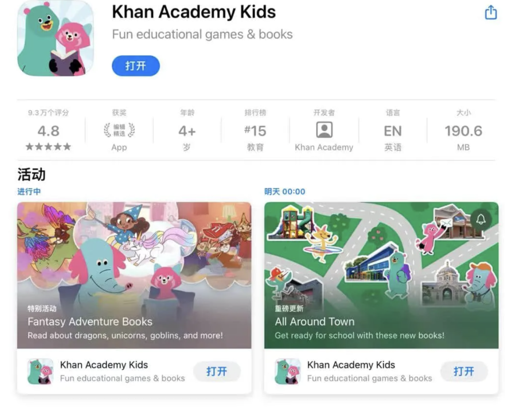
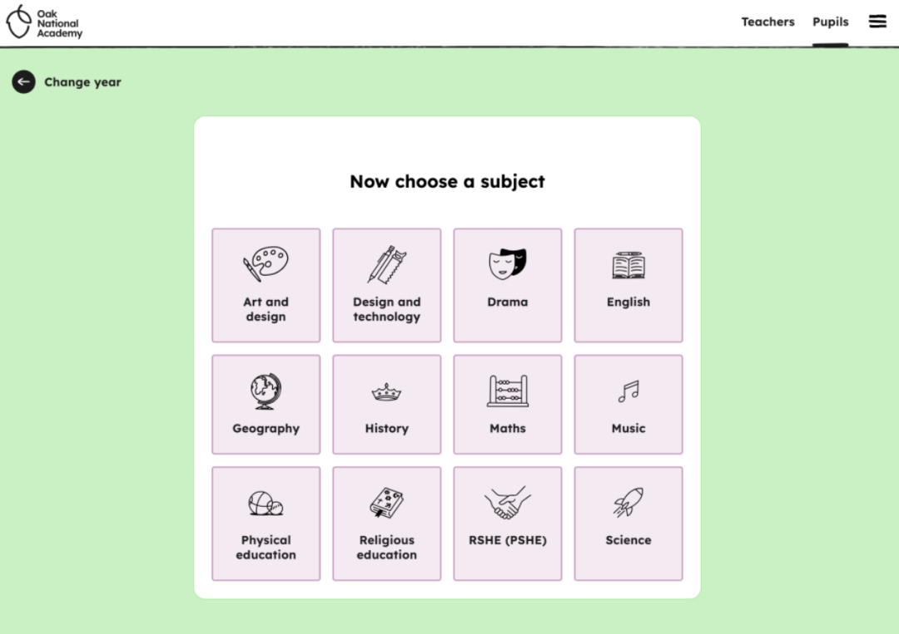
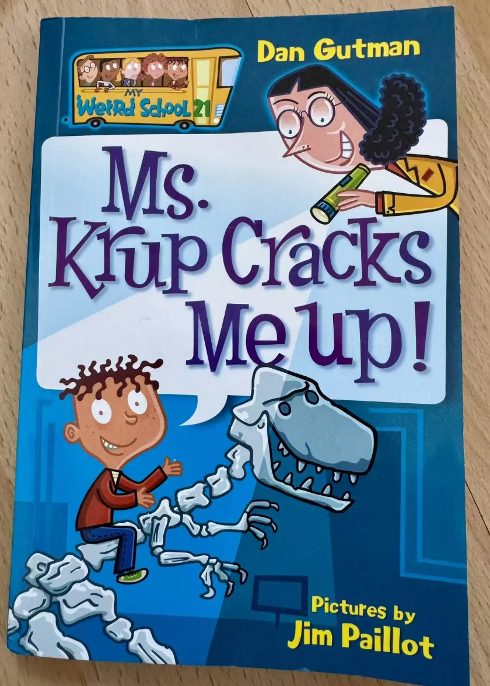
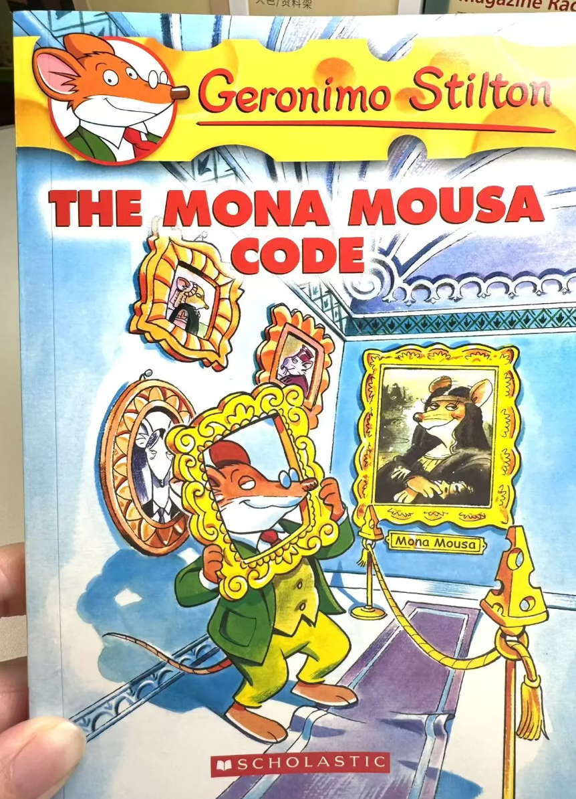
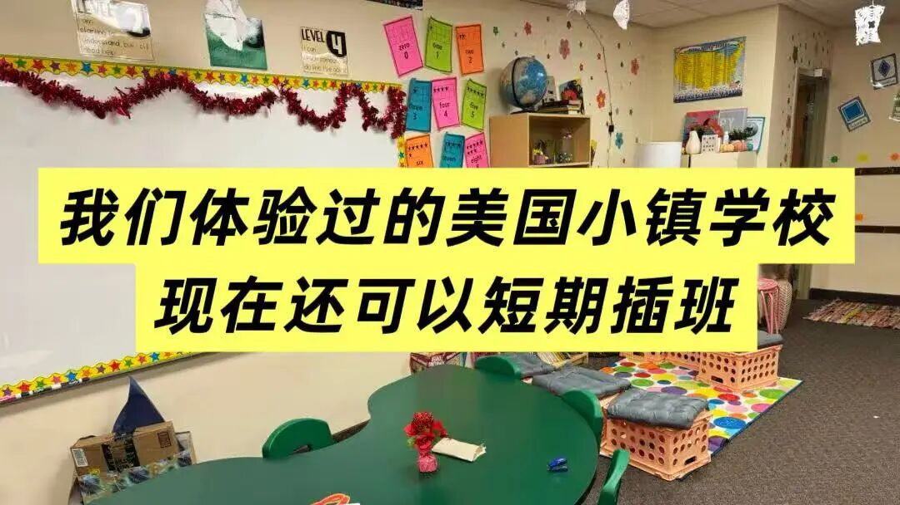

# 英语学习别只盯着教材！这5个英文资源，我觉得值得给孩子收藏
> 💡 备注属性未写入，可能是备注属性名称或者类型被修改了，建议将字段类型设置为 rich_text，可以在小程序-操作-修改文章数据库页面进行调整
> 💡 原文链接:[https://mp.weixin.qq.com/s?__biz=MzI0NTc3MzU3Ng==&mid=2247493662&idx=1&sn=409c93883535aec6899343e350f3ab56&chksm=e872b71163a3e95692f40ec983bb35a1aa2c29cafcde1f4febb88252569a7b3584fd9217a862#rd](https://mp.weixin.qq.com/s?__biz=MzI0NTc3MzU3Ng%3D%3D&mid=2247493662&idx=1&sn=409c93883535aec6899343e350f3ab56&chksm=e872b71163a3e95692f40ec983bb35a1aa2c29cafcde1f4febb88252569a7b3584fd9217a862#rd)
最近来了不少新关注我的朋友, 那我就把之前曾经介绍过的，我家用过的很好的英语资源都汇总分享一下,方便大家查阅~
### Circle Round：把世界各地的民间故事讲给孩子听
### 
这是一个来自美国WBUR电台的儿童英语故事播客。它最吸引我的地方，是故事内容并不局限于英语国家，而是从世界各地的民间故事、传统传说中寻找素材，再通过配音、音乐和音效，把故事制作成一集集有声剧。每集通常15—25分钟，故事主题涉及善良、坚持、勇气、慷慨、同理心等。
和单纯听英语课文不同，Circle Round更像是在听一部广播剧。不同角色有不同的声音，背景音乐和情节也比较丰富，孩子即使不看屏幕，也能跟着故事走。我觉得它比较适合已经有一些英语听力基础愿意听故事的孩子。详细介绍在这里。[**磨耳朵神器！娃迷上的免费英文播客Circle Round：400+全球故事，专业顶级制**](https://mp.weixin.qq.com/s?__biz=MzI0NTc3MzU3Ng%3D%3D&mid=2247491978&idx=1&sn=f80d826778412b6533b0af07da263f92&scene=21#wechat_redirect)

**Khan Academy Kids：免费的儿童英语学习APP**
如果家里有低龄孩子，可以了解一下可汗学院推出的儿童版APP——Khan Academy Kids。它主要面向2—8岁的孩子，内容涵盖英语阅读、自然拼读、词汇、写作、数学和社交情绪学习等。
APP里有很多可爱的卡通角色，会带着孩子完成小游戏、阅读绘本和互动练习。不是简单地让孩子坐在那里背单词，而是通过游戏和故事，让孩子在操作过程中学习。比如字母认读、发音练习、简单单词拼读，以及英文绘本阅读，都能在里面找到相应内容。
它还有一个很大的优点：这个APP完全免费，没有广告，也没有订阅费用。对于英语启蒙阶段的孩子来说，可以作为每天十几分钟的互动学习工具。不过，它更适合学前到小学低年级，不建议把它当成大孩子的主要英语学习资源。

### Oak National Academy：英国免费的在线课程资源
这个资源可能很多家长不太熟悉。Oak National Academy 是英国的在线课程资源平台，和普通的英语学习网站不太一样。它提供的是按照英国学校课程体系设计的教学内容，涵盖英语、数学、科学、历史、地理等多个学科。里面有老师讲解的视频课程，也有配套的练习和学习材料。如果孩子已经有一定英语基础，想接触一些真正用英语学习的学科内容，可以去看看。
我觉得它比较适合年纪大些的孩子，也可以作为家长了解英国学校课程内容的一个窗口。它不是一所可以直接报名入读的英国学校，而是一个免费的数字课程资源平台，缺点是没有互动，只有视频和资料，需要家长自己筛选需要的内容。

以上两个学习平台详细介绍在这里[不花一分钱！用英语启蒙和学习各学科课程的宝藏免费资源（2-16岁全包含）](https://mp.weixin.qq.com/s?__biz=MzI0NTc3MzU3Ng%3D%3D&mid=2247490194&idx=1&sn=492573ef61ad75273406a16b872e17fc&scene=21#wechat_redirect)
### 
### My Weird School《疯狂学校》：美国小学生的爆笑校园日常
最后推荐一套很受美国小学生欢迎的英文桥梁书——Dan Gutman创作的 **My Weird School** 系列，中文常见译名是《疯狂学校》。
这套书的主角是一个叫A.J.的男孩。他不太喜欢上学，更喜欢踢足球、玩游戏，对学校里的各种规矩也常常有自己的看法。故事围绕他和同学们的校园生活展开，最有趣的地方就是：学校里的老师实在太奇怪了！有行为古怪、让学生摸不着头脑的老师，也有各种让人意想不到的课堂状况。每一本书都会围绕一位老师或一段校园经历展开，情节轻松幽默，经常让人忍不住笑出来。这套书的语言比较贴近美国小学生的日常表达，句子相对简短，很多重复用语反复出现，读起来没有太大的压力。
My Weird School偏向校园生活和幽默故事。孩子可以在阅读中接触到学校、课堂、同学相处等日常场景，也能了解一些美国校园文化。如果孩子喜欢搞笑校园故事，这套书可以试试。[**在爆笑中搞定英语初章阅读：从“讨厌上学”到爱上英语，只需一套《疯狂学校》（Weird school系列）**](https://mp.weixin.qq.com/s?__biz=MzI0NTc3MzU3Ng%3D%3D&mid=2247492185&idx=1&sn=3274d80ad33a5a13ec5374a786241f9c&scene=21#wechat_redirect)

### 
### Geronimo Stilton《老鼠记者》：让孩子愿意主动读英文书
这套书应该是很多孩子都喜欢的英文读物。主角Geronimo Stilton是一只住在老鼠岛的老鼠，经营着一家报社。虽然他平时有点胆小、怕麻烦，却总是被卷入各种冒险故事中。从寻找宝藏、埃及探险，到神秘古堡、丛林冒险，故事情节很丰富。
它还有一个很明显的特点：书里的字体、颜色和排版变化很多，一些关键词会用特别的字体和颜色突出显示，读起来不像传统的英文小说那么单调。
这套书特别适合从简单英文读物过渡到章节书的孩子。如果孩子本身喜欢冒险、寻宝和奇幻故事，可以从第一册开始尝试。相比家长要求孩子每天读多少页，找到一本他愿意主动拿起来读的书，可能更重要。[**8岁娃沉迷老鼠记者，我终于理解它为什么火**](https://mp.weixin.qq.com/s?__biz=MzI0NTc3MzU3Ng%3D%3D&mid=2247493033&idx=1&sn=87c373e4b21567e8e8ab2420e8d7583f&scene=21#wechat_redirect)

---
### 
当英语不再只是需要完成的学科，而是获取信息、阅读故事和认识世界的一种工具，孩子学习英语的动力可能也会不一样。这也是我一直给孩子寻找英文原版资源的原因。
之前带孩子在美国插班两个月，后来越来越觉得，这其实是一种很特别的亲子旅居方式——孩子真正走进当地学校，我们也能用几周到几个月的时间，体验当地人的日常生活
最近重新整理这段经历，也对接加州这个小镇短期插班项目，如果你也感兴趣想了解，欢迎来找我。

**关于我**
我是绿叶小贝, 之前是互联网行业设计师，两个孩子的妈妈，老大在国内生，老二在美国生。会分享国宝和美宝长大后的亲子出游，英语学习和教育规划经验和想法。
养美宝这件事，很多零零散散的经验真的不是看一篇攻略就够。旅行证和护照怎么用，孩子以后上学怎么选……不同家庭都会遇到各种具体问题。目前我有个美宝家长群，可以交流和美宝相关的任何话题，有问题大家一起讨论，有经验也可以互相分享。一个人的经验有限，但一群家长的信息差可以互相补上。如果你家也是美宝，欢迎一起沟通有无。
另外也有北京的亲子群和夏令营冬令营的群，不是美宝也可以加我入群～
