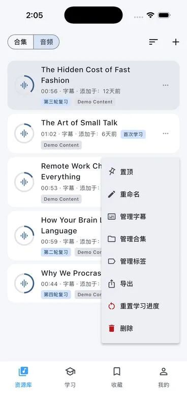
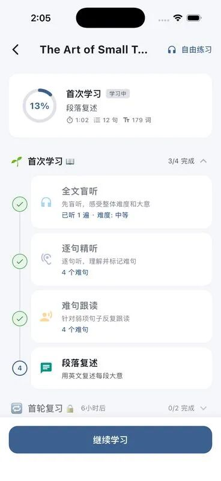
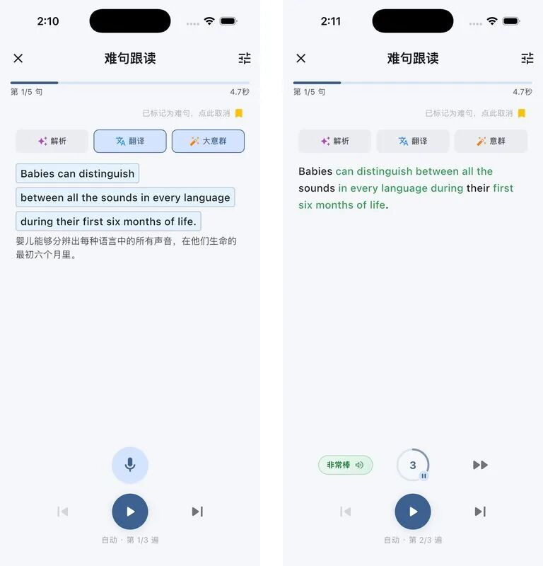
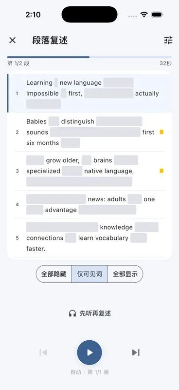
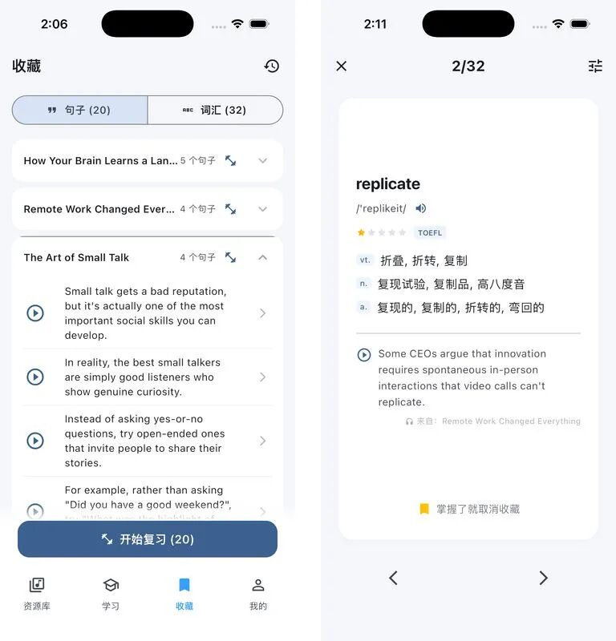
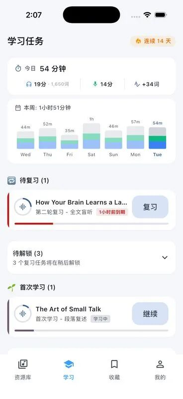
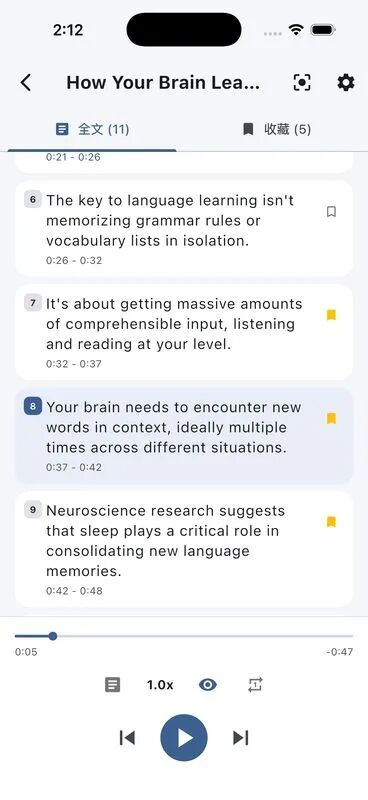

# 英语播客听完就忘？这个开源 App，想让你把一段音频练到会说
> 💡 备注属性未写入，可能是备注属性名称或者类型被修改了，建议将字段类型设置为 rich_text，可以在小程序-操作-修改文章数据库页面进行调整
> 💡 原文链接:[https://mp.weixin.qq.com/s?__biz=MzAxNDU0NzAxNg==&mid=2247486291&idx=1&sn=0a2a96c744a2caf3adcb69f2e3ce05f7&chksm=9aeae084ce3c59b2a7d0207bf8cab54ca78bc3a05932c4198340d3cdf0f61fcc064ec98a73ad#rd](https://mp.weixin.qq.com/s?__biz=MzAxNDU0NzAxNg%3D%3D&mid=2247486291&idx=1&sn=0a2a96c744a2caf3adcb69f2e3ce05f7&chksm=9aeae084ce3c59b2a7d0207bf8cab54ca78bc3a05932c4198340d3cdf0f61fcc064ec98a73ad#rd)
英语学习的收藏夹，很容易变成一个仓库。
今天存一集播客，明天存一段 TED。播放的时候，借助字幕好像都能懂；关掉字幕让你讲两句，脑子里又只剩几个零散的词。材料攒了一堆，能拿来用的表达没留下多少。
最近看到一个开源项目，叫 Echo Loop。它把注意力放在了一件很具体的事上：拿到一段英语音频2以后，接下来到底怎么练。
精听、跟读、盲听、复述，再把难句和生词送回后续复习。它把一段音频拆成了能继续、能回看的练习任务。
 

01图：Echo Loop 中文官网首页。网站承担介绍与下载入口，听说练习在 App 内完成。来源：官网。
看这类工具，我会看四件事：自己的材料能不能放进去，卡住的句子能不能拆开，听完有没有开口的环节，过几天能不能接着练。沿着这四件事看，Echo Loop 的取舍就清楚了。
### 01把自己的音频放进来
官网展示的音频库很直白，上面是「合集」「音频」两个入口，下面是一张张材料卡片。卡片上有时长、字幕状态和学习阶段；展开菜单，还能管理字幕、合集和标签。
这意味着，你可以围绕自己要练的内容组织材料。比如挑一段想听懂的访谈，或者一小段工作中会用到的英文介绍，围绕它反复练习。

02图：官网提供的音频库实图，菜单中可见「管理字幕」「管理合集」「管理标签」。来源：官方原图。
项目文档列出的输入包括本地文件、音频直链、百度网盘和播客订阅。字幕支持 SRT、VTT、LRC；已有字幕可以导入，没有字幕也提供转录入口，其中本地转录需要先下载模型。
初次使用，我建议挑一段一两分钟的材料，先把流程走完。材料越长，精听和复述需要投入的时间也越多。
### 02一段材料有自己的练习进度
Echo Loop 的学习计划页，是我最想让大家看的一张图。
顶部显示这篇材料的进度，下面把练习拆成几个步骤。哪些已经完成、现在停在哪里，都能看到。底部的「继续学习」，把下一次练习接回当前环节。

03图：官网提供的学习计划示例，前三项已完成，当前停在段落复述。图中为盲听在前的流程示例。来源：官方原图。
这里有一个版本细节：v1.0.46 的学习计划给新建材料安排的是「精听 → 跟读 → 盲听 → 复述」，旧材料保留原有计划，所以会和官网截图的顺序不同。无论从哪个环节进入，这个页面都在回答同一个问题：这段音频，我练到哪一步了？
对经常半途切换工具的人，这种设计有实际价值。播放器通常记住你听到了第几秒；这里还会记住，你正在完成哪一种练习。
### 03卡住的句子，可以拆开练
难句跟读页里，一次只放当前句子。上面有「解析」「翻译」和意群切换，下面是录音、播放和进度控制。
左边这张图把一句英语拆成了三块：Babies can distinguish、between all the sounds in every language、during their first six months of life。中文翻译放在下方，读的时候能对着几个有意义的片段练。

04图：左侧为意群与翻译，右侧为另一张跟读反馈示例，可见词语高亮和「非常棒」评级。两张均为官网原图，仅并排排版。来源：意群图、反馈图。
这个拆法有用的地方，是让注意力落到一句话内部。遇到一长串词时，你能先看它在说什么、修饰什么，再回去听原声里的停顿和重音。需要解释时展开解析，练顺以后再减少提示。
右边的图则能看到跟读反馈：部分词被高亮，下方出现评级。它提供了重复练习的反馈入口，但一个评级覆盖不了口音、语调和表达自然度的全部问题。把它用来定位漏词、提醒自己重练，会更稳妥。
### 04到了复述这一步，需要自己组织语言
跟着原声读完一句话，接下来还有段落复述。
官网这张复述图很有意思：句子里的大部分词被遮住，只留下几个提示。下面有「全部隐藏」「仅关键词」「全部显示」三档，你可以逐渐撤掉原文，把内容用自己的话讲出来。

05图：段落复述的关键词提示模式。底部可切换三档显示程度，并提示「先听再复述」。来源：官方原图。
同一段材料，到这里换了一种要求。精听时，你在辨认别人说了什么；复述时，你要决定先说哪件事、用哪个词、怎样把几句话接起来。听着熟悉的内容，能不能自己说出来，会在这里暴露得很直接。
我更看重这一环。很多英语工具可以帮忙翻译和查词，读者也很容易一直停在看解释的状态。**关键词卡片把提示留到一个合适的位置，同时把组织语言的工作交回给你。**
### 05收藏之后，还能回到原来的语境
练习里标记的难句和收藏的生词，会汇总到收藏页。官网截图把「句子」「词汇」分成两个标签，句子再按来源音频分组，底部可以直接开始复习。
旁边的单词闪卡也保留了来源。以 replicate 为例，卡片除了音标、释义和考试标签，还放着原音频里的例句及播放入口。下次复习时，你能回到遇见这个词的那句话。

06图：左侧为收藏句列表，右侧为带来源例句的词汇闪卡。两张官方实图并排，界面内容未改写。来源：收藏图、闪卡图。
复习任务则集中在学习页。图里能看到「待复习」「待解锁」「首次学习」几组状态，上方显示学习时长和输入、输出记录。今天继续旧材料还是开始新材料，打开页面就有线索。

07图：官网提供的学习任务示例。时长、词数和连续天数均属于展示数据。来源：官方原图。
v1.0.46 的材料学习计划包含首次学习和七轮复习，每轮都按时完成时，等待间隔累计为 28 天。具体任务会跟着上一轮的实际完成时间推进，日常使用直接看任务卡更省事。
这里要分清，完成计划代表走过了这些练习环节。听说能力能提高多少，还要看材料难度、练习质量，以及你能否把表达用到新的场景里。
### 06免费范围、平台和使用选择
按照官网 FAQ，基础练习、导入、收藏和复习等功能免费，AI 翻译、句子解析、意群拆分、复述评估及云端转录等功能有月度额度。额度用完，基础练习仍可继续；具体会员价格和权益，以 App 内展示为准。
数据也有本地和云端之分。官网说学习数据默认保存在本机，换手机前需要导出备份；隐私政策同时说明，调用云端 AI 时，相关文本、学习上下文或音频可能交给相应服务商处理。开源提供了查看实现的条件，使用云端功能时仍要考虑材料适不适合上传。
平台方面，官方主要提供 iOS、Android App，Android 也有 GitHub APK。官网上的 Mac 下载按钮仍是「即将推出」，仓库也把正式桌面版列在后续计划里；想在浏览器里直接练习的人，需要留意这一点。
它也留了一个轻松些的入口。自由练习页能看全文、切到收藏句、调速度、按时间戳定位，适合只想重听某几句的时候。

08图：自由练习页，当前句子和收藏标记都保留在字幕列表中。来源：官方原图。
怎么选，可以按自己卡住的位置来。
> 💡 此处疑似丢失表格内容，如确有丢失，请联系开发者处理qid(uchTn3EDzTMsjNBsIpSHt)
| 你的情况 | 更合适的入口 | 需要投入什么 |
| 材料不少，常常听完就换下一篇 | 选一段短音频，完成整套练习 | 愿意对同一内容重复听说 |
| 大意能懂，某几句总是卡住 | 逐句精听、意群提示、难句跟读 | 逐句定位问题并开口重练 |
| 看字幕能懂，离开字幕讲不出来 | 段落复述，逐步减少关键词提示 | 自己组织语言，接受说得磕绊 |
| 只想轻松听一遍或重听几句 | 自由练习 | 按自己的节奏播放和收藏 |
项目采用 AGPL-3.0 许可证，用 Flutter / Dart 开发。仓库仍在更新，v1.0.46发布于 11 月 6 日，之后也有新的代码提交。对普通学习者，先用现成的移动端就够了；想自己编译，再去看配置和开发文档。
Echo Loop 值得尝试的地方，就是把一段材料后面的练习安排得足够具体。你不用每次重新决定听几遍、练哪句、什么时候回来看，能把更多精力留给听和说。
如果你的收藏夹里已经躺着很多英语音频，可以挑一段最想用上的，先试着讲出来。讲到哪里卡住，再回去练哪里。工具能替你安排下一步，开口的那一遍，还得自己完成。
官网：Echo Loop
开源仓库：echo-loop / Echo-Loop
