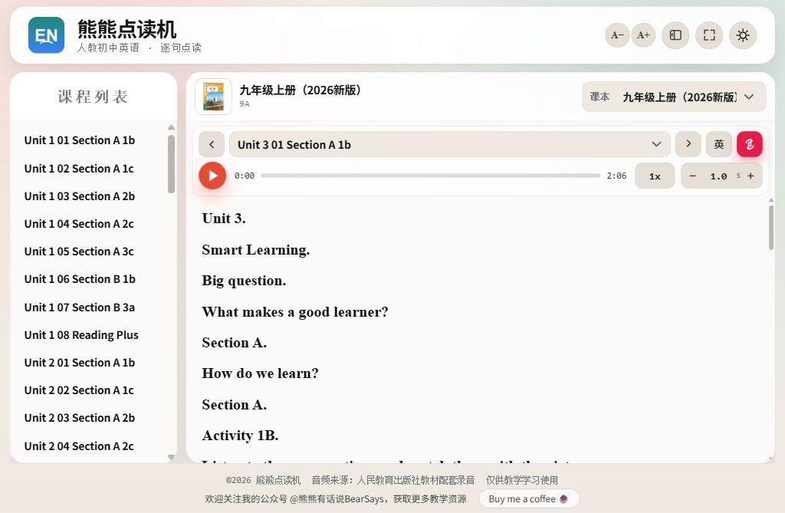
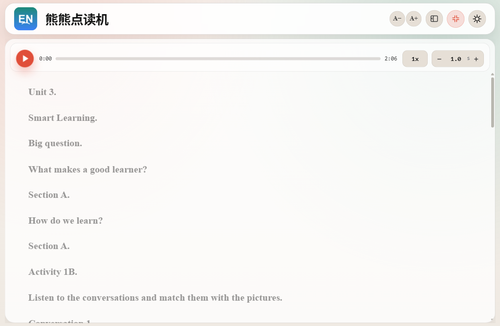
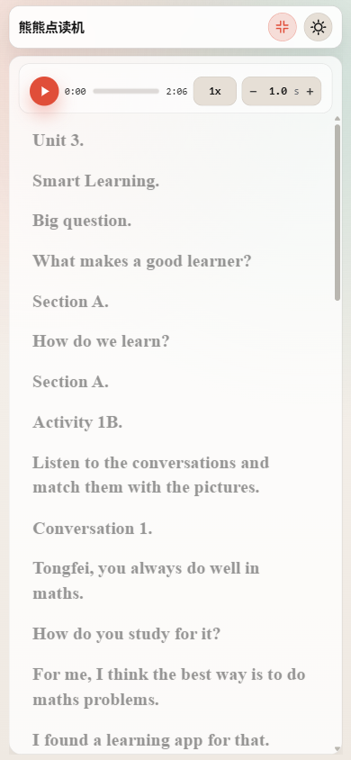

# 英语老师亲测：人教点读录音终于不用全网找了
> 💡 备注属性未写入，可能是备注属性名称或者类型被修改了，建议将字段类型设置为 rich_text，可以在小程序-操作-修改文章数据库页面进行调整
> 💡 原文链接:[https://mp.weixin.qq.com/s?__biz=MzU3NDgzMzMyMg==&mid=2247486396&idx=1&sn=d18c6706b57fdcd92744687672456c5a&chksm=fc81b56ccdabe28d7280183b30b915b75dff80cbcdc3e29dc6420a66700af9de0293d1f7659e#rd](https://mp.weixin.qq.com/s?__biz=MzU3NDgzMzMyMg%3D%3D&mid=2247486396&idx=1&sn=d18c6706b57fdcd92744687672456c5a&chksm=fc81b56ccdabe28d7280183b30b915b75dff80cbcdc3e29dc6420a66700af9de0293d1f7659e#rd)
**英语老师亲测：人教点读录音终于不用全网找了**
带早自习的老师都懂这种狼狈——录音拷进U盘，读一句，暂停；等全班跟读，再点下一句，再暂停……一节课四十分钟，手一直悬在播放键上。学生读慢了要等，读快了要倒回去。一学期下来，“暂停”这两个字，你按了成百上千次。
比手动暂停更磨人的，是找录音本身。

**▍ 01 人教官方点读录音，为什么这么难找？**
新学期换教材，家长群第一句话永远是：“有没有课文音频？”
你翻人教社官网，教材资源入口散得让人崩溃——一个单元一个单元地藏在不同导航下，七年级上册一个入口，九年级上册又一个入口，普通家长根本摸不着门。
去网盘搜，全是“付费解锁”；去QQ群求，靠的是人情。好不容易求到一份，要么只有朗读版没有逐句版，要么音频和课文对不上。一个英语老师，硬生生被逼成了“全网找资源专家”。
其实教材音频是官方的、开放的、每个学生都该有的——
**问题从来不是“有没有”，而是“没人把它整理好”。**
**▍ 02 点读不难，难的是“它会等你”**
后来我干脆自己动手，把五册人教初中英语（七上、七下、八上、八下、九上）的课文录音一册一册整理好，做成了一个免费网页点读机。
它叫“熊熊点读机”，网址：diandu.aifunclass.cn
我最想夸它的，是一个很多点读工具都没有的设计——自动跟读。
点一下播放，它读一句，然后自动停下来，按你设定的秒数等全班跟读，再自动读下一句。间隔可调，默认是句子时长加1秒，步长0.1秒，想留2秒还是3秒，你自己定。
**意味着老师终于可以把手从播放键上放下来了。全班跟读的时候，你走到学生中间听发音、看口型，而不是守在电脑前当“人形暂停器”。**

**▍ 03 一个为“教室大屏”而生的界面**
除了自动跟读，它还有很多为真实课堂设计的小心思：
· **逐句点读**：点哪句读哪句，句子高亮跟着走，中英双语对照，基础弱的学生也跟得上。
· **全屏跟读模式**：大屏投影时，左侧目录自动收起，整个屏幕只留当前句子，Times New Roman 字体，后排学生也看得清。
· **五种播放模式**：自动跟读、单句点读、单句循环、本课循环……上课想怎么用怎么用。
· **手机也能用**：家长在家点开就能听，不用下载App、不用注册、不用付费。

**一句话：老师能省力，学生能看清，家长能找到。**

**▍ 04 写在最后**
做一个网站不难，难的是把教学场景里的每一处别扭都想到。
“手动暂停”这个小麻烦，我们老师忍了很多年，忍到都习惯了。
我只是觉得，工具应该是为人省力的，而不是让人更累的。
熊熊点读机完全免费，如果你觉得有用，欢迎转发给需要的老师和家长。
**网站：diandu.aifunclass.cn**
也欢迎关注我的公众号 @熊熊有话说BearSays，英语教学的工具和干货，我会一直更新。
你早自习领读时最头疼的是什么？评论区聊聊，我看看能不能继续改进。

