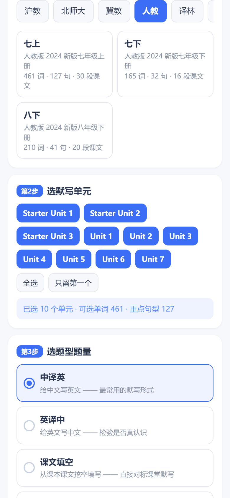
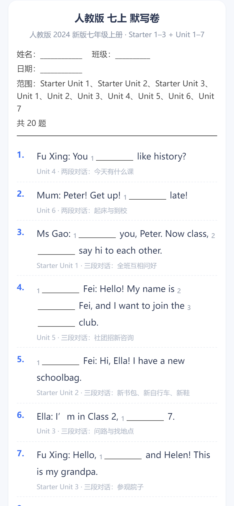
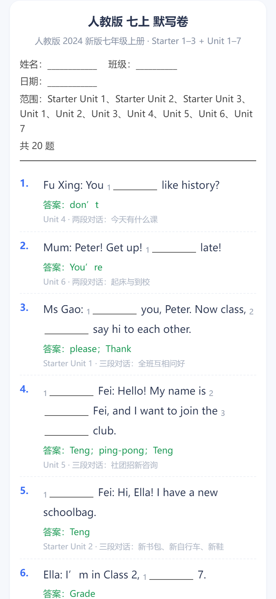
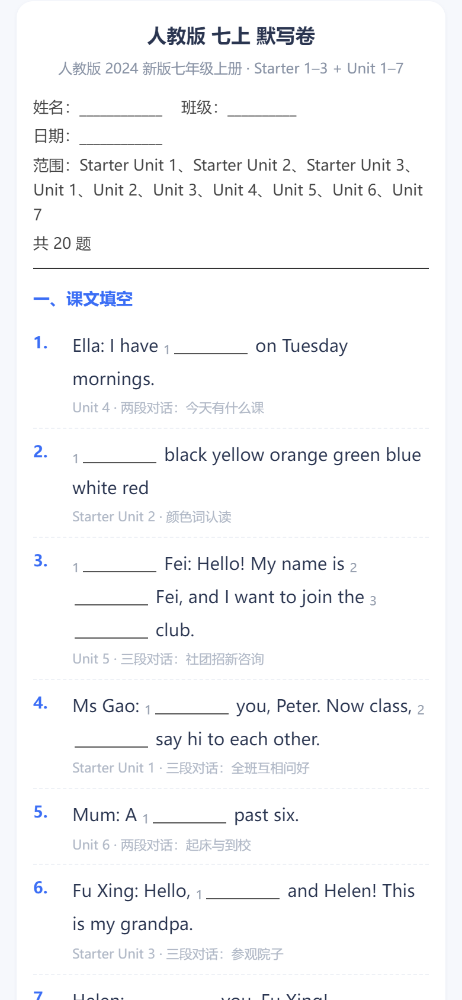

# 英语背诵表配套的默写卷自动生成：选个单元，一分钟出一张能打印的卷子
> 💡 备注属性未写入，可能是备注属性名称或者类型被修改了，建议将字段类型设置为 rich_text，可以在小程序-操作-修改文章数据库页面进行调整
> 💡 原文链接:[https://mp.weixin.qq.com/s?__biz=MzU0OTEwOTc2Ng==&mid=2247484674&idx=1&sn=0183daffd1c94c7f2ce7947e1f164685&chksm=faeec2e3d03d35056af729863e215f75f3d27635e10591d4fb4fe77777d57f1b15cb34a11790#rd](https://mp.weixin.qq.com/s?__biz=MzU0OTEwOTc2Ng%3D%3D&mid=2247484674&idx=1&sn=0183daffd1c94c7f2ce7947e1f164685&chksm=faeec2e3d03d35056af729863e215f75f3d27635e10591d4fb4fe77777d57f1b15cb34a11790#rd)
英语先要掌握课本内容，否则补课感觉除了费钱费时，作用有多大，有待商讨——**你觉得呢。**
之前我做过英语背诵表，娃背词、打卡、课文过关都能管。有家长后台留言，希望能自动生成默写，能检测孩子课本掌握情况。
于是我把它接上了：**背过的词，直接变成默写卷。**
✦
**01 打开你的背诵表，点一下就有**
如果你已经在用我的英语背诵表，它右上角多了个**「📝 默写卷」**按钮——点开就是生成器，不用另存链接、也不用记网址。
**① 选单元**：点一下 Unit 3，或者整个学期全选
**② 选题型**：默写页 / 中译英 / 课文填空……挑一个
**③ 点生成**：二十秒，一张能打印的卷子 
词库不是我一个个敲进去的，就是你那张背诵表本身的：**8 个出版社、57 个版本、一万三千多条词和句型**，选单元的时候一眼能看到这册有多少词。

▼ 打开背诵表，点右上角「📝 默写卷」，直接选单元
✦
**02 五种题型，对应五种默写场景**
**中译英**：给中文写英文。最常用的那种，娃抄写的时候最费时间。
**英译中**：给英文写中文，检验是不是真认识，不是"看着眼熟"。
**课文填空**：直接从课本课文里挖空——挖的是实词，每空标号，句子挖完还站得住。同一篇课文最多出两道题，不会把一段对话拆成三道重复题。
**句子翻译**：重点句型中英互译。
**混合卷**：填空＋写单词＋翻译，三段式，一张卷子把三种都练了。

▼ 课文填空：空里标了号，每道题下面留了手写的地方

▼ 点「看答案」出现答案，批改完再收起——学生那份是干净的
✦
**03 我最常用的两个开关**
**「优先出没背熟的词」。**这一条是我做完之后最惊喜的。背诵表里娃打过卡、标过"过"的词，我都读得到；开了这个开关，**卷子会优先挑他还没背熟的词来默**——不用我再去翻"哪几个词老是错"。没打卡记录的新同学，也能用，只是这时候是全量随机。
**「英译中显示音标」。**要不要给音标提示，一个开关的事。给低年级娃用，我会关掉，让他们真的想；给初三冲刺用，我就开着，先过认读这关。
还有个细节我比较在意：**同一个词不会重复出，两次生成几乎不重合**。点一次"换一批"，出来的就是新的一套，不用手动去重。
✦
**04 手机上怎么打印、怎么发**
之前有人问我，手机上怎么把卷子打出来。其实我一开始也卡在这儿——手机浏览器直接调打印，多数时候是打不出来的。
所以我做了两条路：
**电脑**：点「打印」，直接出空白卷，答案不会跟着打出来。
**手机**：点「存为图片」，生成一张长图存到相册——可以发家长群、可以发给孩子做、也可以拿去打印店打。 
我一般晚上生成好，存成图，第二天下班带去打印店打两份，一份娃做，一份我批。答案卷我单独存一张，不给她看。

▼ 混合卷：填空、写单词、翻译三段式
✦
**05 给老朋友：怎么更新到最新版**
已经把背诵表存到手机桌面 / 主屏的朋友注意啦——你那个快捷方式可能是旧版，打开看不到「📝 默写卷」。别急，四步就好，**娃的打卡记录也不会丢**：
**① 备份数据**：打开你常用的那张背诵表 → 右上角设置 → 点「导出备份」，把娃的打卡记录存下来。
**② 删快捷方式**：把手机桌面 / 主屏上旧的背诵表图标删掉（旧版会被缓存，不删就不会更新）。
**③ 重新进入**：从公众号菜单、或点文章底部「阅读原文」，重新打开最新的背诵表。
**④ 导入数据**：进表后，设置 → 点「恢复备份」，把刚才导出的记录导回来，打卡进度原样回来。 
做完这四步，你那张表就和新的一样，右上角也有「📝 默写卷」了。
你家娃的默写卷，还在一题题手抄吗？
点文章底部「**阅读原文**」，直接打开 **默写卷生成器**，手机就能用 👇
还没存过表？关注后后台留言【**默写卷**】，把入口发你。
工具这东西，我越来越觉得，值不值钱不看它多花哨，看它是不是**把你那件最烦、最重复的事整个接过去**。
抄一张默写卷，就是那种事。半小时的活儿，现在二十秒。以后娃的卷子，我可以只负责按那个打印键。
你家娃最烦的是背单词，还是默写？评论区聊聊，我看看还能不能再省一步。
日子留缝隙，光会长出来
@ 暖隙生光间 · 一个用AI的职场妈妈 · 15年程序员 · 俩娃妈妈
