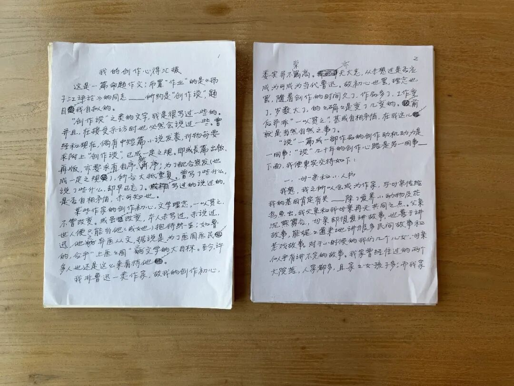
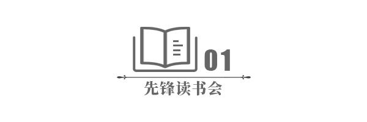
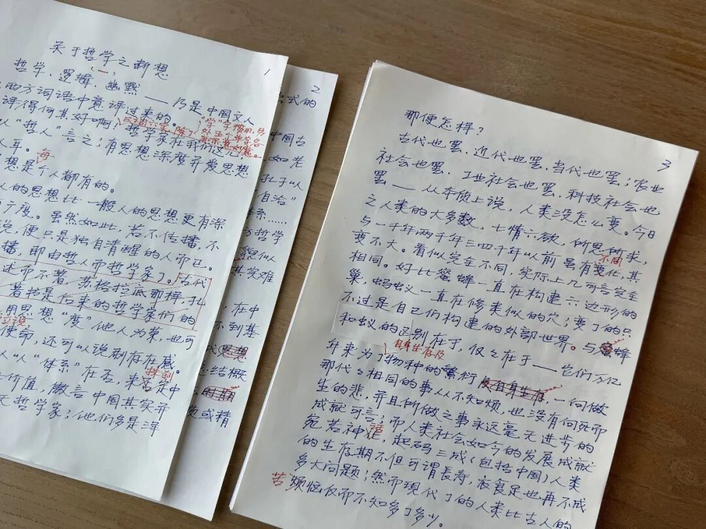
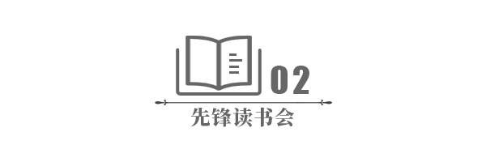
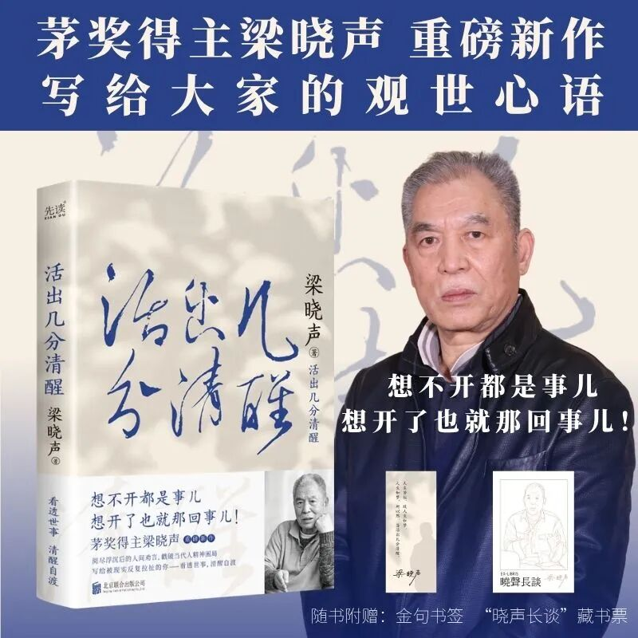
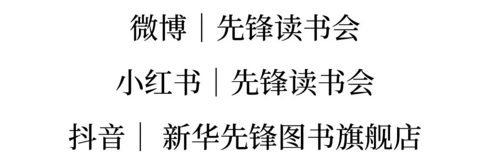

# 茅盾文学奖得主至今用笔写作！新作手稿曝光，字字戳醒当代人
> 💡 备注属性未写入，可能是备注属性名称或者类型被修改了，建议将字段类型设置为 rich_text，可以在小程序-操作-修改文章数据库页面进行调整
> 💡 原文链接:[https://mp.weixin.qq.com/s?__biz=MzIzMzMzNDAyMg==&mid=2247544626&idx=1&sn=a75cf7be84e7eb635210cc2da1f2d3c9&chksm=e91c080b9fc3758a3c22acb132b58d5a901ab8ce41bf943c5f5277ba56d95ddb9d3c742f8ea4#rd](https://mp.weixin.qq.com/s?__biz=MzIzMzMzNDAyMg%3D%3D&mid=2247544626&idx=1&sn=a75cf7be84e7eb635210cc2da1f2d3c9&chksm=e91c080b9fc3758a3c22acb132b58d5a901ab8ce41bf943c5f5277ba56d95ddb9d3c742f8ea4#rd)

最近，诺贝尔文学奖得主莫言发起的“与星同行”作家手稿展正在巡展，百余位作家的手稿公之于众，让很多人重新看见手写文字独有的力量。
在键盘打字成为主流的今天，一页页手稿，不再只是稿件，更是作家思绪流动最真实的见证。
作家#梁晓声 的手迹，也在这场展览中亮相。

有些作家是为了这场展览，专门手写了一篇稿件。殊不知，**梁晓声从开始文学创作那天起，直到今天，半个世纪里，始终坚持手写。**这在当今文坛并不多见。

梁晓声写作，要提前备好一沓稿纸（有时是A4纸）、几支削好的铅笔。随着年岁渐长，他的腰颈时常不适，常年戴着护具伏案，把所思所想落笔纸面。

**梁晓声老师正在为作品《中国人的日常》写寄语**
梁晓声的手稿，字迹清秀，一笔一划，但并非完美无瑕的誊抄稿。纸面上遍布修改痕迹：划掉的句子，行间缝隙里挤进去的增补感悟，页边空白随手记下的灵光碎片，有的段落几经改写，多处涂划。没有一键删除的便捷，写错了就划掉，想到新的观点，就挤在边角补写。
**纸上每一处痕迹，都是思考流动的证据。**

我们即将出版的梁晓声新书《活出几分清醒》，全部文稿，便来自他近年来积累下的沉甸甸的手写稿件，部分篇章更是首次面世，保留着最原始、最鲜活的思考痕迹。

梁晓声历经七十余年人生浮沉，把对时代、普通人生活的观察，对迷茫、内卷、精神倦怠的思索，全部写进了这本新书里。他写开出租车的父亲、午休的工人、返乡创业的青年，描摹市井烟火里平凡人的悲欢；也讨论文学、社会与人文理想。以朴素真诚的文字，叩问何为真正的清醒。
**何为真正的清醒？不是冷漠与疏离，而是在浮躁洪流中，为自己筑起一座理性的灯塔；在众声喧哗里，依然能听见自己内心的判断。**
这份人生哲思，不是在电脑上快速敲出的快餐文字，是作家伏案一笔一划，慢慢沉淀下来的人间箴言。电脑可以快速输出文字，但手写，会把情绪、阅历与时间，一同封存在笔墨之间。
如今这些手稿汇集成了**《活出几分清醒》**，梁晓声把纸页间沉淀的思考交付给读者。
翻开这本书，你读到的不只是散文随笔，更是一位文学大家耗费心力，写给当代人的清醒沉思录。
无论是正在挣扎的年轻职场人，还是阅尽世事的中年读者，都能在这本书中照见自己。
**新书即将上市，敬请期待。**

##
