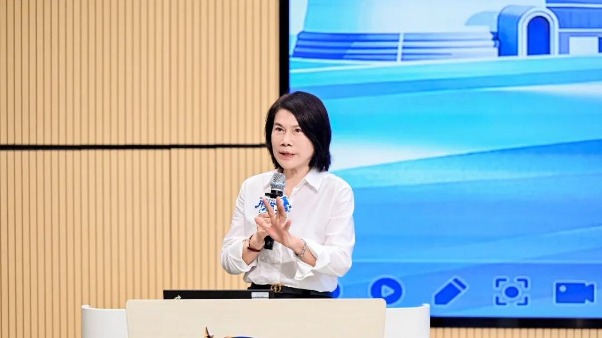
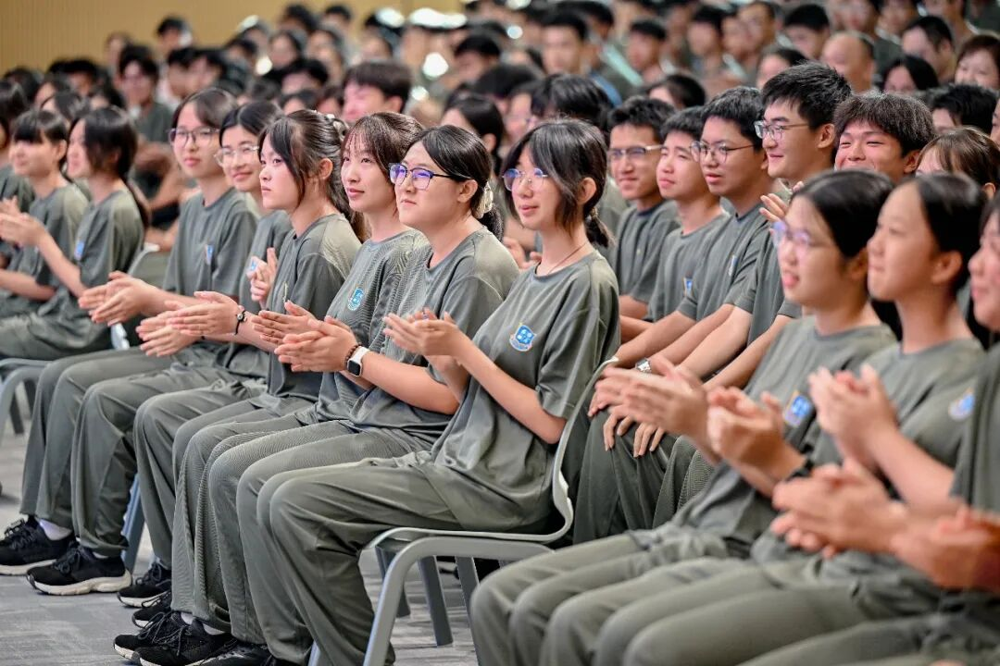

# 董明珠约法三章，8000人抢着报名
> 💡 备注属性未写入，可能是备注属性名称或者类型被修改了，建议将字段类型设置为 rich_text，可以在小程序-操作-修改文章数据库页面进行调整
> 💡 原文链接:[https://mp.weixin.qq.com/s?__biz=Mzg5NjgzMjc5OQ==&mid=2247521285&idx=1&sn=dadd49ee4f9a0adf0e25d36cbebbd7a4&chksm=c1d8fc8e9a7361dd84009ce2a6e25fd9f8256bea2f2f85006d4ff5cd50535bdd89d3c7191551#rd](https://mp.weixin.qq.com/s?__biz=Mzg5NjgzMjc5OQ%3D%3D&mid=2247521285&idx=1&sn=dadd49ee4f9a0adf0e25d36cbebbd7a4&chksm=c1d8fc8e9a7361dd84009ce2a6e25fd9f8256bea2f2f85006d4ff5cd50535bdd89d3c7191551#rd)

10月19日，珠海，一所技工学校开学，校长是董明珠。
她上台没讲大道理，先讲的是学生过日子的事。
她说开学前她在校园里转了一圈，进了趟学生超市，出来就把负责人狠批了一通——一个橘子卖1块5，你们怎么定的价？当场拍板：赚学生钱的超市，不允许在这儿开。
接着她跟新生约法三章。
第一，不许谈恋爱。你们这个年龄来这儿是学本事的，三年一晃就过，别把精力花在不该花的地方。
第二，不留长发。她注意到有些新生头发很长，当场安排：请专业理发师周末来学校做义工，免费给孩子理头发。
第三，她说格力在全国有那么多的生产基地、营销网点，缺的就是懂技术、懂营销的人才，你们好好学三年，对所有电器了如指掌，到时候是别人求着你们帮忙。
底下有学生问她：格力技校能不能培养出第二个张雪？

董明珠说，格力有广阔的成长空间，培养张雪这样的也可以。她更希望15年后，有人能坐上她这个校长的位置，扛起更大的责任。她还撂下一句话：今天技校出来的学生，我觉得不弱于大学文凭。
当天还来了一位特殊嘉宾，陈行甲，受聘为学校的名誉校长。他的课题目叫"有温度的大国工匠"，拿自己的成长举例，说母亲留给他两句话，影响他一生：一个要勤快，二个要干净。
他说，把一件简单的事重复一万遍，你就是专家；把一万件简单的事做成零瑕疵，你就是大师。技校，是能出大师的。
这所学校，就是格力电器全资兴办、董明珠亲自出任校长的珠海市格力技工学校。
它今年第一次招生，就爆了。报名申请超过8000份，最终录取600余名新生，13个人录一个，录取率不到8%——远高于现在读普通本科的难度，大致相当于冲刺985。
首日报到的326名学生里，六成来自广东以外的省份。有个新生叫彭彦杰，湖南人，中考624分，物理考了98分，已经被当地普高录取了，是自己选择来这儿的。
学费每年9000到15000，宿舍4人间，统一配格力的洗衣机、空调、床垫。董明珠说，就这600多人，还不够支撑格力的可持续发展，后面还要继续扩大招生。
这事发酵之后，网上吵翻了，我给大家捋一捋各个平台都在吵什么。
吵得最凶的是办学模式。这所学校"入校即入企，毕业即适岗"，学生毕业优先进格力及产业链企业。
一派人说，深圳技术大学、福耀科技大学干的都是这件事，曹德旺和董明珠，是中国需要的实干企业家。
另一派人问：三年之后，这些孩子是被培养成大国工匠，还是被培养成流水线上的熟练工？月薪12000的工程师和两班倒4000的产线工人，路在入学那天就分好了吗？
这个问题现在没有答案，答案得等三年后第一批学生走上岗位才见分晓。
“禁止谈恋爱”“统一剪发”这两条，也吵得厉害。有人说，十五六岁的孩子，立规矩没毛病，三年学制本来就不是来谈恋爱的，校长连超市橘子的价钱都要管，说明是真把学生当回事。
吵得最出圈的，是“技校生不弱于大学文凭”这句话。这两年恰好是本科生回炉读技校、职校招生火爆的新闻密集期，AI正在批量冲击知识型岗位，高级技工的缺口越拉越大。
董明珠这句话能刷屏，不是因为她敢说，而是太多家庭心里正在重新掂量：一张越来越空的文凭，和一门越来越值钱的手艺，到底哪个更能托住孩子的未来？
教育这东西，向来是最诚实的。家长的脚，比专家嘴诚实一万倍。
过去几十年，技校在人们嘴里是什么？是考不上高中的退路，是家长提起来都抬不起头的地方。
可时代真的变了。8000份报名申请里，有624分主动放弃普高的孩子，有从外省坐十几个小时车来报到的家长。
这不是信任董明珠，这是家长们在为孩子的未来重新下注。
**下注的对象，不是某个学校，是一个判断：学历通胀的时代，手艺开始重新定价。**
**当一所技校的录取率干过了985，当七旬的企业家掏真金白银办学校而不是买热搜，用脚投票的家庭已经给出了他们的答案。**
**陈行甲在那堂课上说了一句大实话：这个时代，我们不仅需要写字楼里的精美，也需要车间里精准到毫米、微米的图纸和火花。**
**写字楼里的精美，眼下正在批量毕业；车间里的火花，正在批量缺人。**
**谁看懂了这一层，谁就明白这8000个家庭在抢的到底是什么。**
**- 完 - **
** 笔不阿贵，文不奉承**

@关注和转发，就是最大的支持@

## 摘要

（待补充）

## 我的笔记

（待补充）
