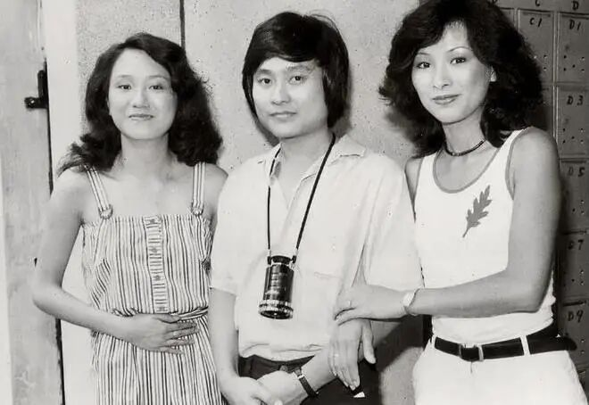
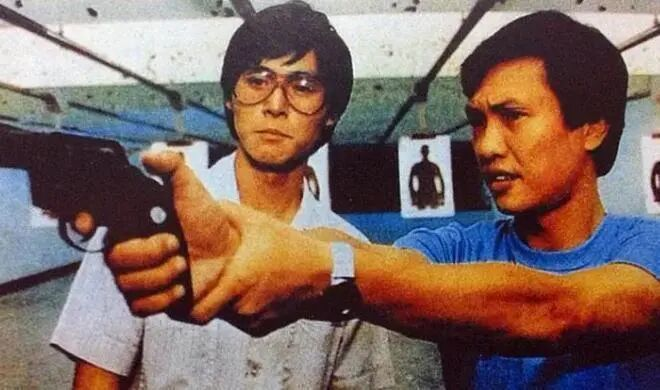
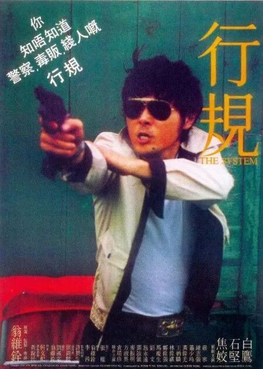
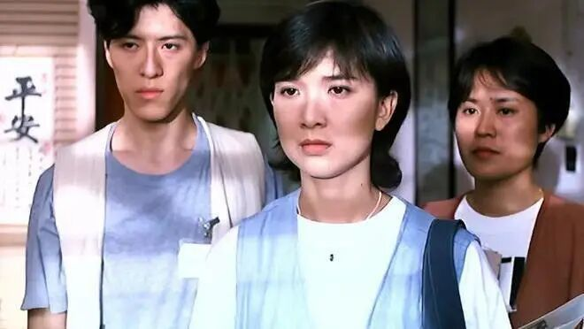
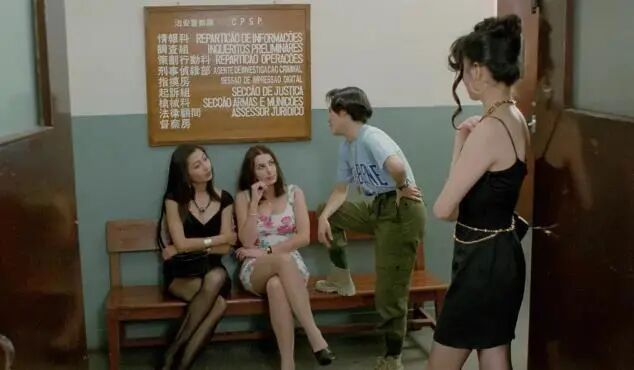

# 被港台禁播的6部限制级电影，最后一部至今都是童年阴影
> 💡 备注属性未写入，可能是备注属性名称或者类型被修改了，建议将字段类型设置为 rich_text，可以在小程序-操作-修改文章数据库页面进行调整
> 💡 原文链接:[https://mp.weixin.qq.com/s?__biz=MzUyNDUxMTMyNg==&mid=2247587166&idx=3&sn=e5676ab4bf8cfa136f2c91aaced4ad26&chksm=fbf7e858823947efe9694db0bc9fec32853fc928b001c36060bd9216842296d7ffc587a8d069#rd](https://mp.weixin.qq.com/s?__biz=MzUyNDUxMTMyNg%3D%3D&mid=2247587166&idx=3&sn=e5676ab4bf8cfa136f2c91aaced4ad26&chksm=fbf7e858823947efe9694db0bc9fec32853fc928b001c36060bd9216842296d7ffc587a8d069#rd)
1、《边缘人》
阿潮的职业、经历和结局，其实都是这个复杂社会逼出来的。卧底这活儿，打着正义旗号，实际上命悬一线，还天天面对信任危机，心理压力大得很。阿潮扛住了没丢本心，但代价也搭进去了，没法回头。最后他私刑收场，仔细想想，这何尝不是对愚民文化的一记响亮耳光呢。整部片把个人命运和社会现实拧在一起，看完挺让人唏嘘的。

2、《点指兵兵》
这片儿虽然故事没那么圆满，但看起来是真带劲儿。才九十分钟，愣是觉得不够看，恨不得再多来十分钟。导演拍恐怖片真有一手，最后逼张国强走绝路那段，感觉跟别的恐怖片桥段有点像，但不影响观感。还有开头阿婆骂孙子那场戏，用了一段经典老歌的原声，味道一下就出来了。整体氛围拿捏得挺好，就是剧情再饱满点就更完美了。

3、《羔羊医生》
小时候对任达华的片子很抵触，不喜欢他的长相。可近些年越来越觉得他越来越帅，有男人味，可能是有总出演杜琪峰影片的原因。 雨夜屠夫内心的扭曲没有太拍出来，相比于猎奇的刺激的画面冲击力，心理层面上恐怖才是真正的可怕。影片拍得比较浅。李修贤和郑则仕完全工具人，没有可以代替演技的地方。任达华中规中矩，没有吴启华演变态那么像。话说吴启华在跛豪里面真的惊艳。

4、《行规‍‍》
七九年的老片子了，那会儿拍片手艺还嫩，不少镜头看得人一头雾水，故事也拖拖拉拉，半天搞不清要讲啥。不过七十年代香港街头和老百姓过日子的画面，确实有史料味道。后半段跟踪戏拍得绝了，愣是整出谍战片的感觉，后来同类题材基本都照着这个路子来。结尾更狠，主角说没就没了，啥事也没办成，突然就领盒饭了，典型新浪潮那种不按套路出牌的劲儿。

5、《弱杀》
这片儿镜头玩得挺溜，反派表面斯文优雅，骨子里邪魅凶狠，反差感拉满。背景故事也交代了他咋一步步黑化的，家庭环境养出个恶魔，让人恨又有点可怜。后半段虐杀缠斗拍得带劲，就是俩弱女子干翻大反派有点说不通，要是加个女主追求者三人联手会更合理。开头挺刺激，但残障女孩的悲惨遭遇一出来，色情感全没了，只剩心疼，社会批判味也出来了。整体不是无脑爽片，算得上有想法的佳作。

6、《八仙饭店之人肉叉烧包》
前面的那些剧情，不过是传统犯罪电影的老套路。但看到那家伙用啤酒瓶灭门那段场景时，脑子里突然意识到，这种没有任何软肋的家伙，才是社会的最大不稳定因素！然而未来几十年，这种人会越来越多。有些段落只能快进过去，怕自己恶心的承受不住。

被港台禁播的6部限制级电影，最后一部至今都是童年阴影！
