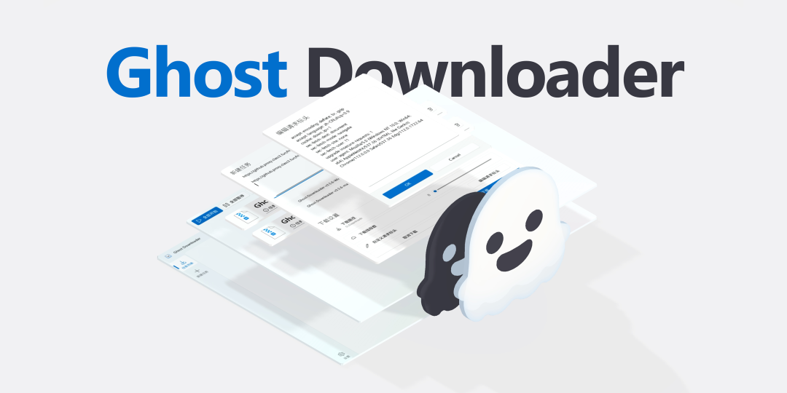
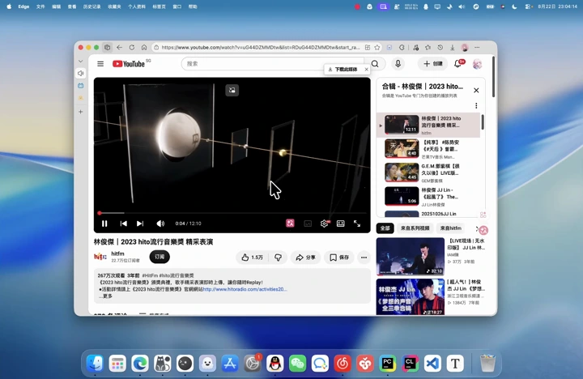
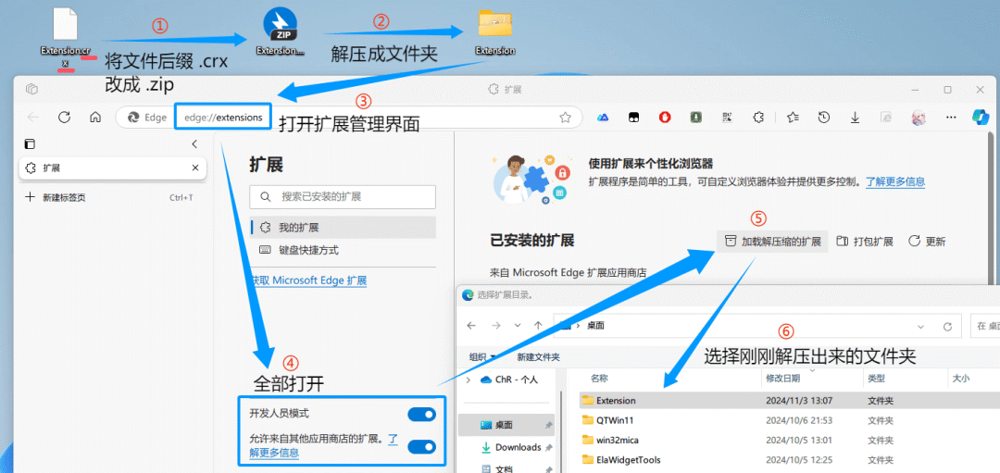

# 被限速弹窗恶心吐了？GitHub近万星开源神作：全网视频/BT一键下载，完全免费！
> 💡 备注属性未写入，可能是备注属性名称或者类型被修改了，建议将字段类型设置为 rich_text，可以在小程序-操作-修改文章数据库页面进行调整
> 💡 原文链接:[https://mp.weixin.qq.com/s?__biz=MzY4NzMyNzUzNg==&mid=2247484907&idx=1&sn=77dec7618baa4f5890b40dbcedfea8fb&chksm=f2ec207beb66ce7977f974be01497ee26baf52564acfbbd6b70c37be162f5aafc442af1c59f4#rd](https://mp.weixin.qq.com/s?__biz=MzY4NzMyNzUzNg%3D%3D&mid=2247484907&idx=1&sn=77dec7618baa4f5890b40dbcedfea8fb&chksm=f2ec207beb66ce7977f974be01497ee26baf52564acfbbd6b70c37be162f5aafc442af1c59f4#rd)
不知道你有没有经历过这种让人道心破碎的瞬间：
周三下午 4 点半，领导或客户突然在群里甩来一个 4GB 的高清视频素材和设计包，急着要改版交差。
你急匆匆打开电脑里某老牌商业下载软件，把链接往里一贴——**速度瞬间被硬生生卡在可怜的 12 KB/s**。窗口右上角开始像霓虹灯一样疯狂闪烁：“您的非会员通道已拥堵，开通超级VIP立即提速”；还没等你缓过神，右下角又啪啪弹出了两个低俗页游广告；最绝望的是，你强忍着恶心耗了一个半小时，进度条终于走到 99%，屏幕突然弹出一记响亮的红叉：**“下载失败：资源违规被拦截，请重新下载”**！
既然商业软件如此流氓，换个大家吹爆的老牌工具**IDM**呢？
结果打开一看，界面仿佛是从上个世纪 Windows 98 古墓里刨出来的；官网售价贵得肉疼，网上找的“破解版”动不动就被杀毒软件报毒；换到苹果 Mac 电脑直接抓瞎（根本没有 Mac 版）；最致命的是，只要遇到磁力链、BT 种子或者电驴，它立刻两手一摊，毫无办法。
更别提平时在浏览器里看到想存的公开课或纪录片：按下审查元素想抓视频，结果发现全是**500 多个几秒一段的 .ts 碎片**；在 GitHub 或者 HuggingFace 下个开源大模型权重，网络稍有抖动就直接断流归零……
我们不过是想在自己的电脑上安安静静、满速下个文件，**为什么就非得被这些商业流氓软件和复杂的工具链当韭菜割？**到底有没有一个干净、免费、全协议通吃、点一下就能无脑下完的“终极神器”？

“当年互联网最纯粹的精神是开放与互联；而今天某些下载工具的本质，却变成了人为制造拥堵来兜售加速包。当一个工具真正把所有协议打通、把代码全部开源、把速度还给宽带本身，所有的商业套路都会瞬间土崩瓦解。”
—— 开源极客工程手记
**01**
**PART**
 
**始于极客兴趣：GitHub近万星开源神作降维破局**
THE ACCIDENTAL MASTERPIECE // 始于帮UP主整合资源的传奇神作
今天给所有人安利的，就是在 GitHub 上狂揽**9,500+ 颗星**、被全球无数技术极客奉为“下载器集大成者”的开源神器——Ghost Downloader 3 (简称 GD3)。
这个项目的诞生背景，本身就极其富有传奇色彩。
作者XiaoYouChR最初写这个项目的初衷，其实特别单纯：仅仅是为了帮 B 站知名硬核装机 UP 主（杰克尧）整合一套纯净的系统镜像资源。为了让小白粉丝能够一键下到最完整的资源，作者开始手搓下载逻辑。
没想到代码越写越停不下来，作者顺手把市面上所有协议、所有流媒体嗅探、所有系统的原生适配全部撸了一遍。从一个小脚本，一路蜕变成了今天支持四大操作系统、全协议通吃的开源巨无霸！

**ZERO RISK & THREE PROMISES**小白专属定心丸
为了彻底消灭非技术用户的后顾之忧，GD3 从代码底层立下了三条绝对军规：
①**绝不流氓**：采用最纯粹的 GPL v3.0 开源协议，100% 纯本地运行，零后台常驻、零弹窗广告、零隐私数据上传，绝不偷偷拿你的机器做商业 P2P 挖矿；
②**不用安装也能跑**：提供完全独立的单文件绿色便携版！在 exe 同级目录建个名为GhostDownloader的空文件夹，所有数据跟着文件夹走，放在 U 盘里随插随用；
③**全平台处处原生**：Windows 10/11、macOS（完美兼容 M 系列 Apple Silicon 与 Intel）、Linux 以及安卓手机（Android 11+）全部支持，界面采用微软最新的 Fluent Design 云母毛玻璃设计，颜值直接拉满！
**02**
**PART**
 
**硬核大一统：凭什么它能把传统下载器全干趴下？**
UNDER THE HOOD // 深度拆解四大颠覆性底层技术
很多人会好奇：市面上下载器那么多，凭什么说 GD3 是“集大成者”？
答案就在于它把以前需要安装 4、5 个不同软件才能搞定的事情，用一个极其硬核的统一引擎彻底解决了：

**绝活一：原地动态分块写入，告别“合并卡死”噩梦**。
用过 IDM 的朋友都知道最大的痛点：32 个线程下载很爽，但下完之后，软件必须在后台把 32 个碎片拼成一个完整文件。如果你下的是 30GB 的大蓝光电影或者大模型，合并过程能把电脑机械硬盘卡死几分钟，二次 IO 疯狂伤盘。
而 GD3 独创了Placeholder 预占位机制：文件刚建立就在磁盘上划好坑，每个并发线程根据 Byte-Range 原地写入最终文件。**下载进度达到 100% 的瞬间，文件就已经处于完整可用状态，无需等待合并，秒级直接打开！**
**绝活二：真实浏览器 TLS 指纹伪装，防限速防封禁**。
现在很多大厂网盘和文件服务器极其狡猾，只要探测到底层是普通的 Python 脚本、Aria2 或多线程下载器，立刻对你执行 403 封锁或降速到 10KB/s。
GD3 在传输层深度集成了真实的浏览器 TLS 握手指纹（Chrome 级客户端特征），让对端服务器误以为这就是一个真人正在用 Chrome 浏览器普通访问，轻松绕过防盗链与反爬风控！
**绝活三：全协议大一统，冷门协议也能起死回生**。
它直接打通了所有主流与冷门传输协议：
•**HTTP / HTTPS / FTP**：32 到 128 线程极速并发，自动适配弱网与断点续传；
•**BT 种子与 Magnet 磁力链**：内置全球公共 Tracker 列表自动刷新订阅，自带 KAD 网络节点发现，支持单个文件自由勾选下载，不再强制下全包；
•**eD2k 电驴协议**：多少老网民以为电驴早已作古？GD3 原生复活了 eD2k 协议支持，连接电驴服务器与 KAD 节点，海量绝版古老资源直接重见天日；
•**AI 开发者专属加速通道**：针对 HuggingFace 与 GitHub 源码，内置了专属镜像解析与加速选项，大模型权重与代码仓库一键满速直下！

**03**
**PART**
 
**视频党与素材党狂喜：浏览器无感嗅探与神级接管**
BROWSER SYNERGY // 深度融合猫抓引擎与播放器悬浮接管
对于平时喜欢在网上找素材、下公开课、刷纪录片的视频党来说，GD3 的浏览器扩展体验简直可以用“爽到飞起”来形容。
大家平时最头疼的是什么？网页上的视频是分段切片的（M3U8 或者 MPEG-DASH），或者音视频是分离传输的，普通下载软件抓下来的链接根本不能播。
而 GD3 的浏览器插件直接做了一件不可思议的事：**它把全网封神的“猫抓 (cat-catch)”深度嗅探引擎，与自研的 Page Media 视频画面追踪系统完全融为了一体！**

这个组合拳带来了三大无敌体验：
1.**播放器悬浮下载按钮**：你在任何视频网站播放视频时，播放器右上角会自动浮现 GD3 的专属下载小标。点一下，从 360P 到 4K/8K、HDR、各种音轨任你挑选，根本不需要按 F12 抓包；
2.**自动同步登录态 Cookie**：很多网站的高清原画需要登录账号才能看。GD3 扩展在捕获资源时会自动生成 Header Snapshot（请求头快照），把你在浏览器里已登录的 Cookie 认证信息无缝传给桌面端，**你在网页上能看什么清晰度，下下来的就是什么清晰度！**
3.**完美接管 Aria2 RPC**：网页端配合油猴脚本（比如各类网盘助手），只要点击“导出到 Aria2”，后台的 GD3 就会静默接管下载，免去安装臃肿的第三方后台服务。
**04**
**PART**
 
**三维真机硬核实测：不搞虚招，端出最极限场景**
TORTURE TEST // 极限边缘测试与真机表现验证
为了验证 GD3 到底是不是“嘴把式”，我们在真实网络环境下进行了三场刁钻的极限实测：
**实测一：B站多P超清视频批量下载与无损混流**视频与素材党日常核心刚需
【测试目标】：抓取一部 10 集分 P 的 4K 高画质合集视频，并考核字幕与封面提取。
【实测表现】：将合集链接贴入 GD3，软件自动解析出全部 10 个视频分 P 与对应字幕。勾选全部任务后，GD3 并发拉取流媒体，并在后台调用内置的 FFmpeg 进行无损音视频混流，生成独立的 MP4 成品。
【实测结论】：全程无需手动转码，单集 800MB 视频平均 25 秒下载完成并完成合并，音画完全同步，连外挂字幕文件都整整齐齐放在旁边！
**实测二：古老冷门种子探活与单文件勾选**BT 磁力重度用户核心考题
【测试目标】：找寻一个发布于 8 年前、仅剩零星做种者的老旧开源 Linux 镜像种子。
【实测表现】：常规下载器因本地 Tracker 失效直接红种卡死在 0%。GD3 启动后，自动加载后台订阅的最新公共 Tracker 列表并向对等方发起广播，在 45 秒内成功连通 12 个海外 Peer 节点并开启满速拉取；在文件列表里只勾选需要的 1 个镜像，多余的说明文档全部跳过。
【实测结论】：成功将“死种”盘活，单文件选择下载功能彻底避免了拉下一堆垃圾文件的烦恼。
**实测三：下载中途换链接与网络突发中断**大文件下载最怕的翻车死穴
【测试目标】：下载一个 15GB 的超大文件，下载到 60% 时模拟临时断网，并将下载源地址切换为镜像链接。
【实测表现】：在任务面板直接暂停任务，编辑 Task Options 中的 URL 与请求头，重新点击开始。
【实测结论】：GD3 毫秒级重用已有 Part 文件，从 60% 处精准恢复字节流，进度毫无损失，彻底告别“前功尽弃重新来过”的绝望！
**05**
**PART**
 
**坦白 20% 的客观局限：诚实讲透边界与踩坑点**
HONEST LIMITATIONS // 不吹万能，只讲客观真相
作为一家专注于前沿开源深度的硬核专栏，我们坚决反对无脑吹捧。在深入阅读项目源码后，我们必须负责任地坦白 GD3 目前的**3 个客观局限与适用边界**：
1.**老旧电脑 CPU 指令集限制**：
由于 GD3 采用了现代化的 PySide6 / Qt 6.6+ 框架，官方底层已停止支持不支持 AVX 指令集的极古老 CPU（大约 2011 年之前的老爷机奔腾/赛扬）。如果你还在用 15 年前不带 AVX 的古董电脑，可能无法正常运行；
2.**商业影视平台的 DRM 加密防线不可破**：
虽然 GD3 对 B站、YouTube、M3U8 直播等公开流媒体几乎做到了降维打击，但对于爱优腾等采用了商业级 Widevine DRM 硬件加密的正片，GD3 坚决遵守技术与法律红线，不支持解密嗅探；
3.**BT 下载并非无中生有的“魔法加速”**：
GD3 内置了强大的公共 Tracker 订阅与 DHT 网络探活，但这依然遵循 P2P 物理规律。如果一个冷门种子全球所有机器都彻底关机关种（0 做种源），软件同样无法凭空变出数据。
**06**
**PART**
 
**全维度代际横评表：下载器的集大成者究竟强在哪？**
GENERATION COMPARISON // 四大主流方案终极决选
我们将市面上最常见的 4 种下载方案拉入同一维度进行了全景对照，差距一目了然：
| **对比维度** | **传统商业流氓下载器** | **老牌商业工具 (IDM)** | **基础开源工具 (如Motrix)** | **Ghost Downloader 3 (本项目)** |
| 资费与纯净度 | 逼氪SVIP / 满屏弹窗 / 后台偷跑P2P | 昂贵商业授权 / 盗版木马泛滥 | 开源免费 / 纯净无广告 | 100% 开源免费 (GPL v3.0) / 纯净无广告 |
| 核心协议覆盖 | 仅常规HTTP/BT (敏感资源常被误杀) | 仅HTTP/FTP (完全不支持BT/电驴) | HTTP/BT (不支持电驴/流媒体差) | HTTP/BT磁力/eD2k电驴/FTP 全协议通吃 |
| 磁盘与写入机制 | 大量临时缓存碎片，合并消耗极大 | 32线程下完后强制二次合并卡死硬盘 | 常规分块写入 | 预占位原地动态分块写入，下完秒开零合并 |
| 网页视频与流媒体 | 无原生嗅探 / 需手动复制链接 | 简单抓包 / 无法直出M3U8 / 无浮动按钮 | 无内置深度嗅探 | 深度融合猫抓引擎 / 播放器悬浮按钮 / 8K直出 |
| 登录态携带能力 | 无法获取浏览器会员状态 | 需手动复杂配置 Cookie | 不支持自动同步 | 扩展自动生成请求头快照，无感带Cookie下载 |
| 操作系统跨平台 | 仅 Win/Mac (移动端阉割且广告多) | 仅支持 Windows (Mac/Linux彻底绝缘) | 桌面三端 / 无原生移动端 | Win / Mac / Linux / Android 四大平台全覆盖 |
| 绿色便携免安装 | 强制注入系统服务与开机启动 | 必须写入注册表深度安装 | 需常规安装运行 | 建个空文件夹秒变便携版，装入U盘随插随走 |
| 代码签名与安全 | 闭源商业软件，存在隐私隐患 | 闭源商业软件，破解版风险高 | 社区维护 | 获 SignPath 官方基金会免费代码签名认证 |
**07**
**PART**
 
**极简上手指南：老妪能解的三步极速法**
GETTING STARTED // 没有任何环境配置负担
不需要懂任何编程知识，也不需要配置复杂的命令行，小白用户只需 3 步即可享受满速下载的快感：

•**第一步：下载对应平台安装包或便携版**。
Windows 用户推荐下载 Setup 安装包或压缩包；如果你喜欢便携版，解压后在 exe 同级目录新建一个名为GhostDownloader的空文件夹即可激活便携模式；Mac 用户直接拖入 Applications 即可；
•**第二步：配对浏览器扩展**。
打开 Chrome、Edge 或 Firefox 浏览器，在应用商店搜索安装官方扩展，点击扩展图标上的“配对”，桌面端会弹出一个授权提示，点击“允许”即可完成终身连接；
•**第三步：随心下载，静享满速**。
在网页上遇到任何文件或视频，直接点击播放器右上角的悬浮下载按钮，或者把任何下载链接拖进 GD3 窗口，泡一杯咖啡，看着带宽瞬间跑满！
**📥 全平台官方正版下载直链（复制链接到浏览器即可下载）**
项目已发布最新稳定版 v4.3.7，全平台原生编译，支持纯绿色便携运行（解压即用），请长按复制对应系统的下载链接：
**💻 1. Windows 客户端（Win 10 / 11）：**
• 官方安装版（Setup.exe）直链：
https://github.com/XiaoYouChR/Ghost-Downloader-3/releases/download/v4.3.7/Ghost-Downloader-v4.3.7-Windows-x86_64-Setup.exe
• 绿色免安装便携版（ZIP 压缩包）直链：
https://github.com/XiaoYouChR/Ghost-Downloader-3/releases/download/v4.3.7/Ghost-Downloader-v4.3.7-Windows-x86_64.zip
（便携模式：解压后在 exe 同级目录新建空的 GhostDownloader 文件夹，数据随 U 盘随插随走）
**🍎 2. macOS 苹果电脑（M 系列与 Intel 双版本）：**
• Apple Silicon M 芯片（M1/M2/M3/M4）直链：
https://github.com/XiaoYouChR/Ghost-Downloader-3/releases/download/v4.3.7/Ghost-Downloader-v4.3.7-macOS-arm64.dmg
• Intel 芯片机型直链：
https://github.com/XiaoYouChR/Ghost-Downloader-3/releases/download/v4.3.7/Ghost-Downloader-v4.3.7-macOS-x86_64.dmg
**📱 3. Android 安卓手机客户端：**
• 手机端直装 APK 文件直链：
https://github.com/XiaoYouChR/Ghost-Downloader-3/releases/download/v4.3.7/Ghost-Downloader-v4.3.7-Android-arm64-v8a.apk
**🐧 4. Linux 客户端：**
• 通用免安装 AppImage 直链：
https://github.com/XiaoYouChR/Ghost-Downloader-3/releases/download/v4.3.7/Ghost-Downloader-v4.3.7-Linux-x86_64.AppImage
• Debian / Ubuntu (.deb) 安装包直链：
https://github.com/XiaoYouChR/Ghost-Downloader-3/releases/download/v4.3.7/Ghost-Downloader-v4.3.7-Linux-x86_64.deb
**🌐 5. 官方总发布页与国内高速通道：**
• GitHub Releases 官方版本库总览页：
https://github.com/XiaoYouChR/Ghost-Downloader-3/releases/latest
• 官方中文主页与使用指南：
https://gd.xychr.com/zh/
**🚀 开源项目传送门**
项目完全开源免费，建议每位开发者立即收藏，随时随地查阅最新动态！
GitHub 官方开源地址：
**https://github.com/XiaoYouChR/Ghost-Downloader-3**
官方网页版在线检索导航：
**https://gd.xychr.com/zh/ (官方主页与中文文档) / https://gd3.top/**
⭐ 9,537+ Stars · 🍴 615+ Forks · 👥 XiaoYouChR & 开源社区 维护者
💬
**留言区互动话题**
**你平时用得最多的是哪款下载工具？有没有被流氓限速或者 99% 卡死的经历恶心过？你最期待 GD3 接入哪些新功能？欢迎在留言区聊聊你的真实踩坑经历！**
精选留言将置顶展示，欢迎交流踩坑心得！
**欢迎关注「奇点造物所」**
深度拆解前沿开源神作与高阶生产力工具，打破信息差，拒绝割韭菜。如果觉得本文真的帮到了你，欢迎点个【在看】、转发给身边的朋友！

## 摘要

（待补充）

## 我的笔记

（待补充）
