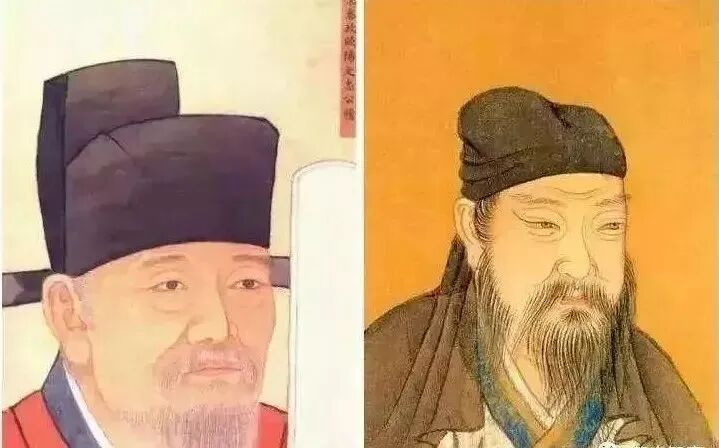
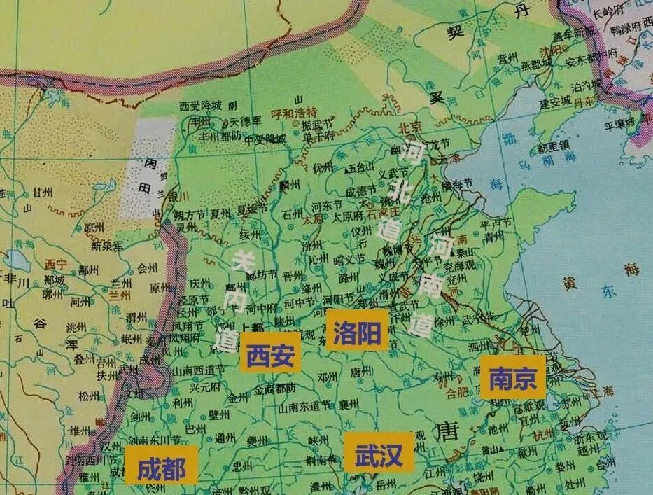
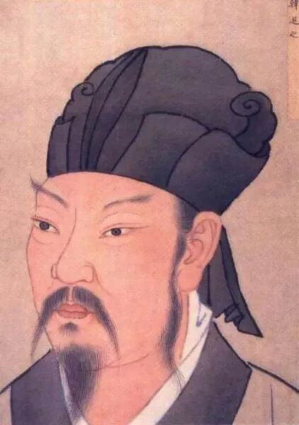
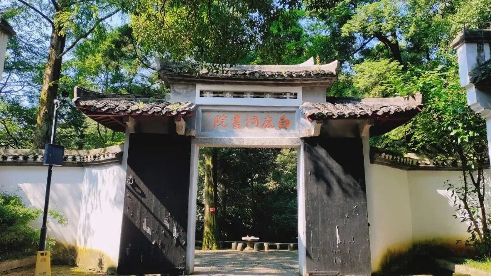
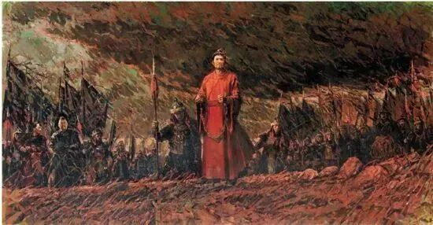
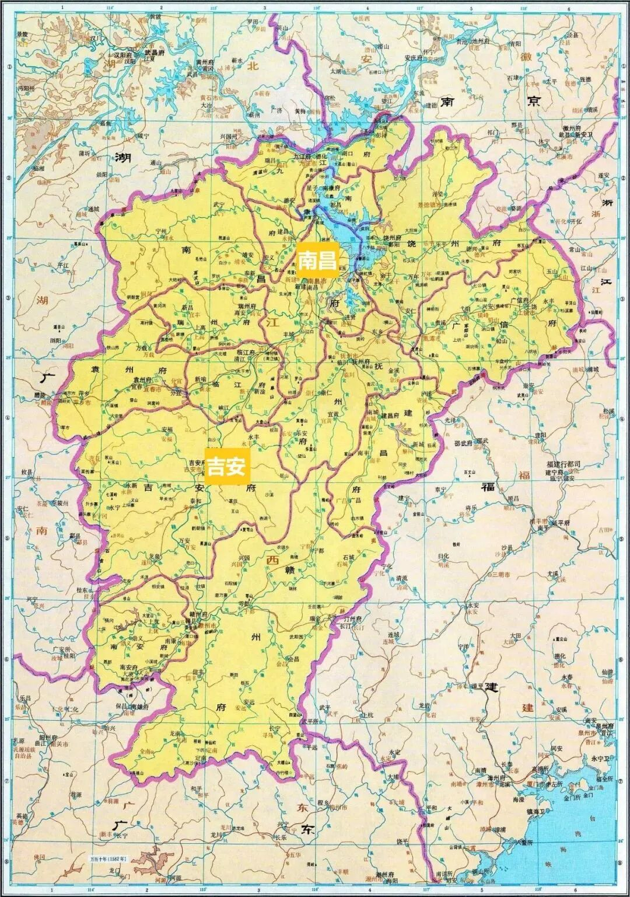
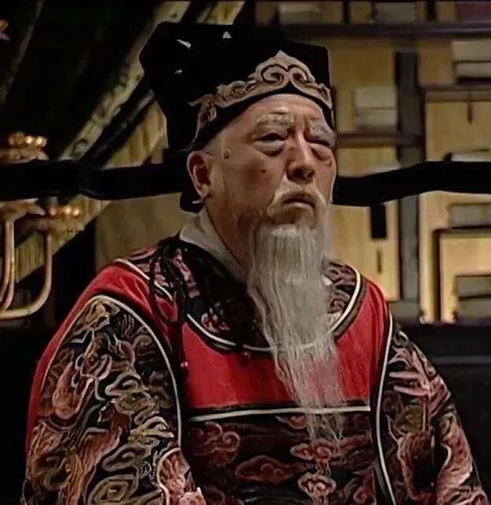

# 观江右 | 中国隐藏最深的考神大省
> 💡 备注属性未写入，可能是备注属性名称或者类型被修改了，建议将字段类型设置为 rich_text，可以在小程序-操作-修改文章数据库页面进行调整
> 原文链接:[https://mp.weixin.qq.com/s/bh4ydlg6zVYvq1gtYs6T3Q](https://mp.weixin.qq.com/s/bh4ydlg6zVYvq1gtYs6T3Q)

**赣江汇**
ID：ganjianghui
关注

北宋嘉祐二年（1057），来自江西的“考神”刘几，竟然落榜了。
消息传出，不仅刘几本人惊讶，举国学子都惊讶。要知道，刘几在国子监读书时经常考第一名，他的写作风格——喜用怪异之语和生僻字词——更是被其他士子效仿，形成了一股名为“太学体”的写作风气。
但坏就坏在，刘几遇上了另一个江西人：这一年的贡举，恰好由翰林学士欧阳修主持。
欧阳修向来提倡平实文风，对艰涩怪异的诗文深恶痛绝。因此，他决定，在这次科举中整治一番，凡作文有“太学体”之风的士子，概不录取。
堂堂考神，于是名落孙山。
两年后，一个名叫刘煇的江西人参加科举，并顺利走到了最后一关。
很巧，这一年的主考官，又是欧阳修。欧阳修对刘煇的文章大加赞赏，并将其答卷评为第一。
到了殿试奏名环节，当喊出“状元刘煇”时，众人循声望去，却颇觉面熟。
“这是刘几啊，他改名了！”有人认出来了。
欧阳修知道自己亲选的状元竟然就是改了名字、改了文风的刘几，一时惊愕不已。
没办法，考神就是考神。
或许欧阳修只能安慰自己说：“区区彼江西，其产多材贤。”谁叫咱们江西人考起试来这么牛呢。

**▲江西风光。图源：摄图网**
**01**
北宋时期，科举大兴，朝堂上曾围绕科举发生过多次争论。
最著名的一次，是山西人司马光和江西人欧阳修的争吵，关于科举录取方法是否公平。

**▲欧阳修（左）与司马光（右）。图源：网络**
司马光说，北方有的路（相当于现在的省），几十年来竟然连一个考上进士的人都没有，可见全国一张卷统一录取，这种做法看似公平，实则太不公平。应该按照人口比例，给各路分配名额，逐路录取。
欧阳修对此辩驳说，科举都是匿名考试，中榜后才知道籍贯，这么公平的制度去哪里找？北方进士少，只能说明北方人书没读好，说明不了其他问题。国家考试选进士，一定要在全国范围内把最好的人才选出来，而不要搞成地区间的分猪肉。
双方各有道理，但最终决定政策走向的，是政治斗争的胜利者。
在同为江西人的王安石主持变法期间，科举沿袭了全国统一录取的做法；到王安石变法失败后，司马光上位，就开始试行“分省录取”。
即便如此，整个北宋，南方人将九成进士收入囊中，北方进士仅占10%左右。南宋时期，因为北方基本沦陷，95%以上的进士都来自南方地区。
为南方人霸榜作出最大贡献的，是福建、浙江、江西三省，进士人数高居全国前三。
尽管从进士人数来看，江西（5328名）比福建（7043名）少了将近两千人。但从人才影响力的角度来看，江西丝毫不逊色。
两宋期间，通过科举入仕的晏殊父子、欧阳修、曾巩、王安石、黄庭坚和杨万里等人，不仅撑起了大宋政坛、文坛的半壁江山，更是直接推动了江西文化辐射到全国。
江西科举，牛的不仅是数量，更有质量。
**02**
回溯到两宋以前，江西的科举成绩并不出彩。
自隋朝始开科举，到唐朝逐步完善，三百多年间有籍贯可考的江西进士，仅仅64名，全部为唐时录取。有学者统计，唐代共开进士科263科（有说270科），取进士将近7000人。可见，这一时期，江西进士人数占全国比例还不到1%。
这也是整个南方地区在隋唐科举史上的缩影。
当时，科举最牛的地方主要集中在北方中原地区。包括现在的陕西、河南、河北及山东这几个省份，产生了全国近70%的进士。尤其是西京长安和神都洛阳所在的关内道和河南道，两地作为国家的政治和经济中心，考试政策和教育资源都倾斜在此，比别的地区拥有更多的录取名额。

**▲唐代能考的地方都在黄河流域，长江流域寂寂无闻。**
政治本位决定录取名额，唐朝科举的公平性多少差了点意思。
不过，尽管当时江西进士人数少，但也有过十分亮眼的成绩：会昌三年（843），江西宜春人卢肇首度夺科举桂冠，成为状元；两年后，又一名江西宜春人易重，再次考得状元。
在“麻衣尽举一双手，桂树只生三两枝”的唐朝，得中进士已属不易，更何况是考上状元？而偏远的江西宜春竟然包揽了连续两榜的状元，更是让人愕然。
但这并非单纯的好运，而是江西科举崛起的前奏。
元和十四年（819），韩愈因谏迎佛骨遭贬广东潮州，后改贬至江西袁州（宜春），担任袁州刺史。

**▲韩愈。图源：网络**
民国《宜春县志》称赞韩愈：“左迁来袁州，矫矫贤刺史。惠政纪丰碑，书院自公始。”韩愈到袁州后，积极兴学，发展教育。不到一年的时间，他对袁州一带好学重举风气的形成作出了重要贡献，为江西地域文学的发展奠定基础。
在韩愈来到袁州以前，袁州只出过5位进士，而之后，出了21位进士。还曾有过一种说法，称卢肇、易重两位状元是“韩退之之教也”。越来越多人及第，激励着当地士子努力读书，读书风气愈发浓厚。
唐末，由于战乱，中原一带的经济、文化遭到了严重破坏。这时，原来远离朝堂的南方地区，反而成为了社会相对安定的净土。不少北方人迁入江西，在此定居，为江西在接下来的科举爆发持续蓄力。
**03**
赵宋取代李唐，真正的布衣时代来了。
宋朝统治者喜好读书，在政治上，实行“崇文抑武”政策。科举制度上，在考试门槛、录取名额等各方面，朝廷尽力摒除过去世家大族对科举的垄断，让寒门学子有途径上位。
而随着大宋政治、经济中心的南移，江西受到的文化辐射更强。曾经因地理位置不好而经济匮乏的江西人，无论如何都不会放弃这个改变个人和家族命运的机会。
比起唐朝，两宋年间，在中央兴学运动的推动下，江西地方官员兴建州县学：北宋，江西建州县学（地方官学）覆盖率达83%，其中13个州一级（北宋江西共78个州县）行政单位全部建学；南宋，江西新创建了14个州县学，并修建、重建或迁建55个受战火损毁的州县学。
在官学以外，政府也鼓励民间教育发展。
江西民间有责任感的士人，纷纷担当起培养人才、发展教育的职责。宋代江西书院，在全国范围内占有绝对优势。以顾宏义先生的统计为例，两宋全国书院共762所，其中江西259所，远高于第二名浙江的164所。
若是北宋和南宋对比，由于南宋理学发展，在朱熹、陆九渊等人讲学活动的影响下，江西书院的数量接近翻倍。江西书院中，著名的有白鹿洞书院、雷塘书院、豫章书院等等。

**▲白鹿洞书院。图源：图虫创意**
在政、经、文的多重利好促进下，两宋时期，江西迎来了第一次科举考试的高峰。
根据学者统计，北宋全国进士有19071名，其中江西有1734名，占全国比例约9%；南宋全国进士有23319名，江西有3594名，占全国比例约15%。与唐朝相比，显然是质的飞跃。
江西这5000多名进士中，出了些什么人物？
晏殊，景德二年（1005）进士，官拜宰相，江西词派领袖。
欧阳修，天圣八年（1030）进士，官拜参知政事，领导北宋诗文革新运动，一扫西昆体、太学体等贫乏空虚、缺少真情实感的文学创作风气，开创了内容充实、抒情述志等文风，影响数代。
王安石，庆历二年（1042）进士，官拜宰相，主持熙宁变法，以一己之力拯救帝国财政危机，北宋最伟大的改革家。
黄庭坚，治平四年（1067）进士，虽仕途坎坷，却开创了江西诗派，构建并提出了“点铁成金”和“夺胎换骨”等诗学理论，对后世文学创作产生深远影响。
杨万里，绍兴二十四年（1154）进士，历任国子博士、广东提点刑狱等，一生作诗两万多首，被誉为一代诗宗。
文天祥，宝佑四年（1256）中进士，且为状元，为穷途末路的帝国挺身而出，以身殉国……

**▲文天祥从容就义。图源：网络**
这样一群人，创造了江西文学与政治的黄金时代，不仅给大宋，也给后世留下了一笔伟大的财富。
在文天祥殉国后，宋史终于合上了无尽叹息的最后一页。 
接替的元朝，不兴科举，常被称为文化荒漠。但两宋兴建的江西书院，默默为江西人的再次崛起保留了无数读书种子。
**04**
明朝开国后的前100年，江西一举超越闽浙两省，成为了全国最能考的省份。
据统计，明朝两百多年间，全国共有进士24595人，若15省平分，每省应有1639名，平均水平为6.7%。其中，考籍为江西的进士有2719名，占全国总数11%；若从原籍角度统计，则江西进士有3067名，占全国总数12.5%。也就是说，不管从哪个角度统计，江西进士人数都比全国水平高出约一倍。
在巅峰期，即明初的89年间，江西进士（938名）是同期全国进士人数（4369）的21.5%。相当于，全国每5个进士中就有1个是江西人。
从江西内部各府的角度对比，考试最牛的要数吉安府，其次为南昌府。

**▲明代江西地图。图源：《中国历史地图集》**
数据上看，吉安府共有进士818名，南昌有625名，两者加起来1443人，超过全省进士人数的一半。
曾经，在1400年和1404年连续两次科举殿试中，共有一甲进士6名，而吉安人包办了5名。
全国科举看江西，江西科举看吉安，是真的。
明初江西科举，为什么这么牛？
历史学者何炳棣曾指出，明初江西科举的盛况，尤其吉安府，是空前绝后的纪录：“目前只能粗略地揣测这现象或与宋代江西人文之盛不无关系。”这种猜测无疑是准确的，江西过去几百年的文化积累，是江西人在明朝初年迅速崛起的基础。
但除此以外，还有其他因素。
当时流传“翰林多吉水，朝士半江西”的说法，这是因为，明朝前期，江西士大夫不仅出仕者多，还有很多人（尤其是吉安人）进入了明朝政治中心，在中央决策中起着重要作用。
从永乐至景泰的八十余年间，内阁共有宰辅23人，江西人多达8人，分别为胡广、解缙、杨士奇、金幼孜、胡促、陈循、彭时和萧镒，超过了总数的三分之一。其中，胡广、杨士奇和陈循为吉安人。
与此同时，江西人担任首辅的时间也很长，尤其是杨士奇，长达二十年，历经四朝统治。
可以说，江西人在明初，长期处于国家权力的中心，对江西士子参加科举的积极性有着极大的鼓励。
而明初，以杨士奇为首的“三杨”所开创的“台阁体”，一度统治了整个文坛。台阁体是一种以江西文学传统为内核所发展的创作风格，作家以江西文人为主。在当时，大盛的台阁体对科举考试的判卷标准也产生了影响，考官会更倾向于这种写作风格。那些从小受江西文化熏陶的士子们，自然比其他地区的考生更能写出高分答卷。
不过，江西科举从天顺朝开始，逐渐走向了没落。
从天顺初至崇祯末，187年间，共有宰辅136人，其中，仅有13位江西人，占比急剧下降。影响较大的有夏言、严嵩等少数几人，但远不及明初江西人在朝堂那般叱咤风云。江西人逐渐淡出明朝政治中心，与之对应的是台阁体的衰微，它在文学复古运动的大潮之中，逐渐被淹没。

**▲严嵩。图源：影视剧截图**
这个阶段，浙江、江苏轮番崛起，取代江西，成为全国最能考的省份。
到了清代，江西进士人数（1886），在全国人数（26849）中仅占7%，比宋、明两代都低。
而后，随着科举制度的日渐式微，直到废止，不管是进士身份，还是中国古代教育，都走向了末路，转而是近代教育的发展。
可惜的是，文化底蕴如此深厚的江西，并没有跟上近代教育的步伐。
在战争毁城、经济封闭和书院转型缓慢等多重因素的影响下，江西失去了与沿海地区齐头并进的机会。从此，再也不复当年“考神”的辉煌。由于存在感薄弱，这个失落的省份还被网友戏称为“阿卡林省”。
但愿，大家都记得，两宋到明初之间400多年，那个群星闪耀的黄金时代。
那个永恒的“物华天宝，人杰地灵”的江西。
那个还在默默蓄力、等待一飞冲天的江西。
内容来源：最爱历史 
发布时间：2022-06-08
精彩回顾
[《观江右 | 江西本土首篇Nature论文诞生](http://mp.weixin.qq.com/s?__biz=MjM5MDIwODQ0OA%3D%3D&mid=2650399361&idx=1&sn=5b0041b73c631ea4e9c504a78bfc8d3c&chksm=be451a2e89329338a82c138001da6f71504a843d4df4163d5de2f26ff926fa39cb4e90223144&scene=21#wechat_redirect)》

《[观江右 | 一季度GDP版图生变，江西令人眼前一亮！》](http://mp.weixin.qq.com/s?__biz=MjM5MDIwODQ0OA%3D%3D&mid=2650399342&idx=1&sn=1e828b98513678c957a3607a6e55d978&chksm=be451ac1893293d7d3c149eaf8a71bd462077eee30579077a7b5ff56f9f07cf312e9e1e6e13d&scene=21#wechat_redirect)

《[观江右 | 陶渊明的饮酒诗》](http://mp.weixin.qq.com/s?__biz=MjM5MDIwODQ0OA%3D%3D&mid=2650398746&idx=1&sn=72a9fbc6b30c4a60959fc96bc6a4f18b&chksm=be4518b5893291a3acbd7af37204fa149a645f370d2e3f4b091296d4b0df518655529a433d9b&scene=21#wechat_redirect)
《[观江右 | 文章大家曾巩](http://mp.weixin.qq.com/s?__biz=MjM5MDIwODQ0OA%3D%3D&mid=2650398533&idx=1&sn=3e09cf5e5b598a3dbdad04baf04c0cdd&chksm=be4527ea8932aefc294991213da18caf0521da549805674c334b5f49e1555bd10d31649a1f9a&scene=21#wechat_redirect)》
《[观江右 | 聂辉华：“北京赣籍经济学人”群体扫描](http://mp.weixin.qq.com/s?__biz=MjM5MDIwODQ0OA%3D%3D&mid=2650398412&idx=1&sn=e6418c9907e1c240368601257ef74f16&chksm=be4526638932af750e1d7a84f3e03ea2138ad553ff344da93e29eef43057e2a5d21acccd2dcb&scene=21#wechat_redirect)》

本文版权为“赣江汇”及/或相关权利人专属所有。转载请注明来源：赣江汇(ID:ganjianghui)。欢迎转发，更欢迎扫码关注！

