# 让北宋头痛不已的契丹，是现在哪个民族，说出来你可能不信
> 💡 备注属性未写入，可能是备注属性名称或者类型被修改了，建议将字段类型设置为 rich_text，可以在小程序-操作-修改文章数据库页面进行调整
> 💡 原文链接:[https://mp.weixin.qq.com/s?__biz=MzU4MzY2MzgwNA==&mid=2248551426&idx=1&sn=bc9dd4b954d2da109acc2f95beff6e87&chksm=ff723134048368455bff6aab53f8eea4de8fac079a7e52e0452584d151b7253e340e1768ffdd#rd](https://mp.weixin.qq.com/s?__biz=MzU4MzY2MzgwNA%3D%3D&mid=2248551426&idx=1&sn=bc9dd4b954d2da109acc2f95beff6e87&chksm=ff723134048368455bff6aab53f8eea4de8fac079a7e52e0452584d151b7253e340e1768ffdd#rd)
如果说有一件事，是最高回报帮助我们增长见识、提升眼界、开拓智慧的，答案一定是：历史。
不读历史，你不会知道写下“慈母手中线，游子身上衣”的孟郊，
最后并没有带母亲享福，相反，母亲去世时，他甚至没钱为她立一块像样的墓碑。

而赋闲在家30年，天天在诗里哭穷的大诗人陆游，
不仅吃穿不愁，还靠着房产和田产收租，养活了全家老少40口人。

更不会知道刘邦从一个沛县小吏，到成为开国皇帝，仅用了短短七年时间。
而这7年中的大部分时间，外人眼里的他，都是一个一事无成的江湖混混。
殊不知正是鱼龙混杂的江湖底层历练，为刘邦的未来之路筑牢了资源、人脉、信息的根基。
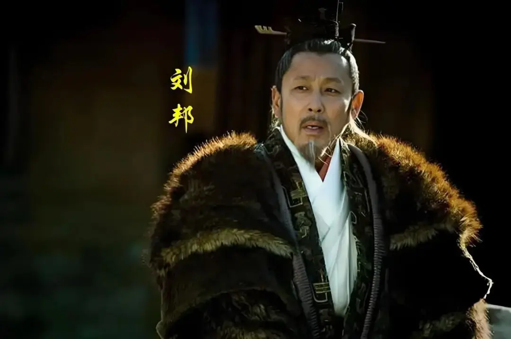
不读历史，你可能不知道**契丹这个曾经威震三朝，雄霸半个中国，让北宋头疼不已的游牧民族，在契丹灭亡后，这些人都去了哪里？现在是哪个民族？**

契丹起于南北朝辽河上游，五代时期，耶律阿保机统一各部，916年建契丹国，后改辽，雄踞北方。宋辽交战二十六年，宋太宗伐辽失败，1004年澶渊之盟换来百余年和平。
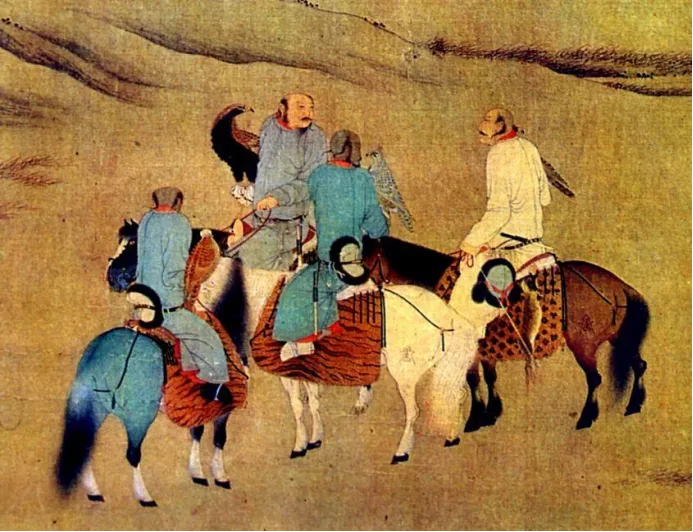
因丝路中断，中亚西亚“只知有契丹，不知有宋朝”，**“契丹”长期成为中国代称。**
辽末腐败，女真完颜阿骨打联宋灭辽，金国随即南下酿成“靖康之耻”。辽亡后，部分契丹人西迁建西辽，存续87年被蒙古所灭；另有“后西辽”融合进中亚人群。留居原地的契丹人成为金朝臣民，改姓迁徙，在民族融合中看似消失。
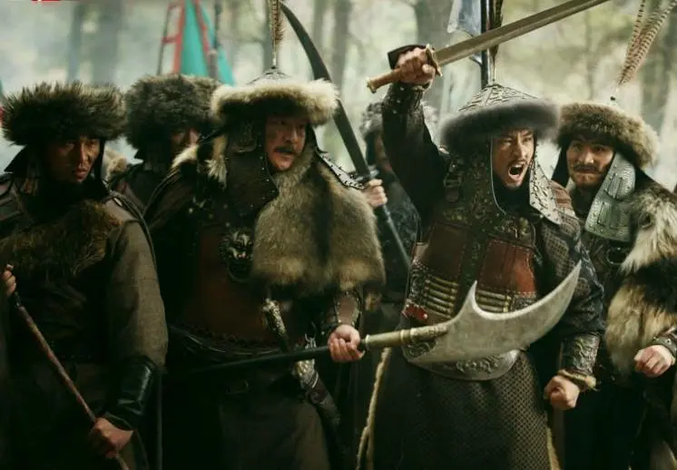
2004年DNA技术证实：**达斡尔族与契丹血缘最近**，且保留契丹外貌特征与系统战术。**契丹并未消失，而是以达斡尔族等形式延续至今。**
我们常说以史为鉴，但现实是，很多人对历史的了解，不过是影视剧的戏说。
当年明月在《明朝那些事儿》里写道：
“**历史从来不是冷冰冰的文字，而是一个个鲜活的人，做出一个个艰难的选择”**。
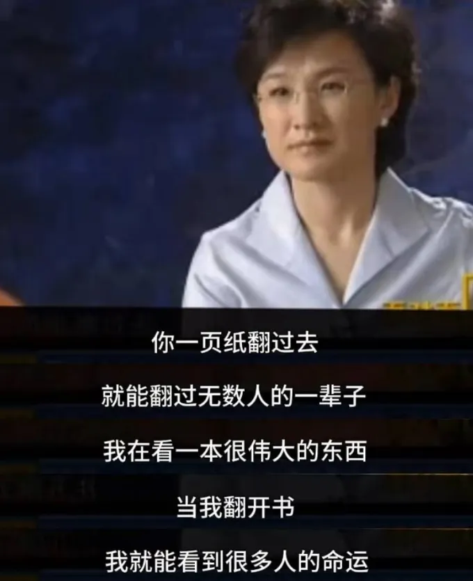
作为一个从历史中受益无穷的读者，我太同意了！
几千年前的帝王将相、烽火狼烟，早已化为尘埃，但**历史背后的逻辑和人性，从未改变。**
读历史，不只是审视王朝兴衰，更是在**洞察人性幽微，照见我们自己。**
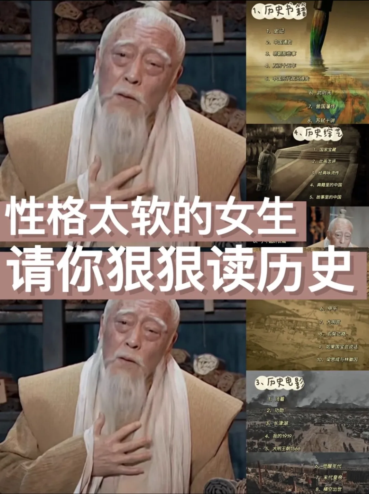
只可惜，市面上大多历史读物——
要么是**厚重的断代史，读起来像啃砖头**；要么是**戏说的野史，误导了一代人**。
如果真想读读真正鲜活有趣、权威靠谱的历史读物。
今天小编掏心窝子推荐这套，由**人民日报社主管主办**、**连续畅销15年**，
被无数学者、教授、知性白领**奉为“良心纸媒”**的期刊杂志——
**《国家人文历史》 **
**把历史讲到“骨头缝”里**
**层层揭秘宫廷秘闻、百姓民生、古典美学**

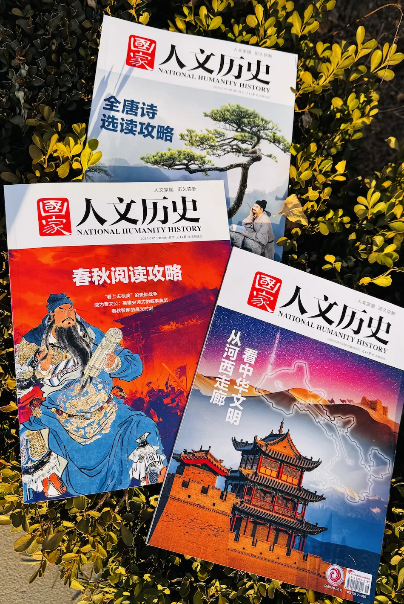
敢以“国”字号命名的杂志，一听就知道不一般。
在纸媒式微的年代，它反而逆流而上——
**创刊15年，连续5年**入选“中国邮政发行**百强报刊**”。
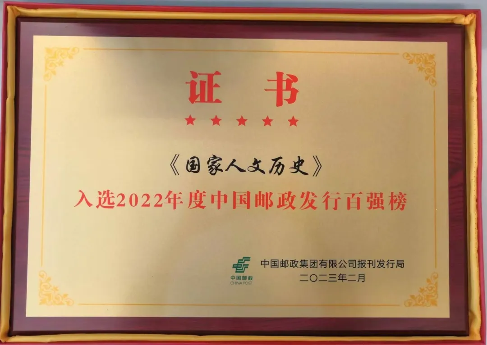
**豆瓣评分高达9.4**。
口碑更是期刊杂志中的一股清流！

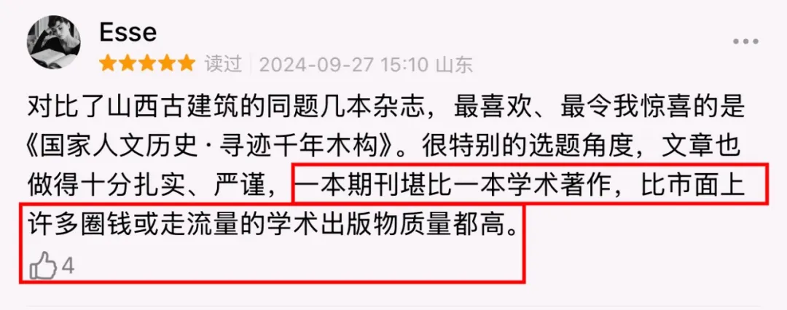

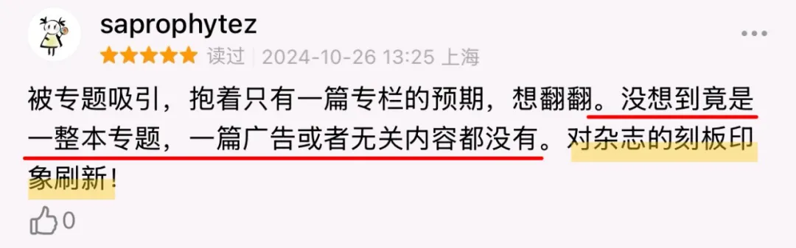
不仅成年读者爱读，好多学生都爱不释手。

别看名字像个一本正经“老学究”，**翻开才知道，这可能是最会“整活”的历史杂志**。
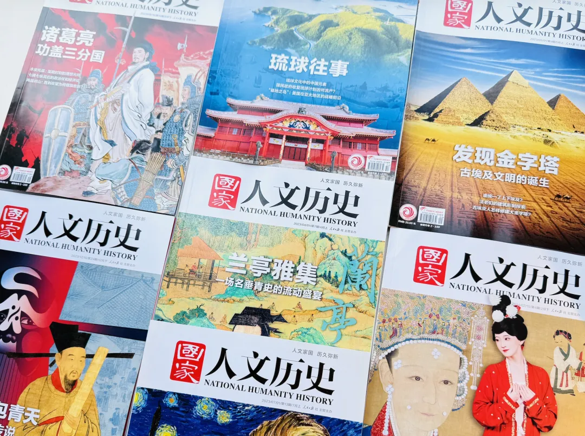
**◎ 选题多元，覆盖人文历史各个领域**
每期100多页，10万+文字量，**内容包罗万象**：
**文学历史**
——从《诗经》《楚辞》到唐诗宋词，从孔孟之道到程朱理学
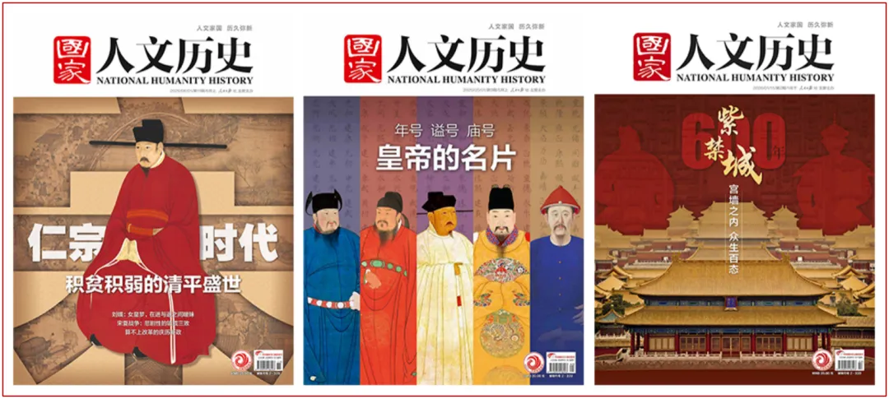
**考古文物**
——青铜器、瓷器、漆器、玉器、金器……讲述国宝背后的故事

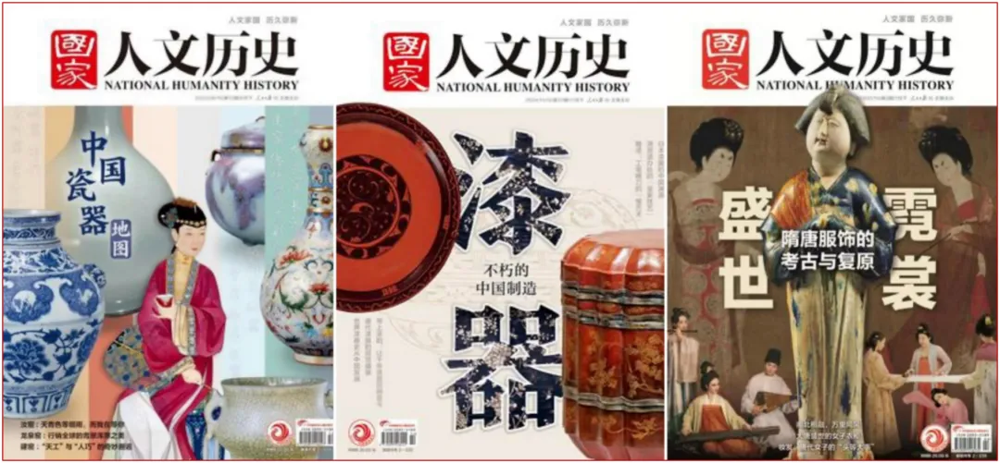
**地理建筑**
——故宫太和殿、敦煌莫高窟、秦始皇陵、大运河的千年传奇

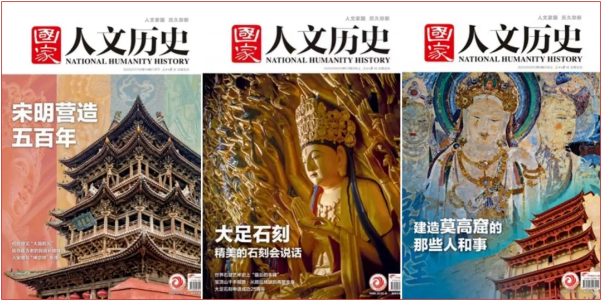
**艺术文化**
——书画、音乐、舞蹈、戏曲，中华美学的精髓传承
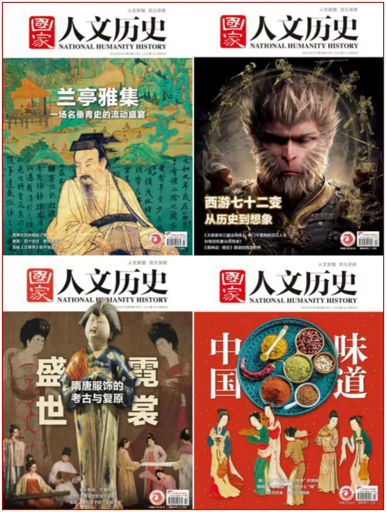
**政治经济**
——朝堂权谋、市井民生、货币贸易、制度变迁

**◎ 视野开阔，不止中国，更有世界**
从古埃及金字塔到罗马斗兽场，
从文艺复兴到大航海时代，从工业革命到现代文明……
**每一期都为你打开全球视野**，让你在中华五千年文明与人类文明长河中自由穿梭。

**◎ 紧跟时下热点，提供更丰富多元的独家视角**

虽是人民日报的老牌杂志，却比谁都懂年轻人的兴趣点——
《太平年》热播，它就**有五代十国专刊**；

**每年春节，必有生肖专题**，让传统文化知识融入生活日常。

还特别增加了博物馆、敦煌等专刊！
相当于是**送到你枕边的“人文旅行全攻略”**——

**全年24期，每月2册**，每册字数10万+
内容覆盖**考古、文物、艺术、建筑、文学、电影、自然、地理**……

讲解**角度刁钻，话题新颖，**让你每一期都看得尽兴、上瘾！
《水浒传》里的**“水浒”**是什么意思？
清朝灭亡后，格格们都去了哪儿？
所向披靡的蒙古铁骑，为何在越南摔了跟头？

创刊15年，每一篇稿件都要**经过“三审三校”**，
考据严谨到每一处引文、每一张配图都要标明出处。
也是这份较真，让它成为**国内罕见被【中国知网】全文收录的大众历史杂志**。

这也是为什么很多读者都是**连续订阅5年、10年以上**，
直言：“想读真正**权威准确、不戏说、不注水的真实历史，除了它市场上根本没有对手**。”

**历史、语文老师**更把它当作**隐形题库和课外备课本**。
**《兰亭集序》**的欢宴悲歌
**《包青天》**的司法人情与制度博弈
**《战国策》**中的人心博弈……

**作为孩子的人文启蒙和作为素材库**，简直再合适不过~
对中学生来说，完全就是都是高考文科综合的“活教材”。
**一年读下来，很多成绩直接原地起飞！**

想要**开阔视野、追求历史细节的爱好者**，更会爱不释手！

如果也想收**获一整年不重样的精神盛宴**，用深度阅读对抗精神熵增，
这套杂志，真的值得闭眼入！
**全年24册**（每月2册包邮到家），**团价仅480元**。

**每天1块多**，就能给你和全家人碎片时间变得充实、丰富、涨知识！
前100名下单，还赠送**6本限定主题特刊**——
**跟着李白去旅行**，感受“天生我材必有用”的浪漫豪情；
从**苏轼的“工作群”和“朋友圈”**看他如何宦海沉浮。
还能让杜甫手把手教孩子写出满分作文~

也就是说：到手**一共30册！机会难得，错过等一年**！
推文下单，再独家加赠价值69元的【定制保温随行杯1个】。

**点下图，立即抢订▼**
**2026年9月-2027年8月/2026年10月-2027年9月跨年订阅**
**9月刊或10月刊和赠品，48小时发出**

**无一语无来历，无一事无根据**
**这才是值得反复翻阅的真历史**
知乎上有人问，**哪些杂志是你订阅1年以上，并真心认为值得推荐的**？
排名最靠前的就是**《国家人文历史》**。

还有人说，**满分100分，愿意打90分**，原因就在于它的真实严谨、可考据。

正如央视记者说，在这个信息爆炸的时代，**我们最缺的不是信息，而是真相**。
**真实的历史，远比杜撰的宫斗剧更惊心、更烧脑、更颠覆三观**。
就像很多人一提起包拯，就想到“包青天”，
想到铡驸马、审乌盆，甚至“黑白通吃，穿梭阴阳”……

事实上**真实的包拯，45岁才当上“见习御史”**。
不是因为他能力不行，而是因为北宋的“选人”升“京官”，需要**五位高级官员联名举荐**。

包拯在这条路上走了18年，只因他太耿直、太廉洁！
端州三年，不取一砚；
出使契丹，怼得对方哑口无言；
为把外戚拉下马，哪怕唾沫星子溅到仁宗脸上也毫不退让。
书中把这段历史掰开揉碎，让你看见：**所谓“青天”也是凡人一枚**。

为了做到创始人立下：“**无一语无来历，无一事无根据**”
**编辑记者**从不坐在办公室里抄通稿，而是**去现场、下工地、翻故纸堆、请教当事人**。

比如**西夏陵申遗成功冲上热搜**，大多数人看一眼就划过去了。
而它当月就推出一整本专刊——
从残破的陵塔讲到党项人的信仰，
从陵墓里那具被迁葬三次的白骨，讲到一代王朝的陨落与遗忘。
真正带你读懂：**这个被蒙古铁骑抹去的王朝，凭什么在中华文明版图上留下不可磨灭的痕迹**。

每期还**资深专家和学者**，拨开历史的迷雾，抽丝剥茧讲述：
**孔孟李杜的精神世界**，**唐宋明清的朝堂市井**；
《春秋》《左传》的**微言大义**，一件件**国宝文物的前世今生**。

内容遍布**经济、建筑、文字、考古、医学、文学、文化**……
秦始皇的焚书令，到底烧了什么、没烧什么？
为什么说《左传》里的女性群像，比甄嬛传更精彩？
大宋的官员，一年能休多少天假？

哪怕只读一刊，也能得到全方位视野的知识扩展。**一整年，你的谈吐涵养和精神格局都会让人刮目相看**！
**点下图，立即抢订▼**
**2026年9月-2027年8月/2026年10月-2027年9月跨年订阅**
**9月刊或10月刊和赠品，48小时发出**

**比刷“历史短视频”还上头**
**有血有肉的人生，比任何剧本都好看**
如果你要问，这套杂志好不好读，我只想说：
没有比它更擅长用讲故事的方式，让厚重的历史变得**可触可感**。
就像一位读者说的，“**这里有真正的笔者**”。

比如武则天的真实人生，比任何宫斗剧都精彩：
**14岁入宫，67岁称帝**，每一步都是精准的政治计算。
她执政30年，**开创殿试、武举**，
不仅**让寒门子弟有了上升通道**，更为**“开元盛世”打下基础**。

讲到国外艺术大师梵高的爱情与疯狂——
很多人都知道他割耳自残、精神崩溃，却不知道**他曾有一段温暖却短暂的爱情**。
30岁那年，梵高收留了32岁的西恩，一个带着两个孩子的妓女。
朋友嘲笑他“疯了”。
但在梵高眼里，**西恩“像被驯养的鸽子一样温柔”**。

正是这段恋爱时光，让他创作出了《掘土的人》《海滩上的渔民》《悲哀》……
也让我们看到一个别样温情、有担当的“父亲梵高”。

这样的故事，每一期都有。
**不讲帝王将相的权谋流水账，只讲人的抉择、人的困境、人的光芒**。
读完才懂，读历史的意义就在于，在别人的人生里照见自己的欲望、恐惧，和那些不动声色的隐秘挣扎。
**点下图，立即抢订▼**
**2026年9月-2027年8月/2026年10月-2027年9月跨年订阅**
**9月刊或10月刊和赠品，48小时发出**

**权威地图+考古现场+高清国宝**
**图文并茂，身临其境读历史**
最后必须夸夸**这套杂志的高质量、高审美配图**，
每一期都是一场精心策划的视觉盛宴。

**权威历史地图**，
从春秋战国到明清版图，从丝绸之路到郑和下西洋，专业绘制，一目了然

**一线考古现场图**，
三星堆、秦始皇陵、敦煌莫高窟……最新考古发现，第一时间高清呈现

**国宝文物细节图**，
青铜器纹路、瓷器釉色、玉器雕工、书画笔触，放大细节，让你看清千年匠心

**世界各地风景实拍**，
金字塔、罗马斗兽场、泰姬陵，足不出户，看遍世界文明遗迹

为什么说它的图片特别珍贵？
因为很多图片都是**独家授权**或**现场拍摄**，其他地方根本看不到。

不是简单的插图配文，而是**图文互证，互为补充**。

**孩子读，图文结合，知识点记得牢**。
**老人看，大图清晰，阅读不费眼**。
**人文历史爱好者读**，也能从高清细节，满足专业阅读需求。

诚如国学大师季羡林说的，当你站在时间的纵线上看人生百态，
你**会看懂人性、读懂人心，变得更加通透、坚韧**。
欲知大道，必先为史；格局大了，事就小了。读进去了，心就静了。

《国家人文历史》2026跨年订阅，**特惠仅480元**！
前100名下单，还赠送**6本限定主题特刊**——
可以**跟着李白去旅行**，看杜甫封圣之路，
还能从**苏轼的“工作群”和“朋友圈”**看他如何宦海沉浮。

也就是说：到手**一共30册！机会难得，错过等一年**！
推文下单，再独家加赠价值**69元的【定制保温随行杯1个】**。

**点下图，立即抢订▼**
**2026年9月-2027年8月/2026年10月-2027年9月跨年订阅**
**9月刊或10月刊和赠品，48小时发出**

**·END·**
**订单查看、物流查询，任何售后问题**
**点击上方小程序进入商城咨询在线客服**
**点击“点击购买”按钮，立即抢购**
👇

*以上内容为广告推广

## 摘要

（待补充）

## 我的笔记

（待补充）
