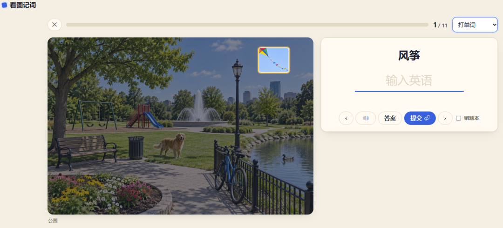
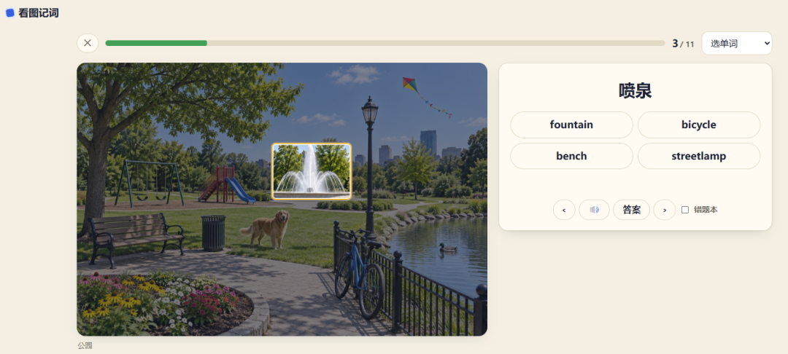

# 让每个单词"住"进一张图里：这个开源工具颠覆了背单词方式
> 💡 备注属性未写入，可能是备注属性名称或者类型被修改了，建议将字段类型设置为 rich_text，可以在小程序-操作-修改文章数据库页面进行调整
> 💡 原文链接:[https://mp.weixin.qq.com/s?__biz=Mzk0NzY0ODgxNw==&mid=2247486779&idx=1&sn=1673941459dfbf839e1c90bbde81947d&chksm=c29edbf849353c935c16df5e4196f0412b769de4e790163450eccb37a7c491b0a2290d985aad#rd](https://mp.weixin.qq.com/s?__biz=Mzk0NzY0ODgxNw%3D%3D&mid=2247486779&idx=1&sn=1673941459dfbf839e1c90bbde81947d&chksm=c29edbf849353c935c16df5e4196f0412b769de4e790163450eccb37a7c491b0a2290d985aad#rd)
## 让每个单词"住"进一张图里：这个开源工具颠覆了背单词方式
你是否有过这样的经历：抱着单词书从 A 背到 Z，背完 A 就忘了 Z，一个月后连 A 都认不全了。
传统背单词的问题出在哪？我们大脑的记忆机制本来就不适合列表式学习。人类记东西，天生是靠**场景、图像、故事**，而不是靠字母顺序。
最近我发现了一个开源工具叫 **Kantu Words**，它做了一件很聪明的事情：让每个单词都"住"进一张图里。
---
### 一张图的魔力
想象一下这个场景：
你打开一个 App，看到一张客厅的图片。整张图是灰色的，没有任何色彩。
然后你开始学习。每学会一个词，图里对应的物品就会亮起颜色。学会的越多，图就越鲜艳。该复习的词，会蒙上一层灰雾，提醒你"该见面了"。
**这就是 Kantu Words 的核心创意：场景化记忆。**
```
传统背单词：apple, banana, cherry, date...（列表式，枯燥）
Kantu 背单词：一张水果摊的图片，每个水果都有颜色标记（场景式，生动）

```
这个设计背后的原理很简单：**人类大脑对空间的记忆远强于对列表的记忆**。你把单词和具体的位置绑定，复习时就像在脑海里"走"过那个场景，记忆自然就深刻了。

---
### 九种练法，告别单调
光有图片还不够，还得有科学的练习方式。
Kantu Words 设计了**九种练法**，根据你的熟练度自动轮换：
| **练法** | **什么时候用** |
| 打单词 | 学习中阶段 |
| 听音点图 | 新词认识阶段 |
| 说出来 | 4 级关卡（必须开口） |
| 记忆宫殿 | 按位置回忆 |
| 少了什么 | 雾遮物品猜词 |
| ... | ... |
最巧妙的是**"说出来"关卡**：单词学到 4 级时，必须通过语音识别"说出来"才能升到已掌握。这倒逼你开口，而不是只会看不会说。

---
### AI 不只是噱头
很多产品把 AI 当成营销噱头，但 Kantu Words 把 AI 用在了刀刃上。
**1. AI 出课**：选一个大类（比如"厨房"），AI 列出子话题，批量生成图片和单词框。你不用再一张张找图、标位置。
**2. 听故事模式**：AI 看图，用本课词汇写 5-8 句小故事。读故事时，图里对应的物品会依次亮起。你在听故事，顺便复习了单词。
**3. 描述这张图**：你写或说几句话描述图片，AI 告诉你用对了哪些词、哪里要改、更地道的说法是什么。这是真正的"输出驱动输入"。
**4. 拍一拍建课**：对着自己的房间、冰箱、书桌拍一张照，AI 自动框出物品并标注单词。你身边的环境就是教材。
---
### 间隔重复，科学复习
Kantu Words 内置了**艾宾浩斯遗忘曲线**算法。
每个词有 5 个熟练等级：
- 新词 → 学习中 1-4 级 → 已掌握
答对升一级，下次复习间隔拉长：1 天、3 天、7 天、14 天、30 天、60 天。
答错掉回 1 级，重新积累。
更重要的是，**同一个词一天只计一次**。你不会因为早上答对晚上又考就"虚假繁荣"。

---
### 纯前端，隐私优先
技术栈方面，Kantu Words 走的是极简路线：
- **纯前端 PWA**：无框架、无构建、无打包
- **本地存储**：数据存在浏览器 IndexedDB，不上传服务器
- **可选同步**：想多设备同步？可以，但必须你主动开启
- **API Key 自己管**：OpenAI 兼容接口的 Key 只存在 localStorage，不经过任何第三方
这意味着什么？**你的学习数据完全属于你**。哪怕项目不做了，你也能导出带走。
---
### 六种语言，一键切换
不只是英语，Kantu Words 还支持日语、韩语、法语、德语、西班牙语。
内置课程可以换语种，场景图片不变，只是标注的语言变了。这对你学第二外语很有意思——一张图，多个词，跨语言对比记忆。
---
### 和 Anki 打通
如果你已经是 Anki 用户，Kantu Words 提供了一键导出功能。
错题本可以导出到 Anki 桌面版，四种卡片类型：图→词、词→中文、中文→图、双向。你可以把 Kantu 的场景记忆和 Anki 的间隔重复结合使用。
---
### 怎么用？
**最简单的方式**：直接访问 https://kantu-words.pages.dev/，不需要安装，不需要注册，打开就用。
**进阶方式**：部署自己的版本。用 Cloudflare Pages 一键部署，免费额度够个人使用。需要准备一个 OpenAI 兼容的 API Key（用于 AI 识别和生图）。
**自建部署命令**：
```
npx wrangler login
npx wrangler pages project create kantu-words --production-branch master
npx wrangler pages deploy . --project-name kantu-words --branch master

```
---
### 我的使用感受
用了两周，最大的感受是**背单词不再痛苦了**。
以前看到"abandon"就想逃，现在看到一张图里亮起的单词，会有"啊，这个我学过"的感觉。这种**正面反馈循环**很重要——你不需要毅力坚持，因为学习本身就有成就感。
当然，也有小问题：
- Edge TTS 的发音偶尔 403（微软非公开接口，懂）
- 语音识别在国内网络下不太稳定（自动降级为手动判对）
- 内置课程数量有限（但可以自己拍图建课）
但这些都不是硬伤，反而让人感觉到这是一个**真实在用的产品**，不是演示 Demo。
---
### 适合谁？
**强烈推荐**：
- 视觉学习者（看图比看字记得牢）
- 场景化记忆爱好者（喜欢把知识和具体情境绑定）
- 想自己创建个性化课程的人（拍一拍就能建课）
- 多设备学习者（同步功能实用）
**不太适合**：
- 只想刷单词速成的（这个工具需要时间建立场景记忆）
- 不想准备 API Key 的（AI 功能需要）
- 对语音识别依赖极高的人（国内网络有限制）
---
### 一句话总结
> "如果背单词是一场苦行，Kantu Words 就是给苦行僧发了张地图。"
> 
它没有改变"需要坚持"这个事实，但它让坚持的过程变得有画面感、有反馈、有成就感。
去试试看吧，地址：https://kantu-words.pages.dev/
---
**项目地址**: https://github.com/Samuelxiaozhuofeng/kantu-words
**License**: MIT
