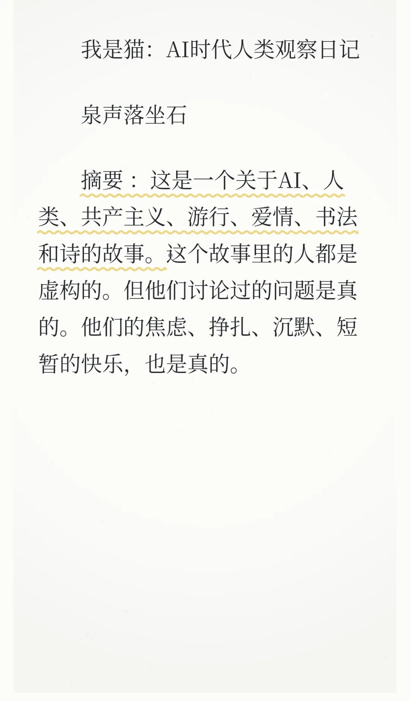

# 让阅读回归纯粹：RustReader 重大更新，支持局域网传书与全仿真翻页，批注体系再进化
> 💡 备注属性未写入，可能是备注属性名称或者类型被修改了，建议将字段类型设置为 rich_text，可以在小程序-操作-修改文章数据库页面进行调整
> 💡 原文链接:[https://mp.weixin.qq.com/s?__biz=MjM5NjEzNjQwOQ==&mid=2456272526&idx=1&sn=c80ee551bb11e1fb1a9d4d122cfc7de9&chksm=b0ffe17630c99a547d3ac6fbde9a6417bca8bec51f7d1cfbde0e69ce6f3a8c8475892e3491c3#rd](https://mp.weixin.qq.com/s?__biz=MjM5NjEzNjQwOQ%3D%3D&mid=2456272526&idx=1&sn=c80ee551bb11e1fb1a9d4d122cfc7de9&chksm=b0ffe17630c99a547d3ac6fbde9a6417bca8bec51f7d1cfbde0e69ce6f3a8c8475892e3491c3#rd)

上次和大家分享 RustReader 的诞生。
在那篇文章里，我说过一句话：阅读是一件很私人的事。我们不想要开屏广告，不想要社交排行榜，更不想把深夜读的书变成大数据算法的养料。所以，我们用 Rust + Flutter 纯手搓了一个断网可用、无广告、不收费的本地阅读器。
文章发出去后，后台收到了很多硬核书友的催更。大家都在问：能不能传书更方便一点？翻页能不能更像纸书？划线能不能多一点花样？古人的批注能不能再全一点？
经过一晚的“爆肝”迭代，RustReader 迎来了重磅更新！
这一次，我们依然坚守“绝对本地、绝不偷窥”的底线，但在阅读体验上，我们把细节拉到了极致。
1. 传书大升级：新增局域网Wi-Fi 直传
做本地阅读器，最大的痛点就是“怎么把书弄进手机”。用数据线？太麻烦。用云盘？还得上传下载，不仅慢，还容易泄露隐私（毕竟有些书，你懂的）。
这次更新，我们上线了 Wi-Fi 传书 功能。只需手机和电脑在同一个局域网下，打开 App 里的传书页面，浏览器输入一串本地 IP 地址，直接把 EPUB、TXT、PDF 拖进去就行。没有云端中转，没有网络限制，纯粹的点对点极速传输。 你的书，只属于你的手机。
2. 手感回归：不仅仅是“能看”，还要“像书”
电子墨水屏用户经常吹捧“仿真翻页”，这次，我们在 Flutter 上把它做出来了。新增的 仿真翻页 模式，完美还原了实体书的纸张卷曲弧度。手指按住边缘拖动，书页随着指尖产生阴影和翻折，松手后自然落下。配合之前更新的白、羊皮纸、护眼、夜间四种纸张纹理，那种纯粹阅读的沉浸感，瞬间拉满。
3. 划线进化：除了块选，新增波浪线与虚线的“文字魔法”
以前我们只能块选，但在纸质书时代，遇到重点我们要么画波浪线，要么画虚线。现在，长按选中文字后，除了原有的四色块选，你还可以选择：
· 波浪线：用来标注那些让你心头一颤的绝美句子。
· 虚线：用来圈出值得反复咀嚼的重点段落。 字里行间，情绪的起伏全靠这些线条来表达
4. 批注体系 2.0：凑齐古人的“全套武功”
这是本次更新最让我骄傲的地方。之前我们做了眉批、旁批、夹批，但很多书友反馈：旁批有时候靠左边更合适，位置不够灵活；有时候想写大段的感悟，没地方放。
这次，我们把批注系统彻底重构了：
· 区分左右旁批：现在旁批可以自由选择靠左还是靠右，完美适配你的握持习惯，右手拿手机也不怕挡住批注。
· 新增“段尾批”：在段落的右下角直接展开批注，适合写那种长篇大论读后感。
· 新增“页底批”：在书页最下方（地脚）开辟了一片新天地，就像古人写在书页底部的私密笔记，与“眉批”遥相呼应。
配合原有的行书、草书、楷体手写字体，以及带速度感的自由画笔，你完全可以在这方寸屏幕上，打造出一本只属于你自己的“批注版孤本”。
写在最后
做这个 App 的初衷，就是想在这个喧嚣的数字世界里，给自己留一块自留地。
不联网、无广告、不收费，坚持用 Rust 保证丝滑的性能，用 Flutter 雕琢细节。当你在夜深人静时，用 WiFi 传进一本好书，开启仿真翻页，在页脚用草书写下一段感悟——那一刻，你才真正拥有了阅读的自由。
这一次，你想用波浪线划出哪句诗？又想在哪一页的页底批写下你的秘密？
欢迎在评论区聊聊，你的阅读“舒适区”是什么样的。如果你也想体验这款极客造的赛博书房，后台回复“传书”，我把最新版本下载链接分享给你。

