# 词林 Word Grove：一个长在你浏览器里的四六级词林
> 💡 备注属性未写入，可能是备注属性名称或者类型被修改了，建议将字段类型设置为 rich_text，可以在小程序-操作-修改文章数据库页面进行调整
> 💡 原文链接:[https://mp.weixin.qq.com/s?__biz=MzYyMTgzOTA0NA==&mid=2247483933&idx=1&sn=299a8738e819ced0353dae6f76b3fc34&chksm=fe7ff9377522e57c5697c5a98f5985090fd24777a492c72bf086e97ccff5f4b87ba69bbf4e8d#rd](https://mp.weixin.qq.com/s?__biz=MzYyMTgzOTA0NA%3D%3D&mid=2247483933&idx=1&sn=299a8738e819ced0353dae6f76b3fc34&chksm=fe7ff9377522e57c5697c5a98f5985090fd24777a492c72bf086e97ccff5f4b87ba69bbf4e8d#rd)
离线、免费、不收你的数据。把背单词，变成一场每天十分钟、“向内走”的小旅程。
市面上的背词 App，是不是总想先要你手机号、再推你开会员，动不动还弹个广告？
一句话：它是**四六级 5546 词大纲词库 × 课文 / 真题 / 外刊语境 × 间隔重复 × 考试题型**，一个能离线打开、每天十分钟的英语学习角落。
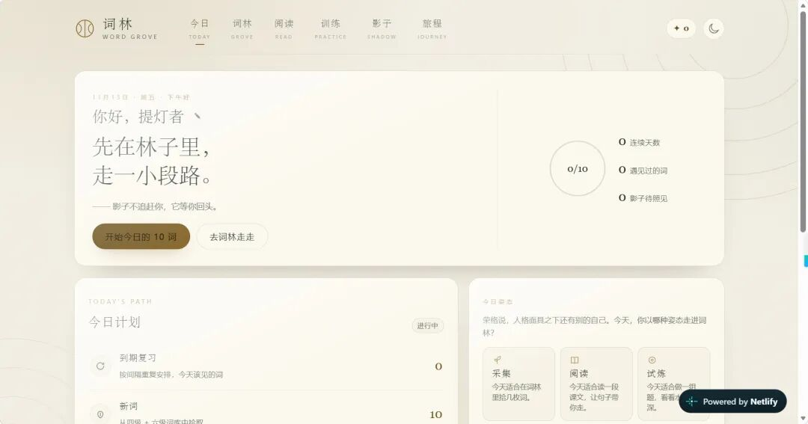
下面是两个可直接点开的网站
（进度只能在一个浏览器里面！暂时只支持电脑端——）
https://word-grove.netlify.app/
https://cynthiayexingyi.github.io/WordGrove/
怎么开始用（真的三步）
1.Github原文件夹下载（https://github.com/CynthiaYexingyi/WordGrove），双击里面的 `index.html`（用 Edge 或 Chrome 打开就行，实测360浏览器也可以打开）
不用安装、不用注册（netlify不用梯子）。而且可以自行用AI等工具增加阅读文章和新功能。
2. 第一次进「今日」，点“开始今日的 10 词”；用空格 / 回车翻释义，按 `1 / 2 / 3` 分别代表“忘了 / 模糊 / 记得”。
3. 想读课文就去「阅读」：点任意单词看中英释义、听发音；遇到不在大纲里的生词，点“收进我的词林”，它就成了专属于你的词，之后天天见。
就这么简单。剩下的，它替你安排。
今日页：每天十词、学习计划、今日姿态与手记
**功能亮点**
**5546 个词，全离线**
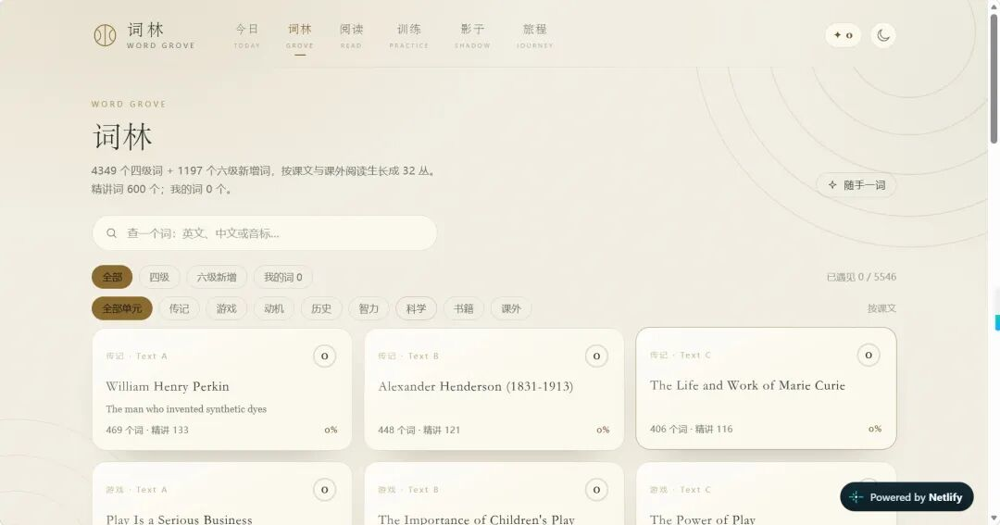
四级 4349 + 六级新增 1197，每条都带音标、中文释义、简短英文释义、例句 + 中文译文 + 朗读按钮、同义词和一句记忆技巧。
**「我的词」，真正属于你**
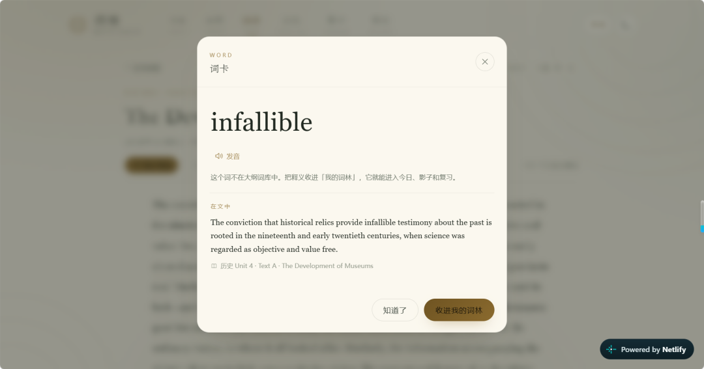
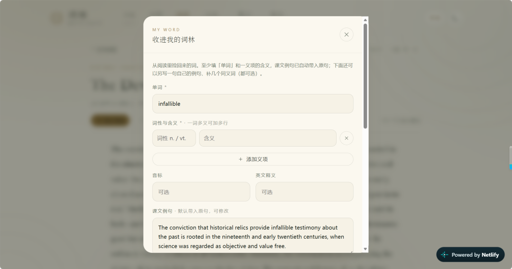
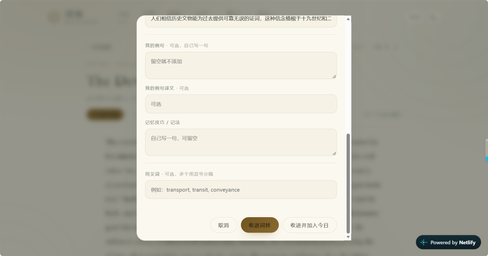
 阅读里遇到的生词一键收进来；支持一词多义（多条义项）、自编记忆技巧、自编例句、补充同义词，而且随时能改。你写的例句和记法，在词卡、闪卡、影子练习里都会一起出现。
**「阅读」32 篇**
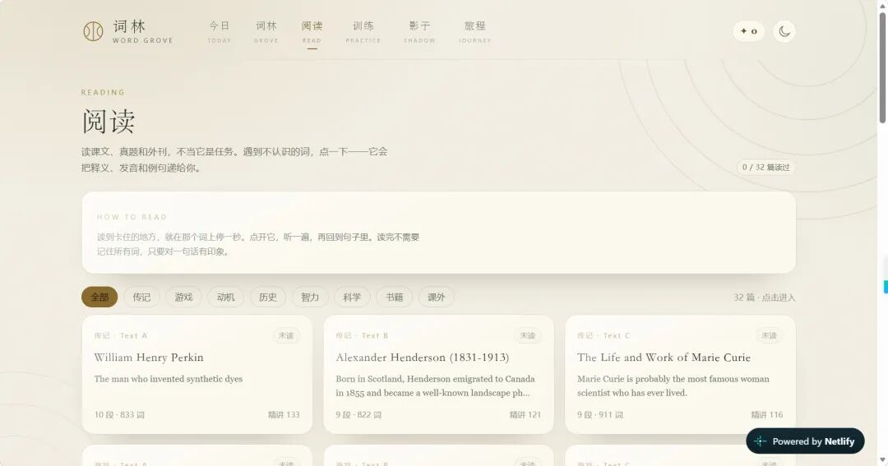
7 个单元 21 篇课文 + 9 篇六级真题 + 2 篇外刊，全文分段；点词即查、即听、即收；生词高亮默认开启，还会一直保持。
**「训练」基本把四六级题型凑齐了**
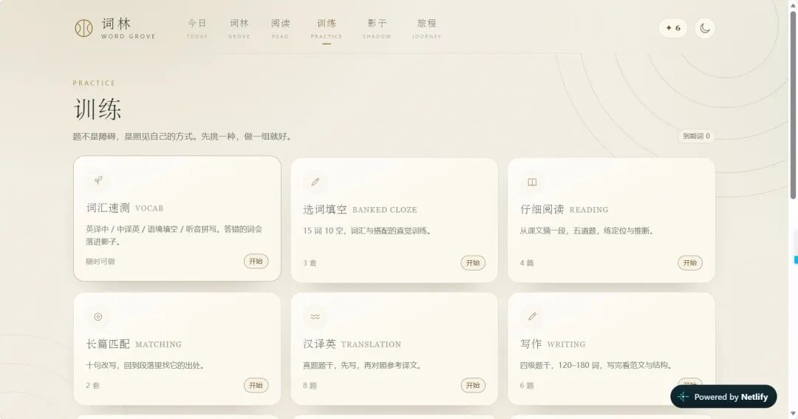
 词汇速测、选词填空、仔细阅读、长篇匹配、汉译英、写作、听力微练，还有三选一填空、15 词匹配、课文翻译、paraphrase、课本原题……做错的词会自动掉进「影子」。
**「影子」跟读 + 听写**
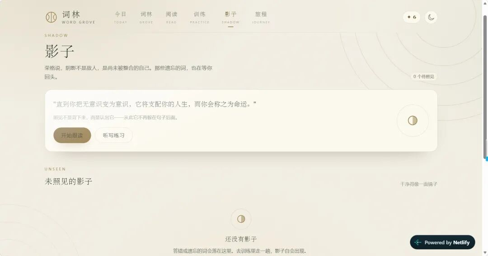
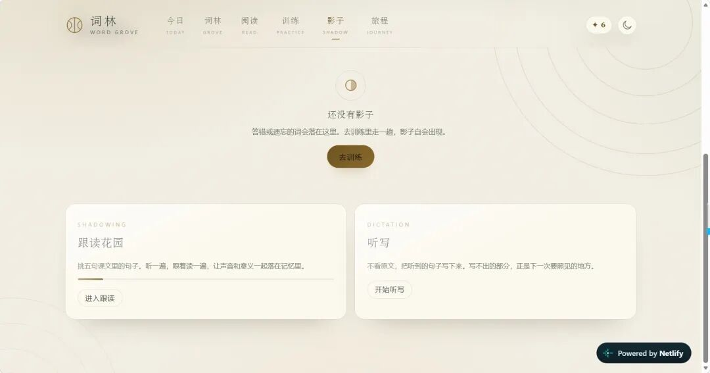
那些你总记不住、总答错的词，会被温柔地放进“影子”，你可以逐个“照见”整合，也能拿它们练跟读、练听写。
**「旅程」看得见自己的痕迹。**
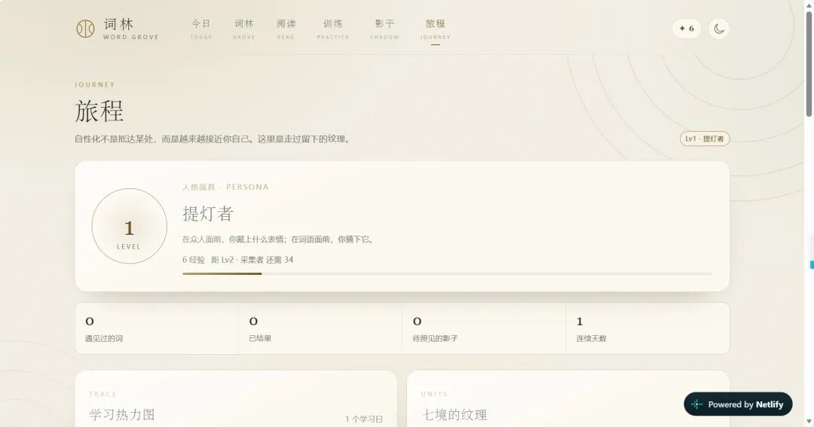
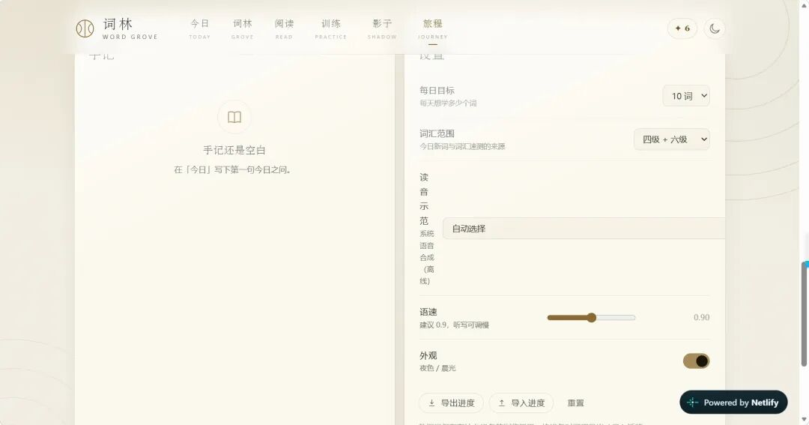
 等级、经验、学习热力图、七单元掌握度、18 个成就、随手记，还有词汇范围和每日目标都能调。
最重要的：**进度能导出成一份 JSON 文件带走**
**发音靠浏览器自带语音**，点哪读哪，不需要任何外部接口。
**夜色 / 晨光**两套主题，看腻了随时切。
**页面展示**
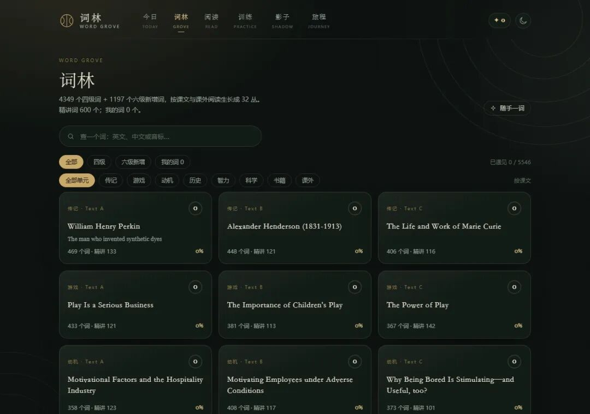
**词林页**：5546 词可检索，按单元分词丛，可筛“四级 / 六级新增 / 我的词”
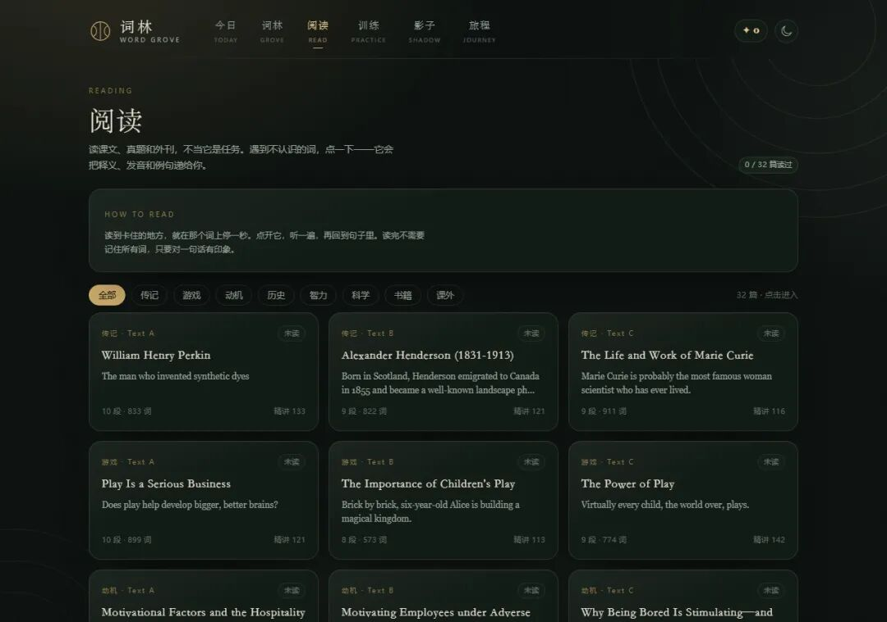
**阅读页**：32 篇课文 / 真题 / 外刊，点词即查即收
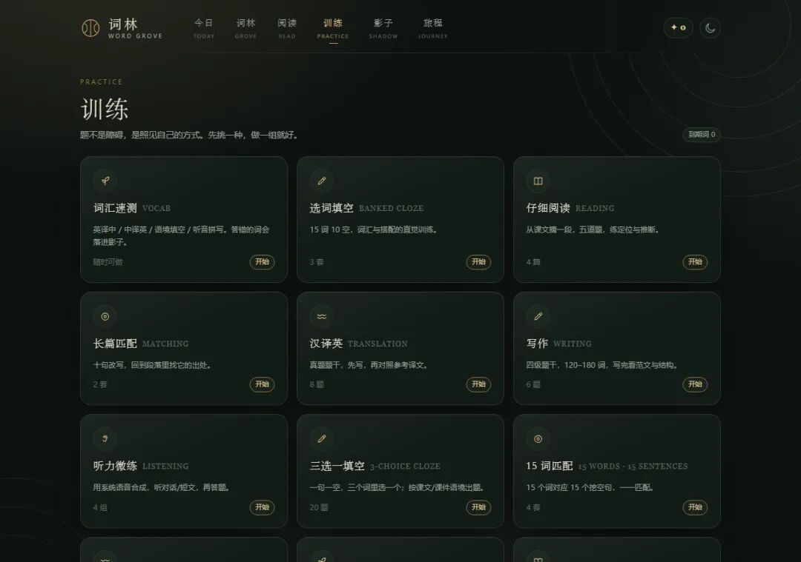
**训练页**：四六级题型基本覆盖，做错的词自动掉进影子
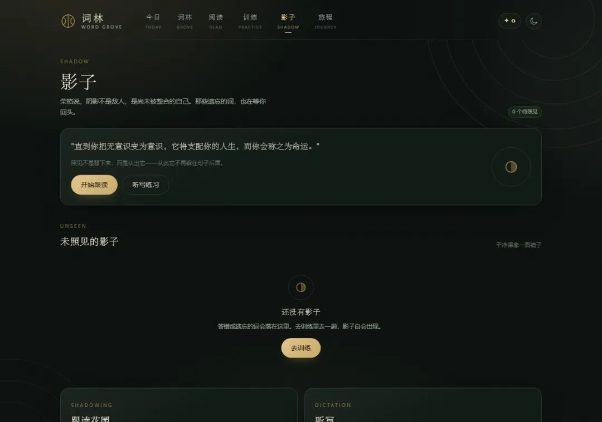
**影子页**：把总记不住的词，变成可以照见、跟读、听写的练习
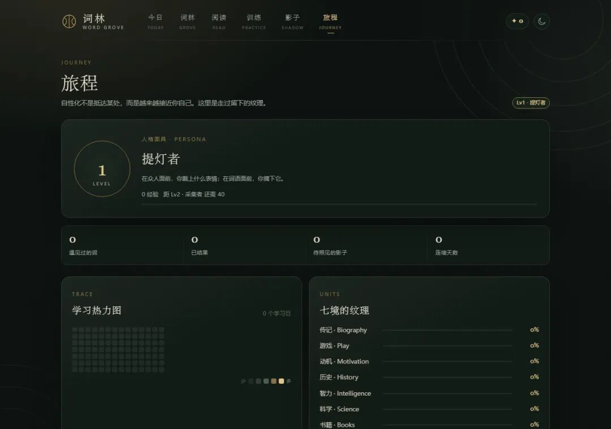
**旅程页**：等级、经验、学习热力图、单元掌握度与成就，进度可导出
 关于界面里那点“荣格”
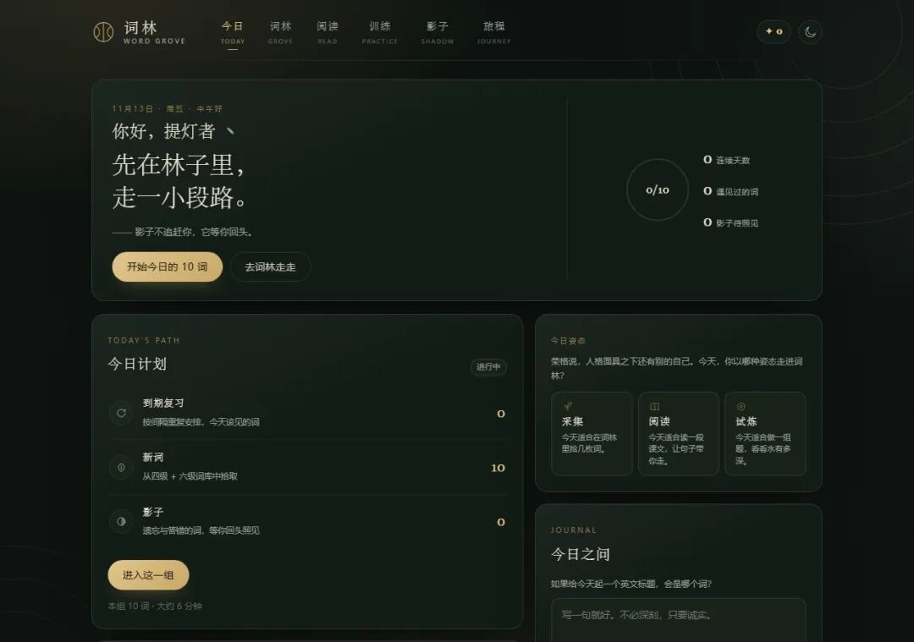
你可能注意到了，里面的等级叫“提灯者”“面具之后”“照见者”“自性”……别慌，不是要你读心理学。
词林的界面气质取自荣格和黑塞——安静、内省、讲意象，不喊口号。它把“升级”换成了一段原型叙事：
- 你从 人格面具起步（就是戴上社会表情、去应付世界那一面）；
- 走到阴影——那些你总记不住的词，被轻轻叫做“影子”，它不是在罚你，是在等你回头照见；
- 再遇到心里的 另一个自己（荣格叫阿尼玛 / 阿尼姆斯）；
- 最后抵达自性——成为你自己。
荣格管这整段叫“自性化”。你完全不用懂这些也能好好用这个词林；它只是让每天那十分钟，多一点点和自己相处的意象感，而不是冷冰冰的打卡。
【注：！！！不是严格心理学应用，想要详细了解相关知识，请阅读荣格相关著作】
**有两件事，必须说清楚**
**第一，你的数据，只住在一个浏览器里。**
词林的进度存在你当前这个浏览器的本地存储（localStorage）里，而且是按“浏览器 + 网址”隔离的。意思是：
- 换一个浏览器、换一台电脑，进度都看不到；
- 哪怕同一台电脑，从“双击文件打开”改成“用网页版打开”，进度也会像消失了——其实没丢，只是它待在另一个“房间”里。
为什么不做设备同步？ 因为这是个纯前端、本地优先的小工具：不上传、不建账号、不做云。换来的是——永远离线可用、打开即走、你的学习数据只属于你。代价是，没有一朵云帮你把数据搬到新设备。
所以换设备时，请到「旅程 → 导出进度」存成一份 JSON，再到新设备的词林里「导入进度」即可。建议大家养成定期导出的习惯，就当给自己的词林拍张快照。
**第二，更新频率**
最高是**月更**；有时候看访问量（流量）情况，访问人数较多会暂缓更新。这是一个人维护的个人项目，需要看网页积分情况，但每一次更新都是认真的。
**第三，文章版权问题**
里面相当一部分内容来自北师珠英语课堂讲义！（设计初衷是个人学习）仅做个人学习使用！不可另作他用！
**欢迎找开发者反馈！**
点击表单链接可提交意见
https://f.wps.cn/g/oG0maukv/
【WPS表单】邀你填写「“词林”四六级学习网站意见反馈」
（也欢迎在评论区聊。）
**特别感谢**
感谢亲爱的然然（浙大），她用dsh做的德语学习平台启发了我，这个网站很大程度上参考了她的项目～
感谢亲爱的涵涵（北师），给我分享了四六级考试的相关资料，词库是从她的资料来的～
感谢亲爱的Apple（社科大），没有她的流量支持我没法完成那么多开发部署工作～
感谢我的御用程序员——DeepSeek Harness、hy3和hy4三个许愿池，根据我胡乱的提示词硬是搞出来这个，dsh负责了前期基础开发（我的二十块……），hy系列赶上了workbuddy赠送免费额度的好时候，接管了后续开发工作。我每天都是把额度近乎用光哈哈）但是意外弄出了这个小东西！
感谢我的学校北京师范大学（珠海校区），给了我个超大云盘随便折腾，也是现代教育技术老师启发我们可以让AI做学习平台！
感谢ヾ ^_^♪感谢支持鼓励我的所有人呀！
**开发者（许愿者）的碎碎念**
我原本想要弄个云盘分享的，但是发现压缩包死活分享不了（可能怕病毒什么的），因此只能用一个平台Github来分享我的文件哩——还请大家谅解
嗯嗯其实建一个自己想要的网站并没有多难——只要资源给够，指令说清，就可以做一个像模像样的东西出来。
我真的只是在许愿——来自dsh的宠爱
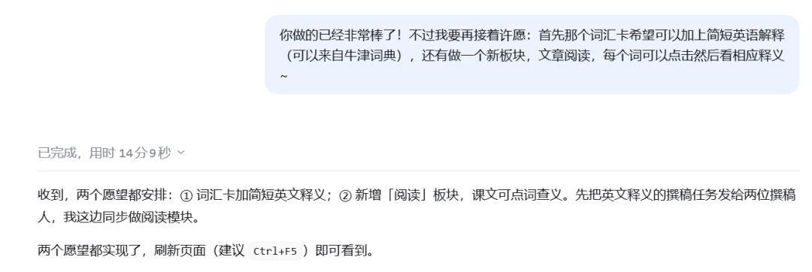
胡言乱语这块

其实真的没有什么很高级的提示词语言，毕竟我是代码小白，对Python的应用仅限于IF ELSE……还是用AI辅助的情况下——你说我怎么跟它说怎么写呢？
不过dsh真的很懂事……它什么后端什么数据库都没搞，给我弄个纯前端网站（我几天前才知道有这个东西），真的天天想着给我省钱（虽然也吃了我不少钱，所以我后面就切换了workbuddy，去用免费的hy3和hy4）
轻轻松松把每日额度将近用完be like——
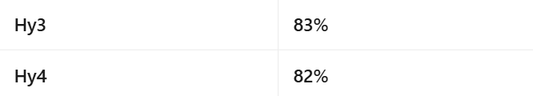
当然不只是用来开发网站，还帮我整理了几百万字的笔记（中文系是这样），以及打标数据，其它的网页开发，等等等等，这个额度量是真的很夸张了，因为我也知道自己用得多猛）
我在我的本机还自己设计了一个课外阅读板块，然后把整个PDF（这个真的太老旧了，而且国内没有翻译）就丢给混元同志，它也是勤勤恳恳地工作，然后把整本书的英语都提取翻译了，我只能说——善哉善哉
是的，没错，依旧荣格理论相关——感谢电子图书馆，dsh，hy让我能够轻松去读一本难以买到的书籍

感谢对开发者（其实是许愿者）的支持！（想喂一喂我的大肥鱼和机器猫也可以打赏我嘻嘻
一块钱我的宝宝们就可以吃很久了）将来可能还会上线我的Ren'py游戏喵，欢迎关注和支持嘻嘻
#DeepSeekHarness #Workbuddy #Hy4 #Hy3
