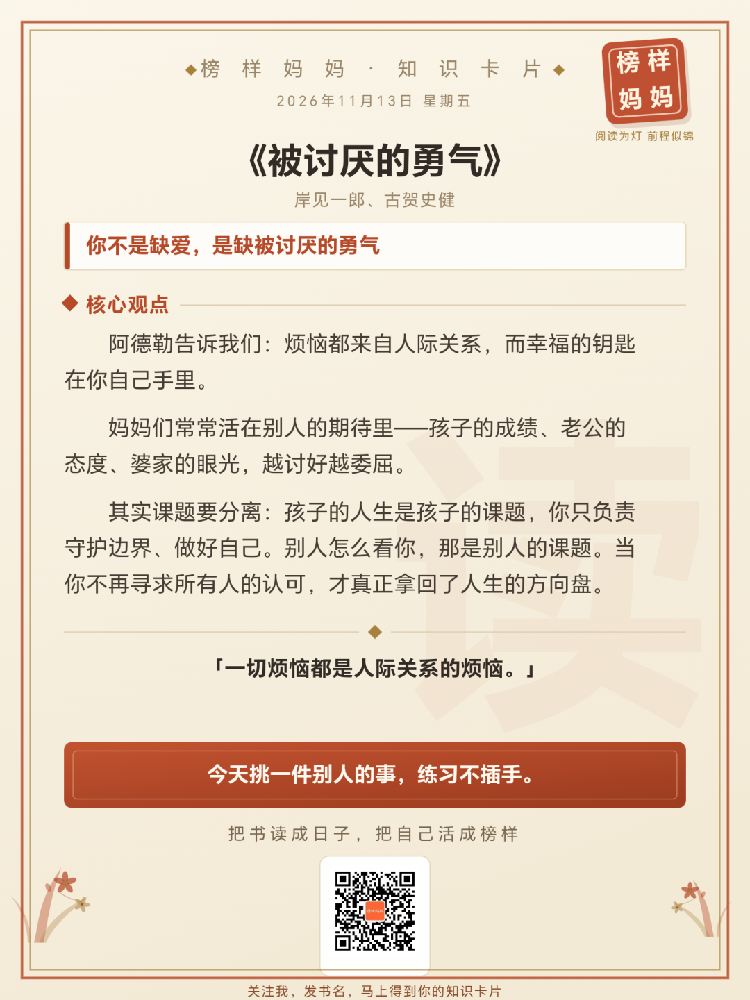
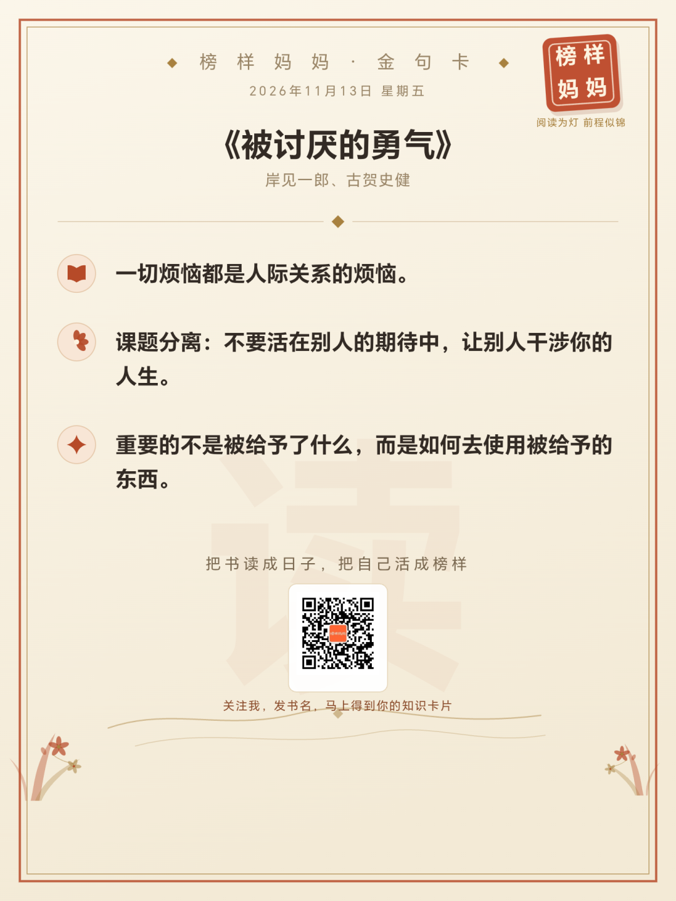
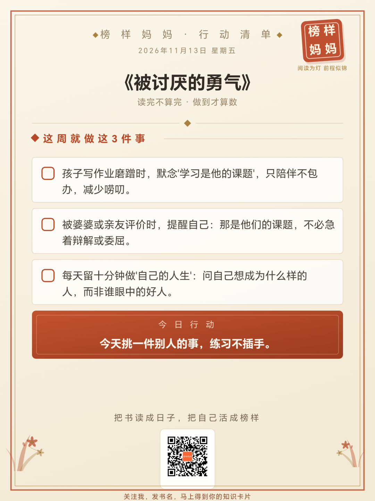

# 读书博主必看，自动生成读书卡片
> 💡 备注属性未写入，可能是备注属性名称或者类型被修改了，建议将字段类型设置为 rich_text，可以在小程序-操作-修改文章数据库页面进行调整
> 💡 原文链接:[https://mp.weixin.qq.com/s?__biz=Mzk0MzYyNDYzNw==&mid=2247485692&idx=1&sn=0fcd61e5f6244fccde6ef6a1da42bb04&chksm=c2ce71a7f592fd05219d2528f9c33d829ac48a53226317cffef643c0548ae951f4338758b57c#rd](https://mp.weixin.qq.com/s?__biz=Mzk0MzYyNDYzNw%3D%3D&mid=2247485692&idx=1&sn=0fcd61e5f6244fccde6ef6a1da42bb04&chksm=c2ce71a7f592fd05219d2528f9c33d829ac48a53226317cffef643c0548ae951f4338758b57c#rd)
榜样妈妈 · 读书卡片使用指南
你有没有过这样的时刻——
一本书读完，合上那一下挺感动的。过一个月，别人问你「这书讲了啥」，你只剩一句：**挺好的，讲人性的。**
我以前也这样。
后来我给自己立了个规矩：每读完一本书，做一张卡片。书名、作者、一句最核心的话、三句最戳我的原话、三个能用进日子里的做法。
做完的卡片，有的贴在冰箱上，有的存在手机相册。隔一阵子翻一翻，**那些书就都回来了。**
这事不难，但麻烦。找图、排版、调字号，一张卡片要花二十来分钟。做了十几张之后，我就开始偷懒了。
偷懒的后果是：我干脆做了个小工具，让它替我干活。
它就住在我的公众号里。今天，正式交给你。
**一、怎么用？三步**
**第一步，找到对话框。**
注意，**不是文章底部的留言区**，是公众号的对话框——就是平时你给我发消息、说话的那个地方。
**第二步，发一个书名。**
《活着》《围城》《被讨厌的勇气》……什么书都行。带上《》更清楚，不带我也认得出。你甚至可以顺手打一句「帮我做张《活着》的卡片」，我也接得住。
**第三步，等十几秒。**
发出去后，我会马上回你一句「收到」。然后大概十五秒，一张卡片就到了对话框里。点开它。
**就这么简单。不用下载任何东西，不用注册，不用填写任何资料。**

▲ 粉丝实测：发一句「活着」，收到的就是这张卡片
**二、这张卡片，其实有三页**
点开之后别急着走，它有三页。
**第一页，知识卡。**有书名和作者、一句核心观点、三句书里的金句。还有我最喜欢的部分——「把书用进日子里」：三个专门写给妈妈的生活场景。读到一个道理，马上知道回家怎么用。

**第二页，金句卡。**书里最经典的三句话，单独放大，配着兰花和印章。适合存在手机里，累了、烦了、想一个人的时候，翻出来看一眼。

▲ 第二页：金句卡
**第三页，行动清单卡。**把书里的道理变成三件这周就能做的小事，每件事前面留了一个打勾的小方框。做完一件，勾一件。
读书这件事，最怕的不是慢，**是读完就散了。**有了清单，就散不了。

▲ 第三页：行动清单卡，做完一件勾一件
三页怎么翻？左右滑动图片，或者直接点一下。想保存哪一页，就长按哪一张，存进相册——是高清大图，发朋友圈、发读书群、打印出来，都清清楚楚。
**三、几个小提示**
1. 一次发一个书名就好。上一张还在生成时又发新书名，我会提醒你等二十秒。
2. 每个小时我最多做六张。做多了它会累，你也会贪多——慢慢来，一本书一张卡，刚刚好。
3. 书太冷门没找到的话，我会告诉你，换个书名再试就是。
4. 万一推送没到，回复**「卡片」**两个字，最新那张就回来了。
5. 卡片内容由 AI 辅助整理，做笔记、做分享够用；真要引用原文，请以你手里的书为准。
**四、为什么做这件事**
说到底，我们这个年纪的妈妈，读书缺的从来不是书单，是**「被看见的收获」**。
书读完了，可它去了哪里？
一张卡片，就是这本书在你日子里留下的证据。
这也是「榜样妈妈」想做的事：把书读成日子，把自己活成榜样。一张一张卡片，就是一步一步脚印。
以后我还想带着一群妈妈，把读书这件事，读成更多的可能。今天的卡片，就是第一步。
**现在就去试：
回到对话框，发一个书名**
《活着》《围城》《被讨厌的勇气》都可以

 关注我，回复书名，即可得到三张知识卡片
拿到卡片后，回来留言告诉我——是哪本书，哪句话戳中了你。
我会认真看每一条留言，下一篇文章里，跟你聊聊那些被做成卡片的书。
💬 你最想先把哪本书做成卡片？
留言告诉我，我挑几本做出来，下一篇一起看。
每条留言我都会回
#读书博主#读书博主用AI#读书
