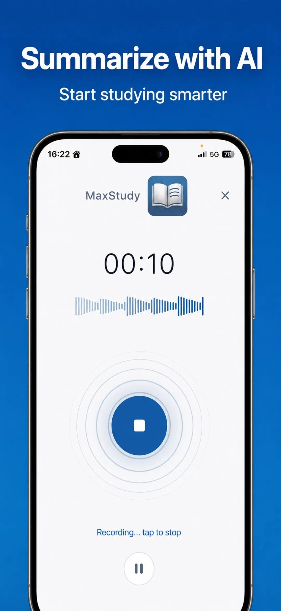
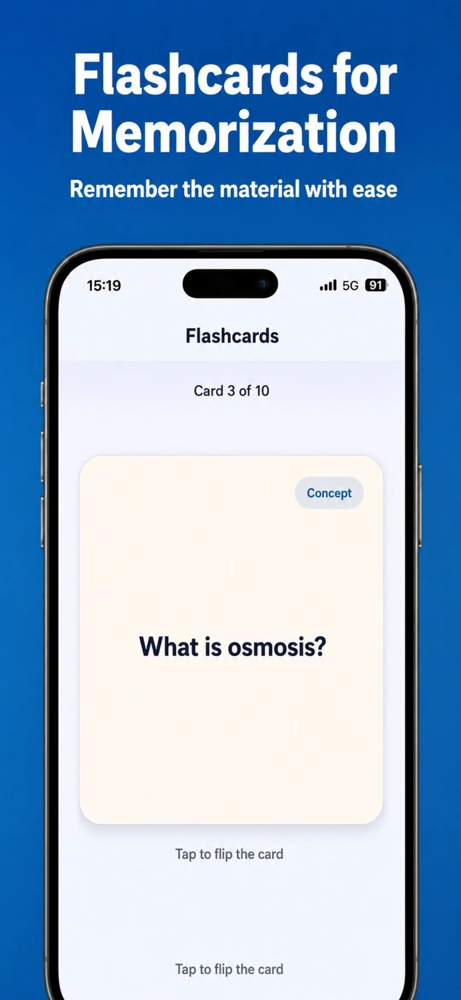
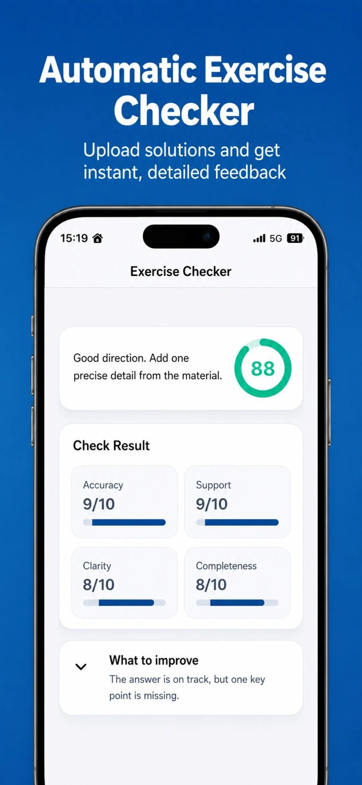

# 课堂录音变摘要和题库，月入8万美元
> 💡 备注属性未写入，可能是备注属性名称或者类型被修改了，建议将字段类型设置为 rich_text，可以在小程序-操作-修改文章数据库页面进行调整
> 💡 原文链接:[https://mp.weixin.qq.com/s?__biz=Mzg4NDYyMzE3OA==&mid=2247484470&idx=1&sn=177c937012a7891609cfafcd23738719&chksm=ce6e56c080cc0ade92a8f24fbff792d71510466650e7b41ce4f30c65c58df548c9ff35c5639c#rd](https://mp.weixin.qq.com/s?__biz=Mzg4NDYyMzE3OA%3D%3D&mid=2247484470&idx=1&sn=177c937012a7891609cfafcd23738719&chksm=ce6e56c080cc0ade92a8f24fbff792d71510466650e7b41ce4f30c65c58df548c9ff35c5639c#rd)
把课堂录音、PDF、讲义照片变成摘要、记忆卡和测验题的 MaxStudy，上架约七个月，我们估算它一个月收入约 8 万美元。这个估算只覆盖一个市场，误差可能很大，所以不要把它当成真实流水。更值得看的是：一套已不新鲜的 AI 学习功能，为什么换到一个具体国家的校园里，能做成一门生意。

### 第一次打开：先让学生把“手上的材料”交出来
这类产品的第一步不是问“你想学什么”，而是问“你现在有什么”。学生可以按录音，也可以上传 PDF、演示文稿、文档，甚至讲义或白板的照片。这个入口覆盖了课堂最常见的三种混乱：没来得及记、资料太长、笔记散在不同地方。
按下录音后，路径很短：录音结束，应用转写；转写完成，组织成摘要；摘要再变成记忆卡和复习题。用户不必先学习一个复杂工作流，也不用自己决定哪些句子该摘。第一次得到一张能翻的记忆卡或几道选择题，才是他觉得“这东西有用”的时刻。
这种首屏安排的聪明之处，在于它不卖模型名词。对学生来说，录音、照片和 PDF 都是已有物；摘要、题目和卡片则是马上能拿去复习的结果。AI 被藏在中间的处理层里，用户看到的是“我那份乱讲义，变成了能背的东西”。

### 核心功能一：把不同输入统一成一条复习流水线
课堂记录通常不是一种格式。有人有老师的讲义，有人只有手机录音，有人拍了投影或白板，还有人从群聊里收到一份 PDF。MaxStudy 的第一个核心功能，是把这些输入先归到同一份学习材料，再往下生成结果。
这并不意味着它必须在每种输入上都做到完美。真正重要的是，用户不用在“录音工具、扫描工具、笔记工具、题库工具”之间来回搬运。把输入合并，减少的是切换成本；对考试临近的学生，这比多一个高级格式按钮更有价值。
从产品边界看，最小版本可以只支持录音和 PDF。照片、幻灯片、更多文件格式，是验证需求之后再补的扩展。很多团队一开始就想把所有材料都吃进去，结果光是解析和失败提示就拖慢了发布。先让两种最高频输入顺畅地得到复习结果，往往更容易学到用户真正需要什么。
### 核心功能二：摘要之后立刻给“下一步动作”
单独的摘要工具常常停在“这里是一页浓缩文字”。MaxStudy 把它接到记忆卡和多选题上，等于把阅读结果变成练习入口。摘要解决的是快速理解，记忆卡解决的是反复回忆，题目解决的是检验自己到底有没有掌握。
这三个结果其实对应三种不同的心理状态。赶时间时，学生先扫摘要；坐车或排队时，翻几张卡；考前再做题看自己哪里不会。它把同一份材料拆成不同粒度，而不是要求用户每次都从头读一遍。功能没有多神秘，排列顺序却很对。
其中最巧的点是自动生成。学生不会为“建一套卡片体系”付费，他们会为“今晚少整理两个小时，明天能先练一遍”付费。产品也因此不需要承诺完全替代学习：它只需让准备复习的第一步足够轻。

### 核心功能三：把免费额度放在用户已经看到价值之后
它可免费下载，免费计划能做两份摘要；超过后，订阅才接管全部功能。这种设计比“打开就锁住所有页面”友好得多。两次机会足够让学生拿一节课或一份讲义，亲自看见摘要、卡片和题目是不是合用；也不至于长期把高成本的生成能力完全免费送出。
以色列区的月订阅有 39.90 谢克尔起的档位。按 2026-11-19 同日约 3.27 谢克尔兑 1 美元换算，约为 12.2 美元；汇率每天变化，人民币或美元的实际支付仍以当地页面为准。还可以查到周订阅、年订阅和不同月档，所以它不是只靠一口价碰运气，而是在给不同使用频率的人留选择。
付费墙出现的位置也很清楚：免费两份摘要用完后，继续上传、生成和使用全部功能就需要订阅。它没有把“录音按钮”单独卖掉，而是把整条学习流水线的无限使用权打包。这很符合学生的心智：不是为一次转写付费，而是为一段备考期少做重复劳动付费。
### 用户从哪来：公开可查的是校园大使，不是空泛增长故事
这个产品最值得学的并非又加了什么模型，而是公开写明的校园大使计划。它目前在以色列部分校园运行：学生用自己的链接带来用户；当对方成为付费用户并经过等待期，大使获得现金。官网还写到计划会向更多国家开放，但没有公开每个大使带来多少人、付多少钱、转化率多高，所以这些数字不该猜。
这套做法很适合学习工具。学生不会因为广告文案里写“AI 很强”就信任一个陌生应用，却会问同学“你这份卡片怎么来的”。校园大使把传播塞进了已有社交关系：课堂群、宿舍、社团和考试周。产品先把成果做成可展示的卡片和题目，再让使用者有动力分享，获客路径就闭环了。
官网也强调自己服务以色列学生。它没有把“全世界学生”作为第一天的目标。对创业者而言，这提醒我们：成熟功能不一定要在全世界赢，先把一种语言、一套课程资料、一个校园网络做得更顺，也可能形成足够强的起点。
### 用户怎么说：有人说救了学位，也有人说长材料没有读完
商店评论里，一位有学习障碍的学生把它形容为“救了自己的学位”。这不是可以外推给所有人的效果，却说明它抓住了一个真实场景：当整理和复习本身已经很吃力时，自动把材料拆成可练的单元，确实可能减轻压力。
另一类好评集中在省时间：不用从零做笔记，不用手工抄卡片，可以用课上留下的录音和资料直接开始复习。这里的“好”不是抽象的智能，而是少面对一次空白文档。对学习工具来说，这种反馈往往比“回答多聪明”更接近留存原因。
差评也同样具体。一位用户说，一本约 180 页的考试笔记只读到了前十几、二十页；长材料解析不完整，后面的摘要和题目再漂亮也没有意义。已有评论资料里，另外的担忧还包括生成内容是否遗漏关键信息、订阅前能否更清楚地知道额度。这些问题共同指向一个底线：学习工具可以帮助整理，但不能让用户不知道它究竟漏了什么。
如果做同类，最该补的不是“再加一个聊天框”，而是处理进度、页码范围、失败重试和来源定位。让学生能看到题目来自哪页、摘要覆盖到哪里，即使模型偶尔出错，信任也不会一下归零。
### 谁做的：个人名义上架，能查到两款应用
商店的开发者信息是个人姓名；其名下可查到两款应用，另一款是木工建模工具。官网把 MaxStudy 的创始人描述为 founder and builder，也提供了直接联系邮箱。它没有公开清楚的团队人数；大使页面又使用了“团队”一词。因此能写的是个人名义上架、创始人参与建设，不能据此断言只有一个人做。
这点反而很有启发。学习应用并非一定由教育公司才可以做：开发者也能从一个具体的学习流程进入。但上线后的难点会迅速从“生成摘要”转成课程资料兼容、用户支持、订阅、内容质量和校园传播。个人切口可以很小，运营问题不会自动变小。
### 想做一个类似的：别从“大而全的学习助手”开始
最小版本我会保留五个功能：
- 上传一份 PDF 或一段课堂录音；
- 显示处理范围和进度；
- 生成带来源段落的摘要；
- 把摘要做成可翻的记忆卡；
- 生成十道可重做的选择题。
用 AI 辅助写代码，熟悉产品和移动端的人几周能做出可试用版本：语音转文字、摘要、卡片和出题都有现成接口。这是对原型的判断，不代表能立刻达到稳定的商业版本。真正花时间的是长文件解析、内容引用、费用控制、学科术语、不同语言的质量，以及让学生愿意把资料交给你。
可换的切口也很明确。可以先做某个非英语市场的本地教材和考试语言；可以只做职业资格考试、医学课程或法学院资料；也可以反过来做老师端，让教师上传一份讲义后自动发给班级练习。增长上，别急着买大范围广告，先找十位能在一个院系里实际使用的学生，给他们清晰的邀请奖励和反馈通道。
功能并不稀缺，可信的材料处理和具体的人群入口才稀缺。先让一节课的资料变得能学，再谈“学习助手”这个大词。
如果你正在做学习工具，最头疼的往往不是能不能接上 AI，而是同类产品怎么收费、学生真正会抱怨什么。可以到 pivlu.com/ask 让 AI 查我们每天跟踪的苹果商店新上架小团队 App 数据：收入和下载是估算，另有价格、内购和用户评论可供对照。比如直接问：“和我同类的学习 App 都怎么定价？用户差评集中在哪？” 或“课堂录音转摘要类 App 的内购项目和价格是怎么设计的？” 登录后每天有 3 次普通提问，适合先把方向和坑查清楚。
pivlu.com/ask
关注我，每天拆一个普通人能照着做的赚钱 App。
收入是我们估算的
关注我，每天看别人靠一个小 App 赚了多少。
收入是我们估算的
