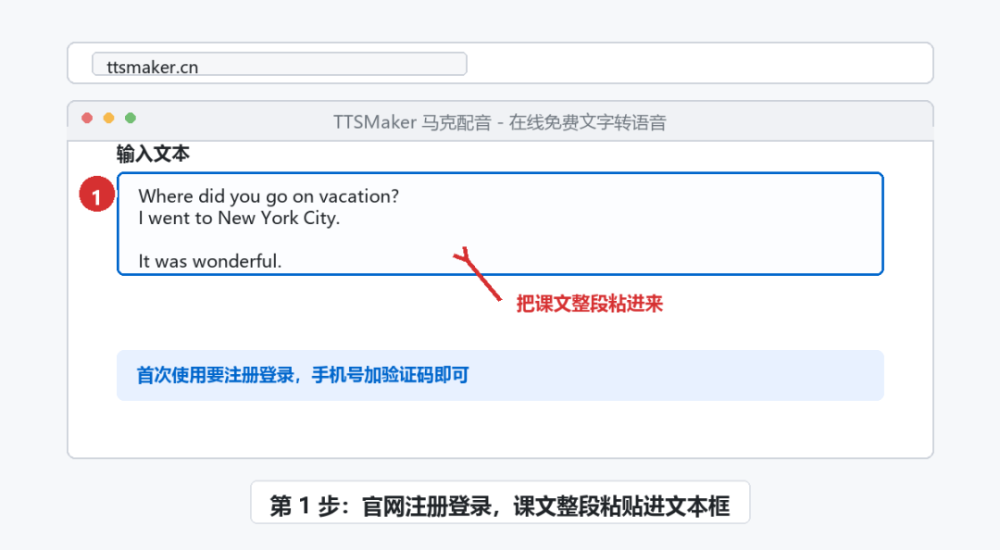
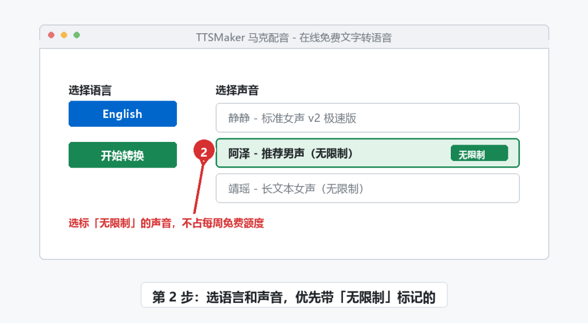
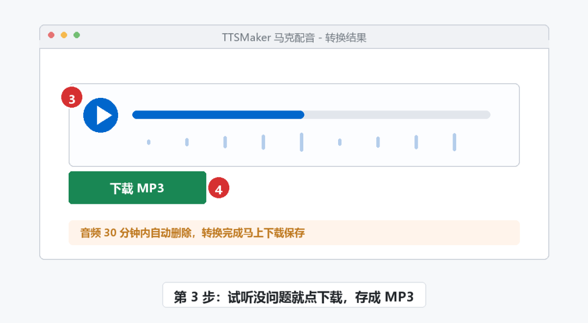

# 课文音频不用自己录，粘贴文字就出 MP3（免费）
> 💡 备注属性未写入，可能是备注属性名称或者类型被修改了，建议将字段类型设置为 rich_text，可以在小程序-操作-修改文章数据库页面进行调整
> 原文链接:[https://mp.weixin.qq.com/s/Ea2Bn61EtVHBcF1eJcnioA](https://mp.weixin.qq.com/s/Ea2Bn61EtVHBcF1eJcnioA)
### 课文音频不用自己录，粘贴文字就出 MP3（免费）
英语老师常缺课文音频：配套资源对不上教材版本，自己录又费劲。TTSMaker（马克配音，ttsmaker.cn）是个免费的文字转语音网站，课文粘进去，选个声音，等一会儿就出 MP3，发群就能用。浏览器打开就能用，不用装 App，完全免费，官方说生成的音频可商用。
只适合朗读材料：英语课文、语文古诗、晨读范文都行。机器音念英文比中文自然，个别多音字会读错；课文太长就分两段转，每个语音包单次转换有字数上限；生成的音频 30 分钟内自动删除，转完记得下载。
**1**浏览器打开 ttsmaker.cn，手机号注册登录，把课文整段粘进文本框。

**2**选文本语言，再挑一个标着「无限制」的语音包，不占每周免费额度。语音都能先试听，挑个念课文不别扭的。

**3**点「开始转换」，转完先试听，语速不合适就在高级设置里调，满意后点下载，存成 MP3。

文本模板，照这个准备：
●英语课文：整段粘贴，段与段之间空一行，停顿更清楚。
觉得快了：高级设置里把语速调到 0.9，低年级正好。
◆关键是挑「无限制」的语音包：免费额度每周 30000 字，一学期的课文都用不完。
生成后通听一遍，多音字读错就把那个字换成同音字，再转一次就对了。
▼ 关注「科技小砖头」，每天一个小技巧
科技小砖头
