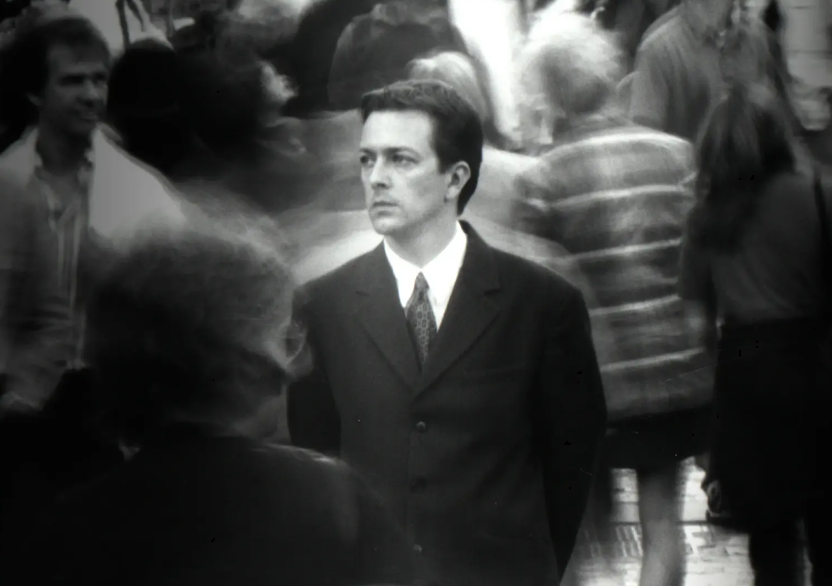
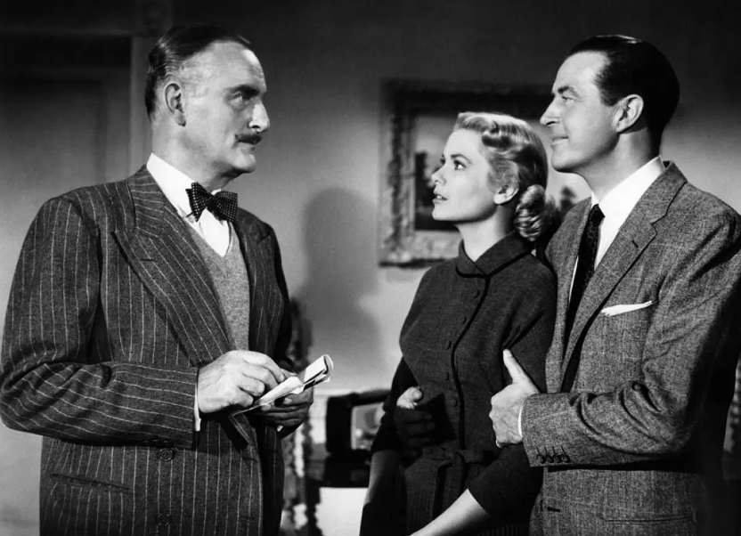
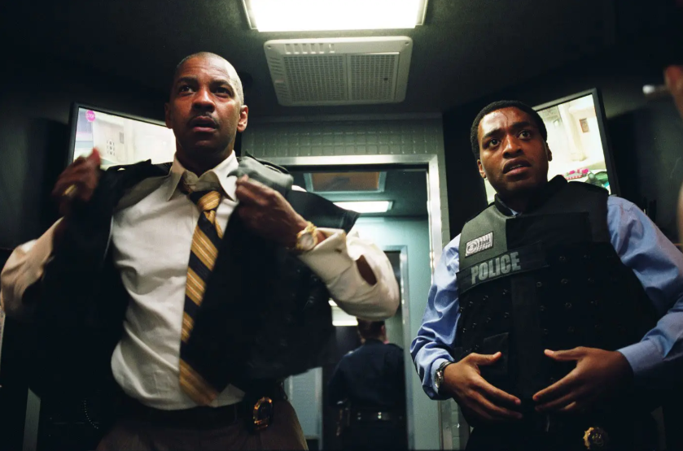
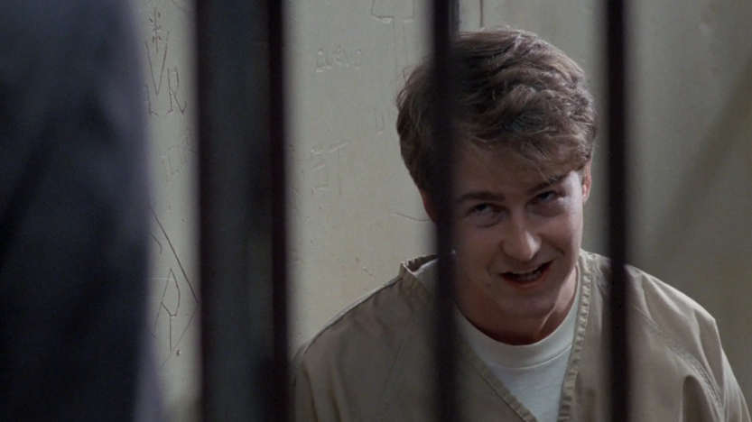
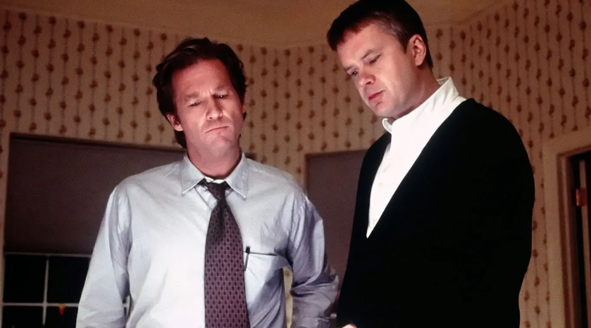
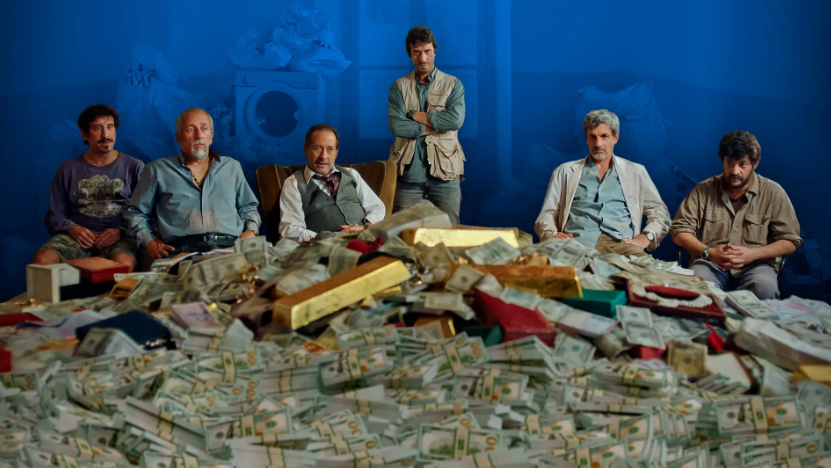
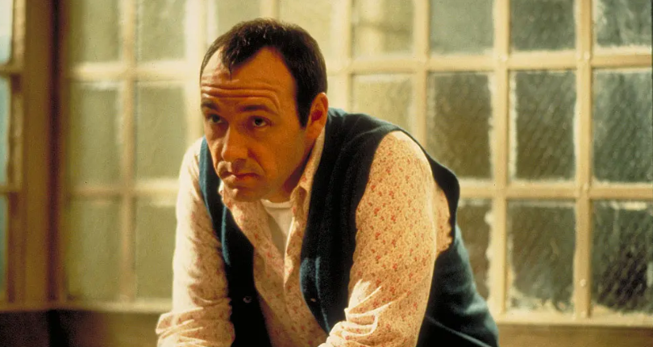

# 谁说没有完美犯罪？推荐10部完美犯罪神作，一部比一部过瘾！
> 💡 备注属性未写入，可能是备注属性名称或者类型被修改了，建议将字段类型设置为 rich_text，可以在小程序-操作-修改文章数据库页面进行调整
> 💡 原文链接:[https://mp.weixin.qq.com/s?__biz=MzkxODY0MjU4Nw==&mid=2247514139&idx=1&sn=e4b7deef55470eabc4522d8bc7e24c9e&chksm=c0a069eea51f02774e5271af44c896bfa2466cd839ed266dc9d8ea28de5bc1b6fbdf63dd0d45#rd](https://mp.weixin.qq.com/s?__biz=MzkxODY0MjU4Nw%3D%3D&mid=2247514139&idx=1&sn=e4b7deef55470eabc4522d8bc7e24c9e&chksm=c0a069eea51f02774e5271af44c896bfa2466cd839ed266dc9d8ea28de5bc1b6fbdf63dd0d45#rd)
只要是犯罪，就会留下破绽。
但在电影中，完美犯罪，恰恰是把这道破绽也算进了计划里。
**下面推荐10部完美犯罪电影**，你跟着主角查到最后才发现，被耍得最惨的那个，可能就是你。
## 1、《破绽》（2007年）
豆瓣评分：7.3
评价人数：5.6万

安东尼·霍普金斯与瑞恩·高斯林主演。
建筑工程师特德，发现妻子出轨后，冷静地开枪射伤她，然后精心布置现场，等待警察到来。
所有证据都指向他，但他利用一个程序上的微小瑕疵，在法庭上推翻了谋杀未遂的罪名。
年轻气盛的检察官威利，以为稳操胜券，却一步步踏入对方的陷阱。
## 2、《追随》（1998年）
豆瓣评分：8.9
评价人数：21万

**克里斯托弗·诺兰的长片处女作。**
成本仅**3500英镑**左右，诺兰在大学期间拍摄完成。
**一个无所事事的年轻作家比尔，为了寻找写作灵感，开始随机跟踪路人。**
**他很快盯上了一个西装革履的男人，却被对方发现。**
**男人自称科布，是个入室窃贼，他带着比尔一起闯空门。**
**但比尔不知道，自己早就成为嫁祸计划里的一枚棋子。**
## 3、《电话谋杀案》（1954年）
豆瓣评分：8.9
评价人数：16.5万

**希区柯克执导**，大部分情节在一个公寓内完成。
前网球选手托尼，发现妻子出轨，他不动声色地策划了一场谋杀。
计划精确到钥匙的位置、电话的时机、不在场证明的每一个环节。
然而执行当晚，妻子在挣扎中反杀了刺客。
托尼赶到现场，没有慌乱，而是立刻开始第二套方案。
## 4、《我是谁：没有绝对安全的系统》（2014年）
豆瓣评分：8.2
评价人数：27.7万

一部德国犯罪片。
本杰明是个顶级黑客，但在现实生活中是个小透明。
他和几个同伴，组成黑客小队，挑衅警方和情报机构，把追捕者耍得团团转。
但当他们被卷入一场行动时，本杰明在审讯室里，向警方讲述的一切，开始变得真假难辨。
他到底是谁，他说的哪些是真的，哪些是他编出来的，直到最后一刻才有答案。
## 5、《局内人》（2006年）
豆瓣评分：7.7
评价人数：8.8万

斯派克·李执导，丹泽尔·华盛顿、克里夫·欧文、朱迪·福斯特主演。
四名劫匪闯入一家银行，控制人质后不急着拿钱跑路，反而慢条斯理地和警方谈判对峙。
谈判专家弗雷泽，试图稳住局面，但劫匪道尔顿的每一步，都像是在拖延时间。
随着对峙拉长，弗雷泽开始意识到，这场劫案根本不为求财。
劫匪真正要的东西，藏在银行深处。
## 6、《一级恐惧》（1996年）
豆瓣评分：8.5
评价人数：27.3万

**爱德华·诺顿的银幕处女作**，**凭此片获得金球奖最佳男配角，并提名奥斯卡最佳男配角。**
芝加哥主教，在家中被残忍杀害，警方在现场逮捕了辅祭少年艾伦。
辩护律师马丁接手此案，发现艾伦患有精神疾病。
马丁以“多重人格”为策略，成功帮艾伦脱罪。
所有人都以为案件已经了结，直到马丁在监室里，最后一次面对艾伦。
## 7、《无懈可击》（1999年）
**豆瓣评分：7.6**
**评价人数：2.2万**

一部“反派”赢得很彻底的电影。
大学历史教授麦可，带着儿子过着平静的生活，直到一对夫妻成为了他们的邻居。
两家人很快熟络起来，但麦可逐渐从奥力佛，不经意的谎言和矛盾中，嗅到了不对劲。
他开始怀疑这个邻居，与恐怖组织有关，并独自展开调查。
结尾的冲击力极强，坏人不一定笑到最后，但这里，坏人确实赢了，而好人成了替罪羊。
## 8、《极盗行动》（2020年）
豆瓣评分：7.0
评价人数：2.6万

阿根廷电影，**改编自2006年真实的世纪银行劫案。**
一群身份各异的劫匪，策划了一场看起来近乎荒唐的银行抢劫。
他们不靠暴力，靠的是精心设计的伪装，以及对警方行动模式的预判。
整个过程，从容到像一场行为艺术，而真实的现实比剧本更离奇。
## 9、《非常嫌疑犯》（1995年）
豆瓣评分：8.6
评价人数：30万

**该片获得奥斯卡最佳原创剧本，**凯文·史派西获得**最佳男配角**。
**一场轮船爆炸案后，唯一生还的是一个跛子金特。**
**他向海关探员，讲述了一个叫“凯撒·苏尔”的幕后黑手，如何召集他们五个人犯案的全过程。**
**直到金特离开审讯室，探员抬头看向那块贴满线索的公告板，突然意识到了什么。**
## 10、《误杀瞒天记》（2015年）
豆瓣评分：8.7
评价人数：30万

印度犯罪片，虽然本身也是翻拍，但知名度更高。

女儿在反抗中，失手杀死了上门骚扰的督察之子。
父亲维杰，只是一个爱看电影的普通人，但他决定用从电影里学来的东西保护家人。
他带着全家反复“排练”案发当天的行程，当警方介入，所有证人的证词都完美地吻合。
而维杰要做的，就是让这个完美的不在场证明，看起来毫无破绽。
全文完。
