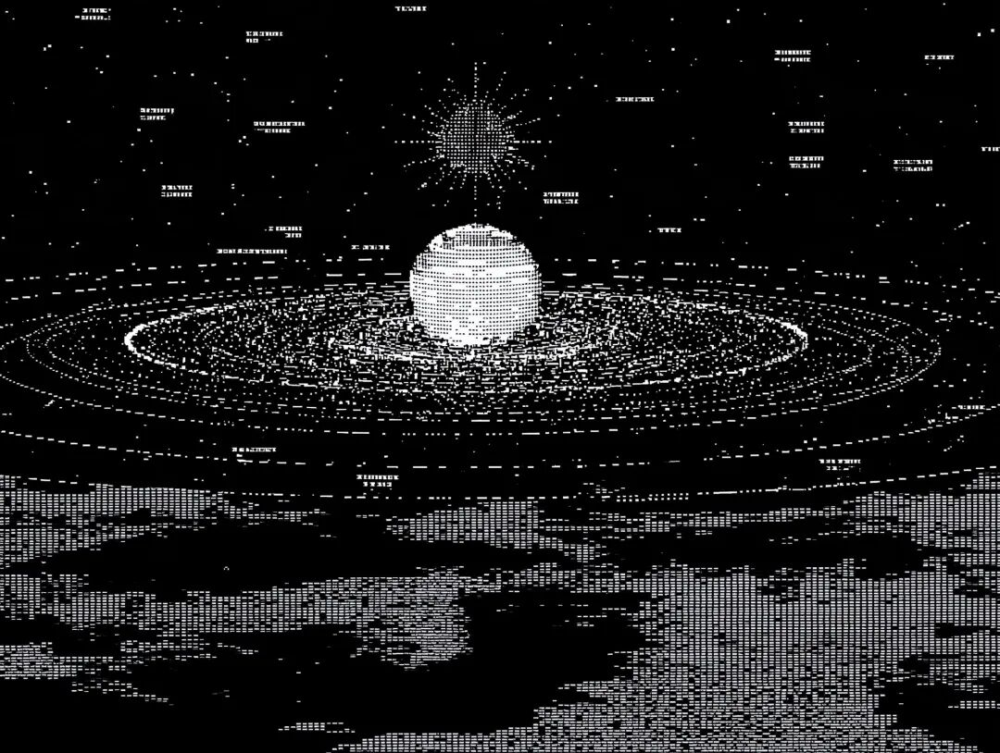
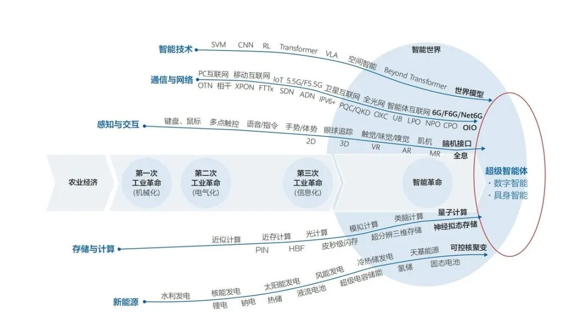
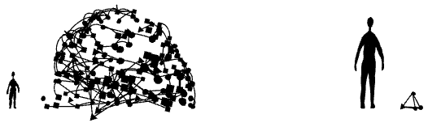

# 赚钱为什么越来越难？这是我看过最深刻的一篇
> 💡 备注属性未写入，可能是备注属性名称或者类型被修改了，建议将字段类型设置为 rich_text，可以在小程序-操作-修改文章数据库页面进行调整
> 💡 原文链接:[https://mp.weixin.qq.com/s?__biz=MzU4NDQwMTc3MQ==&mid=2247493697&idx=1&sn=f83acaf5c74d804194c8baf929884533&chksm=fc79d1d7a8a1295a53cf24a944936173aad14ca4e23a92d5248786cf4ab4b4628cf686aeb708#rd](https://mp.weixin.qq.com/s?__biz=MzU4NDQwMTc3MQ%3D%3D&mid=2247493697&idx=1&sn=f83acaf5c74d804194c8baf929884533&chksm=fc79d1d7a8a1295a53cf24a944936173aad14ca4e23a92d5248786cf4ab4b4628cf686aeb708#rd)

#### 
**去创造，去劳动，去发现自我——我们对工人这样说。期刊上的文字，请你们重新思考，用你们自己的眼睛去看……唯有亲自争取到的东西才有价值，这对于社会斗争和思想生活尤为真实。**
——《新秩序编年》第1卷第10期（1919年7月19日）
几乎所有人都感觉到，钱越来越难赚了。
过去二十年，你不需要很优秀，只需要胆子大，敢折腾，站在风口上就能飞起来。房地产、互联网、外贸，三大造富机器轮番启动。现在机器都慢下来了，进入了存量博弈时代。
[你赚的每一分钱，都可能是别人亏的钱。这意味着对个人能力、信息渠道、资源整合的要求呈指数级上升，绝大多数人的体感就是，钱越来越难赚了。](https://mp.weixin.qq.com/s?__biz=MzU4NDQwMTc3MQ%3D%3D&mid=2247493681&idx=1&sn=702589af97c41800b6eb26bae7598482&scene=21#wechat_redirect)
这种感受并非无病呻吟，它已被无数个体的真实经历所印证：它是豆瓣“上班这件事”小组里，35岁大厂员工被裁后，面对房贷车贷的深夜叹息；它是小红书上，那位月薪八千的“沪漂”，靠着极致的精打细算，才为自己挣得一丝安全感 ；它也是微博上，某位中小企业主在后疫情时代订单断崖式下跌后的无奈倒闭。
这种焦虑如此普遍，以至于“消费降级”、“副业刚需”、“向下兼容”，甚至是“上班和上进之间选择上香”， 都从段子变成了无数人的生活现实。
面对这个时代课题，许多深刻的分析将矛头指向了宏观结构：我们正从“增量市场”变为“存量市场”，过去依赖上述三大造富机器的模式已经落幕，产业升级的阵痛带来了结构性失业。许多人发现，不是自己不努力，而是自己努力的那个领域，“地板正在消失” 。
**这些洞察无疑是精准的，但是，这些解释和认知，描述的只是风暴的轨迹，而非驱动风暴的气象学原理。**
我们在感受和经历的，并非仅仅是一场经济周期性的风暴，而是一次深刻的地壳板块漂移，一场历史性的、结构性的范式革命。我们正站在一个巨大的断层线上，旧世界和新世界在此分野。
[我们之所以觉得钱难赚，是因为我们中的大多数人，仍然带着旧世界的地图，试图在新世界的土地上寻找财宝。](https://mp.weixin.qq.com/s?__biz=MzU4NDQwMTc3MQ%3D%3D&mid=2247491052&idx=1&sn=6de661831ba0ad8f9638954250bb7185&scene=21#wechat_redirect)[**我们仍在用“排列原子”的思维，去玩一场规则已经彻底改变的“排列比特”的游戏。**](https://mp.weixin.qq.com/s?__biz=MzU4NDQwMTc3MQ%3D%3D&mid=2247491052&idx=1&sn=6de661831ba0ad8f9638954250bb7185&scene=21#wechat_redirect)
**一、**
**旧世界的回响：排列原子的史诗**
**要理解我们身在何处，必须回溯我们来自何方。一千年钱，财富的逻辑简单而残酷。**
以加兹尼的马哈茂德为例，他的家乡位于现在的阿富汗境内的⼭地，这位11世纪的征服者，是个公⽜般健壮的男⼈。有次⼀位来访者言语轻率，惹得他⾮常⽣气，他⼀巴掌打过去，竟让那个下半⽣都失去了听⼒。
通过大规模的劫掠，马哈茂德积累了世界级的财富。他的王宫金碧辉煌，王冠需要用链子吊在头顶，因为镶满的珠宝过于沉重。
**在马哈茂德的时代，战争和财富、战神和财神总是相伴而生。财富的本质，是对稀有原子（黄金、宝石、土地）的物理占有。**
**获取财富的方式，是暴力的排列——将别人疆域内的原子，通过武力移动到自己的宝库中。这是“排列原子”经济最原始、最赤裸的形态。**
工业革命的到来，让这种排列变得文明而高效。蒸汽机、铁路和工厂的轰鸣，宣告了一个新时代的来临。财富不再仅仅源于对土地的占有，更源于对大规模生产资料的控制。
这个时代的价值核心，是建立庞大的物理系统，通过标准化的流程，将铁矿石、煤炭、棉花这些基础原子，高效地**排列**成火车、高楼和布匹。亨利·福特的流水线，是“排列原子”的艺术顶峰。
**工业时代的成功法则：**
**控制有形资产：** 拥有矿山、工厂、铁路，你就控制了价值的源头。
**优化线性流程：** 提高效率，降低成本，在物理世界里用更少的消耗排列更多的原子。
[**建立科层制：用金字塔式的管理结构，确保庞大物理系统的精准运行。这是一种“大教堂”式的、自上而下的创造模式 。**](https://mp.weixin.qq.com/s?__biz=MzU4NDQwMTc3MQ%3D%3D&mid=2247492687&idx=1&sn=7abe732fb12b49c5731e4d39eefab175&scene=21#wechat_redirect)
**通过稀缺和排他获利：** 无论是专利保护，还是规模壁垒，核心都是通过制造稀缺来锁定价值。
[这套玩法深刻地塑造了我们过去两个世纪的社会结构和成功观念。“努力工作”、“升职加薪”、“买房买车”，这些我们奉为圭臬的人生信条，本质上都是“排列原子”经济的游戏指南。](https://mp.weixin.qq.com/s?__biz=MzU4NDQwMTc3MQ%3D%3D&mid=2247493547&idx=1&sn=45fb3dcd6dd002399f134dc7b0d371e5&scene=21#wechat_redirect)
它奖励那些能够高效参与物理生产和管理的人，并以有形的物质财富作为回报。我们都是这个时代的产物，我们的思维深处，都刻着排列原子的肌肉记忆。
**二、**
**新世界的法则：排列比特的魔术**
然而，就在“原子经济”臻于完美的时刻，一种全新的价值形态正在悄然兴起。它的载体不是原子，而是比特——信息的基本单位。
金融，便是最早的“排列比特的职业”。它不生产任何有形的物品，却通过排列关于风险、时间和价值的抽象符号，调动着全球的物质资源 。这是新世界的第一次预演。
20世纪下半页以来，随着个人电脑和互联网的普及，这场预演变成了席卷全球的现实。我们正式进入了“排列比特”的时代，一个由“网络化信息经济”驱动的时代 。
**这个新世界遵循着与旧世界截然不同的物理法则：**
**第一性原理：信息是非竞争性商品**。这是理解新旧世界差异的钥匙。一个苹果（原子）被我吃了，你就没了；但一个软件（比特），一首歌，一个想法，可以被无限复制，其边际成本几乎为零。
在原子世界里，价值源于稀缺；而在比特世界里，价值源于分享与连接。信息的这一特性，彻底颠覆了工业时代建立在稀缺性之上的商业逻辑。
**生产资料的民主化**。在工业时代，想发声需要拥有印刷厂或电视台。而在网络时代，像电脑和网络这样的生产资料，被广泛地分配到了数十亿人手中。这使得一种全新的生产模式成为可能：**点对点生产**。
以Linux操作系统和维基百科为例。它们并非由某个公司等级森严地组织生产，而是由全球数万名志愿者，在没有市场交易和科层命令的情况下，通过社会化协作共同创造出来的。这种“集市”式的、自下而上的创造模式，其效率和质量甚至超越了最强大的商业巨头 。
[**然而，这背后带来的是知识资产的悖论：知识越是有用（即越容易被编码、传播和“排列”），就越难被某个主体所独占和控制 。**](https://mp.weixin.qq.com/s?__biz=MzU4NDQwMTc3MQ%3D%3D&mid=2247492489&idx=1&sn=c09aeb3516e890c7ee2c351df28ebc07&scene=21#wechat_redirect)
在新世界里，试图把知识像原子一样锁进保险箱，不仅困难，而且愚蠢。因为知识的价值，恰恰在于其流动、碰撞和重组之中。

图源网络
**三、**
**范式的冲突：昨天的成功，今天的失灵**
我们之所以觉得赚钱越来越难，正是因为这两种范式发生了剧烈的冲突。我们带着排列原子的旧地图，在比特大陆上迷失了方向。
**1. 稀缺思维 vs. 丰饶现实**
原子思维的核心是制造和维持稀缺性。因此，在比特世界里，我们看到了疯狂的“第二次圈地运动”：版权期限被无限延长，软件专利被滥用，一切可编码的东西都被试图私有化。这种做法，如同试图把空气打包出售，它与比特世界“复制成本为零”的天性背道而驰。
当数十亿人通过P2P网络分享音乐时，他们并非道德沦丧的“海盗”，而是在无意识地遵循比特世界的新物理法则——分享让价值最大化 。
旧世界的守门人挥舞着法律大棒，试图维护一个基于物理稀缺的商业模式，但这注定是一场与技术和人性潮流的艰苦对抗。
**2. 科层制 vs. 网络化（网络监狱的形成）**
原子思维推崇稳定的、金字塔式的科层制。成功的路径是“向上爬”。但在比特世界，价值的创造与分配，越来越多地由你在网络中的拓扑位置决定 。
[在我之前推荐的《The Last Economy》中，提到的“网络监狱”的概念一针见血。](https://mp.weixin.qq.com/s?__biz=MzU4NDQwMTc3MQ%3D%3D&mid=2247491292&idx=1&sn=273a57b81efec819d9eb6e48a51d3856&scene=21#wechat_redirect)[**真实世界的网络并非民主的网格，而是遵循“幂律分布”。**](https://mp.weixin.qq.com/s?__biz=MzU4NDQwMTc3MQ%3D%3D&mid=2247491292&idx=1&sn=273a57b81efec819d9eb6e48a51d3856&scene=21#wechat_redirect)
**少数节点拥有巨量的连接，而绝大多数节点连接稀疏。成功不再是正态分布的钟形曲线，而是一道陡峭的滑雪坡。**
Facebook的诞生就是最好的例证。2003年，比扎克伯格编程能力更强的人成千上万，但他身处哈佛——一个未来世界权力精英高度密集的网络节点。当他需要资金时，彼得·蒂尔近在咫尺；当他需要扩张时，硅谷的生态系统触手可及 。
与此同时，一位在孟买的、技术上可能更优秀的程序员，他的网络连接只能通向本地的企业 。印度码农的代码更好，但他的网络位置更差。结果天差地别。
**这解释了为什么许多人感觉“努力贬值”了。**因为在一个网络化的世界里，单纯的线性努力，如果不伴随着网络位置的优化，其回报是极其有限的。旧的“努力就能成功”的叙事，正在被“连接比努力更重要”的残酷拓扑学所取代。
**3. 线性增长 vs. 指数级增长**
法国经济学家托马斯·皮凯蒂（Thomas Piketty）观察到一个核心不等式：r > g，即资本回报率（r）长期高于经济增长率（g） 。这个观察在比特世界得到了极端的放大。
**“排列原子”的经济活动（如传统制造业、服务业）本质上是线性增长的（对应 g）。**你的产出与你的投入（时间、劳力、物理资源）大致成正比。
**“排列比特”的经济活动（如软件、平台、AI）则具有指数级增长的潜力**（对应 r）。一个软件写一次，可以服务十亿用户；一个平台搭建起来，可以通过网络效应实现自我增强 。
当一个社会的主要财富增长引擎从线性转向指数，而绝大多数人的收入模式依然是线性的，财富差距的鸿沟就会以惊人的速度扩大。
[**这就是我们正在经历的现实：0.001% 的人拥有的财富是全世界底层50% 人口的三倍。少数占据了指数级增长赛道的人，与多数仍在线性赛道上奔跑的人，他们的世界正在迅速分离。对后者来说，钱当然越来越难赚了。**](https://mp.weixin.qq.com/s?__biz=MzU4NDQwMTc3MQ%3D%3D&mid=2247491871&idx=1&sn=3fdc34cd76e99e5e9d309440e71029cc&scene=21#wechat_redirect)
**4. 榨取价值 vs. 创造价值**
在“排列原子”的逻辑里，企业是“大教堂”，通过严密的计划和控制来**榨取**价值。而在“排列比特”的世界里，真正蓬勃发展的生态是“集市”，通过开放和连接来**创造**价值。
IBM对Linux的拥抱是一个经典案例。IBM没有试图自己建造一个封闭的操作系统大教堂，而是选择为一个开放的集市贡献资源和服务。它通过出售“Linux相关服务”每年获得数十亿美元的收入 。它没有去“占有”比特，而是通过促进比特的“流动”来盈利。
**这种思维的转变是根本性的。**
[旧的思维模式问：“我如何建立壁垒，保护我的资产，从用户身上赚钱？”新的思维模式问：“我如何构建一个平台，赋能我的用户，让他们创造出我无法想象的价值，并在这个生态中共同获益？”](https://mp.weixin.qq.com/s?__biz=MzU4NDQwMTc3MQ%3D%3D&mid=2247491231&idx=1&sn=6297b47063262de57a34d04f8fe57107&scene=21#wechat_redirect)
**那些仍在前者轨道上思考的企业和个人，会发现他们的护城河正在被新物种的网络效应所淹没。**
**四、**
**最后的终极冲击：当AI开始排列比特**
[如果说从原子到比特的转变是一场地震，那么人工智能（AI）的到来则是一场海啸。因为它正在自动化“排列比特”本身这一行为。正如马斯克预言，2027 年底，AI将可以完成几乎所有的数字人物，智力工作者面临没顶之灾。](https://mp.weixin.qq.com/s?__biz=MzU4NDQwMTc3MQ%3D%3D&mid=2247493434&idx=1&sn=096ece203a0121c4bafd3f6839870390&scene=21#wechat_redirect)
过去，我们从体力劳动者转型为知识工作者（“比特排列者”）。但现在，AI正在以比人类高出几个数量级的效率和低几个数量级的成本，来完成这些认知任务 。
一份需要初级顾问数小时才能完成的20页PPT，AI在几分钟内就能生成 。世界经济论坛的研究报告显示，典型的“比特排列”行业，恰恰是受AI冲击最大的领域，例如金融和科技行业。
在《最后的经济学》中，作者提出一个有点细思恐极的概念——**劳动的“代谢裂谷” (Metabolic Rift)** 。人类劳动者是“新陈代谢引擎”，需要食物、住所、休息和复杂的社会支持。
**而AI是“非新陈代谢劳动”，只需要电力。当一种不需要吃饭睡觉的“劳动者”出现时，人类在纯粹的经济成本竞争中，已经没有退路 。**
[因此，我们正面临着最终的“智能倒转”和“终极大脱钩”：从土地到劳动，从资本到智能，价值的核心载体完成了最后一次跃迁 。这场变革的彻底性，远超我们的想象。](https://mp.weixin.qq.com/s?__biz=MzU4NDQwMTc3MQ%3D%3D&mid=2247493009&idx=1&sn=a45fb6b14d3e587c014b7220b825d543&scene=21#wechat_redirect)
**五、**
**我们的出路：成为新世界的“意义工程师”**
正所谓，历史的车轮从你身上碾过，连声招呼都不打。
[不过，旧的游戏规则确实已经失效，但这不意味着游戏结束了，而是意味着我们需要学习一套全新的玩法。](https://mp.weixin.qq.com/s?__biz=MzU4NDQwMTc3MQ%3D%3D&mid=2247491551&idx=1&sn=d6b92253f3c77676c1a5ed42ccd07ec3&scene=21#wechat_redirect)我们无法阻止范式的转移，但我们可以选择成为新世界的“几何工程师” ，主动塑造我们未来的经济地形。
**1. 告别疯狂的单一指标：构建新的价值坐标系**
首先，我们必须抛弃过时的“仪表盘”，例如GDP、例如房价、例如存款数字。GDP无法衡量比特经济创造的真正价值（比如维基百科对人类知识的贡献），反而将许多社会负外部性（如环境污染、家庭破裂）计为增长。
**我们需要一个全新的坐标系，一个能够衡量系统健康度的MIND仪表盘 。**
**物质资本 (Material):** 关注可持续的物理基础，包括我们的健康和环境。
**智能资本 (Intelligence):** 终身学习，不断更新自己的知识和技能库。
**网络资本 (Network):** 建立和维护信任、关系和连接。你的网络位置是你最宝贵的无形资产。
**多样性资本 (Diversity):** 拒绝将自己锁定在单一赛道上，培养多种技能和身份，构建一个反脆弱的生存结构。
[需要牢记的是，这四种资本是乘法关系。任何一项为零，你在这个时代的生存能力都会趋近于零。](https://mp.weixin.qq.com/s?__biz=MzU4NDQwMTc3MQ%3D%3D&mid=2247493336&idx=1&sn=167369abf01c22d789fe3c3568974912&scene=21#wechat_redirect)
**2. 个体策略的转变：从“工人”到“节点”**
**从榨取者到生成者：** 改变你的提问方式。不要总问“我能从中得到什么？”，而是问“我能为哪个网络创造什么价值？”。在一个连接驱动的世界里，为网络创造价值是提升自身价值的最佳路径。
**从原子囤积者到比特流动者：** 不要再把知识和技能当作需要秘藏的宝藏。分享它们，参与开源项目，在公共领域发表你的见解。在比特的世界里，你的影响力（网络资本）远比你“拥有”的知识产权（被高估的智能资本）更重要。
[**从雇员到主权个体：无论你是否拥有一份全职工作，都要开始像一个独立的网络节点一样思考。建立你自己的“平台”，哪怕它只是一个专业的博客、一个活跃的社群账号。主动去连接其他节点，创造属于你自己的“弱连接”网络。**](https://mp.weixin.qq.com/s?__biz=MzU4NDQwMTc3MQ%3D%3D&mid=2247493038&idx=1&sn=88f7e15ca884c9eeabb4d6291cd7bef4&scene=21#wechat_redirect)
**解放思想，拥抱变革：** 最后，也是最重要的一点，是认识到我们所处时代的深刻变革性。正如葛兰西在一个世纪前所警示的，最大的陷阱是“相信民主国家制度的永恒存在，相信其根本上的完美”。
我们必须摆脱这种思维定式，认识到所有经济制度都是历史的产物，而非自然规律。我们正生活在一个规则被重新书写的时代，最大的障碍不是外部环境，而是自己脑海中那张陈旧的游戏指南。
**结语**
**钱之所以越来越难赚，当然不是我们不够努力，而是努力的物理定律已经改变。**
[旧世界正在不可逆转地逝去，新世界正在混沌中诞生。我们这一代人，正站在连接两个世界的桥梁之上，既被过去的惯性拉扯，又被未来的可能性吸引。这是一个充满焦虑的时代，也是一个充满机遇的时代。](https://mp.weixin.qq.com/s?__biz=MzU4NDQwMTc3MQ%3D%3D&mid=2247492221&idx=1&sn=24614424aa2f96eb2218122107920d46&scene=21#wechat_redirect)
与其哀悼那个正在逝去的、基于原子的、可预测的世界，不如选择成为新世界的“第一批玩家”，学习排列比特的语言，构建新的网络，创造新的价值。
**旧的经济学，是关于如何在一个稀缺的世界里分配资源。新的生存法则，是关于如何在一个丰饶甚至过剩的世界里创造意义。**
排列原子、疯狂内卷、制造稀缺假象的时代结束了，一个属于所有人的、通过排列比特来共同创造和分享价值的时代，才刚刚开始。
**去创造，去劳动，去发现自我，去发挥影响。【懂】**
---
**经叔最近做了一个网站，可在本号首页右下角订阅。**
**人肉筛选挖掘的硬核优质内容及深度原创，重点关注科技、文化、财富、权力四大要素以及它们之间的互动与影响。网站定价1999元/年，目前内测优惠价1299元/年。**

**另外，欢迎加入经叔的知识星球。在这里，我们拒绝无用的焦虑，只谈底层的逻辑与实战的干货。我会结合最新的AI前沿动态、深度的商业创新分析（如一人企业的构建）和独特的文化思潮（如麦克卢汉的媒介洞察），帮助大家把握时间窗口。**
---
我是不懂经的经叔，国内最早翻译介绍了纳瓦尔的《如何不靠运气获得财务自由》，以及影响了纳瓦尔、中本聪、马斯克等大佬的《主权个人》。
不懂经知识星球，众多百万粉丝大V、千万及亿万富翁订阅。专注分享一人企业、一人创投主题，关键词：AI、IP、创投、科技及商业前沿的高杠杆内容。
[大事正在发生，但绝大多数人还没有意识到](https://mp.weixin.qq.com/s?__biz=MzU4NDQwMTc3MQ%3D%3D&mid=2247492355&idx=1&sn=c09b36c6e52fa88e2023734447f5de03&scene=21#wechat_redirect)
[战略性无知：真正有判断力的人，已经不看信息了](https://mp.weixin.qq.com/s?__biz=MzU4NDQwMTc3MQ%3D%3D&mid=2247493122&idx=1&sn=e565d5e7cc2a753adf9e941a180829f7&scene=21#wechat_redirect)
[别再学巴菲特了：致富的主战场已经转移，但没人告诉你](https://mp.weixin.qq.com/s?__biz=MzU4NDQwMTc3MQ%3D%3D&mid=2247492867&idx=1&sn=8636c0516869a18985f24834e8737989&scene=21#wechat_redirect)
[别再做时间的朋友了，AI时代“空间”才是你致富的朋友](https://mp.weixin.qq.com/s?__biz=MzU4NDQwMTc3MQ%3D%3D&mid=2247492602&idx=1&sn=b0b8656c25bc87efd86804e16b8dcfed&scene=21#wechat_redirect)
[旧系统在清盘，越来越多的有钱人开始付费退出](https://mp.weixin.qq.com/s?__biz=MzU4NDQwMTc3MQ%3D%3D&mid=2247493017&idx=1&sn=b40b1a2c7f809b8f714e90f48d32781d&scene=21#wechat_redirect)
[我们这代人正在经历的终极大脱钩](https://mp.weixin.qq.com/s?__biz=MzU4NDQwMTc3MQ%3D%3D&mid=2247493009&idx=1&sn=a45fb6b14d3e587c014b7220b825d543&scene=21#wechat_redirect)
[尖峰报告：稳定币到底是一场怎样的财富大转移？](https://mp.weixin.qq.com/s?__biz=MzU4NDQwMTc3MQ%3D%3D&mid=2247491052&idx=1&sn=6de661831ba0ad8f9638954250bb7185&scene=21#wechat_redirect)
[最后的经济学：1000天内，AI将给人类经济带来不可逆转的相变](https://mp.weixin.qq.com/s?__biz=MzU4NDQwMTc3MQ%3D%3D&mid=2247491292&idx=1&sn=273a57b81efec819d9eb6e48a51d3856&scene=21#wechat_redirect)
[一块钱顶100万：光速下的通胀与传统经济学的崩塌](http://mp.weixin.qq.com/s?__biz=MzU4NDQwMTc3MQ%3D%3D&mid=2247486043&idx=1&sn=bf07b6deb4082a1f75dc9b28eded42d1&chksm=fd9b1c5fcaec9549b854a93693d550283a24501568998919bb0d0f2ef59113a3338450588cce&scene=21#wechat_redirect)

[信息差的本质，根本不在于信息](https://mp.weixin.qq.com/s?__biz=MzU4NDQwMTc3MQ%3D%3D&mid=2247491072&idx=1&sn=eb6e69acfb88f530272737e41a492102&scene=21#wechat_redirect)

**愈懂愈自由**
