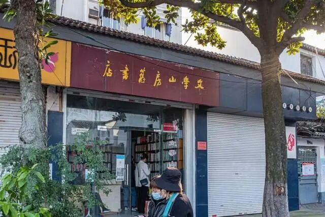

# 赵健：开书店亏掉两套房，拍短视频带货卖了9000万
> 💡 备注属性未写入，可能是备注属性名称或者类型被修改了，建议将字段类型设置为 rich_text，可以在小程序-操作-修改文章数据库页面进行调整
> 💡 原文链接:[https://mp.weixin.qq.com/s?__biz=MzU1Mjk1MDM4Mw==&mid=2247484755&idx=1&sn=5f33cb375af2845b2a2f1ad09bdcc725&chksm=fa8a48fecbbcf280a39b4a6706eb1c4972d95a41215fee4675624ae439ba64f4515321b6bb1a#rd](https://mp.weixin.qq.com/s?__biz=MzU1Mjk1MDM4Mw%3D%3D&mid=2247484755&idx=1&sn=5f33cb375af2845b2a2f1ad09bdcc725&chksm=fa8a48fecbbcf280a39b4a6706eb1c4972d95a41215fee4675624ae439ba64f4515321b6bb1a#rd)
**摘要：**赵健开垮了十年书店，最惨的时候父母卖了两套房，自己靠女朋友养了一年多。后来他对着手机说了句“诸君，你知道吗”，把一条讲旧书店的视频拍到了9000万播放。2025年8月，他直播带货30场卖了9000万。但他又说，读书推广人最大的使命，是希望这个职业最终不再被需要。一个靠卖书赚钱的人，为什么盼着自己“失业”？

**2022年的一天，一个江苏男人坐在苏州一条窄巷子的路沿上，行李箱搁在脚边。**
他刚从北京坐高铁到苏州，临时改签的票。没有提前联系，因为联系不上——他要找的那位老人，没有微信，没有手机，整个家里只有一部固定电话，还不在书店里。巷子太窄，出租车开不进去，他就拖着箱子一路走进来。看到“文学山房”那块旧招牌还在，他心里踏实了。
老人叫江澄波，那年97岁，守着一家从光绪年间传下来的旧书店。赵健掏出手机，拍了一条视频，名字叫《孤独的旧书店》。后来这条视频全网播放量超过了9000万。再后来，全国各地的人专程去苏州打卡那家小书店，老人的房租被减免了，口述史也有人来做了。
但在这条视频之前，赵健已经亏掉了父母两套房。
## 01
赵健1993年出生在江苏淮安，10岁跟着父母到南京。他在南京师范大学读戏剧文学，大二就办起了乡村书院，要求进门的人关掉手机。这个项目拿了“挑战杯”金奖和30万奖金，但书院本身不赚钱。
毕业后他继续开店。医院书店、社区书店，一家接一家地开，一家接一家地倒。2019年，他在南京珠江路开了个9000多平方米的书城，赶上疫情，亏到父母卖了两套房，还欠了一百多万，一家人租房住。他自己靠女朋友养了一年多。
后来他在一次演讲里回忆那段日子，说有人接近羞辱式地嘲讽他：“你这是典型的穷人思维。”他当时没有底气争辩，只说了一句：“我确实是除了才华一无所有。”
**一个开垮了十年书店的人，后来去拍短视频了。这件事本身没什么稀奇。稀奇的是他拍的东西。**
**02**
#### 
赵健的视频很少有夸张特效，基本就是他对镜头娓娓道来，开场永远是那句“诸君，你知道吗”。他讲苏东坡、王阳明、司马迁，也讲一本四十多年前没人看的旧书《画魂：潘玉良传》。那条视频发出去之后，这本库存书加印了五次，卖了三万多册。旧书店里淘到的《杜诗画意》，他讲了一次，加印了四次。
2025年8月，他直播带货30场，累计销售额超过9000万。扬州一家原本发不出工资的漆器厂，经过他带货做出了3000万营收，80个工人给他联名写了封感谢信。
**一个靠卖书赚了钱的人，按理说应该趁热打铁，多开几场直播，多签几个品牌。但赵健说过一句话，跟他做的事放在一起看，很别扭。**
他说：读书推广人的最大使命，是希望这个职业最终不再被需要。
一个卖书的人，盼着自己“失业”。这话听着像漂亮话。但你去看他拍的是什么，就明白他不是在表演。
他拍江澄波，一个97岁的老人每天早晨搬一把米撒在书店门口的玉兰树下，二三十只麻雀来吃，时间久了就住在树上。老人说这是他养的宠物。他拍104岁的翻译家杨苡，拍94岁的敦煌少女常莎娜，拍86岁的画家戴敦邦。这些人在他的镜头里出现之后不久，有两位就去世了。**他拍下的东西，有一部分是挽留。**
**03**
#### 
#### 赵健身上有一种很奇怪的坦诚，跟他“读书博主”的身份不太搭。
他大学一年借阅400本书，学校奖励了他。换别人可能会说“读书让我充实”，他说的是：“因为穷呗，有钱我就直接买了。”然后补一刀：“一个学生爱读书有什么好奖励的？一只猪爱干饭，猪圈会奖励它吗？”
他视频里经常讲民国知识分子的风骨，讲得人热血上头。但他会冷不丁加一句：主要因为他们有钱，被包养是没法谈人格独立的。
**这种话放在一个“文化博主”嘴里，其实是有风险的。但恰恰是这种不修饰的实诚，让他的内容有了一个真人该有的毛边。**
你很难把他归到哪一类。说他是文化人，他跟你算账算得比谁都清楚。说他是生意人，他花大把时间拍那些不赚钱的旧书店和百岁老人。说他成功了，他开头那十年全是败绩。说他失败了，他现在的直播间一天能走几千套《资治通鉴》。
赵健自己好像也不太在乎这些标签。他每天五点半起床，七点到十点直播，午休四十分钟，下午一点半到四点半关手机读书写稿，晚上陪老婆孩子。他把一天当三天过。有人问他为什么这么拼，他说了一句很朴素的话：**长期主义。**
#### 04
回到开头那个问题：一个靠卖书赚钱的人，为什么说希望自己的职业消失？
赵健在2026年的一次演讲里讲过一段话。他说当年把家里房子卖掉、背着几百万债务的时候，被人嘲笑“穷人思维”。他没有争辩，但心里记着一件事：**不能辜负书籍给他的教养**。
他后来做的事，其实就是这句话的注脚。短视频把书卖出去，直播把非遗工厂救活，流量把旧书店和百岁老人推到年轻人面前。这些事情有用，但都不是终点。他自己清楚，一个健康的阅读生态，不需要一个1400万粉丝的人天天对着镜头喊“诸君”。
**他赚的钱是真的，他盼着有一天不用赚这个钱，大概也是真的。**
赵健讲江澄波那条视频里有一个细节。老人说，书店就像城市的眉毛，长在脸上可能不是最重要的，但缺了眉毛，再好看的脸蛋也显得美中不足。
赵健听进去了。他做的事，说到底是替那些快要被忘掉的眉毛，多留一会儿。
**至于他自己，他说过一句话，比任何总结都准：“一只猪爱干饭，猪圈会奖励它吗？”**
你细品。
**参考资料：**
1.百度百科“赵健”词条，2026年更新
2.江南时报《我行我“素”|赵健：在流量时代走“长期主义”之路》，2025年12月
3.大洋网《1400万粉丝读书博主赵健：“诸君，我们一起相约广州”》，2026年3月
4.南风窗《90后带货卖出9000万，读书真的可以改命》，2026年1月
5.微信公众平台《聆听90后文化博主赵健讲座有感》，2026年9月
6.北京青年报《在苏州，有一家名叫文学山房的旧书店》，2022年9月
7.中国青年报综合《读2000本书能改变命运吗？90后小伙的经历火了》，2023年2月
8.赵健2026年度演讲《春天正是读书天》实录，2026年3月
9.南风窗《赵健，登台读书》，2025年12月
10.微信公众平台《关于「公众号推荐」，创作者关心的一些问题》，2026年7月
