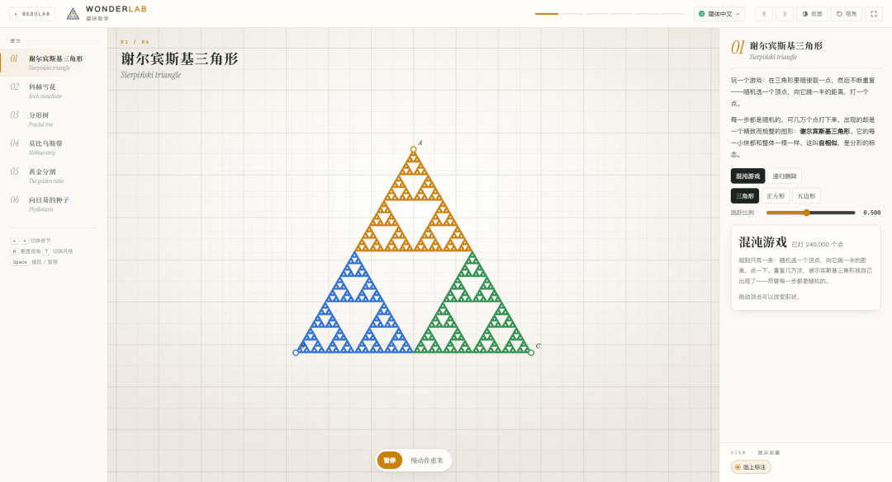

# 趣味数学：每一步都随机，几万个点后却长出谢尔宾斯基三角形（图文教程）
> 💡 备注属性未写入，可能是备注属性名称或者类型被修改了，建议将字段类型设置为 rich_text，可以在小程序-操作-修改文章数据库页面进行调整
> 💡 原文链接:[https://mp.weixin.qq.com/s?__biz=MzI3MTQ0Mzc0Mg==&mid=2247484780&idx=1&sn=e1ef3a312270d46c66717b71c9120b1f&chksm=eb0ae3bbf1a99134d1f0c55494cf00f9acf99ff967e9fa3e06de16330ff2cf21069ca5077d69#rd](https://mp.weixin.qq.com/s?__biz=MzI3MTQ0Mzc0Mg%3D%3D&mid=2247484780&idx=1&sn=e1ef3a312270d46c66717b71c9120b1f&chksm=eb0ae3bbf1a99134d1f0c55494cf00f9acf99ff967e9fa3e06de16330ff2cf21069ca5077d69#rd)
有一个数学游戏，规则简单到可以讲给小学生，结果却相当惊人：
**在三角形里随便取一个点，然后不断重复——随机选一个顶点，向它跳一半的距离，打一个点。**
每一步都是随机的。可几万个点打下来，屏幕上出现的是一个精致而规整的图形：**谢尔宾斯基三角形**。
**WonderLab 趣味数学**把这个游戏（混沌游戏）做成了可交互的演示，还带了科赫雪花、分形树、莫比乌斯带、黄金分割和向日葵种子——六个"看着好玩、背后是数学"的题材。
工具地址：**https://hwx1.gzweidu.top/tool/wedulab/labs/wonder[1]**（免费、无需注册、浏览器直接打开）
所有配图来自实机截图。
### 一、混沌游戏：随机怎么长出秩序
打开第一课，三角形里正在一点点打出点，右上角实时计数：

**已打 240,000 个点**——这是实打实的几十万次随机操作。
讲解把这个"矛盾"点得很准：
玩一个游戏：在三角形里随便取一点，然后不断重复——随机选一个顶点，向它跳一半的距离，打一个点。 **每一步都是随机的，可几万个点打下来，出现的却是一个精致而规整的图形**：谢尔宾斯基三角形。 它的每一小块都和整体一模一样，这叫**自相似**，是**分形**的标志。

**"自相似"**这个概念的直观程度，在这里达到了顶点：你盯着图形里任意一个小三角看，把图放大，看到的还是同一个图形。**这不是画出来的，是随机过程"长"出来的。**
工具还提示：**拖动顶点可以改变形状**——换个三角形再跑一遍，分形结构依然出现。
### 二、两种生成方式 + 三种形状
工具给了两条通往同一个图形的路：
- **混沌游戏**：随机跳点（就是上面那个游戏）
- **递归删除**：**从实心三角形开始，不断挖掉中间的小三角形**——这是谢尔宾斯基三角形的经典构造法
**两种方法得到同一个图形**，这本身就是个有意思的对比：
- 混沌游戏是"**从无到有**"（随机累积出结构）
- 递归删除是"**从有到无**"（确定性规则挖空）
形状还可以换成 **三角形 / 正方形 / 五边形**（正方形的版本叫谢尔宾斯基地毯）。**跳跃比例**也能调（默认 **0.500**），改比例会看到图形发生变化——这是个很适合提问的探索点。
### 三、六个章节，都是"看着玩、想着数学"
- **01 谢尔宾斯基三角形**（分形 + 自相似 + 混沌游戏）
- **02 科赫雪花**（用无限长的边界围出有限面积）
- **03 分形树**（递归结构的自然模拟）
- **04 莫比乌斯带**（只有一个面、一条边的曲面）
- **05 黄金分割**（1.618 的美学与数学）
- **06 向日葵的种子**（叶序与斐波那契螺旋）
**02 科赫雪花**有个反直觉的结论：**周长无限、面积有限**——每次迭代把每条边换成"凸起"的形状，周长不断增加趋于无穷，但它始终被围在有限区域内。这个结论用动画看一遍比讲一节课有效。
**06 向日葵的种子**解释的是自然界里的数学：种子按黄金角（约 137.5°）排列，才能让每个种子获得最大的空间，形成那些漂亮的螺旋线——**而这些螺旋线的条数往往是斐波那契数**。
### 四、操作与显示

- **暂停 / 慢动作重来**：慢动作看点是**怎么一个个落下的**
- **混沌游戏 / 递归删除**：切换生成方式
- **三角形 / 正方形 / 五边形**：换底图形状
- **跳跃比例**：默认 0.500（即"跳一半"）
- **图上标注**：显示辅助说明
快捷键：`←→` 切换章节，`R` 重置视角，`T` 切换风格（**纸面 / 视角**），`Space` 播放 / 暂停。
### 常见问题
**问：免费吗？要注册吗？** 免费，无需注册，打开就用。
**问：手机上能用吗？** 能，但建议用电脑或投屏（点数多，投屏看得清）。
**问：为什么随机过程会产生规则图形？** 因为在混沌游戏的规则里，跳点位置始终被限制在三个顶点的"半程"集合上——**这些限制累积起来，恰好把点留在分形集合上**。规则是随机的，但随机是在一个确定的结构里进行的。这也是"混沌与分形"这一支数学的迷人之处。
**问：跳跃比例改成别的值会怎样？** 图形会改变。比如比例调得偏离 0.5 较多时，点的分布会趋向其他形状。**这正是可以让学生自己试的地方**——为什么 0.5 能长出谢尔宾斯基三角形？
**问：和课本有什么关系？** 分形与自相似是新课标里的拓展内容；科赫雪花的"周长无限、面积有限"常出现在数列与极限的讨论中；黄金分割与斐波那契数列则和数列、递推有关。
**问：适合什么年级？** 小学高年级到高中都能看：小学生看图形有趣，初中生看递归规律，高中生可以谈自相似维数与极限。
**问：能讲莫比乌斯带吗？** 能，`04 莫比乌斯带` 用三维模型看"只有一个面"这个性质，比拿纸条实际剪更清楚。
### 流程速查
打开网址 → 到 `01 谢尔宾斯基三角形` → 看混沌游戏实时打点计数 → 用「慢动作重来」看单点如何落下 → 切到「递归删除」对比另一种生成法 → 拖动顶点改变形状 → 把跳跃比例改一改看变化 → 依次看 `02` 科赫雪花、`03` 分形树、`04` 莫比乌斯带、`05` 黄金分割、`06` 向日葵种子。
**相关工具**：WonderLab 趣味数学[2]（本篇主角）· PythagoLab 勾股定理[3] · GeoSpace 立体几何[4] · ConicLab 圆锥曲线[5] · WeduLab 教学实验合集[6]（22 个学科实验）
**本篇配图来自工具实机截图（本地构建版本实测）。**
#### 引用链接
[1]_https://hwx1.gzweidu.top/tool/wedulab/labs/wonder_
[2]WonderLab 趣味数学: _https://hwx1.gzweidu.top/tool/wedulab/labs/wonder_
[3]PythagoLab 勾股定理: _https://hwx1.gzweidu.top/tool/wedulab/labs/pythagoras_
[4]GeoSpace 立体几何: _https://hwx1.gzweidu.top/tool/wedulab/labs/geo_
[5]ConicLab 圆锥曲线: _https://hwx1.gzweidu.top/tool/wedulab/labs/conic_
[6]WeduLab 教学实验合集: _https://hwx1.gzweidu.top/tool/wedulab/_
