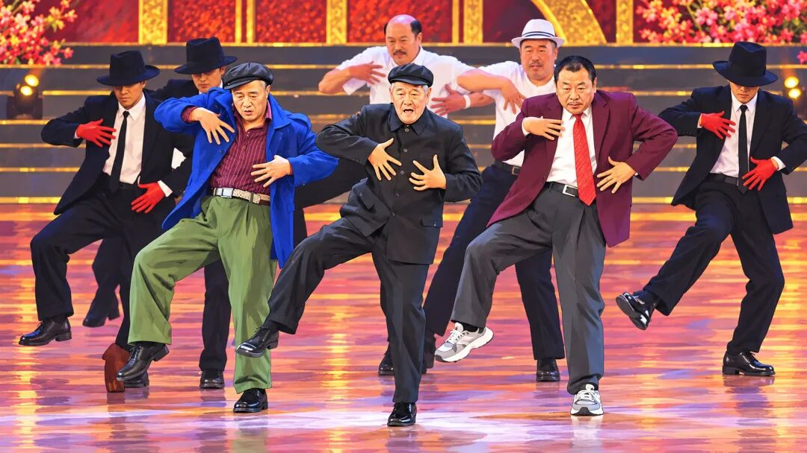

# 跳舞的为什么是赵本山？
> 💡 备注属性未写入，可能是备注属性名称或者类型被修改了，建议将字段类型设置为 rich_text，可以在小程序-操作-修改文章数据库页面进行调整
> 💡 原文链接:[https://mp.weixin.qq.com/s?__biz=MjM5MjA5MTUwMQ==&mid=2649126258&idx=1&sn=f0012a73eee52b940149c421d0a49d47&chksm=bfcd48467b75b9d875aea65e0b7e6807d3b5bafcf1cebea1502ac9f1deba9d24c323291cb24c#rd](https://mp.weixin.qq.com/s?__biz=MjM5MjA5MTUwMQ%3D%3D&mid=2649126258&idx=1&sn=f0012a73eee52b940149c421d0a49d47&chksm=bfcd48467b75b9d875aea65e0b7e6807d3b5bafcf1cebea1502ac9f1deba9d24c323291cb24c#rd)

如果你最近也刷到了赵本山、范伟跳舞的名场面，那咱们的茧房有交集，应该握手致意。

都6202年了，**为什么**给我们带来快乐的，还是赵本山？乌兰察布的AI算力，**为什么**就非得服务东北喜剧大师？**为什么**评论区都是浑然天成、毫无破绽、迈克尔杰克逊致敬过这段？

**我那天带着这几个问题，和一个出马的朋友聊了聊。他给了我三个锦囊。**
**一、冲突**
**出马仙说**：“这个社会正在鼓励冲突。”

“越是风马牛不相及的事情，越要放在一起，冲突就出现了。”

“短视频的2秒跳出率和5秒完播率是平台算法的考核指标，人们必须在2秒以内被吓一跳。”

“要吓一跳，就得反常识、就得一惊一乍、就得危言耸听、就得不正常、就得搞对立。”

“男对女、穷对富，北漂对土著；精致对粗糙，真傻对装酷；当代牛马进入古代宫殿，经典名曲搭配乡村公路。高科技创造大奇观，赵本山偶遇太空步。”

“象牙山和纸牌屋，都有好故事，天然好素材。”

**二、共识**
**出马仙接着说**：“但冲突只是表象，二创还需共识。共识就是大家都知道并且认可的事儿。”

“花有重开日，人无再少年。这种诗句，是不是一听心里就充满遗憾？这是中国人对诗词形成的天然情感共识。共识形成了肥沃的土壤，然后才长出创新的果实。”

“水有源，树有根，盐打哪咸，醋打哪酸。纯粹的标新立异是不能出圈儿的。”

“赵本山是过去三十年的快乐共识，中心化媒体时代塑造了这种共识，赵本山=快乐。”

“于是当AI出现，人们需要新的快乐时，新瓶里装的还是老酒，形式变了，快乐不变，快乐的源泉也不变。”

“有共识，好办事儿。解释成本低。”

**三、社会化本能**
**出马仙点了一根烟，继续说**：“人总是想一起干点儿啥，重点不是干点儿啥，重点是一起。”

“一起过年、一起过节、一起凑单买东西、一起吐槽老板、一起膜拜首富、一起义愤填膺，然后一起反转。”

“共识降低了参与门槛，人有参与社会的本能。”

“观看、点赞、评论、转发、关注、消费。”

“这个时代，一个手指的动作，成了社会化的平替。这不正常，应该脱虚向实。”

“社会化能造成更大的蛋糕，目前的平替限制了做大的机会。”

“多看经典。经典凝聚了人类情感、行为、智慧中丰富的共识，人人都读经典，共识越多，障碍越少。先有共识，再反共识，所谓先立后破。”

“智能时代读经典，就是现象级的反差。”

我觉得挺有道理，于是拜谢了仙家，继续刷短视频。
