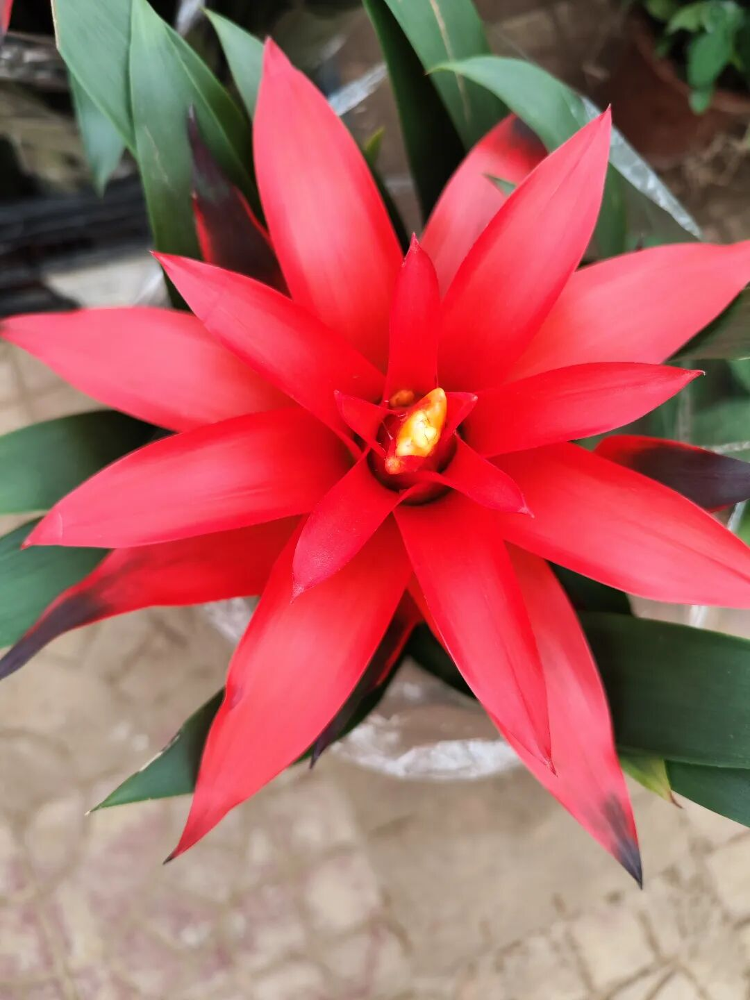

# 身怀六甲是哪六甲？
> 💡 备注属性未写入，可能是备注属性名称或者类型被修改了，建议将字段类型设置为 rich_text，可以在小程序-操作-修改文章数据库页面进行调整
> 原文链接:[https://mp.weixin.qq.com/s/aGT5pM1LXGD-rqABOITd2g](https://mp.weixin.qq.com/s/aGT5pM1LXGD-rqABOITd2g)

今天读书偶然看到世人常说的“身怀六甲”一词，我一直只把它当作怀孕的雅称，从未深究它背后的意蕴，今天看到之后突然有一种想探究明白的冲动。
通过查资料才知道六十甲子之中，甲子、甲戌、甲申、甲午、甲辰、甲寅，便是六甲。甲为天干之首，象征生机初萌，六甲轮转，是时序循环、万物生发的节律。所谓三环六甲，便是天地时序、家族血脉、人间温情，三环相扣，随六甲往复，生生不息。
“身怀六甲”这一词的理念源头是《隋书·经籍志》著录失传古书《六甲贯胎书》，是六甲与怀胎绑定的源头，但书中没有“身怀六甲”这句原文。
这一雅致说法，最早是出自明清古典小说。
《东周列国志》里，褒姒有言：“妾一身死不足惜，但自蒙爱幸，身怀六甲，已两月矣。”
《初刻拍案惊奇》（明·凌濛初，卷三十三）也有:“成婚未久，果然身怀六甲。”
《警世通言》（明·冯梦龙，卷二十《计押番金鳗产祸》）中也说:“只见浑家身怀六甲，只见眉低眼慢，腹大乳高。倏忽间又十月满足。”
《镜花缘》（清·李汝珍，第十回）亦有云:“偏偏媳妇身怀六甲，好容易逃至海外，生下红蕖孙女，就在此处敷衍度日。” 
《石点头》（明·天然痴叟，卷四《侯官县烈女歼仇》）中还有:“时光迅速，董昌成亲早又年余，申屠娘子，已是身怀六甲，到得十月满足，产下一儿。”
有以上可知，古人落笔之时，便早已懂得，腹中孕育，是与天地六甲生机相呼应的大事。
天地有环，寒来暑往，草木荣枯，六甲依次流转，一轮落幕，又一轮又开启，是大自然永恒的孕育。血脉有环，生命代代相承，先祖的气息流淌在后人身上，个体虽短暂，血脉却绵延不绝。人心亦有环，从降生成长，到孕育新生命，再缓缓老去，一生牵挂与期盼，都在这轮回循环之中。
[看似忙碌，实则补上了心里的那份坦然](https://mp.weixin.qq.com/s?__biz=MzkzNTM1NzM0MA%3D%3D&mid=2247484808&idx=1&sn=78539b9f7d4c33e8836d45325ac92928&scene=21#wechat_redirect)
[开辟一处安放心灵的精神后院](https://mp.weixin.qq.com/s?__biz=MzkzNTM1NzM0MA%3D%3D&mid=2247484774&idx=1&sn=c8db27d35f574740142e5c336cf7df76&scene=21#wechat_redirect)
[要学会与自己温柔和解](https://mp.weixin.qq.com/s?__biz=MzkzNTM1NzM0MA%3D%3D&mid=2247484658&idx=1&sn=7c2817c97cf5ce62c1de2994fd91a874&scene=21#wechat_redirect)
[一场急雨，满目烟火](https://mp.weixin.qq.com/s?__biz=MzkzNTM1NzM0MA%3D%3D&mid=2247484610&idx=1&sn=c157cbd5a41e32cffe9dcb5a12440a27&scene=21#wechat_redirect)
[杨公忌是指正月十三这一天，还是指一年有13天？](https://mp.weixin.qq.com/s?__biz=MzkzNTM1NzM0MA%3D%3D&mid=2247484848&idx=1&sn=a39687222cd4e54628e3386c18eab539&scene=21#wechat_redirect)
[马胡子的传说，是马胡子，还是麻叔谋？](https://mp.weixin.qq.com/s?__biz=MzkzNTM1NzM0MA%3D%3D&mid=2247484856&idx=1&sn=ddda73dca7aa116dd1aeb092a4067c7a&scene=21#wechat_redirect)
