# 这个Skill，331 种手绘风、167 种版式，报个编号就能用
> 💡 备注属性未写入，可能是备注属性名称或者类型被修改了，建议将字段类型设置为 rich_text，可以在小程序-操作-修改文章数据库页面进行调整
> 💡 原文链接:[https://mp.weixin.qq.com/s?__biz=MzY4NjM4MTkwNQ==&mid=2247484138&idx=1&sn=d4f4f763aec28e67f89ee2381727d1e0&chksm=f2153d00aaff5730eebf5abc013eeb8a22f215d5607a14c65ead20a9e27cee07297834cd7232#rd](https://mp.weixin.qq.com/s?__biz=MzY4NjM4MTkwNQ%3D%3D&mid=2247484138&idx=1&sn=d4f4f763aec28e67f89ee2381727d1e0&chksm=f2153d00aaff5730eebf5abc013eeb8a22f215d5607a14c65ead20a9e27cee07297834cd7232#rd)
 之前给一篇稿子配图，图库翻了四十分钟，下载七张，拼在同一篇文章里，像七个不同类型的风格。最后发出去的，都是我用手机拍的图片。
问题不在图少。在图片风格不统一。后来我把这件事交给了一个 Skill。现在配图从四十分钟变成两分钟，十篇稿子摆在一起，图片风格再也不担心跑偏了。本篇将选取一部分风格画面讲述，最后告诉你怎么安装。放心使用。
### 它是什么
handraw-style，作者 yang0，MIT 协议开源（带署名要求）。装进能读本地文件的 AI 里，它就是一本带图的画风辞典。
三个数字：331 种编号画风，167 种版式，36 个经典主题色。每种画风配一张参考图，编号从 001 排到 331。
用法很简单。报编号，加主题。
它回你一段中英双语的提示词，你粘进 GPT Image、Midjourney、即梦，都能出图。图由生图模型画，它只负责把"感觉"翻译成模型听得懂的话。
先说清楚一件事：它默认不画图，只写提示词。下面分三块：先看版式，再看 25 种画风，最后是怎么装、怎么用。
### 先看版式，因为版式最直观
画风决定"像谁画的"，版式决定"东西放在哪里、字放在哪里"。
大多数人挑图只看画风，结果图好看，文章还是散。版式是那个被忽略的另一半：它管结构，管字号，管眼睛先看哪里。
这七张是版式库里最能打的。
**SC-021 双拼**：上半张真人照片，下半张同一个人画成手绘，一条街从照片里长进画里。人物故事号的封面利器，一张图同时有"真实"和"可爱"。
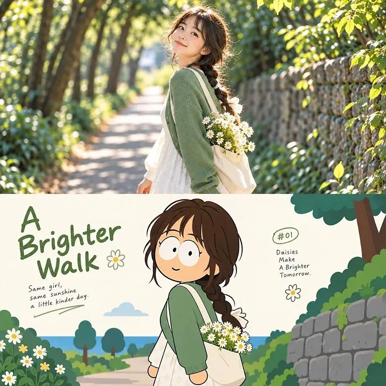
**SC-001 手写标题卡**：手写标题压在画面上，像随手写在便签上。适合观点、清单、日常吐槽，情绪一起来，转发就来了。
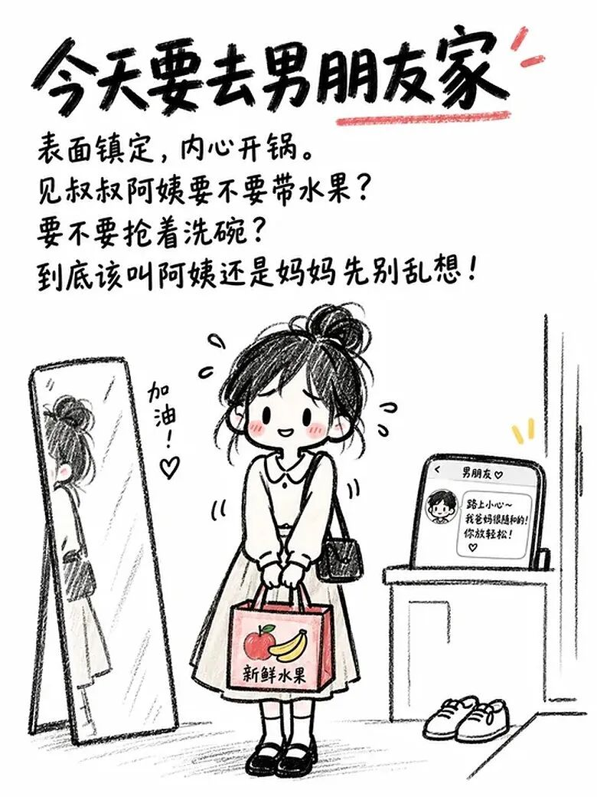
**IG-005 信息图**：把知识拆成图，部位、结构、分级一次讲完。科普号不用再满网找表格。
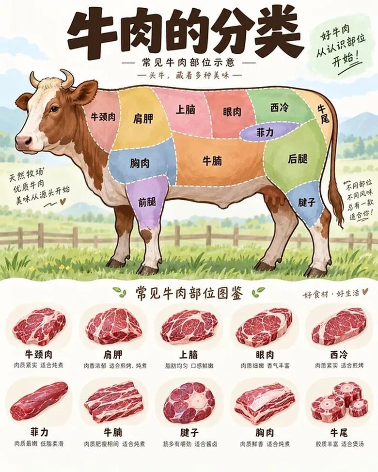
**IG-032 六格图文卡**：一个观点配一张小图，六个格子讲完一件事。心理、成长、方法论最好用。
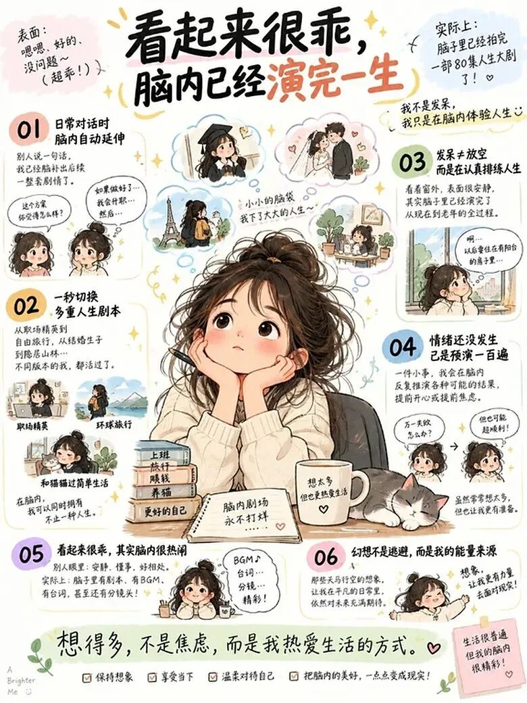
**IG-034 流程地图**：把流程画成一张地图，一个盲盒从设计到出厂。讲供应链、讲幕后、讲"这件事有多复杂"。
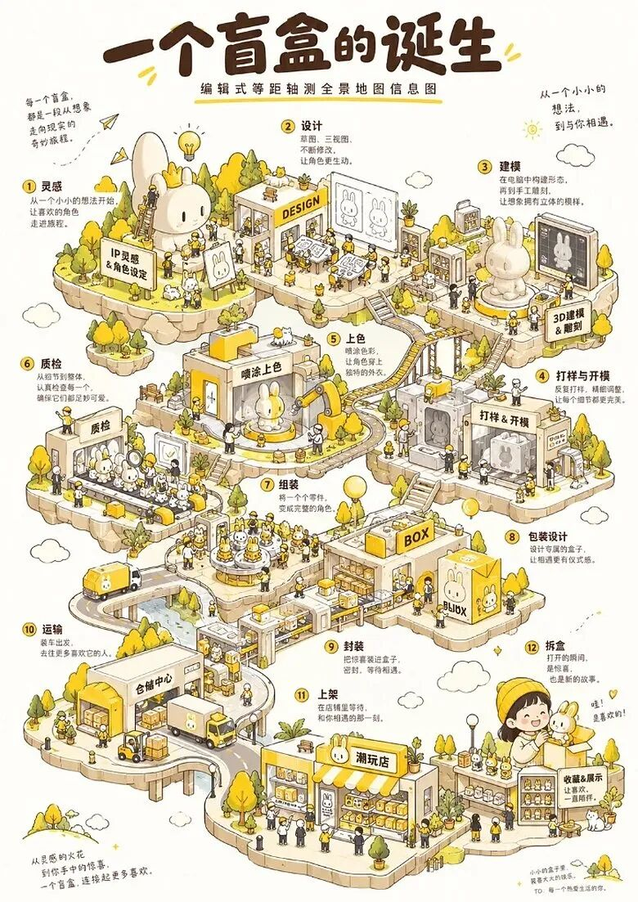
**SB-001 四格分镜**：起承转合，四格讲完一个故事。吐槽、翻车、办公室日常。
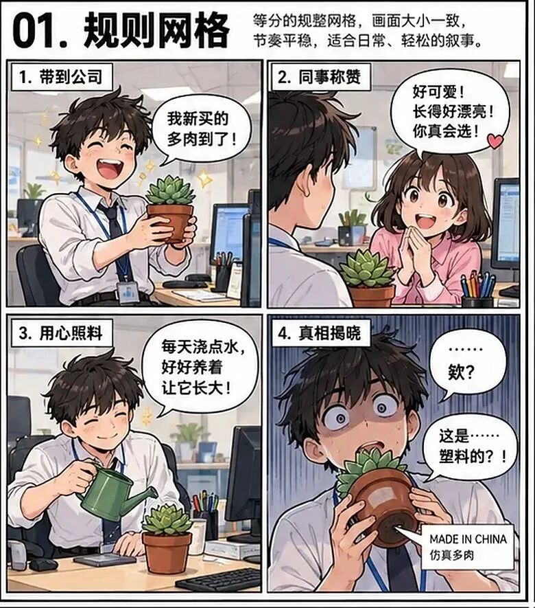
**IP-001 角色设定卡**：一张卡立住一个角色，正面、侧身、表情、周边都在。品牌人设的第一步。

还有电商组（EC），主图、多角度、详情页，做产品的人会用到。
选版式的时候，它会自动切到"图文模式"，因为版式本身要管字。这一步不用你操心。
### 25 种画风，按"你要写什么"分五组
331 种不可能一次讲完。我按公众号实际会遇到的场景，挑了 25 种，每组五种。
#### 第一组：观点与评论
**01 · #012 概念社论**（Christoph Niemann）
他画的东西永远比字少：一个低头的人，影子先笑了。抽象概念配这种图，读者不用读解释就会意。
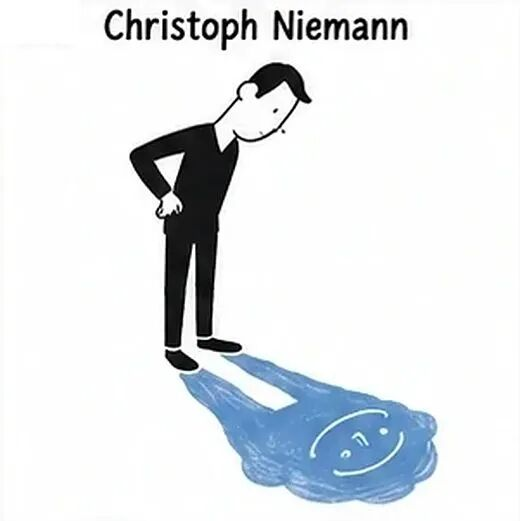
> 这样说：#012，一个人和一条跟得太紧的影子
> 
**02 · #002 一笔到底**（Saul Steinberg）
一整根线不许断，从帽子画到鞋，中间穿过城市。写流程、写路径、写"一环扣一环"的事，它最合适。
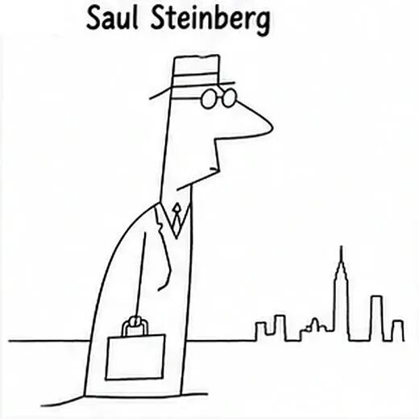
> 这样说：#002，一个人的一生用一根线画完
> 
**03 · #029 几何图解**（Chris Ware）
把情绪画成建筑和站牌。适合写系统、机制、平台规则这类不讲结构就讲不清的稿子。
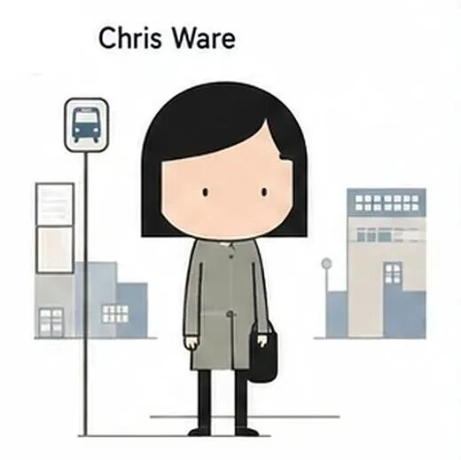
> 这样说：#029，一个人站在三个站牌之间
> 
**04 · #158 杂志单格**（New Yorker 式单格漫画）
一张沙发、一份报纸、一只猫，笑点在留白里。适合写中年、职场、体面生活下面的裂缝。
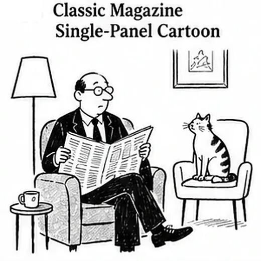
> 这样说：#158，一个读报的人和他的猫
> 
**05 · #059 负空间**（Malika Favre）
黑白两块颜色一咬合，人形就出来了。适合极简封面、金句图、一句顶一万句的那种稿子。
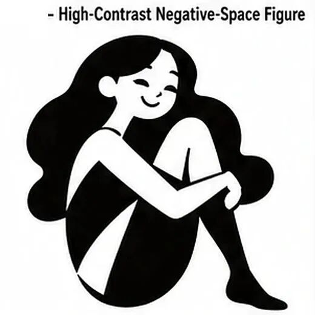
> 这样说：#059，一个人抱住自己的膝盖
> 
#### 第二组：生活与情绪
**06 · #292 动物对话**（Liz Climo）
熊和兔子站着说两句话，一句正经一句拆台。写亲密关系、家庭群、朋友之间，用它不会腻。
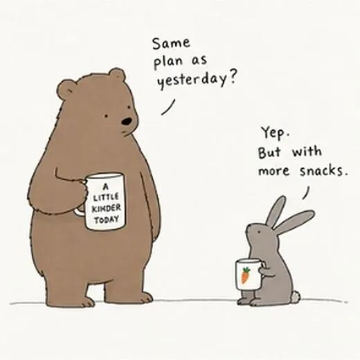
> 这样说：#292，熊和兔子分最后一块饼干
> 
**07 · #254 几米水彩**
夜色、月亮、一个醒着的人。写故乡、成长、错过、一个人过的第一个冬天。
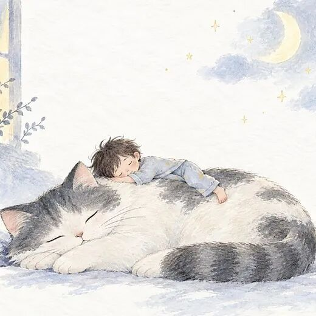
> 这样说：#254，一个人在深夜醒来，窗外有月亮
> 
**08 · #016 情绪小人**（Rubyetc）
一个潦草的小人举着牌子，上面写着一句丧气话。写内耗、焦虑、打工日常，读者会截图。
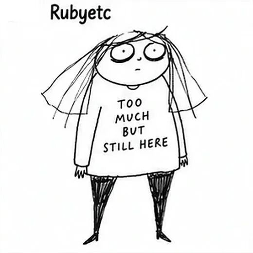
> 这样说：#016，一个举着牌子的小人，牌子上写着"今天不行"
> 
**09 · #185 奶油手绘**
奶油色、圆线、腮红，小红书最常见的那种软。适合生活方式、心理科普、下厨、养猫。
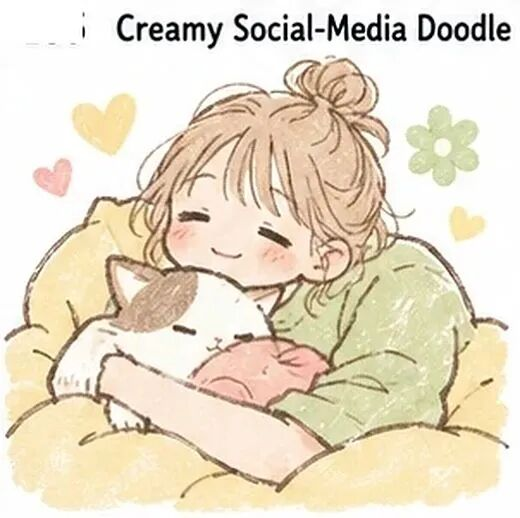
> 这样说：#185，一个人抱着猫在午后发呆
> 
**10 · #098 手账涂鸦**（tomatomayu）
像有人在笔记本上替你画了重点，边上还趴着一只猫。清单、教程、工具测评配它最好用。
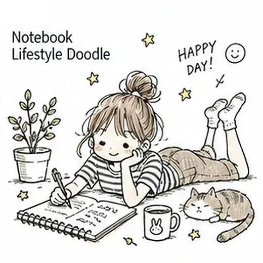
> 这样说：#098，一个人趴在桌前写清单
> 
#### 第三组：品牌与商业
**11 · #276 清透扁平**
留白多，颜色轻，文字压上去不打架。品牌故事、行业观察、方法论长文，这类最稳。

> 这样说：#276，清晨通勤的人走过一片田野
> 
**12 · #075 美好年代海报**（Toulouse-Lautrec）
一百年前的巴黎海报，平涂色块，黑色轮廓线。做活动、做促销、做周年，比现代风更有戏。
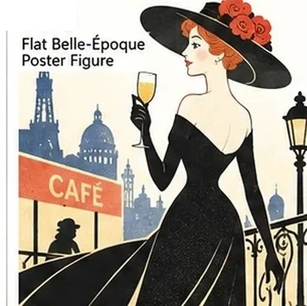
> 这样说：#075，一位戴红花的女士举着酒杯
> 
**13 · #194 海派月份牌**
旗袍、卷发、汽车、外滩的楼。城市记忆、国货故事、老字号焕新，它有一种别的风格给不了的体面。
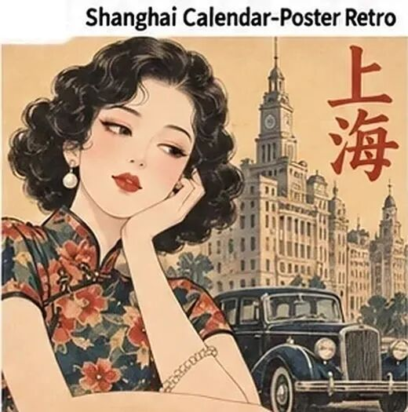
> 这样说：#194，一位穿旗袍的女性站在外滩旧楼前
> 
**14 · #221 毛毡黏土 3D**
毛线一根根看得见，孩子一眼就喜欢。亲子号、吉祥物、活动主视觉，做成周边也不违和。

> 这样说：#221，一只戴围巾的小熊站在雪地里
> 
**15 · #272 纸雕**
层层叠叠的纸片，光从前面打过来。适合产品页、包装、节庆主视觉，比 3D 渲染更有手作味。

> 这样说：#272，一个人在纸做的山间划船
> 
#### 第四组：文化与在地
**16 · #191 宋画淡彩**
米白、细线、青绿淡赭。写茶、器物、节气、古典文学，文章会跟着慢下来。

> 这样说：#191，一把团扇，一枝桂花，窗边的午后
> 
**17 · #256 丰子恺**
寥寥几笔，一个人、一棵树、一只猫，旁边两句题字。写生活哲学、旧事、人情，最合适。

> 这样说：#256，一个大人牵着孩子走过树下
> 
**18 · #188 连环画**
黑白线描，旧纸，一页一景。写历史、写人物、写地方志，比照片更有年代感。

> 这样说：#188，一位女子在窗前读信
> 
**19 · #190 敦煌**
矿物色、飘带、莲花纹。做文化专题、非遗、文旅，配色一出来就有分量。

> 这样说：#190，一位飞天在莲花间回身
> 
**20 · #270 农民画**
高饱和、满构图、不讲究透视。写年味、写团圆、写县城生活，热烈得很直接。

> 这样说：#270，一家人围坐吃年夜饭
> 
#### 第五组：动画感与角色
**21 · #327 韩漫 webtoon**
竖屏友好，表情克制，一屏能放三格。职场故事、情感专栏、日更连载。

> 这样说：#327，一个拎着咖啡赶地铁的上班族
> 
**22 · #323 吉卜力**
手绘赛璐璐，云和草地画得很认真。写童年、写夏天、写一段回不去的路。

> 这样说：#323，一个女孩抱着猫跑过海边
> 
**23 · #239 赛博 OVA**
八十年代末的动画质感，硬光、冷色、胶片噪点。写科幻、写城市夜、写技术和人的关系。

> 这样说：#239，一个短发女性站在霓虹街口
> 
**24 · #329 蜘蛛侠平行宇宙**
抽帧、网点、色差，像漫画在动。写年轻、写潮流、写反叛，视觉冲击最强的一档。

> 这样说：#329，一个少年牵着狗跑过霓虹街头
> 
**25 · #237 胖针织玩偶**
圆滚滚的针织身体，糖果色。做可爱向的 IP、贴纸、周边，比写实 3D 更讨喜。

> 这样说：#237，一只穿粉色外套的小熊
> 
25 个编号，够用一阵了。剩下三百多个，等你想换口味的时候再翻。
### 怎么装
需要两样东西。
一个能读本地文件的 AI 客户端：Claude Code、Codex、DSH 这类都行。纯网页聊天框用不了，因为技能要读本地图库。
Python 3。只出提示词可以不装；想跑解析脚本、重建索引、批量出图，就得有。我这边用 3.12 跑通。
第一步，把仓库拉下来：
```
git clone https://github.com/yang0/handraw-style.git
```
第二步，放进客户端的 skills 目录：
- Claude Code：~/.claude/skills/
- DSH：项目里的 .agents/skills/
- Codex：它的 skills 目录，具体看客户端文档
第三步，确认目录是**整仓**放进去的，不是只拷 SKILL.md：
```
skills/handraw-style/
├── SKILL.md
├── images/                    ← 331 张参考图，删了技能就废了
├── styles_200_reorganized.md
└── skills/handdraw-style-prompter/
    ├── SKILL.md               ← 真正的操作手册
    ├── references/            ← 索引、版式、配色、模型能力表
    ├── scripts/               ← 解析、构建、校验脚本
    └── gallery/index.html     ← 画廊
```
`images` 和 `skills/handdraw-style-prompter` 必须待在同一个仓库目录里。原因很简单：提示词里的参考图路径是按这个结构拼出来的，拆开就找不到图。
第四步，验一下。
打开 `gallery/index.html`，能看到 331 张编号图，就说明图库在位。
再跑一次解析脚本（在仓库根目录执行）：
```
cd skills/handdraw-style-prompter/scripts
python resolve_reference.py --model gpt-image-2 --style 012
```
返回里 `activation_source` 是 `name+style`，说明这个名字模型认得，不用垫图。是 `name+style+traits+reference-image`，说明它要参考图，把 `reference_path` 那张图一起传进去就行。
以后更新，`git pull` 就够。自己存的素材不会丢——它们在 `~/.handraw-style/config.json` 里，不在仓库里。
### 怎么用
**用法一：报编号加主题。** 最快的一种。给编号和一句主题，它出中英双语两条提示词，粘哪个模型都行。
**用法二：不报编号。** 把主题丢给它，它从 331 种里挑一组，附一句为什么，还会推荐主题色。没思路的时候比自己乱翻快。
**用法三：画风乘版式。** 版式负责结构，画风负责语气。比如"用双拼卡，配清透扁平，主题是搬家那天"。选版式会自动进图文模式，因为版式要管字。
**用法四：拿自己的照片改。** 上传照片，说要哪种画风。它会附一条固定的转绘指令，强制模型按画风从零重画，而不是在照片上盖一层滤镜。这条指令挺关键，不然出来的永远是"加了手绘滤镜的照片"。
**用法五：建自己的素材库。** 存角色、存道具、存场景，下次直接点名。跟它说"保存图片到角色库，名称：小蓝"，之后报 IP 编号，它就用这张图垫底。做连载、做 IP 的人，这个功能比画风库还值钱。
模型这块记住一句：只有 `gpt-image-2` 做过强度校准，给名字它就懂。换别的模型，它会老老实实要求你上传参考图；不上传，风格就会漂。
### 四个坑
**编号是索引，不是风格名。** #012 和 FA-012 是同一个东西，两种输入都认。别背英文名，背数字。
**它默认不画图。** 给的是提示词，画图得你自己粘进生图模型。好处是你能改，坏处是你得动手。
**模型之间有差别。** 校准过的只有 gpt-image-2，其余模型一律按"要垫图"处理。这不是它偷懒，是它清楚自己不知道。
**别只拷 SKILL.md。** 很多人装技能习惯只拿一个文件，这个不行。图库、索引、脚本、画廊，缺一样就有一半功能用不了。
### 最后
25 种画风、7 种版式，只是入口。
真正省事的状态是这样：固定两种画风，一种给观点，一种给日常；固定一个版式，封面永远长这样；固定一个主色，读者刷到就知道是你。
剩下的三百多种，不是让你都用，是让你在想换的时候，有地方可换。
