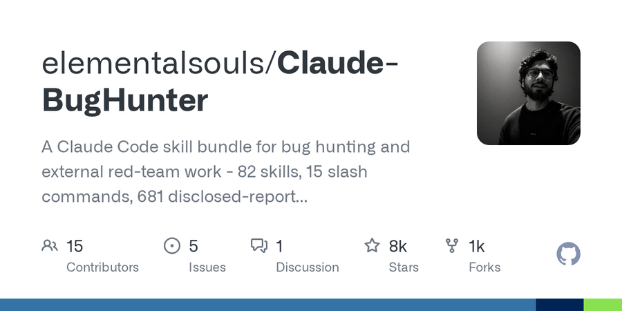
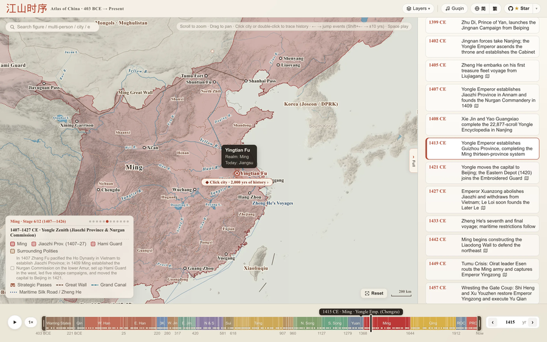
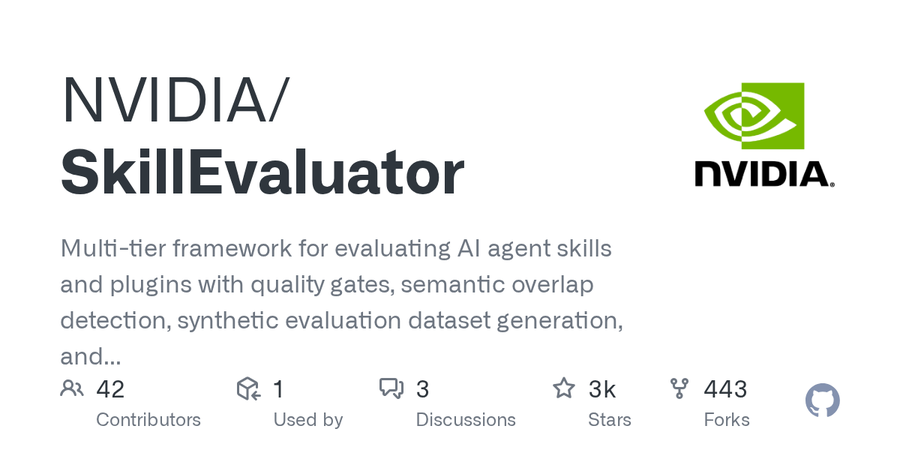
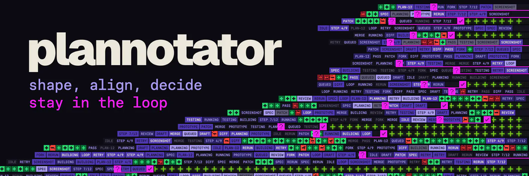

# 这个开源画了个历史地图，把中国五千年画活了
> 💡 备注属性未写入，可能是备注属性名称或者类型被修改了，建议将字段类型设置为 rich_text，可以在小程序-操作-修改文章数据库页面进行调整
> 原文链接:[https://mp.weixin.qq.com/s/nRJ0no3Hs4Zk1hR2PKXblQ](https://mp.weixin.qq.com/s/nRJ0no3Hs4Zk1hR2PKXblQ)
**GITHUB DAILY · 2026.11.17**
**今日 GitHub 热度**
**Top 10 深度拆解**
AI 办公套件登顶 · 红队神器爆发 · 历史地图出圈
DreamNum / NVIDIA / Google Labs / 个人开发者同台
今天的关键词是「硬核跨界」。univer 单日狂揽 1,828 星登顶，让 AI 彻底接管 Excel 和 Word；Claude-BugHunter 带来硬核的红队技能包；NVIDIA 官方下场给 AI 技能当质检员；最浪漫的是一个用代码重绘中国五千年疆域的历史地图——
**当 AI 有了质检员，当历史被代码重新演绎，开源社区的创造力正在向所有学科蔓延。**
速览 Top 10
 › 
**今日之星**
 › 
另外四个必看
 › 
趋势与清单
**SECTION 01**
**📊 十秒速览 · Top 10 全榜**
前三名标深色，其余只留数据 · 星标与新增沿用当日快照
**01ag-ui**★ 19,607**+791**
Agent-User Interaction Protocol，将 Agent 无缝引入前端应用
TypeScript · CopilotKit 团队（官方 · 美国西雅图）
github.com/ag-ui-protocol/ag-ui
**02plannotator**★ 12,829**+696**
保持与 Agent 同步的协同工作区，一键分享反馈
TypeScript · Michael Ramos（个人开发者 · 美国纽约）
github.com/backnotprop/plannotator
**03univer**★ 28,559**+1,828**
基于 Office SDK 构建的 AI 办公套件，整合编辑、协作与文件处理
TypeScript · DreamNum（中国团队 · univer.ai）
github.com/dream-num/univer
**04**claude-trading-skills★ 6,627**+837**
为股票投资者和交易员打造的 Claude 技能包：技术分析、期权策略、风险管理
Python · tradermonty（个人开发者 · 身份未公开）
github.com/tradermonty/claude-trading-skills
**05**Claude-BugHunter★ 7,848**+1,094**
Claude 漏洞挖掘红队技能包：82 个技能 + 681 种漏洞披露模式
Python · Sachin Sharma（个人开发者 · 印度）
github.com/elementalsouls/Claude-BugHunter
**06**arcane★ 8,968**+46**
面向所有人的现代 Docker 管理工具：容器、镜像、模板一站管理
Go · Arcane 团队（已验证官方组织 · 美国）
github.com/getarcaneapp/arcane
**07**jiangshan-map★ 7,431**+288**
江山时序：中国历史交互地图时间轴（403 BCE 至今），18 朝代 198 个疆域快照
JavaScript · Shangjie Chen（中国开发者 · Google 工程师，现居美国）
github.com/DeanChensj/jiangshan-map
**08**stitch-skills★ 9,873**+529**
Google 官方出品的 Agent 技能库，完美适配 Stitch MCP
TypeScript · Google Labs（官方 · 美国）
github.com/google-labs-code/stitch-skills
**09**last30days-skill★ 68,429**+135**
跨全网平台研究任意话题并生成总结的 AI 技能，6.8 万星老将回榜
Python · Matt Van Horn（连续创业者 · 美国，June / Lyft 前身联创）
github.com/mvanhorn/last30days-skill
**10**SkillEvaluator★ 3,060**+873**
多层级 AI Agent 技能与插件评估框架，附带质量闸门
Python · NVIDIA（官方 · 美国）
github.com/NVIDIA/SkillEvaluator
**SECTION 02**
**⭐ 今日之星**
单日 +1,828 星登顶，AI 办公套件彻底爆发
**★ 今日之星 · TOP 01**
**+1,828** 星

单日狂揽 1,828 星登顶，总星标 2.85 万，AI 办公套件彻底爆发
**univer：让 AI 彻底接管你的 Excel 和 Word**
**痛点直击**
让 AI 处理表格和文档一直是个难题。现有的 AI 工具往往只能生成一段死板的文本或 CSV，无法像真人一样在带有复杂公式、图表和排版的办公软件里操作。
**它是什么**
一个**基于 Office SDK 构建的 AI 办公套件框架**，来自中国团队 DreamNum。它将电子表格、文档、幻灯片整合在一起，**专为人类和 AI Agent 协同工作而设计**。这意味着你的 AI 可以直接操作真实的富文本和复杂表格，甚至进行实时协作编辑。**今日狂揽 1,828 星，登顶今日涨幅榜。**
**上手命令**
git clone https://github.com/dream-num/univer.git
pnpm install && pnpm dev # 官方 Monorepo，按 README 启动
# 用它的 SDK 让 AI 直接读写带公式和格式的表格
做办公自动化的，直接用它替换那些「生成 CSV 再人肉调格式」的老方案——AI 能真正进表格里干活了。
**一句话毒舌**
以前 AI 做 Excel 像「画符」，现在 univer 直接让 AI 成了「金牌文员」——不仅会填数，还会调格式、画图表。
**⭐⭐⭐⭐⭐ 非常友好 · **中国团队开发，中文文档极其完善，完美契合国内办公需求。**办公软件开发者和全栈工程师强烈推荐。**
办公自动化Office SDK今日登顶
传送门 · github.com/dream-num/univer
**SECTION 03**
**🔥 另外四个必看**
红队技能包、历史地图、技能质检员、协同工作台
**必看 02**
**安全合规**

**Claude-BugHunter：AI 红队漏洞挖掘神器**
**痛点直击**
网络安全防御太被动？想利用 AI 进行自动化的漏洞挖掘（渗透测试），却苦于没有系统的思路和技巧。
**它是什么**
一个 **Claude Code 红队技能包**。它包含了 **82 个技能、15 个斜杠命令和 681 种漏洞披露模式**，覆盖 24 种核心漏洞类别，甚至包含企业身份和基础设施攻击矩阵。把它装到 Claude 里，它就化身无情的漏洞挖掘机器。**今日狂揽 1,094 星。**
**上手命令**
git clone https://github.com/elementalsouls/Claude-BugHunter.git
# 按 README 加载进 Claude Code
# ⚠️ 仅限在合法授权的目标上进行安全测试
先在自己的测试环境里跑一遍授权范围内的漏洞扫描。它输出的是安全评估参考，不是攻击指令——红线永远不能碰。
**一句话毒舌**
以前搞安全靠大佬手把手教，现在直接把红队大佬的经验包喂给 AI——防线和攻击线，就看谁用得溜了。
**⭐⭐⭐ 需注意合规 ·这个Google工程师不上班写了个历史地图，把中国五千年画活了 **纯 Python 配置包。国内用户务必遵守《网络安全法》，**严禁用于非法攻击，仅限授权测试。**
传送门 · github.com/elementalsouls/Claude-BugHunter
**必看 03**
**人文浪漫**

**jiangshan-map：用代码重绘中国五千年疆域**
**痛点直击**
看历史书时，常常对古代的疆域变迁、地名更迭一头雾水。虽然有历史地图册，但静态的图片很难直观感受到「沧海桑田」的变化。
**它是什么**
一个**极其硬核且浪漫的开源项目——中国历史交互地图时间轴**。它涵盖从**公元前 403 年至今**的历史，包含 **18 个朝代、198 个疆域快照**，以及古今地名对照和古典诗词路线。拖动时间轴，就能在网页上直观看到中国版图的历史变迁。**今日狂揽 288 星。**作者是 Google 工程师 Shangjie Chen。
**上手命令**
git clone https://github.com/DeanChensj/jiangshan-map.git
# 纯前端项目，也可直接打开在线版
# https://deanchen.me/jiangshan-map/ 拖动时间轴看疆域变迁
打开网页拖动时间轴，看看你家乡在古代属于哪个国家——这大概是今天最值得转发给非程序员朋友的一个项目。
**一句话毒舌**
别人用代码写 App 赚钱，这位大佬用代码写历史——这不仅是在敲代码，这是在敲打时间的墙。
**⭐⭐⭐⭐⭐ 量身定制 · **纯前端项目，完全契合中国历史文化，访问极速（GPL-3.0 开源）。**历史爱好者、地理控和学生党强烈推荐。**
传送门 · github.com/DeanChensj/jiangshan-map
**必看 04**
**官方下场**

**SkillEvaluator：NVIDIA 官方的 AI 技能「质检员」**
**痛点直击**
现在各种 AI 技能（Skills）和插件满天飞，质量参差不齐。有的有安全漏洞，有的跟其他技能冲突，你根本不知道哪个能用。
**它是什么**
**NVIDIA 官方开源的 AI 技能与插件评估框架**。它包含**多层级评估、质量闸门（Quality gates）、语义重叠检测、合成评估数据集生成**，甚至能实时测量这些技能对 Agent 行为的影响。相当于给所有狂野生长的 AI 技能，套上一条官方的「质检流水线」。**今日狂揽 873 星。**
**上手命令**
git clone https://github.com/NVIDIA/SkillEvaluator.git
# 配置评估数据集，跑质量闸门检查
# 给你的技能库出一份「体检报告」
如果你在企业里管理 AI 生态，用它来筛选和评估第三方技能——上生产前先过一遍质量闸门，比事后救火便宜得多。
**一句话毒舌**
AI 技能再牛，过不了 NVIDIA 的「质检关」，统统不能上岗——大厂一出手，就知有没有。
**⭐⭐⭐⭐ 可用 · **开源 Python 框架（Apache-2.0），可本地部署。**企业 AI 架构师和研发团队强烈推荐。**
传送门 · github.com/NVIDIA/SkillEvaluator
**必看 05**
**连续霸榜**

**plannotator：和 AI 开周会，人类专属的 Agent 指挥台**
**痛点直击**
现在的 AI Agent 越来越强，但它们经常「闷头干大事」。你很难看懂它们到底在规划什么，也很难在它们写代码的过程中介入修改，最后往往跑偏了才发现。
**它是什么**
一个**专门用来与 AI Agent 同步的协同工作区**。在这里，你可以对 Agent 正在做的事情进行**塑造、决策、规划、代码注释和审查**，并把所有反馈「一键分享」回给 Agent，让它立刻调整方向。**今日再揽 696 星**，已连续多日霸榜。
**上手命令**
git clone https://github.com/backnotprop/plannotator.git
# 本地 TypeScript 工具，按 README 启动
# 接入你的多 Agent 工作流，建立人类的「中控台」
在用复杂多 Agent 工作流的，先拿一个小需求跑通「Agent 干活 → 你标注 → 反馈一键回传」的闭环，避免 AI 瞎忙活。
**一句话毒舌**
以前给 AI 提需求像「对牛弹琴」，现在有了 plannotator，相当于给牛配了个翻译耳机——你说啥，它都能立刻在图纸上改出来。
**⭐⭐⭐⭐⭐ 非常友好 · **纯本地 TypeScript 工具，完美适配各种大模型。**重度使用 AI 开发的工作者强烈推荐。**
传送门 · github.com/backnotprop/plannotator
**SECTION 04**
**🧠 今日趋势**
四条线，看清这一波到底在往哪走
**01 AI 基础设施从「野蛮生长」走向「标准化与监管」**
NVIDIA 推出 SkillEvaluator，plannotator 强化人类监控——大家已经意识到，放任 AI 野蛮生成是危险的。未来的 AI 生态，一定会伴随极强的评估、审计和人工干预机制。
**02 Agent 与人类的「交互层」彻底爆发**
ag-ui（交互协议）和 plannotator（可视化反馈）持续火爆，证明「对话框」已经容不下 Agent 的野心了。AI 需要更复杂的 UI 组件展示思考过程，也需要人类更优雅的介入方式。
**03 AI 正在「吞噬」并「重塑」所有专业软件**
从 univer（办公）到 claude-trading-skills（金融），再到 Claude-BugHunter（安全）——AI 不再是一个独立软件，它正在变成所有专业软件的底层引擎。
**04 开源的「浪漫主义」依然长存**
在一堆搞钱、搞安全的硬核项目里，jiangshan-map（中国历史地图）显得格外浪漫。开源不仅仅是生产工具，更是人类文明和知识的数字化传承。
**SECTION 05**
**💡 行动清单**
按你的角色挑一条，今晚就能动手
**01 做办公自动化开发**
dream-num/univer · 让 AI 操作复杂表格，今日 +1,828
**02 用 AI 做安全测试**
elementalsouls/Claude-BugHunter · ⚠️ 仅限合规授权测试
**03 直观学历史**
DeanChensj/jiangshan-map · 看你家乡在古代属于哪国
**04 给技能库做质检**
NVIDIA/SkillEvaluator · 官方评估框架，质量闸门
**05 和 AI 结对编程**
backnotprop/plannotator · 建立人类协同工作区
**06 统一前后端 Agent 协议**
ag-ui-protocol/ag-ui · Agent-UI 交互协议标准
**07 用 AI 辅助量化交易**
tradermonty/claude-trading-skills · ⚠️ 注意风险，仅供参考
**08 管理 Docker**
getarcaneapp/arcane · 现代 Docker 管理面板
**09 让 AI 掌握全网动态**
mvanhorn/last30days-skill · 跨平台话题调研，6.8 万星
**10 用 Google 官方 MCP 技能**
google-labs-code/stitch-skills · 官方技能库，兼容主流客户端
**🎯 最后想问你一句**
技术的「攻防」与「人文的浪漫」在开源社区完美共存。如果给你一个周末的空闲时间，你更倾向于用 AI 帮自己搞一个「自动赚钱」的项目，还是搞一个像历史地图这样「纯粹为了热爱」的项目？留言区聊聊。
留言区聊聊，我会挑典型观点写进下一期拆解 · 每天蹲守 GitHub 拆风向
