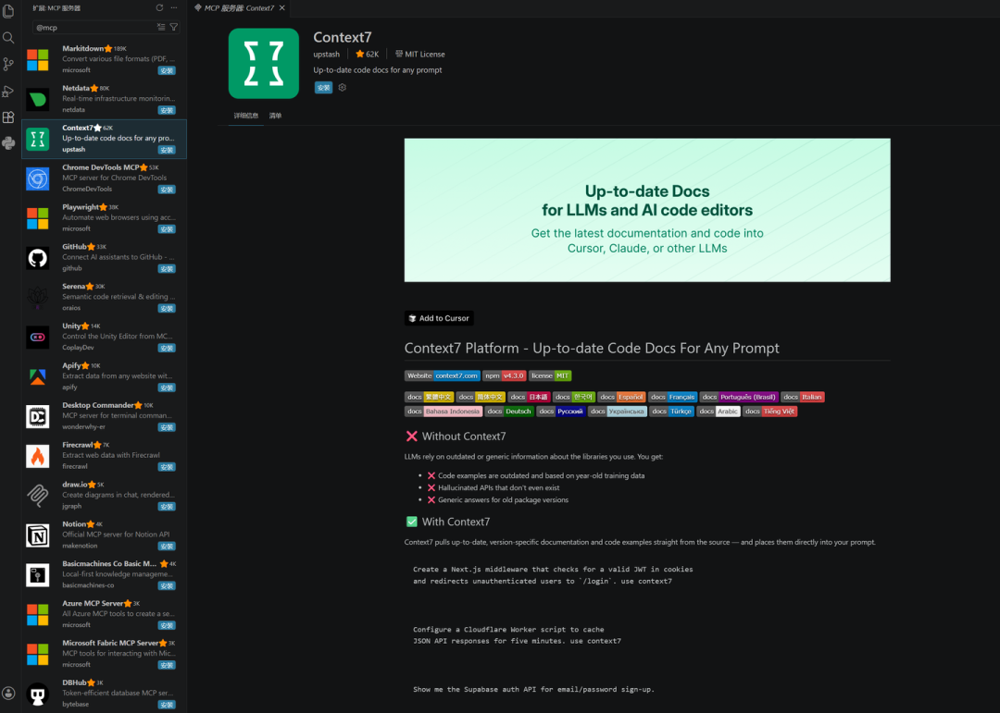
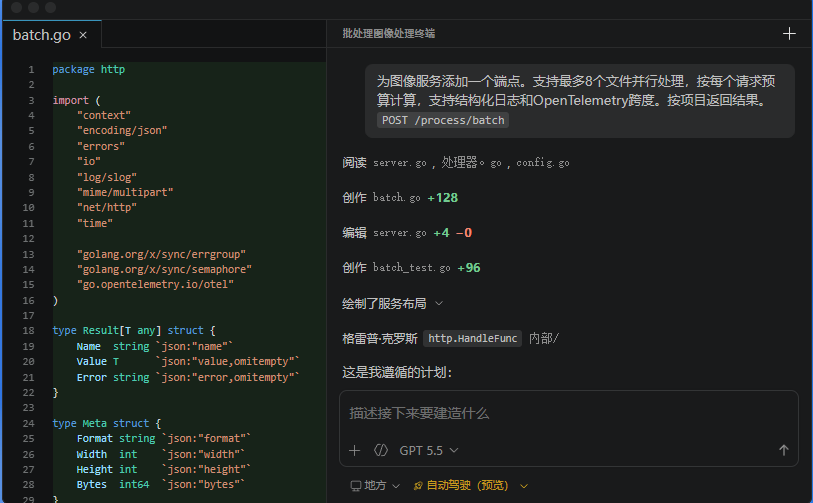
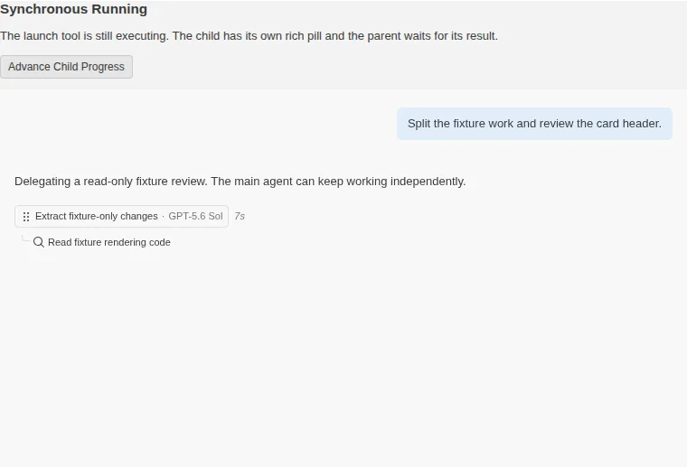
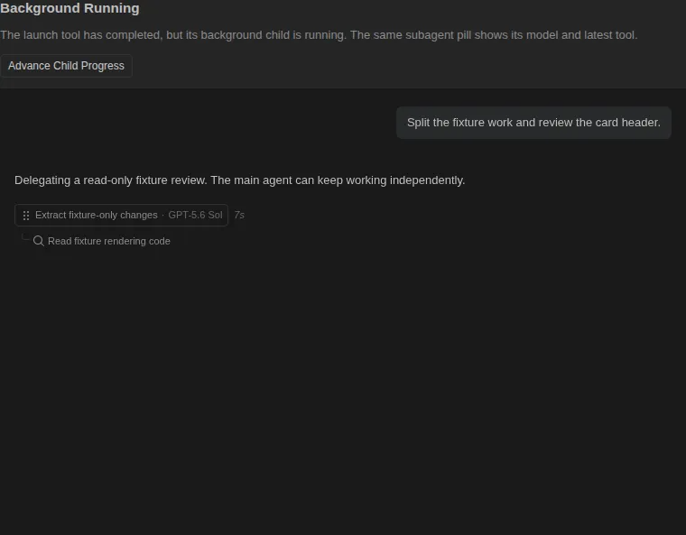
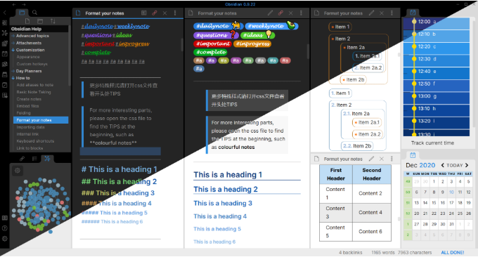
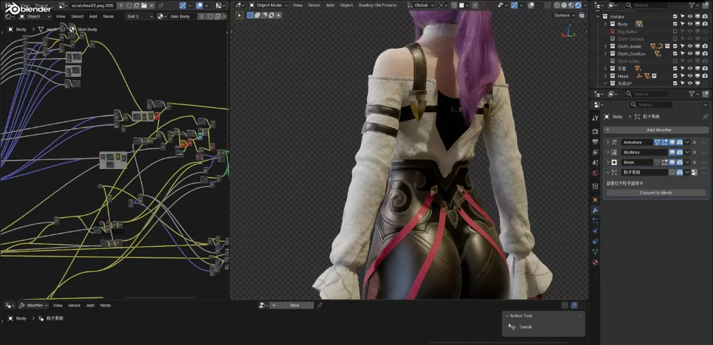
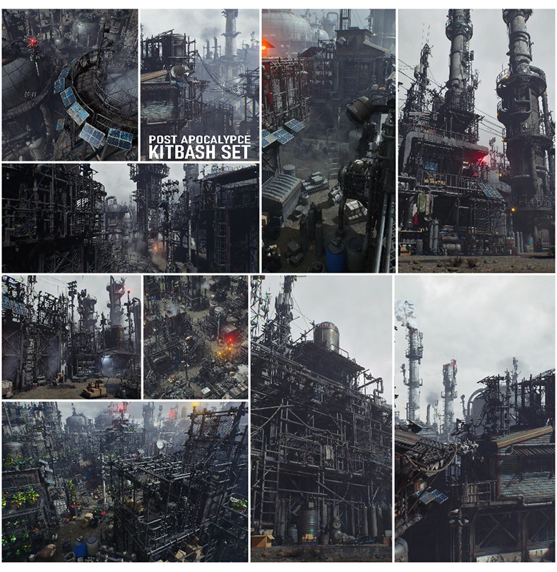
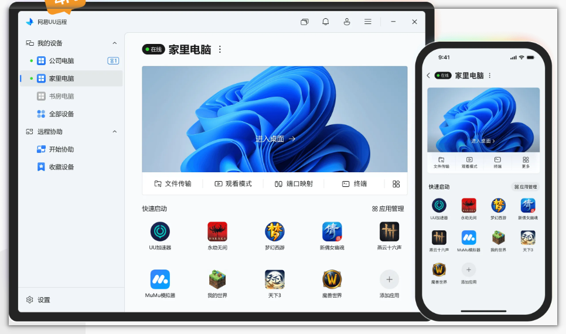
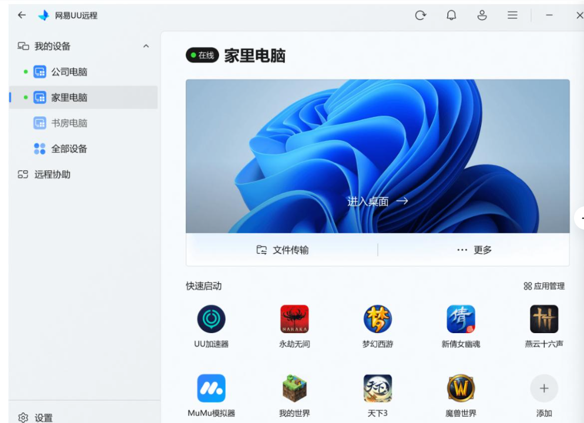
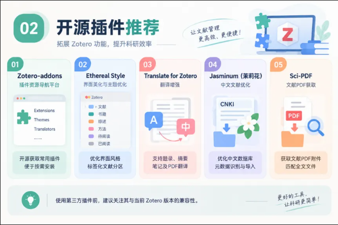

# 这些软件真是免费的吗
> 💡 备注属性未写入，可能是备注属性名称或者类型被修改了，建议将字段类型设置为 rich_text，可以在小程序-操作-修改文章数据库页面进行调整
> 💡 原文链接:[https://mp.weixin.qq.com/s?__biz=Mzg4MzUxMzA5OQ==&mid=2247489771&idx=1&sn=c260dde825088023ba9c9b7ed4202039&chksm=ce6ae46771d56b365d566711d0b37ef6f8a97b014f5733c6ae62bb26cbd5cd7b0443bee6fb0c#rd](https://mp.weixin.qq.com/s?__biz=Mzg4MzUxMzA5OQ%3D%3D&mid=2247489771&idx=1&sn=c260dde825088023ba9c9b7ed4202039&chksm=ce6ae46771d56b365d566711d0b37ef6f8a97b014f5733c6ae62bb26cbd5cd7b0443bee6fb0c#rd)
## 有什么免费软件好用到让你难以置信它是免费的？
分享几个自己平时经常用的软件，一开始用的时候还以为要收费，主要功能实在逆天，要知道以前同类型比它们差的都还要收费，到处找破解。官网下载，软件正版、可扩展性强
### VS Code（文本编辑器、代码编辑器）
全称Visual Studio Code，用过Sublime Text、Atom、UltraEdit‌、EditPlus，轻量化，功能、扩展性不及VsCode，要么没有插件市场，要么需要到处找盗版
像IntelliJ IDEA、Visual Studio‌功能很强大但安装包非常臃肿，打开速度及其慢
**1）强大的应用扩展市场**
扩展能力几乎没有边界，主流的扩展方向完全覆盖全栈开发全链路
#### 支持插件
官方插件市场收录超 3.8 万个扩展，覆盖远程开发、AI 补全、多语言支持等全场景需求
必装插件推荐
- Remote-SSH本地 VS Code 界面，直接打开远端 Linux 服务器的文件，**编辑器、终端、调试全部跑在服务器**。你的电脑只传界面，算力、编译全在云服务器 / 树莓派 / 刀片服务器。可以在轻薄本上编译大模型、跑嵌入式开发
- PlantUML / Mermaid：在编辑器内直接渲染流程图、架构图
- SQLite Viewer / Database Client：侧边栏直接连 MySQL/PG，写 SQL、看表、可视化结果，替代 Navicat
- Markdown 预览、PPT 生成、绘图、交互式科学计算面板（ScienceLab）
- CodeSnap：一键生成漂亮代码截图，带阴影背景，适合写博客
- Code Runner：一键运行几十种语言代码片段，无需配置完整工程
#### 支持MCP
MCP用法
1. 速唤起MCP市场‌按打开扩展面板，直接在搜索框输入，就能过滤出所有官方认证的MCP服务器，不用在海量普通扩展里翻找。
1. ‌**精准定位特定服务**‌：输入，比如、，直接跳转到对应MCP服务器的详情页，点击安装后确认信任，AI就能自动调用它的所有能力。
1. ‌**验证安装状态**‌：安装完成后打开命令面板，执行，就能看到所有已配置的MCP服务器，确认服务正常运行。
一些常用MCP
GitHub MCP‌：让Copilot Agent直接读取仓库Issue、查看PR状态、自动生成代码提交说明，不用切换浏览器打开GitHub网页
Playwright MCP‌、Context7、Figma MCP、HuggingFace MCP
安装MCP入口：

**2）方便定制**
基于插件驱动的架构，像Cursor、Trae基于VSCode修改，换个皮肤就成了新IDE
**Cursor**基于 VS Code 深度改造，AI 能力完全嵌入编辑器底层，多文件 Composer 体验成熟，可自主完成跨文件链路修改，上手零学习成本，是 AI 辅助日常编码的标杆选择
**3）AI**
将任务交给自主规划、修改代码、执行命令并迭代直到完成任务的AI代理。
从GitHub Copilot、CodeGeeX这类实时代码补全工具，到Roo Code这类开源AI Agent，可直接把AI能力深度嵌入编码全流程，实现跨文件自主重构、注释转代码、漏洞自动检测
例如，指定一个基于CLI的代理在后台进行分流和修复错误，与另一个代理交互，利用集成浏览器中的实时验证实现功能，并将首页重设计委托给云代理，后者会向你的团队打开拉取请求进行审核。

### Agent更智能了
直接重构了 Agent 全生命周期渲染逻辑
**1、首先是模型早知道**
现在 Agent 任务刚启动，界面就会实时展示当前调用的大模型，不用等到任务跑完才能知晓，完美适配多模型切换、自定义模型的用户

**2、子任务永久可视化**
解决幽灵任务问题。不管是并行任务、嵌套后台任务，还是父任务结束后仍在运行的子任务，都会保留可视化进度卡片，不会自动隐藏

优化了会话状态保留机制。切换会话、重启页面后，任务进度、模型信息、对话焦点都会完整保留，不会丢失关键上下文。
### Obsidian&思源笔记
本地双向链接笔记，文件全部存在自己电脑（纯 Markdown），不锁云端。插件生态爆炸，知识库、个人第二大脑，基础功能永久免费
(60 封私信) 如何使用Obsidian软件？ - 知乎
**为什么推荐Obsidian？**

**1）插件足够多**
社区插件市场已有600+插件，从Dataview的SQL式笔记查询、Excalidraw手绘图表，到最新的CLI命令行对接AI Agent，几乎能完全自定义出专属你的工作流，甚至可以把它改造成任务管理、文档发布、数据分析工具
用免费插件够用、整体使用成本极低
**2）性能强**
纯本地架构完全不依赖网络，哪怕是万级文档的知识库，全局搜索也能做到毫秒级响应，离线环境下也能无限制正常使用
**3）双链体验好**
通过双向链接自动生成反向引用，搭配知识图谱视图，能直观呈现上千条笔记之间的隐藏关联
笔记是纯文本Markdown，哪怕10年后软件停更，你用记事本也能直接打开
**4）工作流举例**
**a. 读书笔记工作流**
1. 创建书籍主页笔记：用模板快速创建，记录书的元信息
1. 阅读中记录摘录和评注：用 Callout 区分原文引用和个人思考
1. 提炼核心概念笔记：将书中的重要概念独立成原子笔记
1. 建立概念之间的链接：将新概念与已有知识网络连接
**b. 每日工作流（GTD 简化版）**
1. 早上：打开今日日记，列出 3 个今日目标
1. 白天：随时在日记中记录想法、添加任务、写上进度
1. 晚上：回顾今天，勾选完成的任务，简单写一段总结
**c. 学习笔记工作流**
这是基于 Zettelkasten 方法论改造过的实用版本，适合技术人员和学生的学习场景

**工作流程：**
1. 学习一个新知识时，先在日记或临时笔记中记录（闪念笔记）
1. 整理时，用自己的话将核心概念写成独立笔记（文献笔记 → 永久笔记）
1. 为每个概念笔记添加双链，连接到已有的相关知识
1. 打开反向链接面板，检查新笔记是否被其他笔记自然引用
**d. 写作工作流**

### Blender
一款**免费开源的全能三维创作软件**
跨平台支持 Windows、macOS、Linux，功能覆盖建模、雕刻、材质贴图、灯光渲染、动画绑定、粒子特效、视频剪辑、几何节点、3D 打印等完整 3D 工作流，个人、工作室均可无版权限制商用。从静态效果图、角色动画、影视短片、游戏资产到动态视觉、AI 三维内容制作都能完成。

**使用场景：**
- 三维建模（角色 / 场景 / 工业模型）
- 动画制作（角色动画、镜头动画）
- 渲染出图（产品图、插画、CG）
- 游戏资源制作（Unity / UE）
- 特效（烟雾、火焰、流体）
- 视频剪辑
项目文档：
Blender 5.2 LTS Manual
素材：
动画控制_Blender
#### 场景介绍
**1、对复杂的3D城市场景建模**

六十五组科幻末世废土城市建筑机加工厂景观环境全场景3D模型

BMS军事武装人物角色坦克车硬面3D资产模型

#### 一些插件介绍
**1）Blender物理模拟插件Ragdoll Tools**
Blender布偶效果模拟插件Ragdoll Tools V1.5.2是一款专为三维动画师与游戏开发者打造的高效工作流增强工具，它通过深度集成物理模拟功能，极大地简化了在Blender中创建复杂布偶（Ragdoll）系统的繁琐流程，无论是初学者还是资深专业人士，都能通过这款插件在极短时间内完成从静态模型到动态物理交互的转化。Ragdoll Tools的核心优势在于其卓越的兼容性与灵活性，它不仅支持直接从多边形网格（Meshes）生成布偶物理结构，同时也完美适配骨骼系统（Bones），这意味着用户可以根据项目的具体需求，自由选择基于几何体碰撞或骨骼驱动的物理模拟方案。

**2）Blender Mograph Toolbox 插件**
Mograph Toolbox 是一套面向 Blender 动画师、三维设计师和运动图形创作者的专业节点化工具集，它的核心价值在于把原本需要大量手动关键帧、复杂几何节点搭建以及重复修改器配置的动态图形流程，整合成更加直观、高效、程序化的工作方式。

#### AI
用自然语言把 AI 客户端连接到 Blender。上传参考图，描述你想要的模型、材质或场景， AI 可以通过 Blender Python API 读取当前文件、创建对象、调整节点、分析性能并整理资产。
普通聊天机器人只能给你教程或代码片段；MCP Server 会把 AI 客户端、MCP 服务和 Blender 插件连成一条本地通道。 你在 AI 里提出需求，AI 通过接口向 Blender 发出操作，再把结果反馈给你。
### UU 远程
网易出品的跨平台远程控制工具
核心功能免费无广告，支持手机、平板、Mac、电脑远程操控 Windows 与 macOS 主机，依托自研传输技术实现低延迟，最高支持 4K 144 帧画面，具备远程开机、跨设备高速文件传输、远程命令行终端、端口映射、隐私屏等能力，采用账号或 ID + 验证码方式安全连接，无需配置 IP 端口，可满足远程办公、IT 运维、远程协助、PC 游戏串流等场景，适合开发、运维人员与普通用户随时随地访问远端电脑。

**优势特点：**
1. 免费版上限很高：4K/144 帧、手柄映射、高速文件传输、隐私屏全部免费，无时长限制，界面干净无广告；文件传输不限速不限大小，内网能跑满带宽。
1. 游戏串流强项：针对游戏输入优化好，自带按键映射，低延迟画面跟手，适合手机 / 平板远程玩 PC 游戏。

因为平时玩游戏比较多，相对其他几款远程工具，无论是稳定性、分辨率都很满意。本身UU还有网络加速器，又是做游戏起家的，对于网游的优化技术会比较成熟。
游戏优化
**音画同步做得不错**，依托网易 UU 加速的网络中转，跨运营商公网比普通 P2P 串流更容易连上
**大量现成游戏按键映射**：内置 300 多套预设，原神、黑神话、怪物猎人、Galgame 等都有，支持自定义虚拟按键；蓝牙手柄直连，带手柄震动，平板 / 手机秒变掌机
### Zotero
**免费开源的跨平台文献管理工具**
支持 Windows、Mac、Linux 与 iOS，搭配浏览器插件可一键抓取网页、数据库里的论文、书籍资料，自动提取文献元数据并附带 PDF 原文；支持文献分类打标签、PDF 阅读批注、全文检索，可对接 Word、LibreOffice、Google Docs，内置数千种引文格式，写作时一键插入引用并自动生成参考文献，支持多端同步、小组共享文献库，还能通过丰富插件扩展功能
**一站式采集与整理文献**
安装浏览器 Connector 后，**Zotero**可在知网、PubMed、Web of Science、Google Scholar及期刊官网等页面一键抓取文献题录信息，并可同步保存网页快照或PDF全文。对于本地已有PDF文件，**Zotero**也支持导入后自动识别题名、作者、期刊等元数据。
**支持第三方插件扩展**

**Zotero**之所以深受科研用户欢迎，很大程度上得益于其活跃的开源插件生态
1.** Zotero-addons：**Zotero插件资源导航与聚合平台，安装后可开源获取所有常用插件，便于用户按需筛选和安装合适的扩展工具。
**2. Ethereal Style：**界面美化与主题优化插件，可改善Zotero整体视觉风格，可对列表文献分区以标签形式呈现，提升日常使用体验。
**3. Translate for Zotero：**翻译增强插件，支持对题录信息、摘要、笔记以及PDF内容进行翻译，能够在阅读外文文献时提供更便捷的辅助。
**4. Jasminum（茉莉花）**：面向中文文献场景开发，主要用于优化知网等中文数据库的元数据识别与导入效果，改善中文题录抓取质量。
**5. Sci-PDF：**用于获取文献PDF附件，便于为已有条目匹配全文文件，提高文献收集效率。
