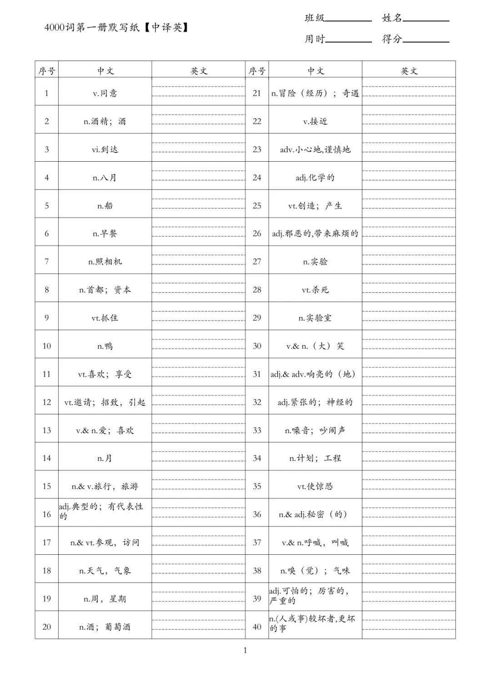
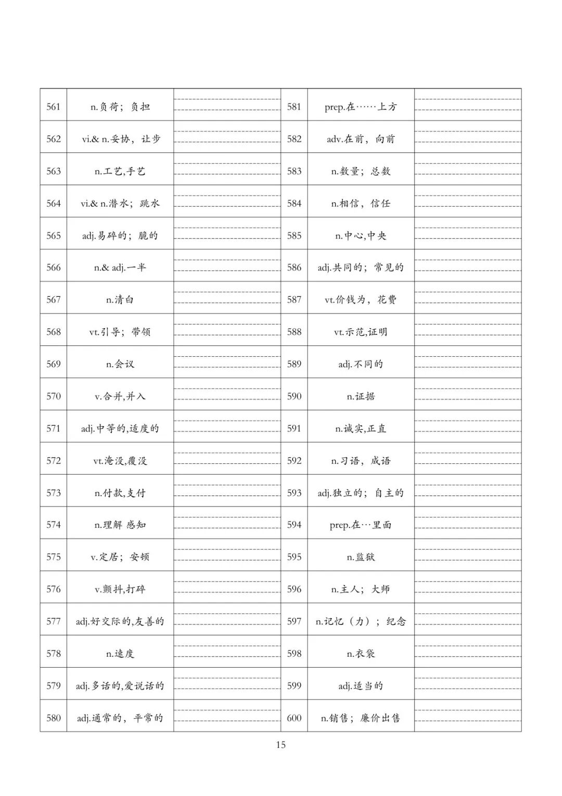

# 这套4000词默写纸，中译英+英译中双向检测，把"假会"看得明明白白
> 💡 备注属性未写入，可能是备注属性名称或者类型被修改了，建议将字段类型设置为 rich_text，可以在小程序-操作-修改文章数据库页面进行调整
> 💡 原文链接:[https://mp.weixin.qq.com/s?__biz=MzkxMjY5NTgwNg==&mid=2247484926&idx=1&sn=cc215d0387ae332715e3672c6613f475&chksm=c00eb36a2244698721cf4f6957ceec5c40c89cdbc51a4e549d7be944dbd934329e32aa7d64aa#rd](https://mp.weixin.qq.com/s?__biz=MzkxMjY5NTgwNg%3D%3D&mid=2247484926&idx=1&sn=cc215d0387ae332715e3672c6613f475&chksm=c00eb36a2244698721cf4f6957ceec5c40c89cdbc51a4e549d7be944dbd934329e32aa7d64aa#rd)
**点击上方蓝色关注我，在陪娃路上一起加油！**
每次问孩子"这个单词认识吗"，他都点头。可一落到笔头上——拼不出来；再换一张纸让他写中文意思，又只记得个大概。
问题出在哪？**大多数家长检查单词，只查了一个方向。**
"看英文说中文"考的是**认读**，"看中文写英文"考的是**拼写**。前者是输入、后者是输出；只测一边，就等于只给单词拍了个半身照——孩子到底是"认识"还是"会用"，家长根本看不清。
今天分享的这套 **4000词默写纸**，最大的特点就是：**每一册都配了两套练习纸，一个中译英、一个英译中，双向夹击，把"假会"看得明明白白。**
**📚 4000词默写纸 · 全4册 · 中译英＋英译中**
**一、这套资料怎么配的？**
整套共 **4 册，逐级进阶**。每一册都配了**两张方向相反的练习纸。**
**🧾 每册的"双向配套"长这样**
**① 英译中练习纸**：英文给出、中文留白——查"**认不认**"，用来快速摸清哪些词只是眼熟、说不出意思。
**② 中译英练习纸**：中文释义（带 v. / vt. / adj. 等词性标注）给出、英文留白——查"**会不会写**"，逼孩子从记忆里提取完整拼写。
两张纸共用同一批词，表头都是**班级 / 姓名 / 用时 / 得分**四栏，A4 一页 40 词，打印即用。
**为什么"双向"这件事这么重要？**
因为两个方向的错，暴露的是完全不同的漏洞：**英译中默不出来**，说明这个词根本没进脑子，要先回去重学；**中译英写不出来**，说明孩子认得出、却记不住拼写，需要专门练拼写。一套资料同时给你这两份"体检报告"，才知道下一步该补哪儿。

▲ 第一册·中译英：中文＋词性给出，英文留白默写
**二、三个专门为"默写"做的设计**
**① 词性标注到位，默写顺便练语法**
中文释义前都挂着词性标签：看到"vi.到达"，孩子会提醒自己 arrive 后面不能直接加宾语；看到"n.& v.（大）笑"，就得反应出 laugh 的双重身份。默写是手的动作，语法意识在悄悄扎根。
**② 四册难度爬坡，从"够用"到"拉分"**
单册内部也是递进的：前面几页是 agree、arrive、breakfast 这类高频基础词，越往后越见功夫——assume（假定）、compromise（妥协）、idiom（习语）陆续登场。按册推进，孩子的词汇量是"爬"上去的，不是"堆"上去的。
**③ 用时＋得分栏，把练习变成挑战**
每页右上角那两格是这套资料的灵魂：40 个词限时默写，孩子自发地跟上一页的自己比速度、比正确率，家长连催促都省了。

▲ 同一册的后段：burden、compromise、idiom 等进阶词压轴
**三、双向四步法：一册书榨出两倍效果**
**第 1 步：先用英译中"摸底"**
不复习、不计时，直接默一遍英译中。写得出的词=已认识；空着或写错的词，就是这册书里真正要学的部分。这一步 10 分钟，省掉盲目背整册的时间。
**第 2 步：只对"认识的词"做中译英**
英译中默不出来的词先不急着默写——不会的词，写多少遍都是抄。等这些词重新学过、有印象了，再拿中译英那套纸攻拼写。顺序反了，孩子只会挫败。
**第 3 步：两张纸摊开对比，错词上色**
同一批词，两个方向的错法放在一起看：**两个方向都错→画红星，回单词本重学**；**只会认不会写→画黄星，专门练拼写**；**字母小错→打勾，下次重默**。一张纸就是一份定制学习清单。
**第 4 步：一周一册，滚动清零**
按"一周推进一册的两个方向"的节奏走，周日把这一周带记号的词重默一轮。得分记在本子上画曲线，看着正确率从 70% 爬到 95%，比任何奖励都让孩子有成就感。
**🍊 使用小贴士**
· 一个方向一张纸、同一页多打 2–3 份，滚动复测；
· 四册按顺序推进，别跳册——词是层层加固的，跳着刷容易反复；
· 单页错一半以上，说明当前段落偏难，退回前一页夯实再前进；
· 中译英那套建议放在"学过之后"用，它是验收工具，不是新词教材。
**📄 资料领取方式见文末菜单栏**
第一步：识别下方二维码关注公众号

第二步：在对话框**回复“4000词”**参与领取

END
