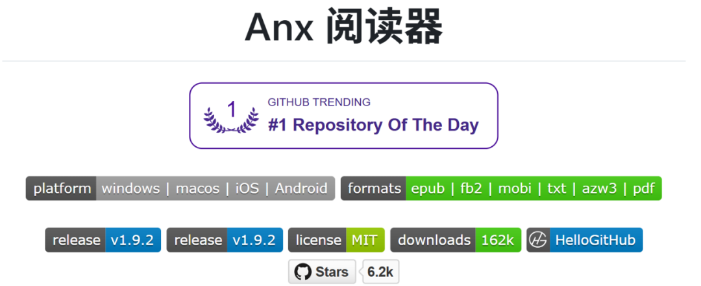
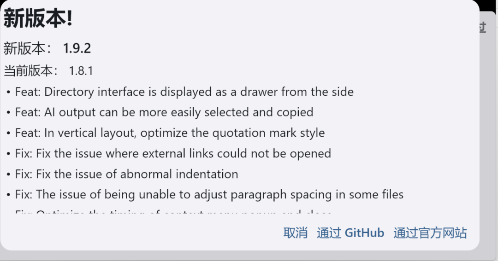
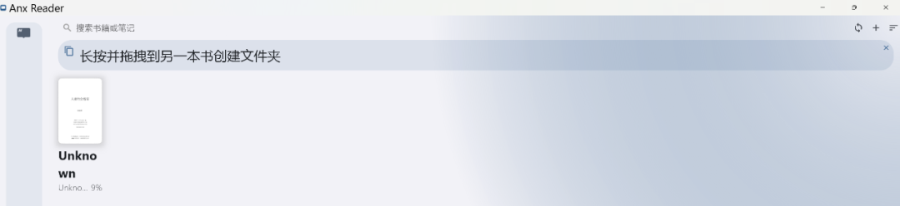
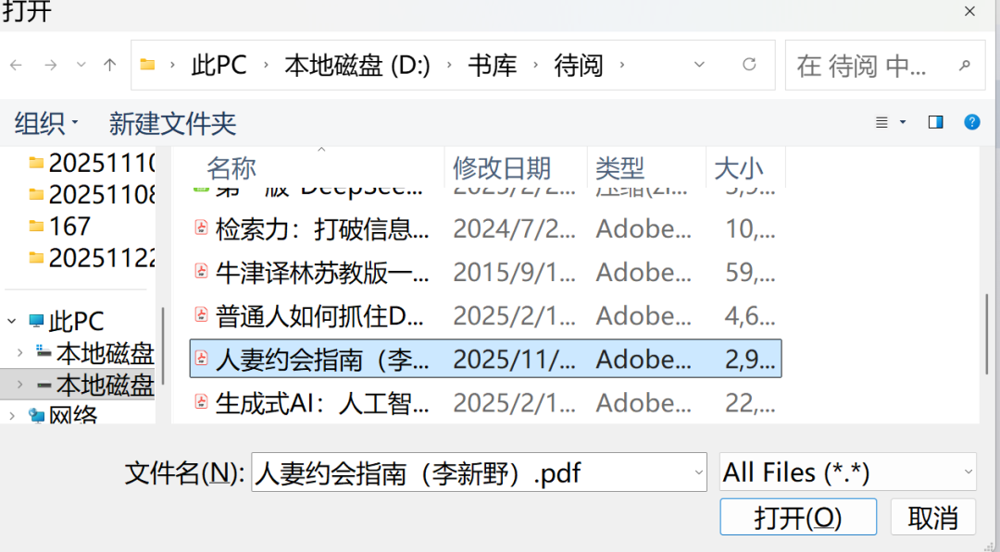
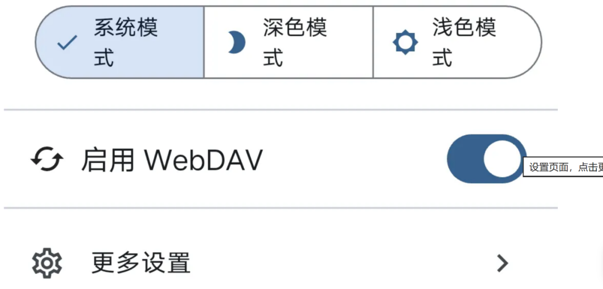
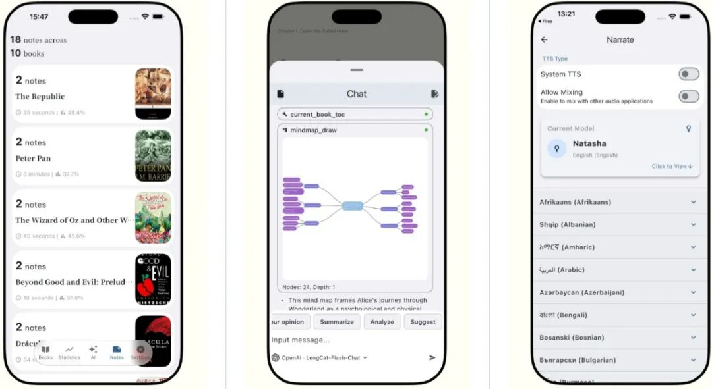
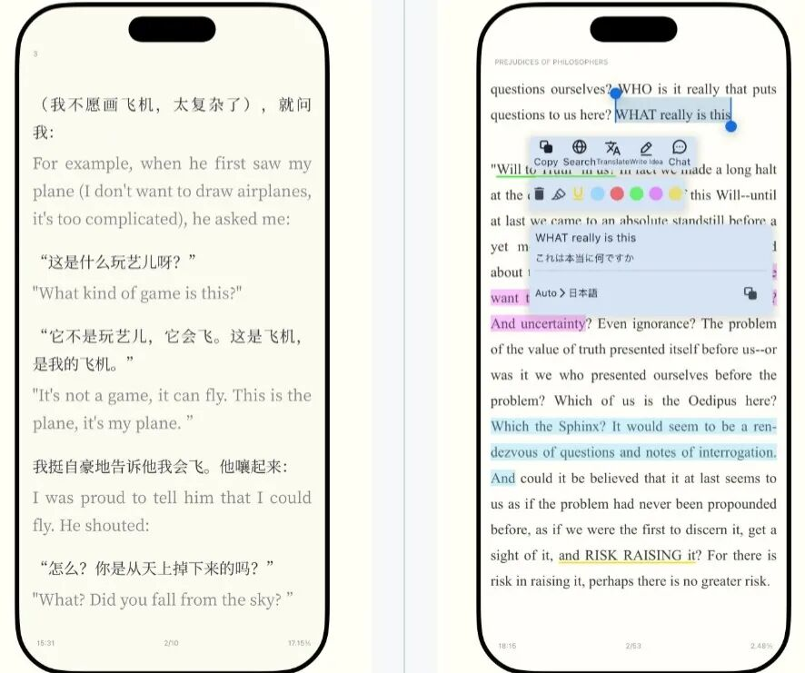

# 这神器让电子书阅读爽到飞起！AI+全平台同步，6.2K人直呼真香
> 💡 备注属性未写入，可能是备注属性名称或者类型被修改了，建议将字段类型设置为 rich_text，可以在小程序-操作-修改文章数据库页面进行调整
> 💡 原文链接:[https://mp.weixin.qq.com/s?__biz=MzkxNjY3Nzg5MQ==&mid=2247489035&idx=1&sn=d4824e4b939b2d2387fffb7105673657&chksm=c0e6ef82ff5fbeba4b6a512fa6eadeb0bd7be1e8336b477abdf009ec94c805aec2af342604df#rd](https://mp.weixin.qq.com/s?__biz=MzkxNjY3Nzg5MQ%3D%3D&mid=2247489035&idx=1&sn=d4824e4b939b2d2387fffb7105673657&chksm=c0e6ef82ff5fbeba4b6a512fa6eadeb0bd7be1e8336b477abdf009ec94c805aec2af342604df#rd)
点击上方或左下角“弗专书馆”**关注**我吧！
电子阅读日益普及，我们对电子书阅读器的要求越来越高。除了支持多种格式和跨平台使用，AI功能的无缝衔接以及个性化体验也越来越被重视。跨平台的开源阅读器Anx Reader（安读）我试用后，认为值得推荐给各位书友。
**为什么值得推荐？**

“让阅读更智能、更专注。”这是Anx Reader开发者的愿望。目前，这款软件在GitHub上已收获了6.2K star，凭借强大的功能和人性化的设计，在众多电子书阅读器中脱颖而出。
Anx Reader凭借AI深度融合、开源免费且无广告、全平台覆盖，成为当今数字阅读的理想工具。
**亮点1.AI智能助手**
集成 OpenAI、DeepSeek、Claude、Gemini 等主流模型，支持内容总结、阅读位置回溯、难点解析。

**亮点2.跨平台同步**
通过WebDAV同步阅读进度、笔记和书籍，支持 Android、Windows、macOS（测试版）。
**亮点3.个性化阅读**
自定义主题、字体、间距，支持滚动、分页模式切换。
内置TTS语音朗读、划词翻译、全文搜索。
**亮点4.专业数据分析**
生成周、月、年度阅读报告，可视化热力图追踪习惯。
**亮点5.笔记管理**
高亮批注后，读书笔记可导出为TXT、Markdown或 CSV格式。
**最新版本**
v1.9.2
**更新重点**
支持更多格式
修复AI服务异常问题
优化全文翻译效果
增强同步稳定性

**下载地址**
1.GitHub官方仓库
https://github.com/Anxcye/anx-reader
2.弗专书馆分享
路径请见本文末。
**支持的电子书格式**
EPUB：主流电子书格式（推荐）
PDF：新开发的功能
MOBI：Kindle 兼容格式
AZW3：Kindle 增强格式
FB2：俄语区常见格式
TX：纯文本文件
**图书导入步骤**
Anx Reader类似于静读天下，属于本地阅读工具，没有在线阅读功能。读者需要自己寻找书籍资源，动手随心所欲导入。

1.打开应用→点击右上角 + 按钮；

2.选择本地书籍→从设备存储中选取电子书文件；

3.系统自动解析并加入书架→双击封面开始阅读。
**自定义设置**
1.点击屏幕空白处呼出菜单。

2.调整字体、段落、边距等。
3.自定义主题、背景、对齐方式和样式。
4.通过目录按钮快速跳转阅读章节。
**跨平台同步方法**（WebDAV）

实现多设备进度同步：
1.启用WebDAV
进入设置→更多设置→同步设置→选择WebDAV；
输入WebDAV服务地址、账号及密码（如 NAS/坚果云等）。
2.手动同步
书架页面点击顶部“循环箭头图标”→立即同步数据。
3.支持同步内容
书籍文件、阅读进度、笔记批注、阅读统计。
**AI功能使用指南**
Anx Reader结合AI按进度和语气，能够帮助组织、管理书架，生成思维导图以加深阅读理解，还可利用AI词典进行翻译，跟能够为读者提供观点分析和图书摘要。
**步骤1：配置AI服务**
进入设置→AI助手→选择服务商（如 DeepSeek）；
输入对应平台的API Key（需自行申请）。
**步骤 2：核心AI功能操作**
1.智能摘要
长按文本→选择 “总结内容”→AI生成章节要点。
2.阅读位置回溯
询问AI：“上次主角XX的情节在哪里？”→自动定位到相关段落。
3.实时翻译

选中单词或句子→点击“翻译”按钮。
4.难点提问
框选文本→选择“提问”→输入问题，如“解释这个词语”。
5.TTS朗读
点击工具栏“耳机图标”→AI语音朗读当前章节（支持调节语速）。
6.高阶技巧
导出AI笔记：
批注后进入笔记库→导出为Markdown，结合AI工具二次整理。
阅读报告生成：
统计页面点击“年度报告”→AI分析阅读偏好并生成建议。
**Anx Reader（安读）最新1.9.2手机版、电脑版免费获取路径**：
“**关注**”弗专书馆后，再“**发消息**”输入关键词“**251204**”，即可收到百度网盘链接。
**如需互助寻书、查询资料、阅读互动，请扫一扫下方二维码加好友邀入“电子书互助共享群”交流！**

**电子书教程——**
[Win+R一键搜遍全网电子书！6类×22个网站免安装神器](https://mp.weixin.qq.com/s?__biz=MzkxNjY3Nzg5MQ%3D%3D&mid=2247488811&idx=1&sn=ae36cb3ffe26ca65fba15d8904327539&scene=21#wechat_redirect)
[Olib 怎么挂了？情非得已](https://mp.weixin.qq.com/s?__biz=MzkxNjY3Nzg5MQ%3D%3D&mid=2247488701&idx=1&sn=3c79db6ec161cc53b365816b05e66a4e&scene=21#wechat_redirect)
[用什么看网络小说最好？](https://mp.weixin.qq.com/s?__biz=MzkxNjY3Nzg5MQ%3D%3D&mid=2247488266&idx=1&sn=decb03f54ef409df9f14071faab7fd20&scene=21#wechat_redirect)
[超好用！手机中舍不得卸掉的读书APP](https://mp.weixin.qq.com/s?__biz=MzkxNjY3Nzg5MQ%3D%3D&mid=2247488238&idx=1&sn=bebc7c93d5713b8f78faad4b1bc2de60&scene=21#wechat_redirect)
