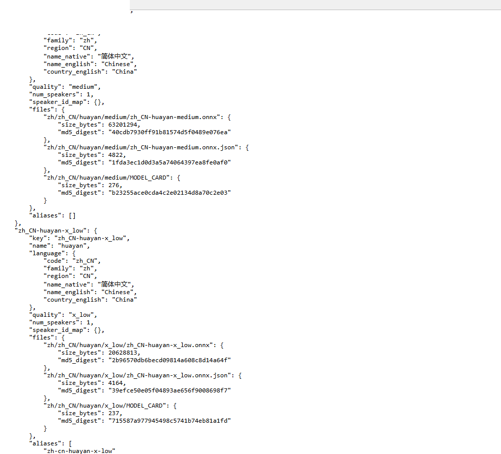

# 逼真人声，中文支持，最小模型仅20M！
> 💡 备注属性未写入，可能是备注属性名称或者类型被修改了，建议将字段类型设置为 rich_text，可以在小程序-操作-修改文章数据库页面进行调整
> 💡 原文链接:[https://mp.weixin.qq.com/s?__biz=Mzg3NjY3NTQxNQ==&mid=2247485100&idx=1&sn=128b8771e1ee82ea92d3fd536b4e0ff0&chksm=ce4d468a57267ded1b3a1c1b0bec5aa5d774a8239927c4b132bf8ca03a15be50039a79478f95#rd](https://mp.weixin.qq.com/s?__biz=Mzg3NjY3NTQxNQ%3D%3D&mid=2247485100&idx=1&sn=128b8771e1ee82ea92d3fd536b4e0ff0&chksm=ce4d468a57267ded1b3a1c1b0bec5aa5d774a8239927c4b132bf8ca03a15be50039a79478f95#rd)
想让程序开口说话，路子基本就两条：要么调云端接口，按字数付钱、断网就哑；要么本地跑大模型，动辄几个 G，普通电脑带不动。今天介绍的这个 Piper，走的是第三条路：语音模型小到能塞进树莓派，纯本地运行，不要网络，不要 API Key，合成的音色还挺像真人。
### 它是什么
Piper 是一个开源的神经语音合成引擎（TTS），出自智能家居项目 Rhasspy，现在归 Open Home Foundation 管。它的思路很直接：不追求超大模型，而是把每个"声音"训练成一个几十 MB 的独立文件，用 CPU 就能实时合成——在一台十二代 i7 上实测，合成速度大约是播放速度的六倍多，十秒的话两秒内就能生成完。
Home Assistant（开源智能家居平台）和 NVDA（知名读屏软件）都用它做语音输出，能进这两个项目的标配名单，稳定性是被大量用户验证过的。
### 小，是真的小
Piper 的语音按大小分四档，官方语音目录里现在有 177 个语音、覆盖 58 种语言。最小的 x_low 档，模型文件只有 20 MB 上下——我从官方目录的数据文件里数了一遍，最小的几个模型都是 20,628,813 字节，约 19.7 MB，真的能做到"塞进微控制器"。
各档位大致是这样：
- x_low：约 20~28 MB，16 kHz，给树莓派 Zero 这类设备用，音质对讲机水平
- low：约 28~70 MB，16 kHz，语音助手短句够用
- medium：约 60 MB，22.05 kHz，主力档，177 个语音里 120 个都是它，音质大约相当于 2021 年的商业在线 TTS
- high：63~137 MB，22.05 kHz，高质量档
作为对比：目前开源圈很火的 Kokoro-82M 是 327 MB，云端的商用大模型更是以 G 计。Piper 这套"小模型全家桶"，是它能在低端设备上普及的根本原因。
### 中文支持：有，20M 档就有中文
这是我最关心也最容易踩坑的部分，所以直接把官方语音目录的页面截图放在这里——注意 `zh_CN-huayan-x_low` 这一条，模型文件 `size_bytes: 20628813`，换算下来就是 19.7 MB：

截图自官方语音目录 voices.json（rhasspy.github.io/piper-samples）
官方目录里简体中文一共四个语音文件：
- 华妍（huayan）：女声，两个档位——medium 版约 60 MB（22050 Hz），**x_low 版只有 19.7 MB**（16 kHz）
- 超文（chaowen）：medium 档，约 60 MB
- 小雅（xiao_ya）：medium 档，约 60 MB
也就是说，标题里的"最小模型仅20M"不只是全家族的成绩，**中文语音自己就有 20M 档**——不过要提醒一句，x_low 是 16 kHz 采样率，音质明显不如 60 MB 的 medium 版，对音质有要求就上 medium，对体积敏感（比如塞进开发板）就用 x_low。
声音版权方面要说清楚一件事：Piper 的**引擎代码是 GPL-3.0**，但**语音模型文件是 MIT 许可**——把华妍的声音文件打包进你的产品里商用，MIT 这一层不拦你（个别语音有单独许可，用之前看一眼 MODEL_CARD 即可）。
### 用起来三行命令
装好 piper-tts，下载语音模型（.onnx 和 .onnx.json 两个文件要成对下载，缺一个都跑不起来），然后：
`echo "你好，我是本地语音助手。" | piper -m zh_CN-huayan-medium.onnx -f hello.wav`
回车，wav 文件就出来了。华妍的 x_low 版在官方语音仓库的 `zh/zh_CN/huayan/x_low/` 目录下。国内网络访问 Hugging Face 不顺的，把下载链接里的域名换成 hf-mirror.com 就行。它还带 HTTP 服务模式和 Python API，想做智能家居播报、给程序配语音、或者做读屏工具，都有现成接口。
### 几句实话
- 音色自然度在中档在线 TTS 之上，但长句里长元音会有轻微的"合成感"，跟现在的商用大模型比还有差距——60 MB 的文件，不能要求它干 3 GB 模型的活
- 老仓库 rhasspy/piper 已经归档不再更新，**新家是 OHF-Voice/piper1-gpl**，2026 年 9 月刚发了 v1.8.0，pip install piper-tts 装的就是新版；项目目前在公开招维护者，发展速度不算快，但开源、本地、免费这三个核心诉求它是满足的
- 自带训练文档，有语料的话可以练自己的声音
### 下载
GitHub 搜 `OHF-Voice/piper1-gpl`，语音模型在 Hugging Face 的 `rhasspy/piper-voices` 仓库。一句话总结：想要一个不联网、不花钱、随处能跑的中文语音合成，Piper 是目前开源方案里最省心的一个。
#Piper #语音合成 #开源免费 #TTS引擎
