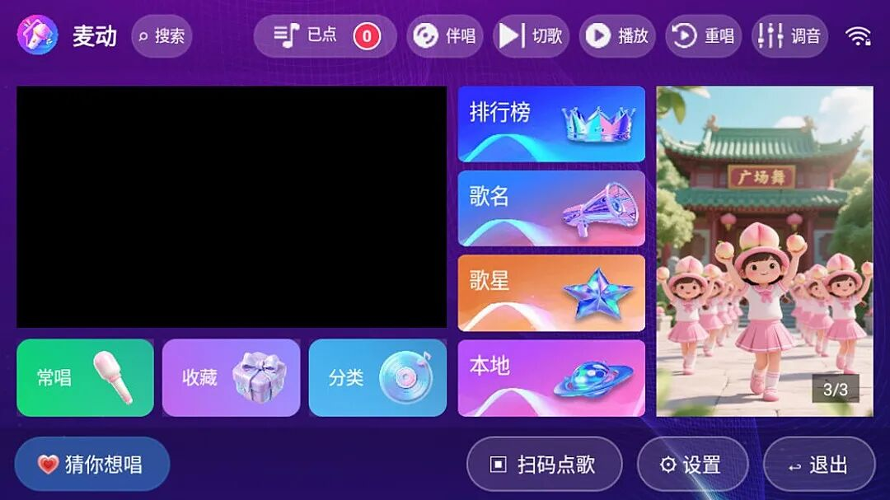
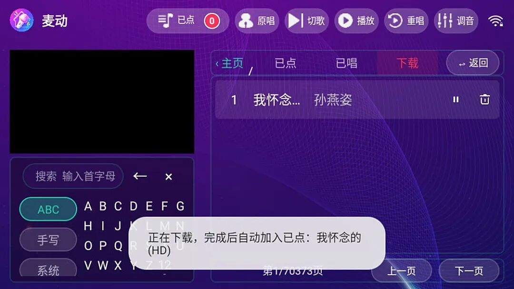

# 遥控器点歌，8 万首 MV 塞在电视里
> 💡 备注属性未写入，可能是备注属性名称或者类型被修改了，建议将字段类型设置为 rich_text，可以在小程序-操作-修改文章数据库页面进行调整
> 💡 原文链接:[https://mp.weixin.qq.com/s?__biz=MzI0MDk3MzQyMQ==&mid=2247484356&idx=1&sn=b0914eb22e9fb8ecf801c925e94f010b&chksm=e8b7f7518b605f26b3a30ebde247cb62ad72fb44a184f2a15f360eb9c18d4fe9107c3655284a#rd](https://mp.weixin.qq.com/s?__biz=MzI0MDk3MzQyMQ%3D%3D&mid=2247484356&idx=1&sn=b0914eb22e9fb8ecf801c925e94f010b&chksm=e8b7f7518b605f26b3a30ebde247cb62ad72fb44a184f2a15f360eb9c18d4fe9107c3655284a#rd)
GITEE · 263 星 · 非商用协议
麦动 KTV
8 万首歌的电视点歌台，曲库是别人的
三个数字：**81,801**、**50.3**、**8**。
第一个是它内置的歌曲数。第二个是安装包体积，单位 MB。第三个是它最近的发版次数——从 2.1.0 到 2.1.7，十九天发了八个版本。
三个数字摆在一起，能看出作者在补什么：把一整套点歌系统，塞进遥控器能操作的那块屏里。
01
它不是投屏
麦动 KTV，作者杨家三郎。主仓在 Gitee，GitHub 上那个仓库是镜像，七月之后就没再同步。
它在 README 第一行的定位写得很直白：面向 Android TV 和横屏点歌设备的本地 KTV 应用。
「本地」这两个字是关键。它不是把手机画面投到电视上，也不是网页版套壳，是应用自己装在电视或电视盒子里跑，遥控器直接操作。
曲库目录直接打包在安装包里——81,801 首歌、4,807 位歌星、63 个分类歌单、7 个排行榜。所以第一次打开就能搜歌，不用先联网建库。代价是安装包有 50.3 MB。
02
这 8 万首歌，不是它的
翻它的源码目录，曲库文件叫 **igeba_catalog.db**。
README 里还有一句更直接的：「点击数据设置中的『曲库更新』，才主动检查 **i歌霸曲库列表**：存在变化则同步。」
到了 2.1.6，更新说明就两行字：「接入集成 i歌霸账号注册与登录。在线点歌和下载需登录 i歌霸账号。」
i歌霸（ige8.net）是成都鑫龙志科技的产品，老 KTV 软件「阿蛮歌霸」的新一代。它本身就是免费的——官网 FAQ 写得很清楚，基本功能永久免费；VIP 只买三件事：免广告、缓存不限速、手机点歌不限次数。
所以这条链子是这样的：**麦动出界面，i歌霸出曲库，唱片公司出 MV。**
麦动没做曲库，也没做版权。它真正做的事，是把 i歌霸从一个 Windows 软件，变成一块能用遥控器点的电视屏。这件事本身有价值——i歌霸有曲库、有双屏、有手机扫码，但它只有电脑版，坐在沙发上没法用。
03
装之前，先备两样
**第一，APK。**去 Gitee 的 Release 页下最新的 2.1.7，50.3 MB，文件名 Maidong-KTV-2.1.7.apk。别从网盘下——网上流传的二手包改过什么没人知道，作者自己在 README 里就写明「付费购买说明你被骗」。
**第二，一个 i歌霸账号。**免费注册，邮箱就行，在应用里直接注册或登录。
顺序别反：先装 APK，再在应用里登录。登录之前，曲库目录能翻、能搜，但点歌播不了。
技术参数上有个细节值得说：minSdk 21，targetSdk 25。前者是 Android 5.0，说明老盒子能装；后者停在 7.1，说明它没跟新系统的适配。对电视盒子这种三年不更新的设备来说，这反而少踩坑。
04
遥控器上怎么点歌

首页：六个入口，底部「猜你想唱」和「扫码点歌」。字号是按三米外看电视定的，手机上看会偏小
首页是六个入口：排行榜、歌名、歌星在上排，常唱、收藏、分类、本地在下排。整块屏只放这几个，没有推荐流、没有 banner 广告位。
点歌有三条路：按歌名搜、按歌星翻、按分类找。搜索框支持首字母输入，键盘有 ABC、手写、系统三种，遥控器上下左右就能敲完一个歌名。
点歌进队列，不打断当前那首。已经下载过的直接进队，没下载的等下载完自动加进去，中间不会跳出来打断你。
播放时顶上那排是全部控制：原唱/伴唱一键切、切歌、重唱、调音。小窗和全屏能互相切，切页面的时候画面不断。画面固定 16:9，不给你拉变形。
手机扫码点歌：全屏右上角常驻一个小二维码，扫码后手机就是点歌台，不用抢遥控器。
05
歌存哪，三个位置

下载中：左边是首字母键盘，右侧列表显示「我怀念的」，底部提示「完成后自动加入已点」
默认存在机器本地。路径是这个：
/storage/emulated/0/MaidongKTV/video/cloud-song
插 U 盘也行。在数据设置里选 U 盘，多个卷就选对应那个，不用自己挑子目录。歌曲放在所选卷的 **maidongktv/video/cloud-song**，手动拷进去的歌点「立即加歌」扫一遍就进列表。U 盘拔了或者空间不够，当前下载自动退回本地，偏好还留着。
第三个位置是网盘，走 **OpenList**。填服务地址、访问凭据、歌曲目录，测通之后把它选成保存位置，「U盘加歌」就变成「网盘加歌」。扫描只建索引，播的时候才从网盘读。
三种位置用同一套规则认歌：应用下载的编号文件自动对应曲库，外部拷进来的按「歌手-歌名」解析。
还有个容易被忽略的设置：预留空间。可以按档位设一个阈值，到线之后自动清理——先保住正在播的和已经点过的那几首，再按最近使用时间删。
06
装之前，四件事
**一，曲库的版权不在作者手上。**MV 的权利人是唱片公司，i歌霸从哪拿的授权、覆盖了多少首，从外部查不到。麦动更没有。你家客厅唱几首，和拿去营业，是两件性质完全不同的事。
**二，它明确禁商用。**根目录下那份 LICENSE 是一份自定义的《非商用协议》，不是 MIT 也不是 GPL——不能卖、不能预装进盒子、不能围绕它做收费安装和技术支持。这不影响你自己用，但拿它做生意是踩线的。
**三，网上有卖这个的。**作者在 README 顶部用加粗写着：「如果您是付费购买的本软件，说明您已被骗，请立即向平台举报商家并退款。」这句话能出现在一个项目的首页，说明这事已经发生过不少次。
**四，它挂在 i歌霸身上。**账号规则一变、接口一改，你就得等作者跟。十九天八个版本听着勤快，反过来说也是：这个「跟」是常态，不是偶发。
07
什么人不该装
不想注册任何账号的，到这儿可以停了——不登录，它就是一个只能翻不能唱的曲库。
指望它替代 KTV 包厢那套音响的，也别抱太大期望。它管的是画面、伴奏、点歌流程；混响、麦克风、功放、灯光是另外一摊事，一个 APK 解决不了。
准备拿它开店的，同上第二条。
电视或盒子跑不动 1080P 的，先别急着装。它画面固定 16:9，老设备上解码跟不上会卡。
“
客厅 K 歌这件事，卡了这么多年，卡住的从来不是播放器，是曲库。
麦动的答案很直接：曲库不做，借。
借来的东西能借多久，不取决于写代码的人。
下载方式
公众号后台回复**麦动**两个字，自动回你 下载 页面地址。
