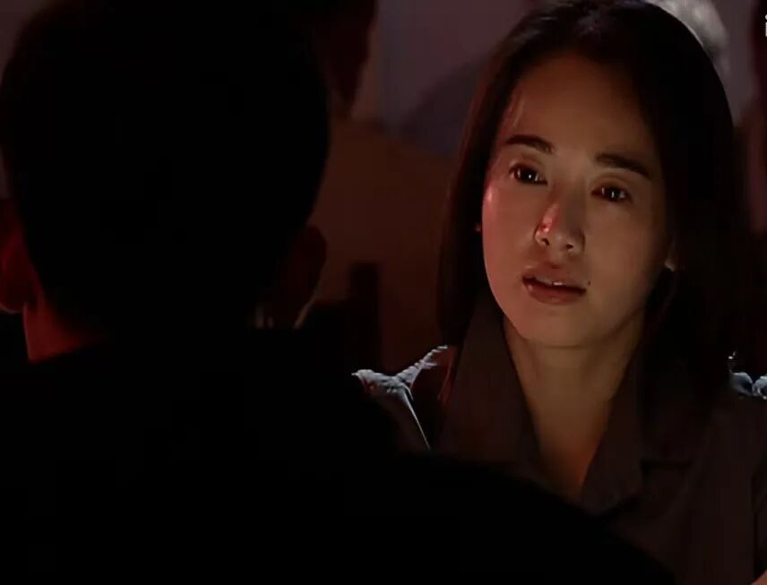
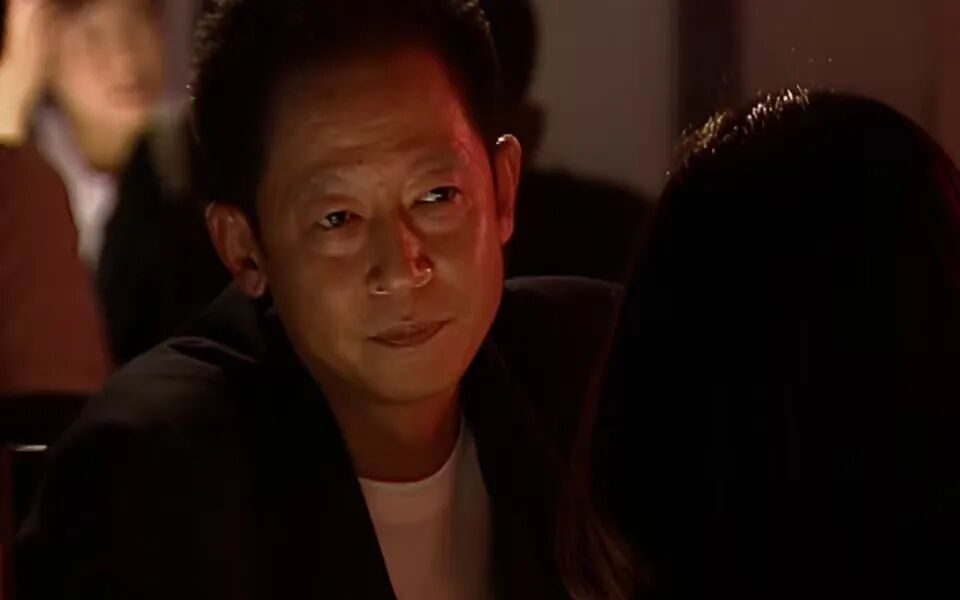
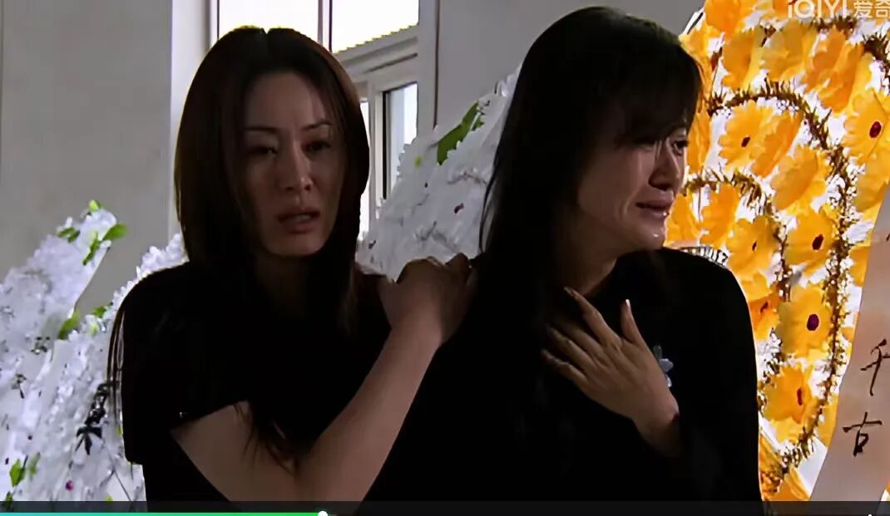
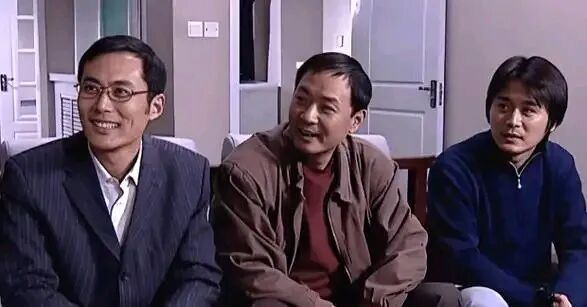
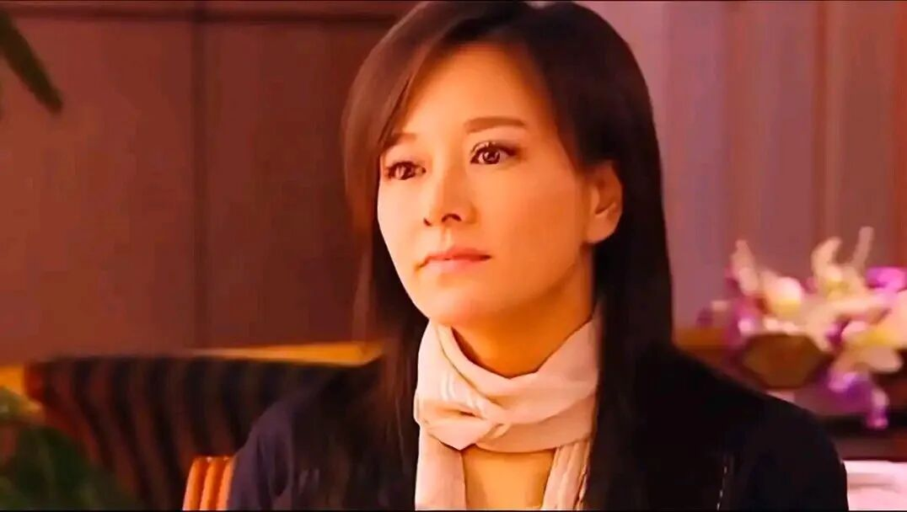
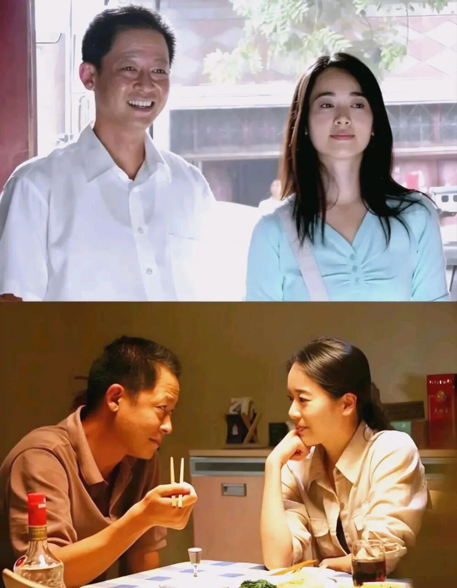
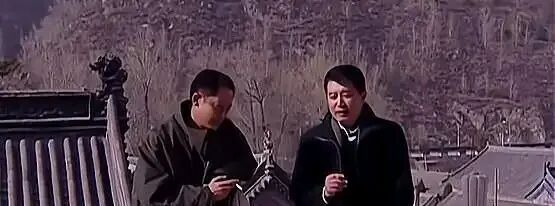
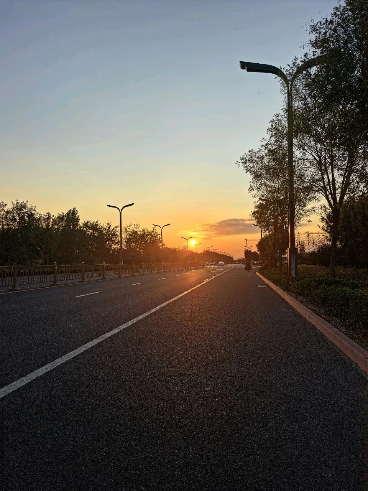

# 重温《天道》，一场情与天道的思考
> 💡 备注属性未写入，可能是备注属性名称或者类型被修改了，建议将字段类型设置为 rich_text，可以在小程序-操作-修改文章数据库页面进行调整
> 💡 原文链接:[https://mp.weixin.qq.com/s?__biz=MzYyMzQ1OTQ1MQ==&mid=2247486908&idx=1&sn=48f7a123ea33db27dfc8932fba81c5fa&chksm=fe522ba32c71eb73d91cdd7fdb327da16793ce4db4d40439fe2c55f25768b006f3467fccadd6#rd](https://mp.weixin.qq.com/s?__biz=MzYyMzQ1OTQ1MQ%3D%3D&mid=2247486908&idx=1&sn=48f7a123ea33db27dfc8932fba81c5fa&chksm=fe522ba32c71eb73d91cdd7fdb327da16793ce4db4d40439fe2c55f25768b006f3467fccadd6#rd)

** 一、芮小丹之死，无声的痛**
重看《天道》，我还是不忍心看芮小丹被炸毁身体后自杀的那一段。心疼，难受，不忍直视。芮小丹那么通透干净，最后却以这样惨烈的方式告别。她做事不拖泥带水，敢爱敢做，连死也是。就像丁元英说的，“丫头，不简单啊，当生则生，当死则死。”

丁元英因为她的死而伤心吐血。一个人悲痛到极致是不会大喊大叫的，那种无声的痛，才是最要命的。别人不能理解他的感受——小丹的同事指责他，说这段感情不值得；小丹的父亲不让他参加葬礼。但这些对丁元英来说，都无所谓。在他心里，他和小丹的感情，没有必要向任何人解释。

**二、有招有术的感情，不如造物主给的那颗心**

说到感情，小丹曾问他：“你不是说你不愿意让女人摧残吗？怎么改主意了？”

丁元英说：“有招有术的感情，招术里面是什么，不去论他了。没招没术的感情，剩下的该是什么？就该是造物主给的那颗心了。”

这段话说得太好了。如今的感情，有多少是靠那颗造物主给的心？大多都是有招有术，各种算计，各种权衡。那颗真挚的心，太稀缺了。
**三、肖亚文：给芮小丹放鞋，让我泪目**

键盘敲到这里，我又看了电视剧里亚文给小丹放鞋的那段，瞬间泪目，小丹有这样的朋友，值了。亚文懂小丹的选择，也懂她的孤独。当小丹父亲气愤丁元英。不让他参加她的葬礼，还不让他知道他的墓地，肖亚文说，“您想保密，那是您的权利，但是您不了解小丹，而您凭借的仅仅是血缘的权利。”就凭这句话，她是懂小丹的，也是懂小丹和丁元英的感情的。

肖雅文是这部电视剧里最大的赢家，皆因她的能力、度量、魄力。一般人是做不到的，特别是女人。

**四、刘冰，叶晓明，冯世杰，三中人性三中结局**

刘冰是那种“趴在井沿看了一眼天”的人。他最大的问题不是穷，而是不甘于穷，却又不想付出代价。

他开出租车时就想攀高枝，进了格律诗后，觉得自己“上桌了”，开始飘。

他处处想的是“我能得到什么”，而不是“我能做什么”。

他最大的败笔是最后拿着那叠“档案袋”去要挟欧阳雪——那已经不只是贪，而是人品崩塌。他以为抓住了别人的把柄，其实是把自己的最后一点体面也押上了。

他的死，不是悲剧，是必然。一个把“利用”当“本事”的人，最终也会被自己的算计反噬。
叶晓明：小聪明，大局限。叶晓明比刘冰强，他懂音响，有技术，也有一定的商业头脑。但他最大的问题是——他的聪明，撑不起他的野心。

他看得到眼前的风险，却看不到长远的机会。格律诗被乐圣起诉时，他第一反应是“完了，赶紧撤”，而不是“这会不会是丁元英布的局”。

他精明，但精明过头就成了算计。他算的是“我亏不亏”，而不是“这件事成不成”。

他退股时，还觉得自己很聪明，躲过了一劫。结果格律诗赢了，他才知道自己错过了什么。

他不是坏人，但他是那种“只能共富贵，不能共患难”的人。顺境时他比谁都积极，逆境时他比谁都跑得快。
冯世杰：笨拙，但厚道。真诚、踏实、有担当、知道自己几斤几两

冯世杰是这三个人里最“笨”的，但也是走得最稳的。

他是王庙村的人，他做格律诗，不只是为了自己，更是为了村里的人。他有使命感。

他不懂什么大道理，但他认死理：丁元英是能人，跟着他干，听他的，不会错。

退股的时候，他也没抱怨。他可能不懂什么“文化属性”，但他懂一件事：愿赌服输，认了就是认了。他能在自己身上找原因，而不是像刘冰那样去抱怨别人，以小人之心。
最后格律诗重新起步，他还是回去了，因为他的根在王庙村。

**五、欧阳雪，一个有魄力有担当的女人**
欧阳雪是我个人很喜欢的角色。她的“信”，不是盲从，是清醒后的选择。她知道自己能做什么、不能做什么，所以她能放手让丁元英去布局，也能在结果出来时稳稳接住。这种女人，不是依附，是并肩。她有担当，也有分寸，她让“信任”这个词有了重量。

**六、丁元英说文化属性**
丁元英被别人称为“鬼才”，他完全配得上这个称呼。肖雅文说他是“极品混混”，因为他从不按套路出牌。他在普通人群里就是一个另类，他是孤独的，但他也享受自己的孤独。

他一直在思考文化属性。他说文化属性就是制度、艺术和文化。任何一种命运，都是文化属性的产物。强势文化造就强者，弱势文化造就弱者，这就是规律，也可以理解为天道，不会随着人的想法而改变。

他说的我不能完全理解。我个人觉得，他说的有一部分应该是命运吧。我们来到这个世上，投胎到哪一家，到底是自己的选择还是上天的安排，且不论它。每个人生存的环境不同，接受的教育不同，那他的文化属性也就不同吧。

像丁元英说的：对于农民，从基础设置上，就不给他们设置天上掉馅饼的机会。这话扎心，但自古以来，就是如此。

这部剧总能让我陷入沉思——思自己的人生，想自己的文化属性，考虑自己的走向。

**七、五台山的悟道**
我最喜欢丁元英去五台山那段。他的一首《悟》：

悟道休言天命，修行勿取真经。

一悲一喜一枯荣，哪个前生注定？

袈裟本无清净，红尘不染性空。

悠悠古刹千年钟，都是痴人说梦。

智玄大师看完，改了几个字：

悟道方知天命，修行勿取真经。

一生一灭一枯荣，皆有因缘注定。

丁元英上山，只是为“杀富济贫”求个心安。当韩楚风知道丁元英做的这个“杀富济贫”只为送小丹的礼物，他惊讶了——他没想到丁元英为了一个女人，做这样的大手笔。

**八、人的一生无非就是两个字——情、财**
丁元英说：“天下之道论到极致，百姓的柴米油盐。人生冷暖论到极致，男人和女人的一个情字。”

人的一生，不就是为情为财吗？

我又开始了自己的沉思——我的一生，到底是为了什么？

