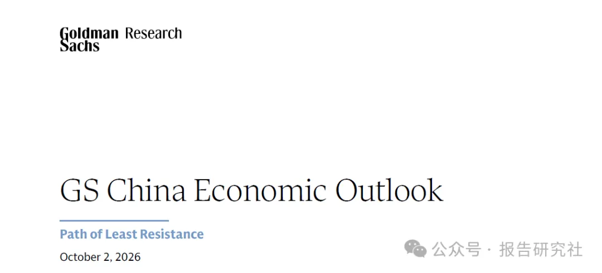
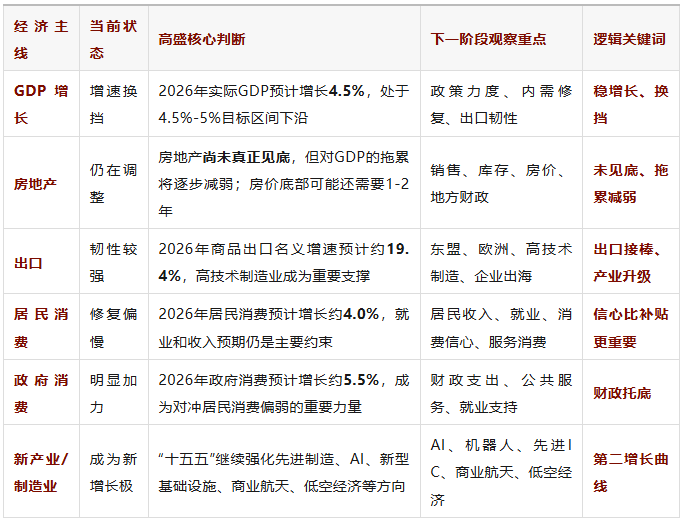
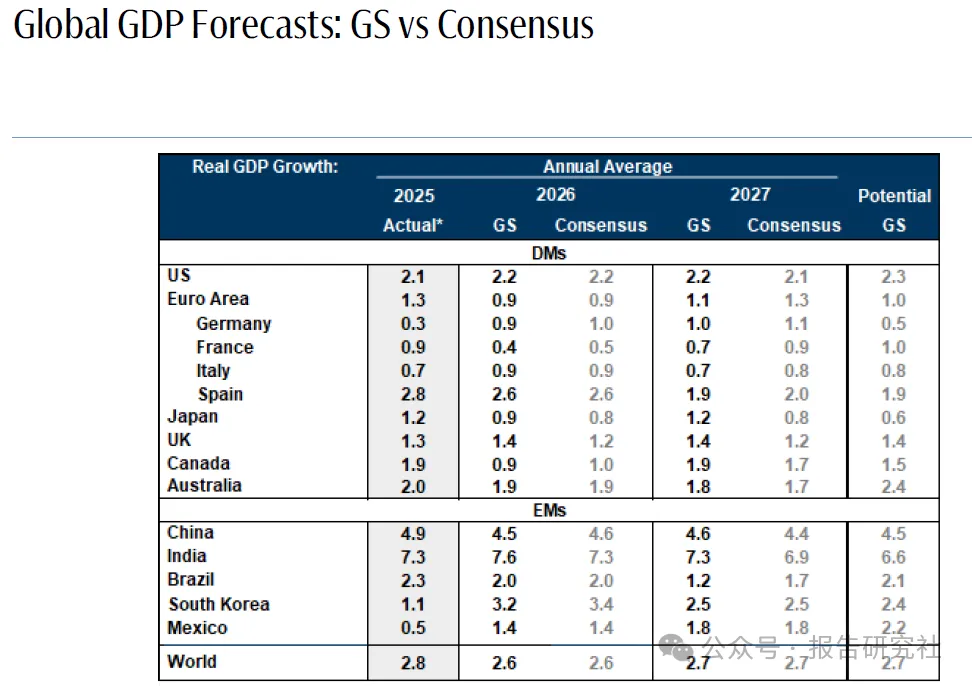
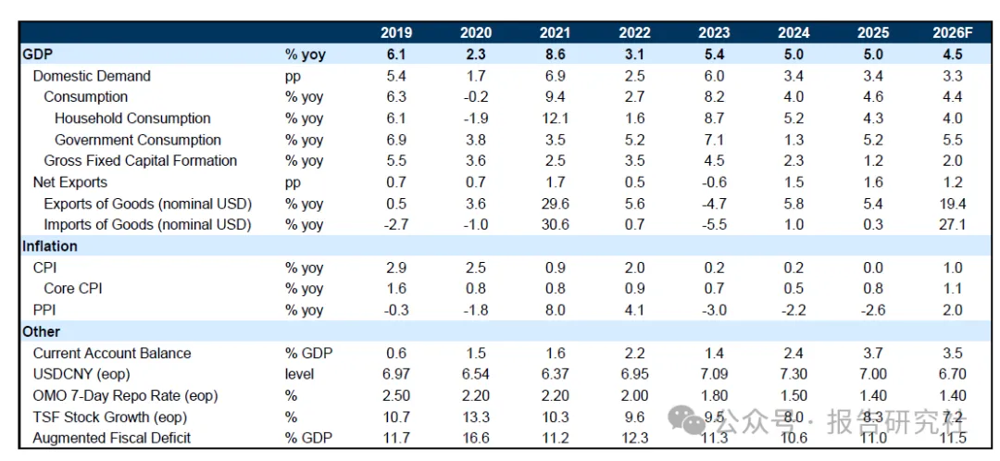
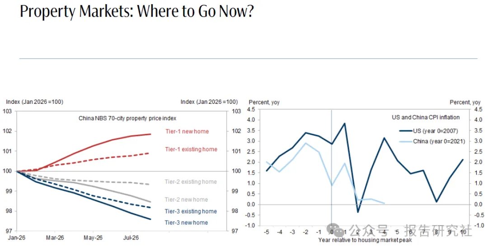
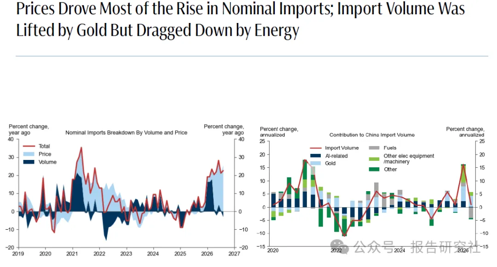
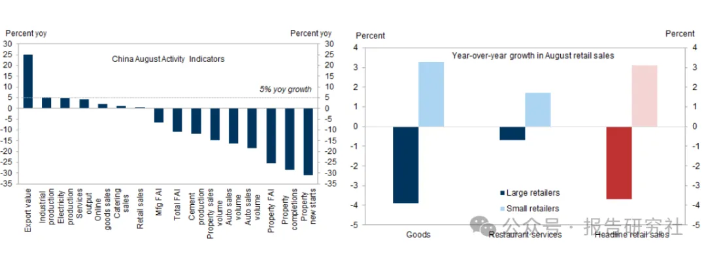

# 重磅：高盛关于中国经济的最新报告
> 💡 备注属性未写入，可能是备注属性名称或者类型被修改了，建议将字段类型设置为 rich_text，可以在小程序-操作-修改文章数据库页面进行调整
> 💡 原文链接:[https://mp.weixin.qq.com/s?__biz=MjM5OTc2NzA2MQ==&mid=2651336302&idx=1&sn=2f009bb97c58d24cba89d18f763461a2&chksm=bd1a7a0e33ee16b3c13c7f16efaaab95c1530467e952ac4f5f968912ebdb724969bd82a46348#rd](https://mp.weixin.qq.com/s?__biz=MjM5OTc2NzA2MQ%3D%3D&mid=2651336302&idx=1&sn=2f009bb97c58d24cba89d18f763461a2&chksm=bd1a7a0e33ee16b3c13c7f16efaaab95c1530467e952ac4f5f968912ebdb724969bd82a46348#rd)

**作者：TOP报告**
**来源：报告研究社（ID：gh_e3d62f4a958a）**
过去几年，判断中国经济，越来越不能只盯着一个GDP数字。
因为经济的结构正在发生变化。
房地产还在调整，但制造业、新质生产力和出口正在变得更加重要；居民消费依然偏弱，但政府消费正在加速；传统投资回报下降，而AI、先进制造、新能源、商业航天等新产业正在获得更多资源。
高盛10月2日最新发布《中国经济展望报告——阻力最小的路径》报告，给出的一个重要判断是：**2026年中国经济增长仍然面临阻力，但经济正在寻找一条“阻力最小的路径”。**

高盛预计，2026年中国实际GDP增长4.5%，处于全年4.5%-5%的增长目标区间下沿。房地产市场尚未见底，但房地产对经济增长的拖累有望逐渐减轻；与此同时，政府消费、出口以及新产业投资将成为重要支撑。
如果把这份报告浓缩成一句话：
**中国经济不是没有增长，而是增长的发动机正在换挡。**

中国经济真正的变化，不是从5%降到4.5%，而是从“房地产驱动”转向“制造业+出口+新产业+消费修复”驱动。
房地产还没有见底，但它对经济的拖累正在减弱；出口还在增长，而且越来越依赖技术和产业链优势；消费暂时没有成为最强引擎，但政策正在从商品消费转向服务消费。
**所以，2026年的中国经济，不是没有增长，而是在寻找新的增长来源。这可能才是“阻力最小路径”真正值得关注的地方。**
**01**
**中国经济进入“换挡期”**
先看最核心的数字。
**高盛预计，2026年中国GDP增长4.5%，低于2025年的5.0%。**

从表面上看，这是经济增速继续放缓。
但如果拆开来看，情况并没有那么简单。
报告预计，2026年国内需求对GDP增长贡献约3.3个百分点，净出口贡献约1.2个百分点。
更值得关注的是，消费仍然保持增长，只是居民消费与政府消费之间出现了明显分化。
高盛预计，2026年居民消费增长约4.0%，而政府消费增长约5.5%。固定资产投资增长则预计从2025年的1.2%回升至2.0%。
这说明一个非常重要的变化：
**未来中国经济的增长模式，正在从“房地产+传统投资”逐步转向“消费+出口+新产业投资+政府支出”。**

过去房地产繁荣的时候，土地财政、房地产投资、居民购房和上下游产业形成了一条巨大的经济链条。
现在这条链条正在收缩。
因此，未来几年中国经济最重要的事情，不一定是重新复制过去的高增长，而是找到新的增长来源。
从这个角度看，4.5%并不只是一个数字。
它更像是中国经济结构调整过程中的一个“换挡速度”。
**02**
**中国房地产**
如果要找当前中国经济最大的拖累，房地产依然排在前面。
高盛的判断非常直接：
**房地产市场还没有见底。**

报告认为，中国新房需求可能继续保持低位，房地产价格可能还需要1-2年才能完成底部确认。
这意味着一个现实问题：
房地产短期内很难重新成为拉动中国经济的主要发动机。
过去房地产对经济的影响远远不只是开发商卖房。
它背后连接着土地财政、建筑、钢铁、水泥、家电、家具、金融、地方政府收入以及居民财富。
所以房地产下行，真正影响的是整个经济循环。
报告同时指出，房地产下行也在持续挤压地方政府财政。土地相关收入下降，使地方财政空间受到明显约束。
但这里也有一个容易被忽视的变化：
**房地产对经济的“边际拖累”正在减弱。**
什么意思？
不是房价马上上涨，也不是房地产马上反转，而是经历较长时间调整之后，房地产继续下跌对经济造成的新增冲击正在逐渐下降。
尤其是部分一线城市已经出现早期稳定迹象。
所以，未来房地产更可能经历的是：
**从“拖累经济的主要变量”，逐渐变成“拖累减弱的变量”。**
这其实非常关键。
中国经济真正的修复，不一定需要房地产重新繁荣，只需要房地产从“持续下坠”逐步转向“低位企稳”。
**03**
**经济“安全垫”：出口**
如果说房地产是当前经济最大的压力，那么出口就是最大的缓冲垫之一。
高盛预计，2026年中国商品出口按美元计增长19.4%，进口增长27.1%，净出口仍将对GDP形成约1.2个百分点的贡献。
这背后反映的是中国制造业竞争力正在发生变化。
过去讨论中国出口，更多关注的是服装、家电、家具、低成本制造。
现在出口结构已经明显不同。
高技术制造业产品正在成为实际出口增长的重要来源，主要出口增量更多流向东盟和欧洲。

这意味着中国出口的核心逻辑正在从：
**“成本优势”→“产业链优势”→“技术+供应链优势”。**
尤其值得关注的是AI相关产品。
报告发现，近期中国名义出口增长中，AI相关产品贡献明显，同时中国对AI硬件生产商的出货也在增加。
但这里需要保持冷静。
高盛特别指出，AI相关出口的增长，有相当一部分来自价格因素，而不是单纯的出口数量增长；部分AI相关贸易属于非普通贸易，对中国真正的增加值和贸易顺差贡献相对有限。
所以不能简单理解成：
**“AI出口爆发，中国经济就彻底起飞。”**
真正值得关注的，是AI背后更广泛的高端制造能力。
换句话说：
**AI可能只是表象，真正重要的是中国制造业正在向产业链更高的位置移动。**
**04**
**消费**
相比出口，消费可能是未来中国经济最值得关注、也是最难解决的问题。

高盛预计2026年居民消费增长约4%，低于政府消费5.5%的增速。
为什么居民消费恢复得没有那么快？
报告给出的答案之一，是就业市场依然偏弱。
就业预期直接影响居民收入预期，而收入预期又决定消费意愿。
这就形成了一个循环：
**就业预期偏弱**
**↓**
**居民更加谨慎**
**↓**
**储蓄增加**
**↓**
**消费恢复偏慢**
**↓**
**企业收入和招聘意愿受到影响**
报告还指出，消费者信心仍然偏弱，同时居民银行存款保持较高水平。与此同时，居民资产负债表正在发生结构性变化——居民正在持续去杠杆，并逐步减少房地产资产暴露、增加金融资产配置。
这可能是未来几年中国消费最重要的变化之一。
过去居民财富高度依赖房地产。
现在房地产经历调整之后，居民资产配置开始发生变化。
因此，真正意义上的消费复苏，可能不仅仅需要“发消费券”。
更重要的是：
**让居民重新建立对收入、就业和资产价格的信心。**
报告也注意到，政策正在从过去主要刺激商品消费，逐渐转向更加关注服务消费。
这意味着未来消费政策的重点可能越来越从“买东西”转向：
**旅游、医疗、养老、教育、文化娱乐、体育以及各种生活服务。**
这将成为消费结构变化的重要方向。
**05**
**经济靠什么继续稳住？**
那么问题来了：
房地产没有见底，居民消费又偏弱，中国经济靠什么继续稳住？
答案很可能是：
**财政+产业政策+结构性投资。**
高盛预计，2026年宏观政策将在经历二、三季度相对偏紧之后，于四季度重新转向温和宽松，但宽松力度不会特别大。
这其实符合当前经济结构。
因为现在最大的问题已经不是简单的“缺流动性”。
资金更需要流向真正有增长潜力的领域。
从“十五五”规划相关布局来看，先进集成电路、具身智能、生物制造、新型电池、商业航天、国产大飞机、低空航空装备、绿氢、脑机接口、高端医疗设备等都被纳入新产业方向。
与此同时，新型基础设施、算力网络、卫星互联网、数据基础设施以及“AI+”行动也成为重要布局。
这就是未来中国经济比较典型的“哑铃型”结构：
一边是传统产业的稳定与出清；
另一边是AI、机器人、先进制造、新能源、商业航天等新产业的快速成长。
中间部分，则需要依靠消费和服务业逐步修复。
所以未来政策的核心，不一定是把所有行业重新拉起来，而是：
**哪里有增长潜力，就把更多资源投向哪里；哪里产能过剩，就推动出清和“反内卷”。**
**06**
**小结**
把这份高盛报告从头到尾串起来，会发现一个非常清晰的逻辑。
房地产仍然是拖累，但拖累正在边际减弱；
居民消费仍然偏弱，但服务消费正在成为政策重点；
传统投资增长有限，但新产业投资正在形成新的增长点；
出口依然强劲，而且出口结构正在向高技术制造业升级；
政策也没有回到过去“大水漫灌”的模式，而是在寻找更精准的增长抓手。
因此，未来几年中国经济最大的变化可能不是“增长突然重新加速”，而是：
增长的来源正在发生彻底变化。
**过去：房地产是核心发动机**
房地产
↓
土地财政
↓
基建+地产投资
↓
钢铁/水泥/家电/家具/金融
↓
居民财富效应
↓
消费
**现在：增长动力正在重新组合**
出口→全球市场份额
先进制造→AI/机器人/新能源/高端装备
政府消费→财政托底
新基建→算力/数据/卫星互联网
服务消费→旅游/医疗/养老/文娱
房地产→从“增长发动机”转向“风险拖累减弱”
这个变化，其实就是全文最值得读者记住的核心。
房地产时代不会突然结束，但中国经济的“房地产单引擎时代”，正在越来越远。
而真正的新周期，可能不是从房价上涨开始。
**而是从产业升级、企业出海和居民信心重新建立开始。**
高盛报告同时指出，生产与消费之间的分化仍在扩大；AI相关产品、高技术制造业出口成为近期出口增长的重要来源，而房地产、就业和居民消费仍是国内需求侧的主要压力。
**版权声明：部分文章推送时未能与原作者取得联系。若涉及版权问题，敬请原作者联系我们。**

## 摘要

（待补充）

## 我的笔记

（待补充）
