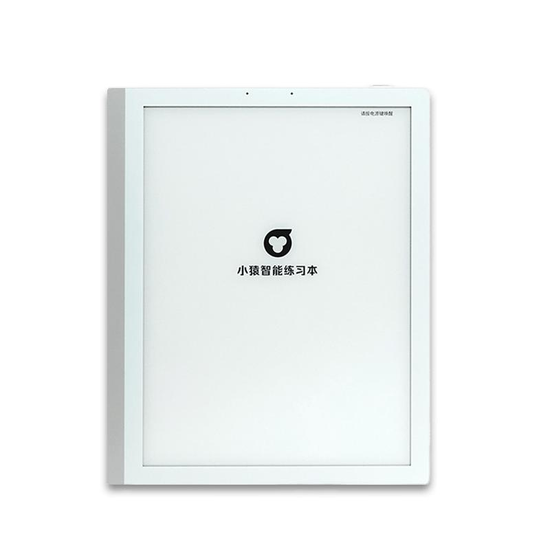
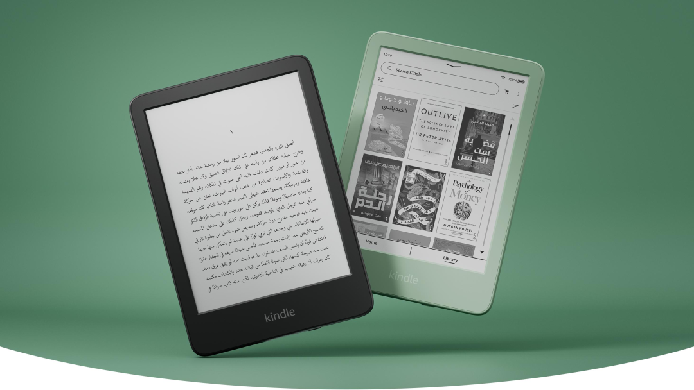
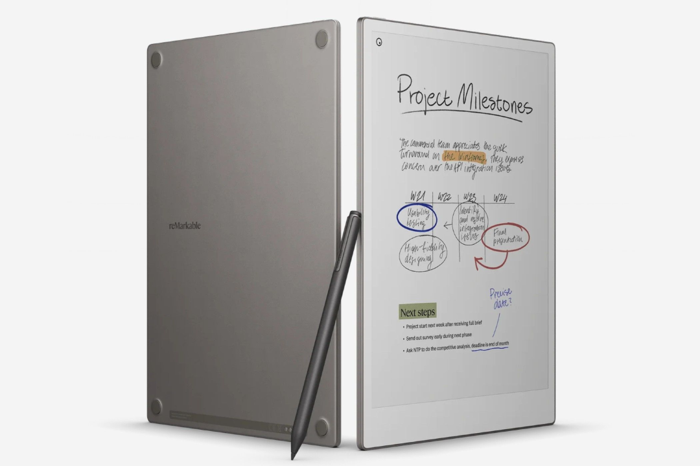
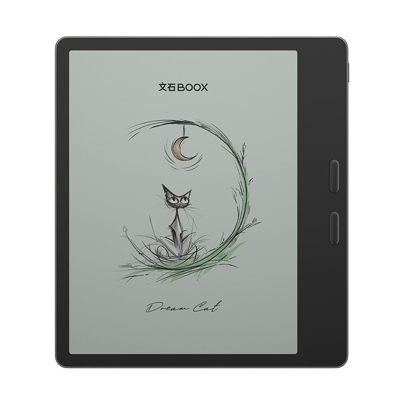

# 销量暴跌90%：曾经被吹爆的墨水屏学习本，为什么突然没人买了？
> 💡 备注属性未写入，可能是备注属性名称或者类型被修改了，建议将字段类型设置为 rich_text，可以在小程序-操作-修改文章数据库页面进行调整
> 💡 原文链接:[https://mp.weixin.qq.com/s?__biz=MzIwODA0OTMzNw==&mid=2456437313&idx=1&sn=49016eacd16f5510914b9a942554617e&chksm=81d5f52d9356099c2a87cc2cc3c309884a394fc26c6c5e7a220ca07588bae397f612006ca4bf#rd](https://mp.weixin.qq.com/s?__biz=MzIwODA0OTMzNw%3D%3D&mid=2456437313&idx=1&sn=49016eacd16f5510914b9a942554617e&chksm=81d5f52d9356099c2a87cc2cc3c309884a394fc26c6c5e7a220ca07588bae397f612006ca4bf#rd)
**90.4%。**
这是今年8月中国电子纸学习本销量的同比跌幅——不是腰斩，是直接跌没了。
洛图科技的最新数据显示，今年8月电子纸学习本在国内线上市场的销量同比暴跌90.4%，在整个电子纸平板市场内部的份额，从去年同期的23.3%急剧萎缩到2.1%。把时间拉长看更惨：今年一季度，这个品类线上销量已经不足2万台，电子纸屏幕在学习平板中的搭载率，从2025年一季度的10.1%跌到只剩1.4%。
两年前，这还是家长圈里公认的"鸡娃神器"，一台卖到三五千还抢断货。两年后，连厂商自己都悄悄砍掉了这条产品线。
这中间的反转，值得好好说说。

曾经家长圈疯抢的电子纸学习本，如今线上月销量已不足万台。
**当年有多火：一场精准的"护眼焦虑"营销**
先回忆一下电子纸学习本是怎么火起来的。它的走红，本质上是一场对家长视力焦虑的精准收割：传统液晶平板有蓝光、有频闪，孩子天天抱着上网课，家长看在眼里急在心里，这时候厂商告诉你——有一种屏幕，靠反射自然光成像，无蓝光、无频闪，显示效果跟纸一样，孩子看多久都不伤眼。你动不动心？动心的人太多了。叠加头部厂商铺天盖地的营销，再加上教育硬件补贴政策的推波助澜，电子纸学习本迅速成了高端学习设备的代名词：2025年一季度，电子纸屏幕在学习平板中的搭载比例一度冲到10.1%，成为细分赛道当之无愧的宠儿。一台配置普通的电子纸学习本，动辄标价3000到5000元，比同尺寸的液晶学习平板贵出一大截，照样被家长争相抢购。那个时候，"护眼"两个字就是最高级的溢价密码。
**崩盘三把刀：硬伤、平替、理性回归**
泡沫破起来，比吹起来快得多。第一把刀是产品自身的硬伤：电子纸屏幕的物理特性决定了它刷新率低、残影明显、色彩缺失，这些短板在静态阅读场景下无伤大雅，可学习场景偏偏是动态的——孩子要上网课、要看教学视频、要刷题、要手写答题，低刷新率带来的拖影和延迟在这些场景里被无限放大，花四千块买回家的"神器"，孩子用两天就嫌卡，最后吃灰的命运从一开始就写好了。第二把刀是类纸液晶的降维打击：这两年液晶显示技术快速迭代，低蓝光、无频闪、防眩光、类纸哑光膜一套组合拳下来，观感越来越接近电子纸，同时保留高刷新率、全色彩和流畅交互，关键是价格只有电子纸学习本的一半甚至更低——一边是四千块只能黑白显示还卡顿的墨水屏，一边是两千块什么都能干的类纸液晶平板，怎么选根本不用犹豫，大量原本属于电子纸学习本的用户就这样被直接抢走。第三把刀是外部环境的逆转：此前刺激消费电子的各类补贴政策全面退坡，政策红利消退，整个平板大盘都在收缩；而最根本的变化是家长的消费观回归理性了——经历过一轮"买完就后悔"的教育之后，大家终于想明白，护眼的核心是控制用眼时长和距离，不是换一块更贵的屏幕。为一个营销噱头支付翻倍溢价的时代，结束了。

同样是墨水屏，聚焦阅读场景的Kindle活得相当滋润——问题从来不在屏幕本身。
**但别急着给墨水屏写悼词：它只是绑错了场景**
有意思的是，就在学习本崩盘的同时，墨水屏这个品类的其他赛道活得并不算差，甚至可以说相当滋润。先看国内：就在学习本暴跌90%的同一份报告里，普通电子纸阅读器销量一季度同比大涨21.5%，8月也增长了14.4%，稳稳托住大盘；电子纸办公本虽然销量小幅波动，均价却涨到3365元、同比提升近9%，是近四年最大涨幅——科大讯飞以53.4%的份额统治办公本市场，文石更是靠着开放安卓生态的"生产力平板"做到年入超10亿，刚刚二次递表港交所，冲击"国产墨水屏第一股"。再看国外，案例更有说服力：Kindle 2023年退出中国时被一片唱衰，结果人家聚焦本土市场后活得很好，全球电子纸平板市占率至今仍有71.6%，3月北美促销把基础款降到100美元以内，单季出货量环比暴增34%，盈利水平重回高位；挪威品牌reMarkable从不碰"学习"这个概念，老老实实服务职场人群的笔记和轻办公需求，稳稳坐在全球办公本出货量第一的位置，份额33.1%；连PocketBook这样的老牌厂商，今年都靠着大屏彩墨新品把美国市场做得有声有色。发现规律了吗？活得好的墨水屏产品都有一个共同点——它们服务的是"静态、深度、长时"的场景：读书、批注、手写笔记，这些恰恰是电子纸技术真正的主场。而死掉的学习本，恰恰是想把一块为静态阅读而生的屏幕，硬塞进网课、视频、刷题这些动态交互场景里。所以，崩盘的不是墨水屏，而是"墨水屏+教育"这个被营销强行捏造出来的组合。

从不碰"学习"概念的reMarkable，靠服务职场笔记需求做到全球办公本出货量第一。

文石BOOX靠开放生态的生产力平板年入超10亿，正在冲击港股"国产墨水屏第一股"。
**写在最后**
总结一下，这场反转给所有人上了三课：**对家长来说**，护眼的本质是科学的用眼习惯，不是一块昂贵的屏幕，学习设备的核心是内容生态和交互体验，而不是某个单一卖点；**对厂商来说**，靠焦虑营销吹起来的溢价，终究会被技术平替打回原形，电子纸学习本的崩盘，本质是噱头败给了实用主义；**对整个行业来说**，墨水屏没有死，也不会死——它只是回到了自己真正擅长的位置，在阅读器、办公本这些"安静"的赛道里，它依然是无可替代的。
一个靠贩卖焦虑起家的品类死掉了，一个靠真实价值立足的技术活下来了。说实话，我觉得这是好事。
你当年买过墨水屏设备吗？现在还在用，还是已经在吃灰了？评论区聊聊。
