# 青春期少女，困在县城里
> 💡 备注属性未写入，可能是备注属性名称或者类型被修改了，建议将字段类型设置为 rich_text，可以在小程序-操作-修改文章数据库页面进行调整
> 💡 原文链接:[https://mp.weixin.qq.com/s?__biz=MjM5NTAyODc2MA==&mid=2654974529&idx=1&sn=7334abee4cdfadbf1ff507bd0b212a51&chksm=bc13911c6843fb6e40e25b8aa4c6d1adb067e43955895d7ab13e5cac1486dd91bdaed1788175#rd](https://mp.weixin.qq.com/s?__biz=MjM5NTAyODc2MA%3D%3D&mid=2654974529&idx=1&sn=7334abee4cdfadbf1ff507bd0b212a51&chksm=bc13911c6843fb6e40e25b8aa4c6d1adb067e43955895d7ab13e5cac1486dd91bdaed1788175#rd)
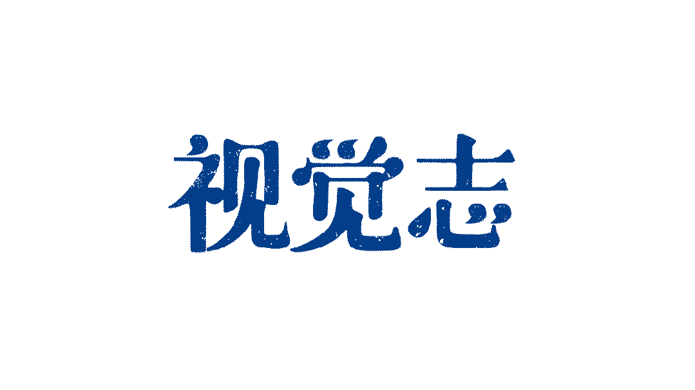

一个初中生跟着“混”，每天都在“混”什么？
在许多成年人眼中，一个未成年人开始“混”，原因似乎无非是叛逆、贪玩，或者交了几个“坏朋友”。
有人叫这些孩子“精神小妹”“精神小伙”，他们自己也拿这个词玩梗。染发、化妆、纹身、喝酒、约架、短视频……这些符号构成了对他们的全部印象。
小奥在初中的后两年里融入了这个圈子。
比起“想变坏”，那个圈子更像是她逃离挫败、获得快乐的地方。课堂上，她不太听课，卷子从第一道选择题开始就不会，却又因为好面子不敢提问。她对学习不甚上心，也无法从中获得认同感。
成绩差的同学之间互相抱团，是学校里心照不宣的交友准则。她跟着朋友认识外校的“大哥大姐”，在商场、台球厅和KTV之间消磨时间。
在由“大哥大姐”、义气和关系构成的世界里，认识的人多、经历的事多，就能获得尊重和位置。所谓“罩着”，有时只是意味着陪伴、照顾，以及在发生矛盾时，有人站在自己这一边。
父母知道小奥交的朋友“不太好”，却不知道她每天具体在经历什么。她见过同学平静地把试卷撕碎，一条条塞进嘴里，也见过一些人手腕上的自伤痕迹。大家很少追问，仿佛什么都没有发生。
初中那段生活像梦一样从她的脑子里溜走，如今回想起来，只有不顾未来的及时行乐，和错综复杂的人际关系。
一次劝架中，小奥被误伤，从楼梯上滚了下去，手臂缝了五六针。她第一次意识到，这样的生活并不只是“好玩”。临近中考，和朋友的一次决裂又让她决定收心学习。最终，她把摇摇欲坠的排名拉了上来，考进了当地一所不错的高中。
过去的朋友也走向了不同的人生：有人退学，有人去工地，有人进入KTV或台球厅工作，也有人很早便开始谈婚论嫁。她意识到，从前的快乐，是一种“不考虑现在，也不考虑未来”的快乐。
进入新的高中后，小奥仍然习惯用过去的规则理解一些事情。直到她为了朋友向母亲撒谎、跟家人闹僵，她才发现，学习可能只是“浮在表面上的改变”。
过去的环境留下的伤害，未必是一场打架、一道伤口或一次处分。更难察觉的是，当他们逐渐习惯了周围的规则，一个孩子判断是非的尺度也会被悄悄改写。
这不是一个“精神小妹悔过逆袭”的故事。它想借一个曾经的局中人，让我们看见一些青春期孩子不为父母所知的生活：
当学习无法提供成就感，成年人又难以看见他们的真实处境，他们会从怎样的关系里寻找认同？那些沉默的变化，由何发生？
考上高中没有让小奥彻底告别过去，她仍记得那些朋友给过自己的陪伴，也清楚许多人本性不坏。
如今，她一边在课间听新同学讨论题目，一边继续和旧朋友保持联系。她已经离开那个圈子，却仍站在两个世界之间。
只是现在，她第一次有机会回过头，重新看清那些曾被视作理所应当的生活。
以下是小奥的自述：

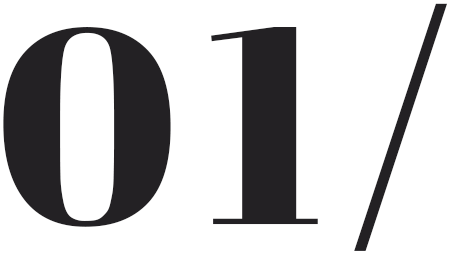
坏学生的江湖
两拨人在楼梯附近发生冲突，我像以前一样当中间人“见证”。事情一下没控制住，不知道是谁的拳头还是手肘撞到了我的胳膊，我从楼梯上滚了下去。
周围站着十几个人，大家一下都愣住了，也有人在喊。
我当时的第一反应不是害怕，而是尴尬。当着这么多人的面滚下楼梯，实在太狼狈了。
当时我的手臂一阵刺痛。我一直觉得可能骨折了，但后来去医院没有打石膏，只缝了大概五六针。
受伤之后，我在家休息了几天没去上学。那段时间我自己想了很多，慢慢感觉到后怕：如果继续这样玩下去，也许连自己的安全都保证不了。
我今年16岁，山东人，暑假结束后，就要读高二了。那些以前一起“混”的人，大多还留在我的通讯录里。偶尔有人发来消息，我们也会聊一聊彼此现在怎么样。
一切的开始，要倒回至初中。
我们这边是五四制，小学五年，初中四年。我读的是一所私立初中，给钱就能上。刚进去时，学校规模很小，同学们会形成很多小团体。大家嘴里的“好学生”和“坏学生”，主要按照成绩划分，并不是说谁的品行好、谁的品行坏。
学习好的和学习好的玩，不学习的和不学习的玩，是一条心照不宣的规则。
初一初二我基本上没怎么学，老师不是特别管我们，我自己也没有什么“学习”的概念。
我们早上七点左右到校，晚上九点才回家。我没有逃过课，但上课基本是在睡觉，有时候传纸条、玩手机，或者和周围人打牌。
老师讲的东西听不懂，我慢慢也就不听了。那时候确实不知道，每天来上学到底是为了什么。
很神奇的是，那时候我们甚至没有“成绩羞耻”这种概念。不会觉得谁考试特别差，谁就怎么样；也不会觉得谁考得好，就特别厉害。我开始学习之后，才慢慢有了这种跟成绩有关的观念。
到了初三，学校搬到了另一所学校。到底是合并还是被收购了，我也不清楚。但学生突然多了起来，不同年级、不同学校的人被连在一起。
就是这时候，开始有朋友给我们介绍其他朋友。三四个人出去玩，再给其他人发消息，最后越聚越多。有些同学家里有哥哥姐姐，本身就不怎么学习，他们会带着我们在同城认识很多朋友。慢慢地，我认识了一些外校和高年级的“大哥大姐”。
最开始我只是觉得新鲜。有些事情挺搞笑，也挺猎奇，我会有过去围观的冲动。这对一群精力充沛又无所事事的青少年来说，一开始确实很有吸引力。
大家聊谁和谁谈恋爱了，谁和谁闹掰了，谁撬了谁的对象。走到街上，又可能遇见八卦里的当事人。别人一介绍：“这就是xxx。”等于线下见到了八卦里的“瓜主”。
这些事情就像连连看。来来回回就是几个熟悉的人名，几种关系不断重新组合。谁借了谁的钱没有还，谁在背后说了谁，谁表面闹翻，私下又还在联系。
那种日子有点像一场无限循环。一觉醒来，还是同一批人、同一些事。
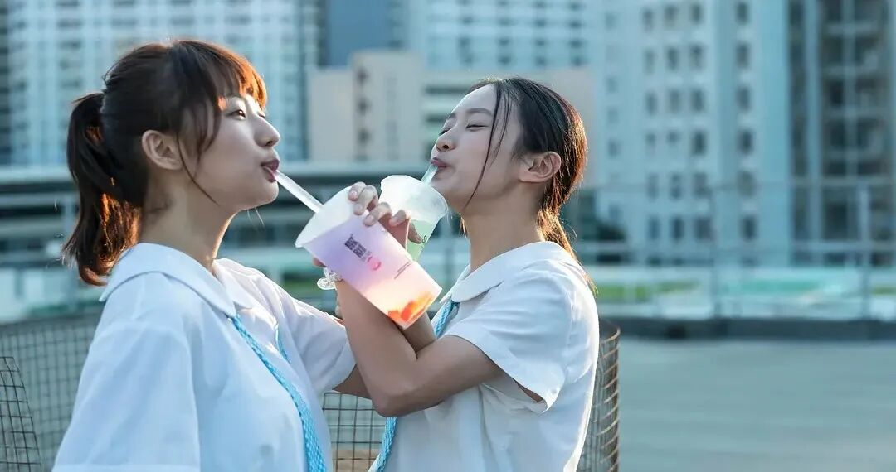
图/电影《过春天》
出了学校，我们会去商场、台球厅、KTV，有时也去网吧和类似酒吧的地方。一边消遣，一边交换周围人的恋爱、矛盾和八卦。
县城里有两三个商场，但我从小逛到大，早就逛腻了。大家手里也没多少钱，就从一个商场徒步到另一个商场，从街头晃到街尾，累了便找个地方蹲一会儿。
我每天跟着他们跑这跑那，就像老年竞走团一样，但其实也不知道在干什么。我一直不明白，大夏天的，明明凑得出打车钱，为什么非要走路。我猜可能是为了在路上能碰见熟人吧。
在学校里也一样。为了找高中部认识的人，我们要跨过半个校园，从这栋楼跑到另一栋楼上，就为了聊几句话，再赶在上课铃响以前回教室。我感觉天天累死了，但确实运动量特别大，大家都挺瘦的。
每天跑来跑去，其实谁也说不清到底在忙什么。但至少那一天有事情可做，也有人陪着。
我大概从初二开始学化妆。初一元旦晚会时，有人替我们化了一次，我发现化完好像挺好看，后来便跟着网上的妆教，一点点买化妆品学。
到了初三、初四，我几乎每天上学前都要打一点粉，有时也到了学校再化。在我的印象里，日常化妆的，主要是我们这些不太学习的女生。
我从那会儿开始有容貌焦虑，其实现在也有。有时候自己照镜子，会觉得自己很不顺眼。
染头发在我们这挺常见的。我身边不少人染黄头发，也有男生把头发漂成白色。
身边也挺多人有纹身，我们这种小县城，纹身店对未成年人的管束不严。不过我没纹，一是怕疼，二是我感觉他们纹的纹身也并不好看。
我不抽烟，对烟味也很敏感。如果是很熟的人在KTV抽烟，我会让他们出去抽。但如果周围的人都抽，或者我和他们不是很熟，我也不好说，只能忍着。
“精神小妹”这个词，我们自己也会拿来玩梗。外面的人一提到它，就会想到黄头发、浓妆、纹身、抽烟、喝酒、打架。我们知道别人怎么看，没有特别抵触，也谈不上多认同，比较无所谓吧。
有时我们会去类似酒吧的地方，我不喜欢特别吵、蹦迪的那种，如果他们要去太吵的地方，我会直接不去。我比较能接受有人唱歌、旁边有小吧台和卡座的地方。
他们会猜拳、玩牌、玩桌游，也有人拼酒，对着瓶子一直吹。我一般不参与，我讨厌啤酒的味道，觉得又苦又难闻，通常只坐在旁边鼓掌、起哄。有些人会喝到后半夜，但那时候我一般已经走了，十一点是我待过最晚的时间。如果他们喝得太醉也挺吓人的，真出了事怎么办？
那里灯光很暗，也很吵。有人一喝酒就拍快手，喝醉了也要拍，再配一段特别伤感的文案。我一直不太理解，明明是出去玩，怎么还是伤感。好像他们一喝酒就伤感，干什么都伤感。
拍短视频，也是一群人聚在一起玩闹。有些人去饭店，有条件的拉一个横幅，上面写一些中二的社会人语录，可能是为了显得比较有排面。
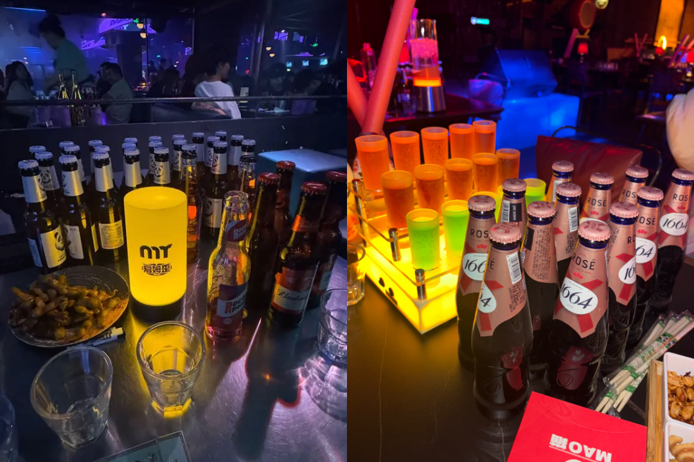
小奥去过的酒吧/受访者供图
圈子里确实有人有“靠山”，但我身边大多数就是一些普通朋友。
我理解的“大哥大姐”，是认识的人比较多，经历过圈子里的一些事，比较“混得开”。我们那个圈子也有自己的“历史”。
谁跟谁打过架，谁跟谁约过架，谁跟谁彻底闹掰了，只要是一件大家都知道的事，就可能算“名垂历史”。真正参与过这些事，或者认识很多人的，在我们看来有点像“前辈”。
那时候我们最看重的一个词，是“义气”。
我有一个朋友，和他同学躲在厕所抽烟。被学校逮到后，他不肯把一起抽烟的人供出来，只说那几根烟都是自己抽的，把责任全揽下来了。这件事传遍了学校，后来好像还因此收了几个“小弟”。当然现在这个社会，“收小弟”也没什么用，大多就是拍拍短视频，被恭维叫句“x哥”。
现在听起来挺幼稚的，不过在当时，我也算见识到了所谓“义气”在他们眼中有多重要。
我最佩服的一个姐姐也是这样的人。她家里好像不太管她，在初三、初四那个年纪，她已经出去打工了一阵子，可能进过工厂或者流水线。
她挣到钱以后，会回来给我们买零食。其实我们也觉得，不应该拿她打工的钱买东西，因为自己也不缺。但最后还是接受了她的善意，我们知道，那是她表达照顾的方式。
后来她和学校里的另一群人发生了冲突。那群人大家都很反感，他们会在厕所门口故意抽烟，对路过的女生指指点点、开黄腔，还会造谣。
那个姐姐好像是为了替朋友出头，在厕所里跟对方打了起来。最后，我听说她独自承担了处分，还用自己打工挣的钱赔了医药费。
我们当时只是觉得，她愿意照顾我们，也愿意替朋友出头，这就是义气。
学校里的冲突，大多发生在厕所或楼梯间。两个人先争吵，一方动手，另一方跟着还手。女生之间常常是抓头发、扯衣服，周围的人大部分在围观、壮胆，也有人在拍视频。
等双方打得差不多了，周围的人才上去拉开。上课铃一响，大家重新回班。四十分钟后，有些人的气已经消了，事情也就顺着台阶过去了。
有一次，几个人在外面合租了一个房间。好像是因为谁把谁的男朋友带了过去，大家吵了起来。一个姐姐带我去了现场。我就看着她们，一开始只是互相骂，后来开始抓头发、动手，旁边还有人在拍视频。
现在回头看，那件事挺像霸凌的。但当时，那个被打的人也可能转头去打别人，这很难简单判断谁对谁错。
我们学校有一个传统，如果两帮人产生了很大的矛盾和冲突，就会携带10-15人到一个地方，大部分人都是陪衬、隔岸观火的，他们的作用是围成一个圈，把监控挡住，也告诉别人，这里有混乱斗争了，其他人都不要从这里走。
真正打架斗殴的，只有两个人。但如果两个人打起来，没有忍住可能会出大事。所以他们就会找一个与这件事情没有任何矛盾的“中间人”，来充当裁判，事情闹得严重时，帮忙把人拉开。我经常在这些冲突中当“中间人”。
我一直以为，自己没有动手，只是站在旁边，应该不会有什么事。直到那一次，我从楼梯上滚了下去。
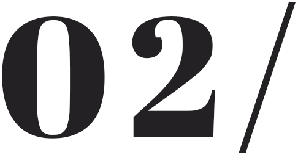
伤痕
临近中考，学校为了冲刺，把学生分成了A层和B层。我坐在A层班的后排，同桌是一个女生。
我们平时不熟，只是分考场时经常遇见，偶尔会聊几句题目和知识点。在那之前，我没有看出她正在经历什么。
某一节晚自习时，她突然开始撕手里的卷子。她把卷子撕成一条一条的，然后往嘴里塞，一边撕，一边吃。
她没有大喊也没有出声，甚至表情也看起来很平静。
我坐在旁边连动都不敢动，更不敢问她发生了什么。到现在，我还是忘不了那个画面。
我也见过一些“混”的朋友手腕上留下的自伤痕迹。但这种事不好问，大家一般只当作没看见。
有人会把受伤的照片发到短视频上，再配一段伤感文案。朋友看见后，可能会去安慰一下。
我觉得他们确实挺伤心的，只是表达方式让外面的人理解不了。
我当时自己的感觉是，大家的状态好像都不太好，可能真的有压力和心里难受的事。
我之前还认识一个同学，平时看起来和其他人没什么不同。后来她自己告诉我们，家里因为她不学习发生过很严重的冲突。她的父母经常拿菜刀砍她卧室的门锁，还把她锁在屋里不让她出门。
再后来，我听说她在学校里伤害了自己，被老师发现后送回了家。我不确定她有没有休学，只是偶尔从朋友圈看到，她发的和朋友出去的照片。
我认识的人里，很多父母在外地打工，不经常回家；有些是爷爷奶奶带，确实管不了；也有些父母离异，或者家里本来就很少管孩子。
我没有专门问过他们以后打算怎么办。听说有的人家里会找关系让他们进厂，也有人去上职高。还有一些人嫌累不想出去赚钱，就家里蹲。
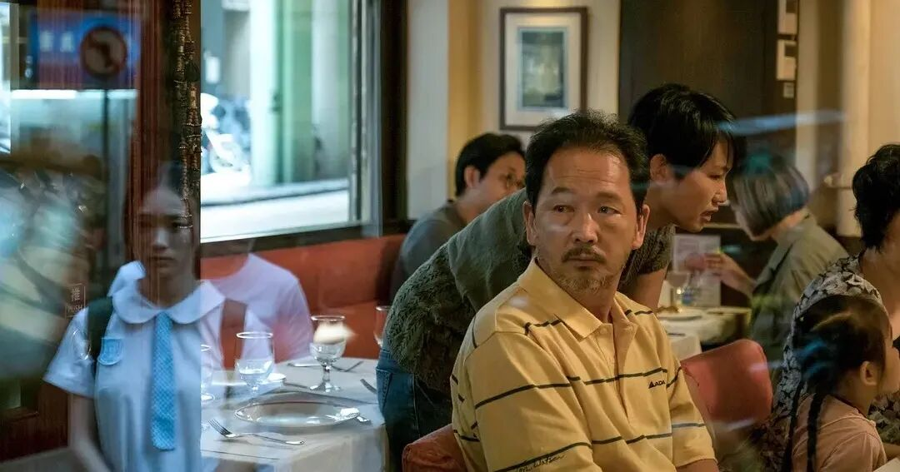
图/电影《过春天》
我爸经常出差，在家的时间不算多，我妈在家比较多。初中时，她对成绩管得不太严，家长会后可能念叨几句，平时更多是提醒我不要玩手机太晚，帮我准备好第二天的衣服。
我和我妈会聊亲戚的八卦，但很少深聊。有时她想问我学校怎么样，我不太想回答，觉得有代沟。
她也不是完全不管我。出去玩时，她会让我报备，回去晚了肯定会念叨，有时也挺凶。只是如果我们去了酒吧，我不会直接告诉她，只会说还要在外面逛一会儿。
很多事情，我觉得告诉父母以后反而更麻烦。我那时候觉得，我自己都有分寸，不想什么都被人管。
我和我亲姐年龄差八岁半，她现在已经读研究生了。我有时会在晚上用微信跟她讲，我们初中发生的一些大事。她一般先震惊，接着感叹现在的小孩和她们那个时候差别太大。
她不太会教育我，她觉得我应该不会真的去做那些事。
不过我也不是所有事情都告诉她。比如学校里有人打架，我去围观、凑热闹，给她讲的时候，我只会说学校发生了什么，不会说我也在现场。只要是我自己参与的事，我就会隐去那部分。她知道我身边的世界大概是什么样，但不知道全部。
“混”到后来，真正让我觉得累的，不只是抽烟、喝酒或者打架，还有那些勾心斗角的关系。
小团体司空见惯。有人当面听你吐槽，表现得特别同情，转头就把你说的话告诉当事人。被发现以后，又会装作自己只是不小心说漏了嘴。
你明知道这样的人不能完全信任，却又不一定能和他断掉，因为他的社交圈很广，大家以后还会见面。
有时朋友跟我讲一件事，我明明觉得是朋友自己做错了，但因为她是我的朋友，我也只能跟着她一起说另一个人的坏话。
我不喜欢这种感觉。现在回头看都是屁大点事，可当时每天都要顾及别人的情绪，生怕说错什么话、得罪了谁，自己就变成所有人议论的对象。
现在把这种话说出来，我也觉得挺搞笑、挺没必要的，但小孩子在那个环境里，真的会很在意。毕竟日常也只有这些事了。
在楼梯上滚下来受伤以后，我开始意识到，一直这样下去没有未来。初四时，我又和一个关系很好的朋友闹掰了。
我们的矛盾已经积累了很久。我们原本有机会和好，但我已经懒得修复了。我觉得闹掰就闹掰，也挺好，我就专心学习。
决定学习之后，那些朋友再有人叫我出去玩，我就经常以“有事不去了”回绝。
我不会特意告诉他们自己在学习。他们不问我肯定不会主动说，就算别人问了，直接说“我在学习”，我自己都会觉得有点尴尬，所以大部分时候只说有事。
我后来越来越不喜欢原来学校的氛围。我听说我们初中本校的高中部，打架会更厉害，甚至有捅刀子的，也有线下约架出事的。虽然那些都只是听说，我没有亲眼见过。但我知道，自己不想继续留在那里，我要考到更好的高中。
到了初四，很多人像突然“开智”了一样。学校到处挂着中考还有多少天的横幅。大家开始意识到，继续上学，某种程度上可以逃避面对真正的生活。如果不上学，就真的要出去面对社会、面对现实了。
老师反复告诉我们，必须进年级多少名才能考上高中。我当时一直卡在边缘，很难受，也担心自己没有高中上。
在那座山东小城，如果考不上高中还是挺丢人的。
我也是一个很好面子的人。小时候，家里会经常说“你这样做会让人笑话”。我三四岁时，我爸带我去医院打针。他告诉我：“你别哭，你哭了会让别人笑话。”
对3岁的我来说，这句话堪比“圣旨”。别的小孩都在鬼哭狼嚎，针扎到我身上，我硬是一声没吭。
到了初四，这种好面子又出现在学习上。周围的同学已经在问老师最后一道大题有没有更好的解法，自己的步骤和答案不一样还能不能得分。
我连前面的基础题和定义都看不懂，但我不好意思问老师。我很怕别人嘲笑我，这么简单的东西，你为什么还要问？
所以初四那一年，我基本是在自学。
物理课、化学课上，老师在讲卷子，但很多题我根本听不懂。我就自己翻答案，一道题一道题开始捋，再自己反推过程。老师讲课的声音被我当成白噪音，我自己在下面学。
我不好意思问别人，但自己对答案就不一样。有什么特别愚蠢的错误，也只有我自己知道。我会想，前一秒的我和现在这一秒的我，已经不是同一个我了，我可以尽情嘲笑前一秒的自己。
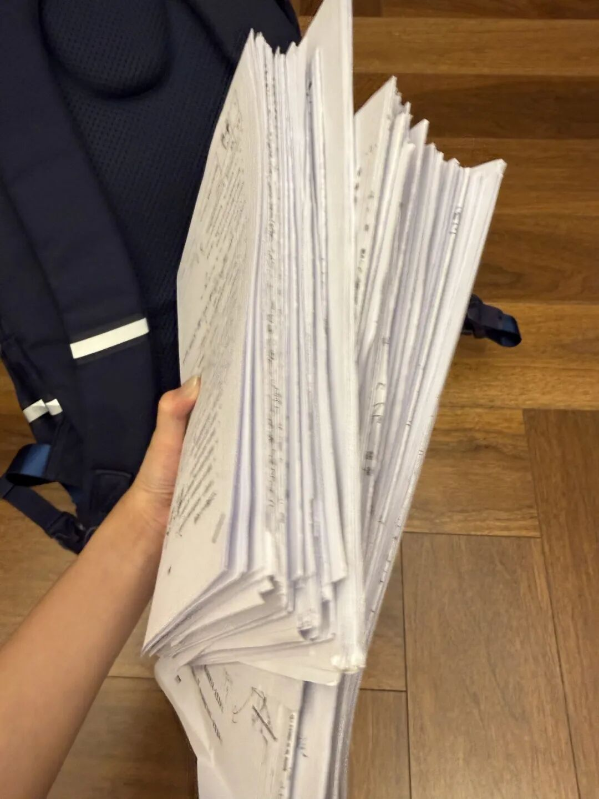
小奥做过的卷子/受访者供图
真正让我对学习有了一些信心的，是我的初中数学老师，我很感谢他。
他是个快五十岁的男老师，不太听得懂我们这些小孩玩的网络烂梗。可能也正因为这样，他不会因为我们过去怎么混，就特别看不起谁。
谁去问他题，他都会很耐心地讲。哪次考试退步了，哪次进步了，他也会单独找人谈，告诉我们卷子里哪里还有提分空间，哪些地方还能多拿一点分。他不是班主任，但班里几乎每个人都被他找过。
数学这门大家都比较讨厌的学科，硬生生被这个老师救了回来。我对其他科目重新燃起的学习热情，都是被数学激发出来的。
初四基本算下血本了。以前我从来没有过这种状态，一整天待在学校，只要是能用来学习的时间，我基本都在学。晚自习从六点到九点，我就一直看错题和不会的题。那时候真的只有一个念头：考高中，没别的了。
我妈那时候应该真的发现我开始学习了，因为那段时间她都没有跟我吵过架。以前我回家，她会催我赶紧洗澡、赶紧睡觉。后来我回家，她开始给我切水果，让我先把晚饭吃饱。
中考前最后一个月，我感觉自己吊着一口气在学。
成绩出来时，我特别惊喜，差点哭了，每一科基本都算超常发挥。
我高兴得整个暑假一点高中内容都没预习。所以上高中第一天，我就快崩溃了。
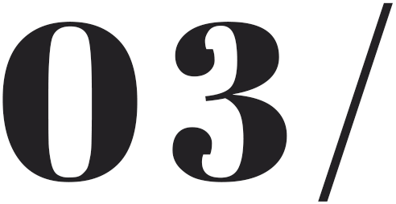
另一种生活
高一以后，我突然掉进了另一个世界。高一上学期，我过得挺有压力。每天学什么都学不懂，也没有真正的好朋友，整个人很压抑。
我那时候成绩基本垫底。一垫底，就会越想越多。老师和同学之间有一些或有或无的鄙夷，我会觉得自己融不进去，被隔离在外面。
有一次晚课，我和同桌偷偷聊天。老师发现后骂了我们两个，她直接当着全班的面，对我的同桌说：“她数学都考不及格了，你还跟她聊天。”
我心里挺难受的，这等于在全班同学面前直接明晃晃表现出来：老师是怎么看你的。
后来我的成绩慢慢提上来一些，老师的态度也发生了变化。至少我再去问问题时，老师会愿意讲，不会那么明显地不耐烦。
我现在的同学，跟以前接触的人完全不一样。
现在班里很多人很认真学，课间会讨论题，或是聊共同的爱好、周围发生的事，但很多网上的梗，他们一点也不知道。
高中同学之间会有一种基于成绩的势利，有些人看不起成绩差的人，你去问他题，他甚至不愿意回答。
我在班里也有关系还可以的人，但更像是为了在学校里不那么孤单的朋友，没有那种能天天联系的真正的好朋友。
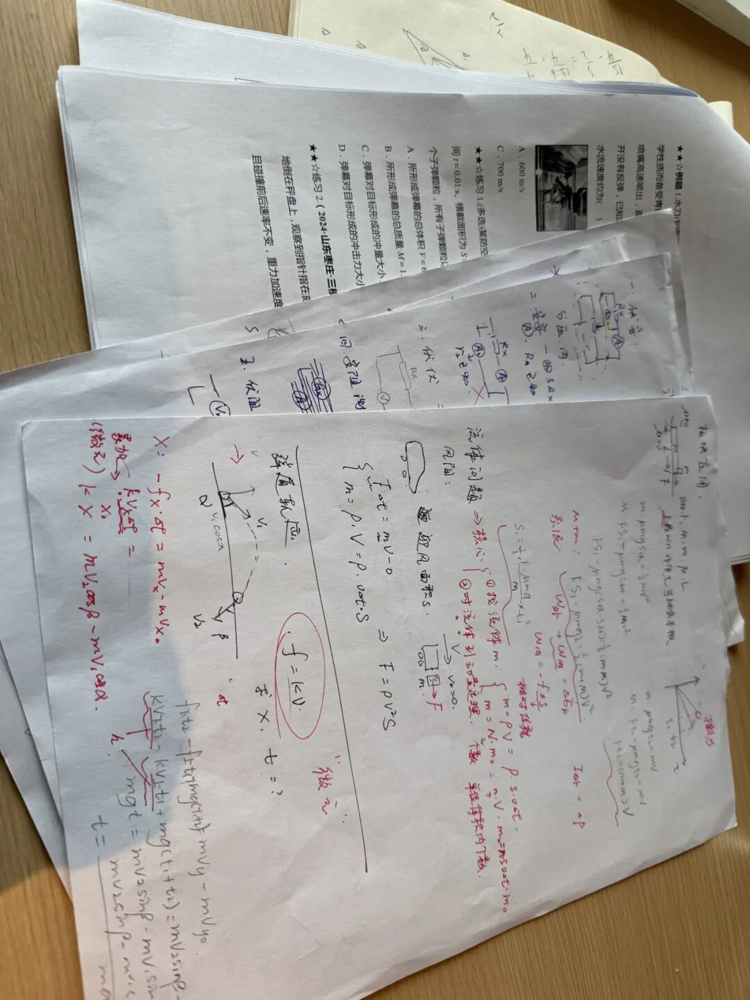
小奥的高中物理试卷/受访者供图
我也不太敢跟他们讲我太多过去的事。如果我把以前发生过的一些、在我看来很平常的事情讲出来，他们会特别震惊。我怕讲多了以后，别人会觉得，“她原来是这样的人。”
真正能深聊的，还是原来几个初中朋友。我们现在不天天见面，也不用每天处理那些人际关系，反而简单了一些。
我不想因为考上高中就把以前的朋友全部否定掉。他们给过我的陪伴是真的，很多人的本性并不坏，他们不喜欢读书可能也有家庭和周围环境的原因。
平时我们在微信上聊天，互相分享短视频，讲各自学校的八卦，放假时也会一起出去玩。
我不太跟他们聊自己的学习情况。因为那样听起来好像是在炫耀，但我并没有那个意思。
他们会跟我聊聊现状，我也听听旧人的八卦。
一个以前关系挺好的男生，有一天在朋友圈看到他真的去工地搬砖了，就是字面意义上的搬砖。搬了一段时间以后，他又回去继续上学了。
还有一个朋友，也让我挺唏嘘。他有时会喝酒、抽烟，但我觉得他品行不坏。高中以后因为天天打游戏，他被家里送到了戒网瘾学校，之后被剃了光头，赶回来重新上学了。
还有人去了职高、休学进厂、被介绍去台球厅或者KTV工作。我也听到一个女生因为早孕，双方家长准备谈婚论嫁的消息。
看到他们走向这些不同的生活，我确实挺唏嘘。
以前可能还跟你一起做小手工、在晚自习聊天的人，突然已经开始出去打工，真的开始面对生活了。
现在回头看以前那段日子，其实有一点逃避现实。你说玩，确实玩得挺开心。但那种开心，完全是不考虑现在、不考虑未来怎么办。
我还是挺庆幸自己当时突然开始学习的。我也不知道那段时间是谁给我“下蛊”了，但心里就有一个声音让我开始学。虽然现在高中也没有学得多好，但未来至少没有那么“定死”。
不过我也不觉得，自己因为考上高中，就可以站在更高的位置看以前的朋友。
有人抽烟、喝酒，很早出去工作，甚至去做一些不太适合未成年人的事情，我第一反应当然还是会震惊。但震惊过后，我又会觉得，好像也挺正常。
这种消息听多了确实会麻木。我知道这些事如果让我自己判断，肯定是不好的，我自己也不会去干。但真的发生在朋友身上，我会觉得，那是他自己的人生，我也劝不动，只能理解尊重。
我后来在网上分享这些事情，有人说，我讲的事情太“白开水”了，没有讲出“混的人”到底有多少肮脏、暴力的行为。
但我不太喜欢把比较少见、猎奇的事情当成流量密码。真正天天发生的，大部分就是这些看起来没那么严重的事。
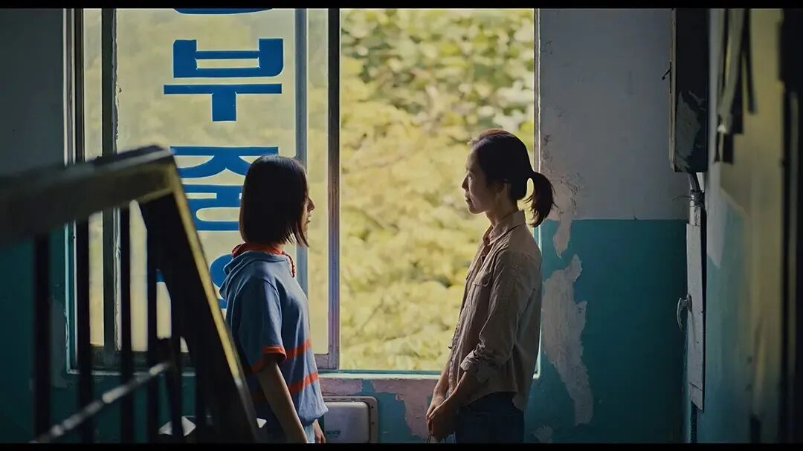
图/电影《蜂鸟》
不过这些事情在身边发生得太多，听得太多，人真的会麻木，不会觉得有什么问题。我觉得这才是最可怕的地方。
暑假的时候，我又替一个朋友撒了慌。
朋友想去见对象，想要我帮忙在家长面前圆谎。我当时觉得自己是个老好人，很自然地就答应了。
为了让这个说法听起来可信，我一个人在外面逛到晚上九点才回家。后来事情还是暴露了，我妈对我进行了非常严厉的批评，我们之间的关系也变得很僵。
这件事肯定是我做错了。可当时我答应朋友的时候，完全没有觉得自己有什么问题。
当时我会觉得，又不是我去见对象，我只是帮朋友说一句话，我没有直接伤害谁，也没有做什么特别严重的事。
后来再复盘，我自己也会觉得挺荒谬：当时为什么会那样想？我虽然没有直接做那件事，但作为一个局外人，确实也在推波助澜。
我意识到，替朋友向父母撒谎，在我原来的世界里几乎是一件顺理成章的事。包括染发、化妆、去台球厅，这些事情在我眼里都很常见。
有人夸我能突然狠下心学习，觉得我执行力很强。但其实，学习只是“浮于表面上的改变”。
它仅仅说明一个人有没有努力，是否理解了应试考试的规则，但它没有关系到人的内核是如何改变的。
考上高中，并不代表我真正发生了什么根本变化。有些观念还是留在潜意识里，甚至不知不觉成为常态。这才是过去的环境对我造成伤害的一个地方。
那几年也不是什么都没有留下，至少我看到了很多普通校园生活可能看不到的东西，也学会了怎么处理人与人之间的关系。
我也觉得，在那种周围所有人都不学习、都在玩的环境里，最后自己能沉下心来学习，其实挺难得的。现在让我重新做到当年那种程度，我都不一定做得到。
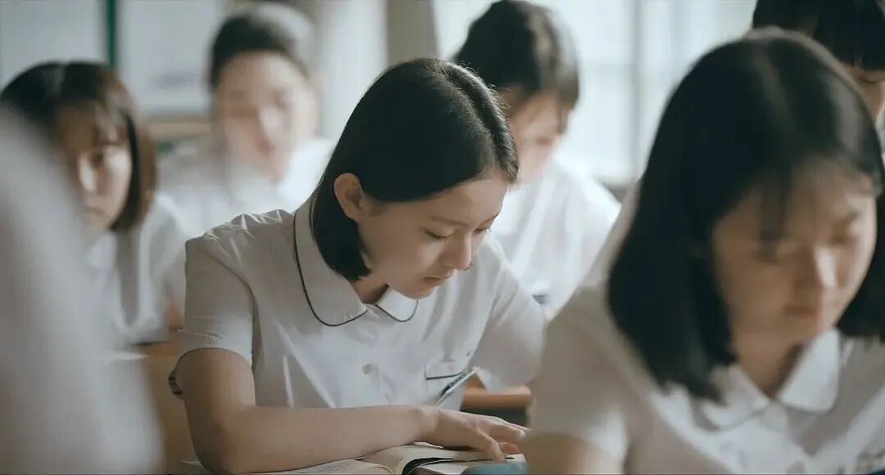
图/电影《蜂鸟》
我妈现在管得比以前严，可能觉得我能考上大学了，开始给我报辅导班。
开学前，我独自坐飞机去深圳，看望实习的姐姐，在那里待了四天。
她在深圳一家电商平台实习，我住在她租的房子里。她最近一边实习一边准备秋招，压力很大。
以前在家里，我觉得姐姐的房间很乱，她好像也没有什么计划。到了深圳，看到她工作的表格和安排，我才发现她在公司里很会规划。她在家里和在外面，好像是两种状态。
在深圳，姐姐教我怎么看地铁，告诉我到了机场以后应该怎么走。我们去逛一个很大的商场，看到很繁华的街景。我甚至有点羡慕她每天坐地铁去高楼大厦里上班。
可是她告诉我，大城市的工作没有看起来那么光鲜。每天挤在小出租屋里，早出晚归，也会很累。她甚至劝我，留在县城找一份相对稳定的工作，也可以生活。
但我去接她下班时，看见商场、地铁和那些下班的人，还是觉得那里的生活更充满希望。
至于以后，我现在也说不准，还是走一步看一步。只是如果有机会，我想离开这个已经混腻的小县城。如果能留在大城市，我宁愿每天累一点，至少还有一点希望。
虽然打工并不像表面上那么光鲜，但我觉得，如果太早放弃期待，可能也是一种失败。
哪怕给自己留一点期望、一点念想，也比什么都不想要好。
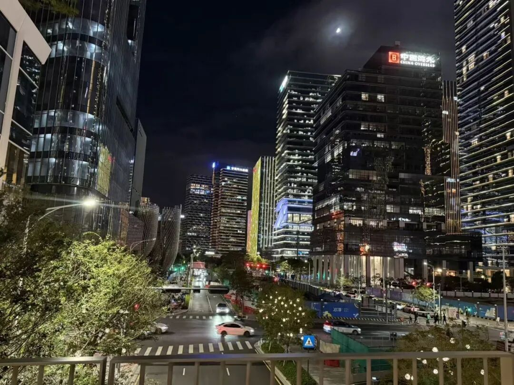
小奥去深圳时拍的照片/受访者供图

有希望，总是好的。
或许，对于青春迷茫、站在人生分岔路口、却又无人指点迷津的女孩子来说，没有比希望更宝贵的东西了。

*为保护未成年人隐私，文中小奥为化名

监制：视觉志

编辑：+L
视频号：视觉志
点击阅读原文，看视频号精彩内容～
