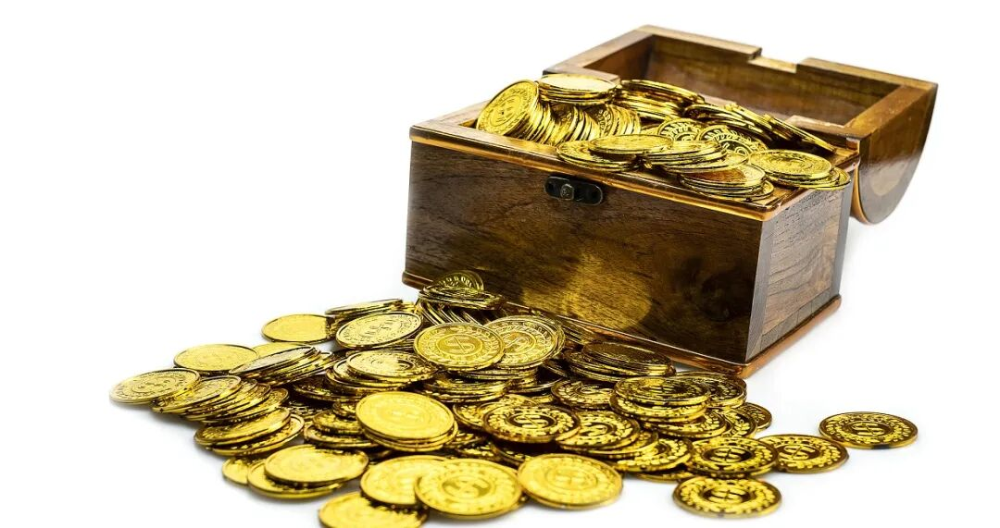
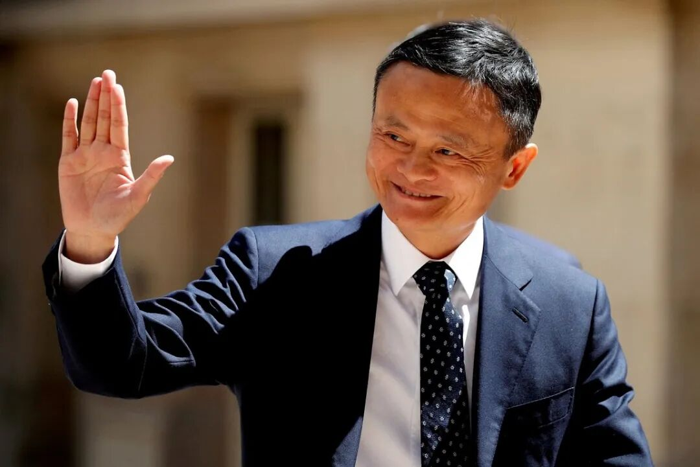
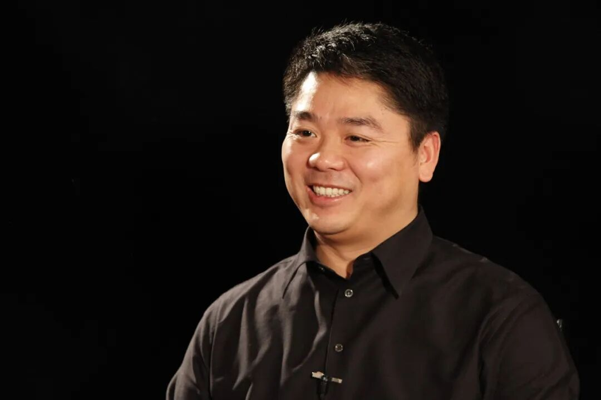
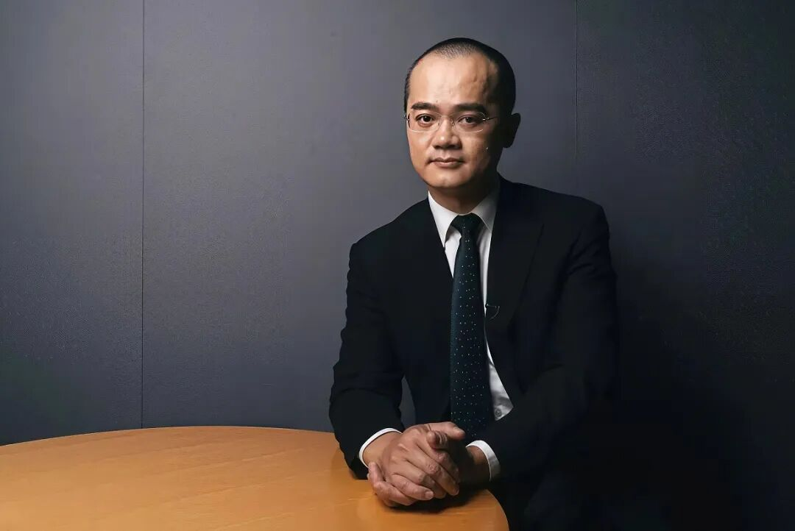
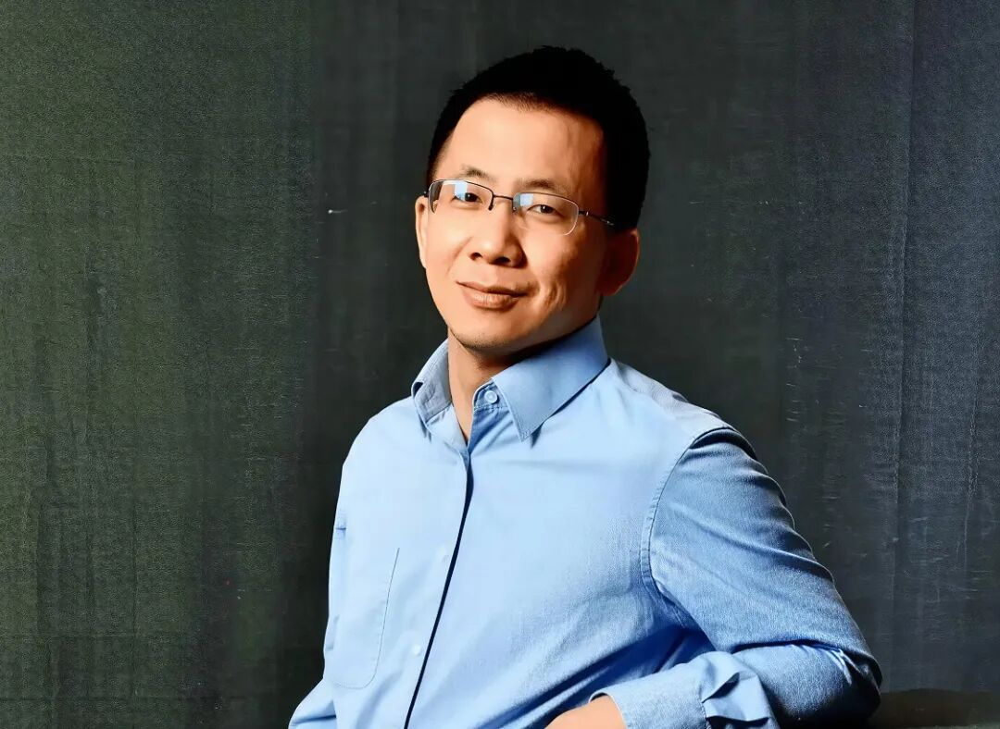
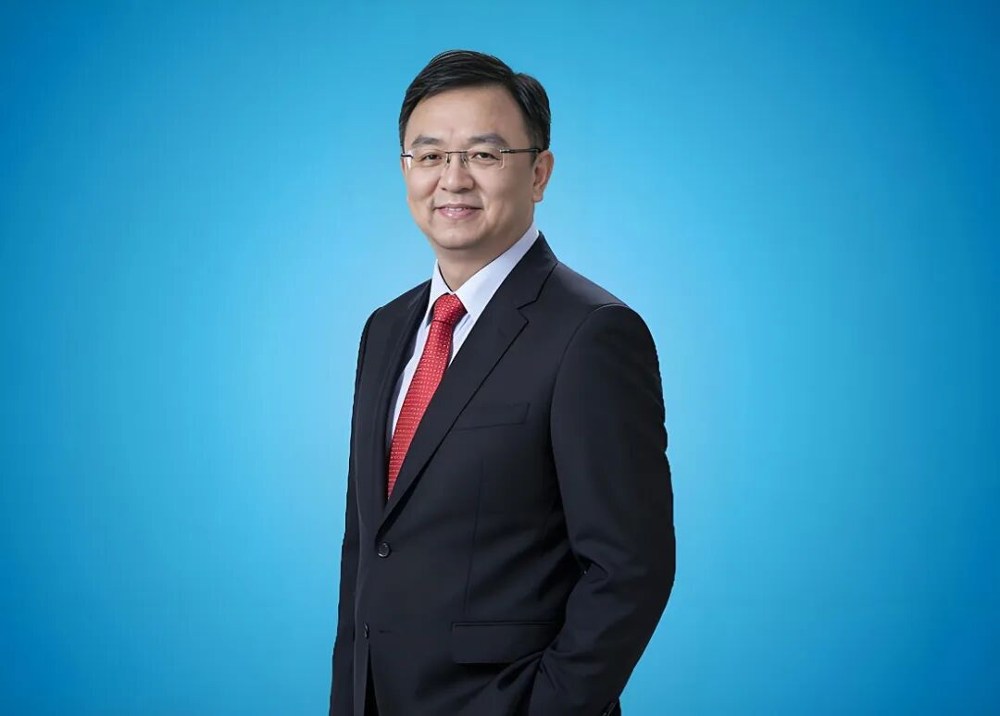
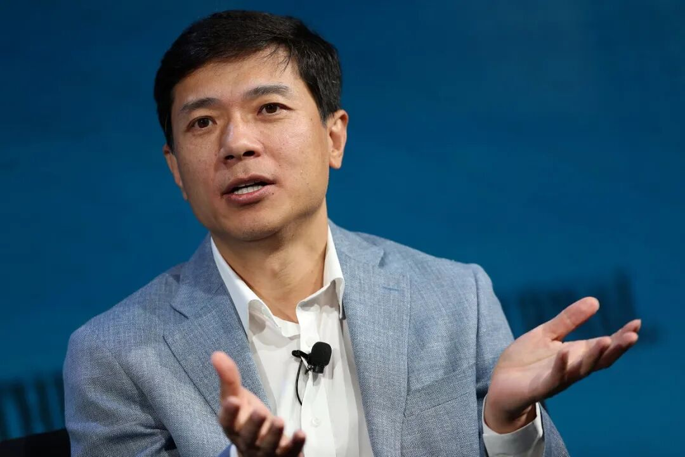
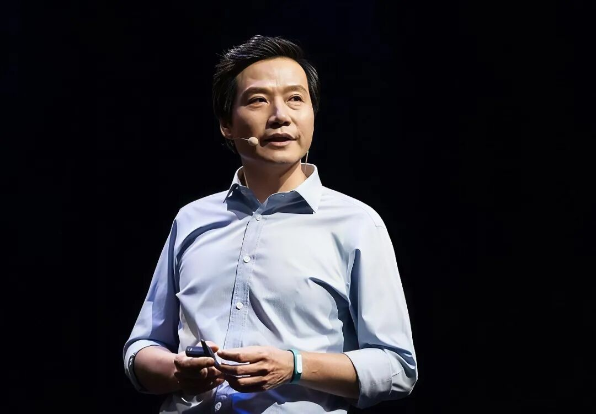
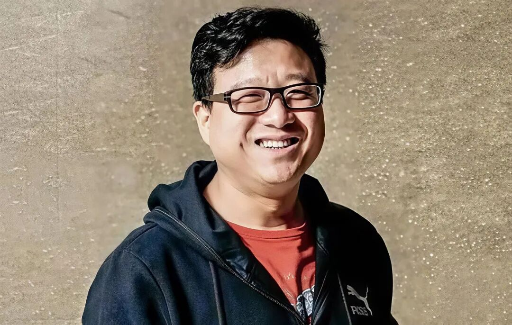

# 顶级富豪的第一桶金都是咋来的？雷军大学赚百万，马云卖掉股份只拿十万
> 💡 备注属性未写入，可能是备注属性名称或者类型被修改了，建议将字段类型设置为 rich_text，可以在小程序-操作-修改文章数据库页面进行调整
> 💡 原文链接:[https://mp.weixin.qq.com/s?__biz=MzkwODM3OTM5MA==&mid=2247502988&idx=1&sn=4fe0d251cef5561cb30d94e73da09b0b&chksm=c1141267b74963fe3be4bfe4cf02199e7b756ef135ba3617fe0ad8a9897d60f42d78edf0d6aa#rd](https://mp.weixin.qq.com/s?__biz=MzkwODM3OTM5MA%3D%3D&mid=2247502988&idx=1&sn=4fe0d251cef5561cb30d94e73da09b0b&chksm=c1141267b74963fe3be4bfe4cf02199e7b756ef135ba3617fe0ad8a9897d60f42d78edf0d6aa#rd)

很多人聊起富豪，总是习惯性地看他们的身价有多少亿，排名有多高，但是很少有人去深扒一个更有意思的问题：**他们的第一桶金都是怎么赚到的**？第一桶金这个东西很微妙，它不是你上班攒下的工资，也不是别人给的启动资金，而是你人生中第一次靠自己的判断和能力，赚到的那笔足以改变命运的钱。

这笔钱是多是少并不太重要，重要的是那些成功的人，人生大多从这笔钱开始迎来了翻天覆地的转变，第一桶金往往能展露一个人真正的本事，你靠什么赚到第一笔大钱，基本决定了你后来会走什么样的路。咱们今天就来扒一扒，国内那些顶层的富豪们，他们的第一桶金究竟是怎么来的。
---
## 马云

1992年，当时还在杭电当英语老师的马云和几个退休教师一起凑了3000元，办了一个英语翻译社，刚开业的时候一个月收入只有700块钱，但是房租等支出要2000多，一直处于亏损状态。为了补贴翻译社的亏空，马云自己背着麻袋去义乌、广州批发小商品，然后回到杭州摆摊售卖，还兼职推销医疗器械，就这样维持了三年，翻译社才勉强实现收支平衡。
1995年，杭州和一家美国公司合资修一条通往安徽阜阳的高速公路，结果开工之后对方的投资款迟迟没打过来，导致上千名农民工的工资发不出。于是浙江省交通厅找了一批英语好的人组成代表团，前往美国“讨薪”，马云便位列其中。这次美国之行虽然没有顺利拿到钱，还被人在洛杉矶软禁了将近一个月，但却让马云意外接触到了互联网，也让他找到了新的创业方向。
回国后，马云和妻子张瑛、同事何一兵凑了2万块钱创办海博网络公司，推出“中国黄页”。1996年，中国黄页引入杭州电信合资，马云手里的股份被稀释到了21%，后来双方在经营理念方面出现了分歧，马云选择把股份卖掉，拿到了十几万现金，这就是他的第一桶金。
---
## 刘强东

他是一个文科生，但是在大学的时候自学了电脑编程，然后通过开发软件赚了一点小钱。大四的时候，刘强东在学校附近开了一家餐馆，结果不仅没有赚到钱，还欠了一屁股债。餐馆倒闭后，他进入一家日企打工，两年时间省吃俭用攒了1.2万元积蓄。1998年，刘强东和当时的女友龚晓京一起在中关村租了一个只有4平米的小柜台，做起了代理销售刻录机、光盘的生意。
当时同行大多都卖水货和盗版，但刘强东坚持只卖正品，而且每件都开发票，口碑就这样慢慢积累起来了。很快，他就陆续开了12家分店，到2001年，京东多媒体成为了全国最大的光磁产品代理商。此时刘强东的个人资产突破了千万元，这是支撑京东后续转型电商的真正第一桶金。
---
## 王兴

他是一个典型的连续创业者，并且是屡战屡败，又屡败屡战，像一个打不死的小强。2004年，王兴中断了美国特拉华大学博士学业，带着自己攒下的奖学金回国创业，拉上几个朋友先后搞了好几个项目，结果无一例外，全部以失败告终。2005年，他效仿美国的Facebook，做出了校内网，成为国内最早的校园SNS网站，快速积累了数百万的大学生用户。
但是很快问题就来了，随着用户量的持续暴增，服务器带宽成本越来越高，公司又迟迟拿不到融资，再加上当时校内网本身没有什么盈利能力，资金压力非常巨大。无奈之下，2006年，王兴把校内网以200万美元的价格打包卖给了陈一舟的千橡集团，实现了他人生中第一笔大额资金变现，这笔钱也成为了后来他创办饭否网和美团的本金。
---
## 张一鸣

和王兴同为龙岩老乡，也同样是连续创业者的张一鸣实际上并没有得到过真正意义上的第一桶金。他大学毕业后第一个创业项目是做IAM企业协同办公系统，结果市场不认可，没赚到钱。然后进入酷讯网上班，拿到了公司给的期权，酷讯后来被收购，但张一鸣在收购前已经离职，没有拿到酷讯的大额变现。紧接着又和王兴一起创办饭否网，同样以失败收场。
2009年，张一鸣创办九九房，虽然做得还不错，但依旧没有清晰的赢利点。他离开之后，也没有卖掉股份，九九房后续也继续运营了几年。2012年，张一鸣创办字节跳动，拿到了海纳亚洲王琼的天使投资，逐渐跑通了信息流广告模式，给公司带来了持续造血的能力。所以说张一鸣的财富是通过字节跳动的股权持续增值带来的，而不是某一笔大额资金。
---
## 王传福

90年代中期，作为全球最大镍镉电池生产国的日本出于环保方面的考虑，决定放弃这项业务，开始逐步淘汰国内的镍镉电池生产线。但另一边在市场方面，由于手机等电子产品的产量不断上升，对镍镉电池的需求量又在不断加大，当时在深圳比格电池公司当总经理的王传福看中了这个机会，于是找表哥吕向阳借了250万，自己则拿出积蓄外加技术入股的方式，合伙创办比亚迪公司。
因为自动化生产线太贵，他压根买不起，所以初期比亚迪就采用半人工+夹具的低成本生产线，大幅压低生产成本。两年后，比亚迪的营业额做到了接近1个亿，成为国内头部的镍镉电池厂商，拿到了规模化的利润，王传福也因此收获了事业上的第一桶金。他后续带领公司转型镍氢电池、锂电池和汽车赛道，均是来源于这段时间的原始资本积累。
---
## 李彦宏

李彦宏从布法罗州立大学毕业后进入道琼斯旗下IDD公司做高级顾问，开发华尔街日报网络版金融检索系统，工资不算低，但也算不上大额财富。1997年，他跳槽到硅谷的搜索引擎公司Infoseek，发明了超链分析（RankDex）专利，公司上市时，给了他一部分股票期权。1999年，Infoseek被迪斯尼收购，李彦宏把手里的期权变现，获得了近百万美元的现金，这就是李彦宏公认的人生第一桶金来源。
不过有意思的是，他后来回国创办百度时并没有动用这笔钱，而是和徐勇一起对接拿到了120万美元的风投，然后紧接着又收到了DFJ和IDG提供的1000万美元投资款，这才逐渐孵化出了后来的百度。
---
## 雷军

在武大读大二的时候，雷军和学长王全国合作搞出一套名叫“BITLOK”的加密软件，专门卖给商业软件做防盗版加密。那个年代市面上软件盗版泛滥，加密工具是刚需，所以BITLOK卖得特别好，几年时间让他赚到了近百万。不过这笔钱并没有对他后来的事业产生多大的影响，因为在大四时，他创办三色公司仿制汉卡，遭遇了盗版冲击，项目倒闭，这笔钱基本被消耗空了。
雷军真正的第一桶金，是在金山时期获得的，他1999年牵头搞了卓越网，最初只是一个软件下载网站，后来转型做电商。2004年，亚马逊用7500万美元将卓越网全资收购，雷军当时持有卓越网10%的股权，顺利套现了750万美元。这笔钱让雷军实现了财务自由，才有资本去给YY、凡客、UC等初创公司做天使投资。
---
## 丁磊

从宁波电信局辞职后丁磊南下广州，先后在几家互联网相关企业做技术工作。1997年，他东拼西借凑了50万创办网易，早期尝试过很多业务，包括搜索引擎、BBS、免费个人主页等等，但一直没有稳定的收入。后来丁磊做电子邮箱，原本打算直接采购国外的Hotmail邮箱系统，但是对方开价280万美元，他买不起，所以这才硬着头皮开始自己开发。
1998年，丁磊带领团队开发出了163邮箱系统，最初163邮箱并不是直接给普通用户使用的，而是卖给各地的电信运营商。第一个买家是广州电信飞华网，卖了119万，后续又有多家电信网站持续采购，让他合计赚了500多万。有了这笔钱，丁磊开始投入门户网站建设，逐步打通了门户广告业务。
---
还有很多我们就不一一赘述了，从这几个人第一桶金的获得方式，不难看出大部分都是跟技术相关，因为技术的边际成本几乎为零，所以说一个人想要创业成功，在自己领域内的专业能力其实就是最大的本钱。没有谁的第一桶金是大风刮来的，表面上看可能是运气、是时代、是风口，但是往深了看，都是在某个领域扎扎实实深耕了很多年，才等到了属于自己爆发的契机。

## 摘要

（待补充）

## 我的笔记

（待补充）
