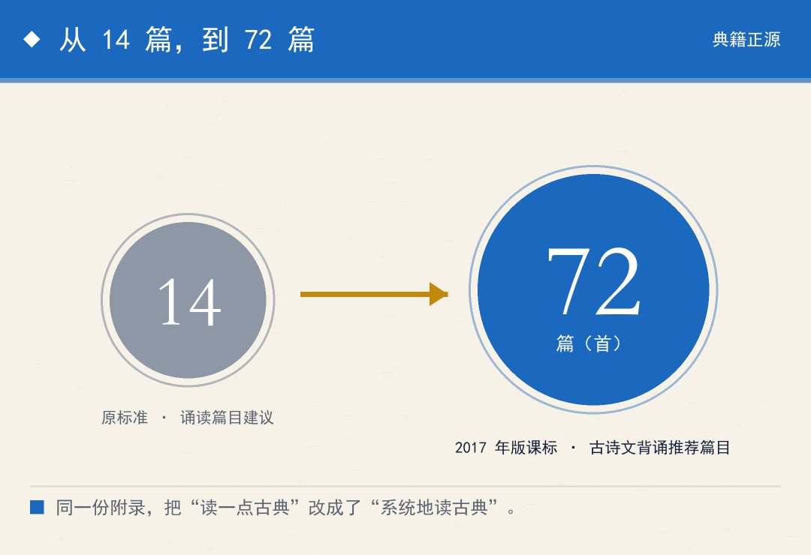
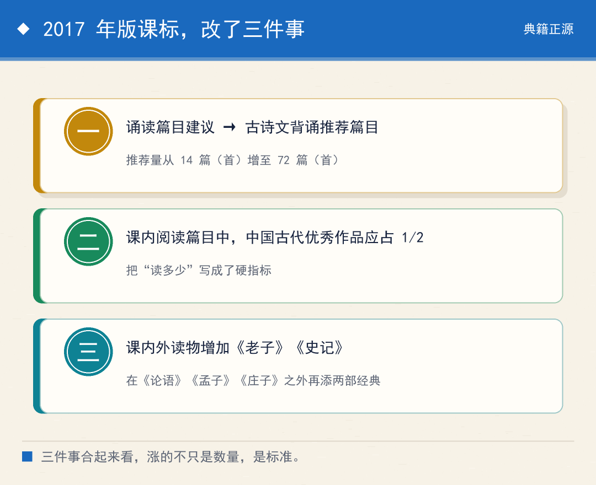
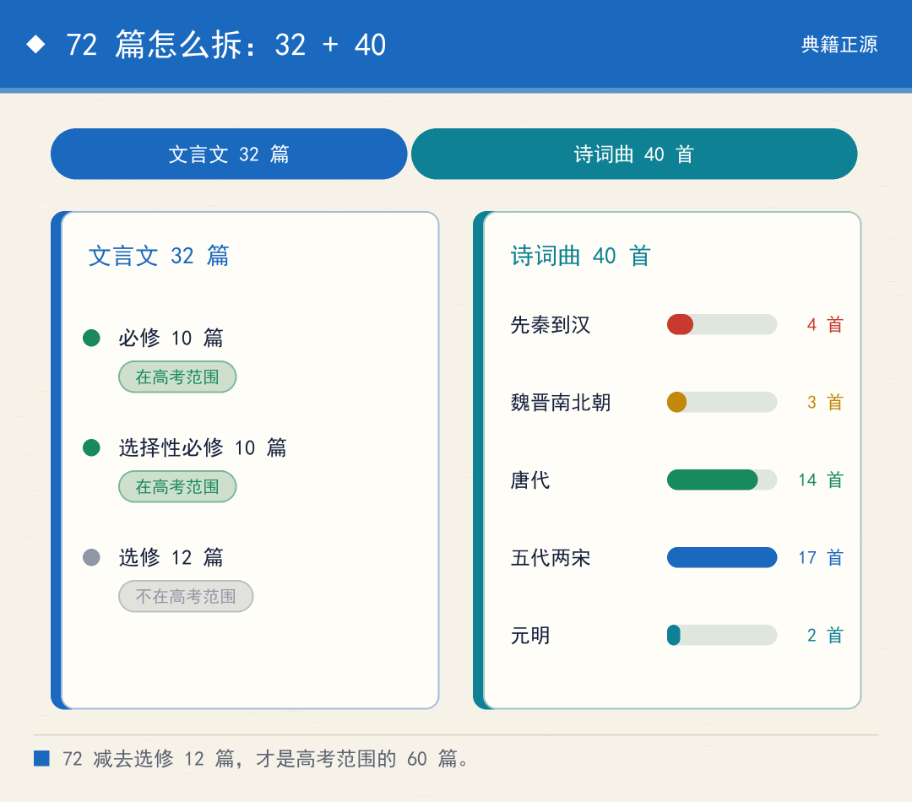
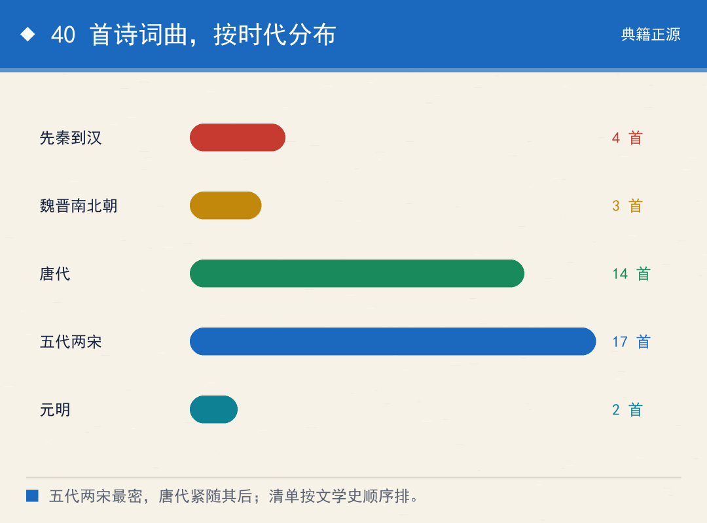
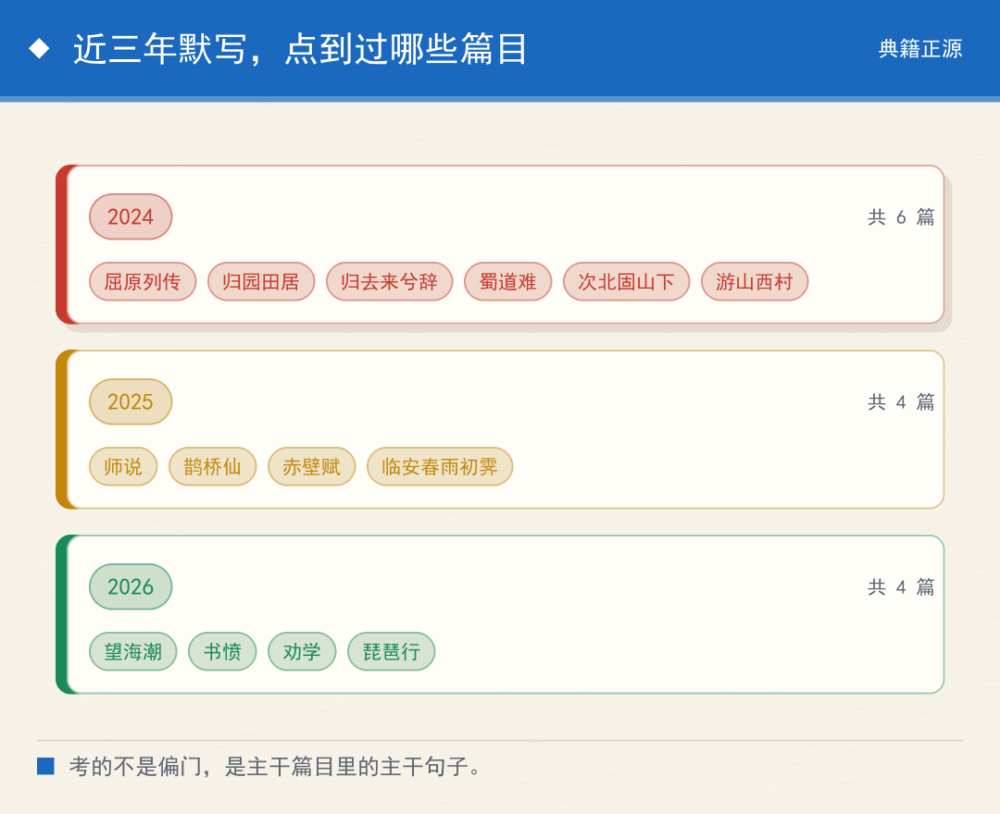
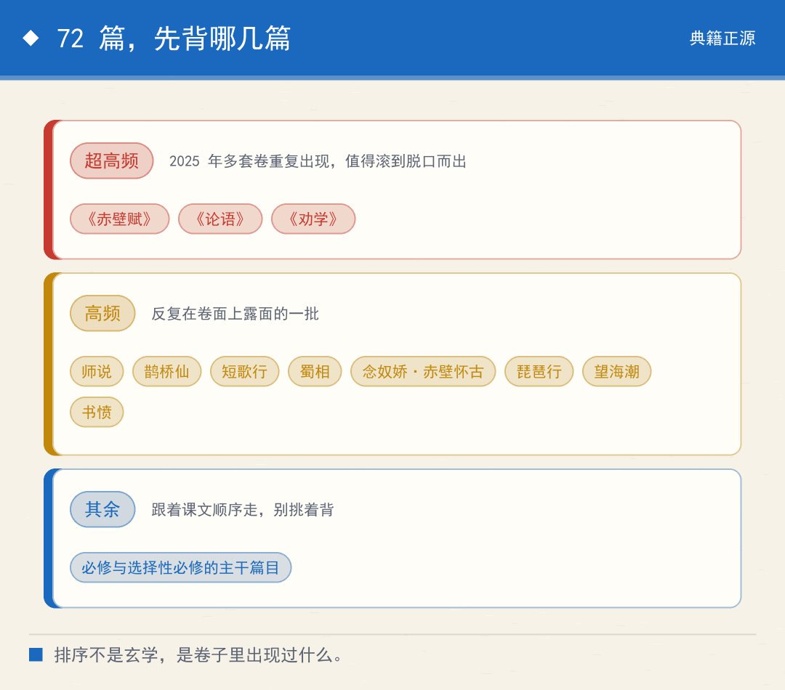

# 高考要背的 72 篇古诗文，这份清单是怎么定下来的
> 💡 备注属性未写入，可能是备注属性名称或者类型被修改了，建议将字段类型设置为 rich_text，可以在小程序-操作-修改文章数据库页面进行调整
> 💡 原文链接:[https://mp.weixin.qq.com/s?__biz=MzY4NTQ0NjQ4Mg==&mid=2247484169&idx=1&sn=491b8fe11d1cfd1995e7c8751ed125b0&chksm=f2f9c051347f895949949d04e11a46610ad2587af60386187248d03f5a6f5142374e66f4d07b#rd](https://mp.weixin.qq.com/s?__biz=MzY4NTQ0NjQ4Mg%3D%3D&mid=2247484169&idx=1&sn=491b8fe11d1cfd1995e7c8751ed125b0&chksm=f2f9c051347f895949949d04e11a46610ad2587af60386187248d03f5a6f5142374e66f4d07b#rd)
高中要背的古诗文，是 72 篇。
这个数字不是哪家出版社凑出来的，也不是某个老师定的。它写在一份国家文件的附录里，而且是被明确"加"上去的。
更具体一点：**在这份文件出台之前，这个数字是 14。**

图1｜从 14 篇到 72 篇：一次课标修订带来的推荐量变化
### 定这份清单的，是 2017 年版的高中语文课标
文件的全名叫《普通高中语文课程标准（2017 年版 2020 年修订）》。
它做了一件原标准没做的事：把"诵读篇目的建议"改成了"古诗文背诵推荐篇目"，推荐数量从 14 篇（首）增加到 72 篇（首）。
改动是公开宣布的。2018 年 1 月 16 日，教育部开新闻发布会介绍新课程方案和新课标，其中语文课标被点名为"传统文化内容贯穿必修、选择性必修和选修各部分"的一科。
同一场发布会上还明确了两条：一是课内阅读篇目中，中国古代优秀作品应占一半；二是课内外读物在原有的《论语》《孟子》《庄子》之外，增加了《老子》和《史记》。
**一份清单从 14 涨到 72，涨的不只是数量，是"必须读到什么程度"的标准。**

图2｜2017 年版课标的三项变化：数量、占比、读物
### 72 篇拆开：32 篇文言文 + 40 首诗词曲
这个 72 不是一锅端的，它先按体裁切成两块：文言文 32 篇，诗词曲 40 首。
32 篇文言文又按课程结构分成三组。
必修 10 篇：《论语》十二章、劝学（《荀子》）、屈原列传（司马迁）、谏太宗十思疏（魏征）、师说（韩愈）、阿房宫赋（杜牧）、六国论（苏洵）、答司马谏议书（王安石）、赤壁赋（苏轼）、项脊轩志（归有光）。
选择性必修 10 篇：子路、曾皙、冉有、公西华侍坐（《论语》）、报任安书（司马迁）、过秦论·上（贾谊）、礼运（《礼记》）、陈情表（李密）、归去来兮辞（陶渊明）、种树郭橐驼传（柳宗元）、五代史伶官传序（欧阳修）、石钟山记（苏轼）、登泰山记（姚鼐）。
选修 12 篇：《老子》八章、季氏将伐颛臾（《论语》）、大学（《礼记》）、中庸（《礼记》）、《孟子》一则、逍遥游（《庄子》）、谏逐客书（李斯）、兰亭集序（王羲之）、滕王阁序（王勃）、黄冈竹楼记（王禹偁）、上枢密韩太尉书（苏辙）、古代文论选段。
最后那一组值得多看一眼。"古代文论选段"里装的是毛诗序、《典论·论文》、《诗品序》、《与元九书》、郑燮《题画》、王国维《人间词话》——**这不是文章，是历代人谈论"文章该怎么写"的议论，等于把一部文论史压进了一篇。**

图3｜72 篇的构成：文言文 32 篇 + 诗词曲 40 首
### 40 首诗词曲，从先秦排到元明
这一批的跨度比很多人想的长。
先秦到汉：《诗经》的静女、无衣，屈原《离骚》，以及《古诗十九首》里的涉江采芙蓉。
魏晋南北朝：曹操短歌行、陶渊明归园田居·其一、鲍照拟行路难·其四。
唐代十四首：春江花月夜（张若虚）、山居秋暝（王维）、蜀道难·梦游天姥吟留别·将进酒（李白）、燕歌行（高适）、蜀相·客至·登高·登岳阳楼（杜甫）、琵琶行（白居易）、李凭箜篌引（李贺）、菩萨蛮（温庭筠）、锦瑟（李商隐）。
五代两宋：虞美人（李煜）、望海潮（柳永）、桂枝香·金陵怀古（王安石）、江城子·乙卯正月二十日夜记梦与念奴娇·赤壁怀古（苏轼）、登快阁（黄庭坚）、鹊桥仙（秦观）、苏幕遮（周邦彦）、声声慢（李清照）、书愤与临安春雨初霁（陆游）、念奴娇·过洞庭（张孝祥）、永遇乐·京口北固亭怀古与菩萨蛮·书江西造口壁与青玉案·元夕（辛弃疾）、贺新郎（刘克庄）、扬州慢（姜夔）。
元明两首：长亭送别（王实甫）、朝天子·咏喇叭（王磐）。
**从《诗经》到明代散曲，两千多年压在 40 首里。这份清单是按文学史的顺序排的，顺着读一遍，等于过了一遍中国诗的骨架。**

图4｜40 首诗词曲的时代分布：五代两宋 17 首为最密
### 哪几篇最该先背：看卷子里出现过什么
背 72 篇要有先后。历年卷子里的默写题，给了最直接的排序依据。
超高频的三篇：《赤壁赋》《论语》《劝学》。
《赤壁赋》在 2025 年的多套卷子里重复出现；《论语》几乎每年在不同的卷子上露面；《劝学》同样反复被点到。这三篇值得滚到脱口而出。
高频的还有一批：师说、鹊桥仙、短歌行、蜀相、念奴娇·赤壁怀古、琵琶行、望海潮、书愤。
具体到年份更清楚：2024 年的卷子点到过屈原列传、归园田居、归去来兮辞、蜀道难、次北固山下、游山西村；2025 年点到过师说、鹊桥仙、赤壁赋、临安春雨初霁；2026 年点到过望海潮、书愤、劝学、琵琶行。
排一遍就能看出一个规律：**考的不是偏门，是主干篇目里的主干句子。**
还有一个变化要留意。近三年的默写题基本都带情境——不是给上句填下句，而是给一个场景或一句意象描述，让你自己去找对应的句子。2026 年有卷子直接把默写和卷内的诗歌阅读绑在一起考。
**默写已经从"记住"挪到了"用出来"。背得再熟，不理解那句诗在说什么，照样卡住。**
我做过很多年的材料审查，看下来一条规律：一份清单最难的地方不在收录，在划界。收什么好办，划到哪一刀停，才是真正的判断。
**72 这个数字之所以重要，就因为它是一刀划下来的结果。**

图5｜近三年默写考查篇目速览（据公开试卷整理）
### 必须说清的一个边界
课标写的"推荐"，是推荐，不是考试范围。
课标自己也划了线：学业水平考试考的是必修课程，高考考的是"必修和选择性必修"。72 篇里的选修 12 篇——包括《老子》八章、季氏将伐颛臾、《大学》《中庸》、《逍遥游》、《谏逐客书》、《兰亭集序》、《滕王阁序》、《黄冈竹楼记》、《上枢密韩太尉书》，以及"古代文论选段"——不在高考范围之内。
**72 减 12，就是高考实际要背的 60 篇：40 首诗词曲，加必修 10 篇、选择性必修 10 篇。**
另外，各省教育考试院还会另行发布本省的篇目文件，个别省份的版本与 60 篇并不完全一致，具体仍以本省最新的考试文件为准。
**这条边界必须讲清楚：课标给的是全国统一的底线，省里的文件才是本地的准绳。**
所以真正稳妥的用法是：先用 72 篇把底子铺满，再拿本省的文件对着核一遍。顺序反过来，容易漏。
### 一份清单的真正含义
从 14 篇到 72 篇，表面上只是数字变大了。
往深一层看，这是把"读一点古典"改成了"系统地读古典"——从选段到成体系，从知道有名篇到知道名篇在哪个位置上。
我认为，这份清单最大的价值不是增加了多少背诵量，而是它承认了一件事：**没有量的积累，所谓的文化素养只是一句空话。**
25 岁背下来的句子，和 15 岁背下来的句子，在一个人身上的分量是不一样的。这份文件把话说明白了：趁早，成体系，别挑着背。

图6｜72 篇背诵优先级：按卷面出现频次分三档
免责声明：本文内容为传统文化、民俗与思想史范畴的知识分享，旨在帮助读者理解古人的思维方式与历史语境。文中所引述均为文献记载、民俗现象或学术讨论，不构成对任何个人事务的预测、指导或建议。请读者以文化视角理性看待。

## 摘要

（待补充）

## 我的笔记

（待补充）
