# 魏晋南北朝：倾覆乱世，何以绽放极致文化之美
> 💡 备注属性未写入，可能是备注属性名称或者类型被修改了，建议将字段类型设置为 rich_text，可以在小程序-操作-修改文章数据库页面进行调整
> 💡 原文链接:[https://mp.weixin.qq.com/s?__biz=MzA4NTg2NTQxMA==&mid=2247489441&idx=1&sn=c4d809979d7727b514864cae01a4812a&chksm=9e621359d2286c73065c02f61c6f8129fa86da47e3e9152dd47caf290f36bd7e46ac36a92320#rd](https://mp.weixin.qq.com/s?__biz=MzA4NTg2NTQxMA%3D%3D&mid=2247489441&idx=1&sn=c4d809979d7727b514864cae01a4812a&chksm=9e621359d2286c73065c02f61c6f8129fa86da47e3e9152dd47caf290f36bd7e46ac36a92320#rd)
从曹丕代汉建魏，到公元589年隋文帝杨坚灭陈、重新一统山河，三百六十九年的时光流转。帝王更迭，如同客栈来去匆匆的过客，今日身披黄袍，明日刀锋便可能架上脖颈。而寻常百姓的性命，在这三百多年里，轻得如同秋风飘零的桐叶。
可偏偏，许多直到今天我们依旧珍重的精神珍宝，恰恰是从这片满目疮痍的泥土之中，挣扎着生长了出来。

王羲之的书法，陶渊明的诗篇，顾恺之传于后世的画理，祖冲之推演的圆周率，还有敦煌、云冈、龙门，一整面山崖静静镌刻下的信仰，仿佛千万尊石像在山崖间低声诵经。

宗白华在《美学散步》里说：汉末魏晋六朝是“中国政治上最混乱、社会上最苦痛的时代，然而却是精神史上极自由、极解放，最富于智慧、最浓于热情的一个时代”。

这句话被无数文章辗转摘抄，可很少有人愿意往下多追问一层，为什么，偏偏是这个时代？
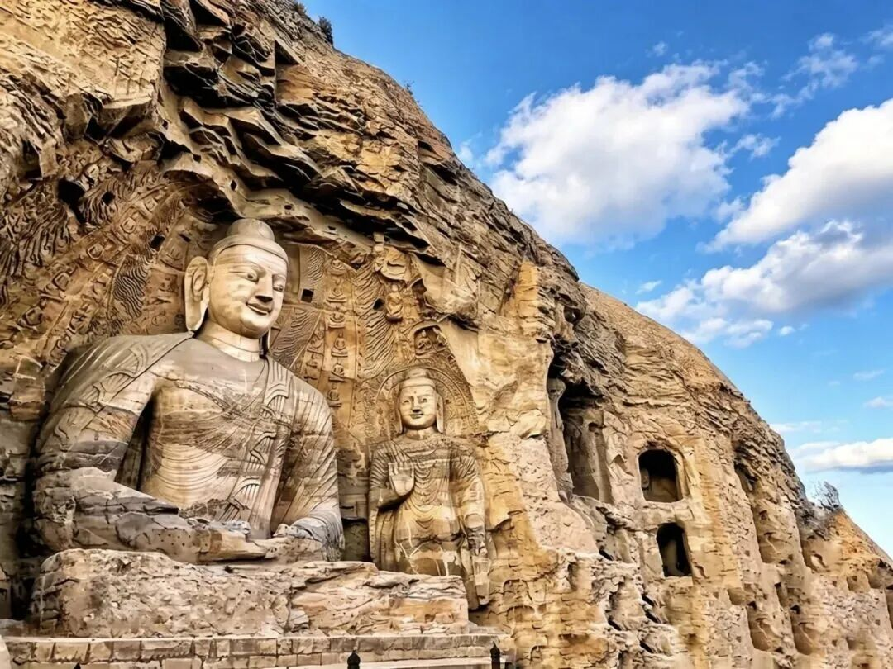
▲云冈石窟。图源：网络

汉武帝之后，儒家经书几乎成为社会唯一的正统教材。想要踏入仕途，就要熟稔儒家典籍。人的头脑，被成套标准化的答案填满。写文章，行文范式不能逾越规矩。品评人物，总绕不开忠孝两套标尺。就连审美，也被礼法牢牢管束。时日一久，人变得顺从乖巧，乖到快要遗忘自己原本的模样。

东汉末年天下大乱，这套捆住世人的紧箍咒，忽然裂开了一道缝隙。

曹操先后数次颁布求贤令，明确提出“唯才是举”，甚至说，哪怕一个人背着污辱之名、不仁不孝，只要有治国用兵的真本事，也该举荐。这几句话，推开了那扇长久锁死的窗子，浩荡快哉风灌了进来。

待到曹魏建立，九品中正制正式落地。这套制度的初衷是选拔贤才，可评判人才的权力交到地方世家出身的中正手中，弊病便根植进了骨血。寒门子弟纵使拼尽全力，也很难挤进门阀构筑的圈层。正是这套“仕途看血统”的规则，击碎了读书人“依靠才学便能平步青云”的幻想。

既然仕途不完全由学识决定，那一身才学，便可以拿来安顿自己，可以拿来饮酒，拿来挥毫写字，也可以躬耕南山。

外在礼教的枷锁裂开缝隙，强权的刀却依旧高悬在世人头顶。就在这进退两难的夹缝之中，一部分读书人才向内生长出属于自我的骨头。

先说玄学。

听上去玄虚缥缈的玄学，内核其实格外贴近人间烟火。它不是号召世人统统躲进深山避世，而是用老庄“人之本然”的思考，置换掉儒家那套“你必须如此”的规训。它告诉时人，人在天地之间何其渺小，生命倏忽短暂，不必端着装模作样。
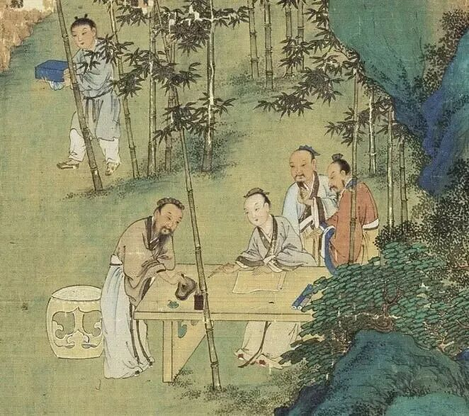
▲明 仇英《竹林七贤图》（局部）。图源：网络
于是便有了阮籍。母亲亡故，友人登门吊唁，他依旧安然下棋。旁人劝他就此停手，阮籍只说：“请终此局。”棋局落定，他痛饮两斗酒，一声悲号过后，吐血数升。这份悲痛，不是演给外人看的表演，是从胸腔里炸开的哀恸。

同一场丧事里还有一幕。按照礼法，居丧期间不该见酒见琴。可嵇康的哥哥嵇喜来吊唁，阮籍翻出白眼。嵇康抱着酒、挟着琴来，阮籍的眼珠才转回来，露出黑瞳。他不是不悲痛，他只是拒绝按规定好的姿势悲痛。白眼给礼法，青眼给知己。一双眼，把整个时代的分裂照得清清楚楚。

阮籍还常常独自驾车，毫无目的地奔走。马蹄碾过荒草和残破的官道，碾过一个个相似而疲惫的村庄，最终在无路可走的地方停下来，眼前是苍茫的暮色，天地间仿佛只剩他一人。他于是放声痛哭，哭声在旷野里回荡，像要把胸中所有郁结都倾倒给这末世。哭够了，调转车头，归家。放旷背后，藏着时代无路可逃的深重苦闷。

这份“真”，不独名士所有。
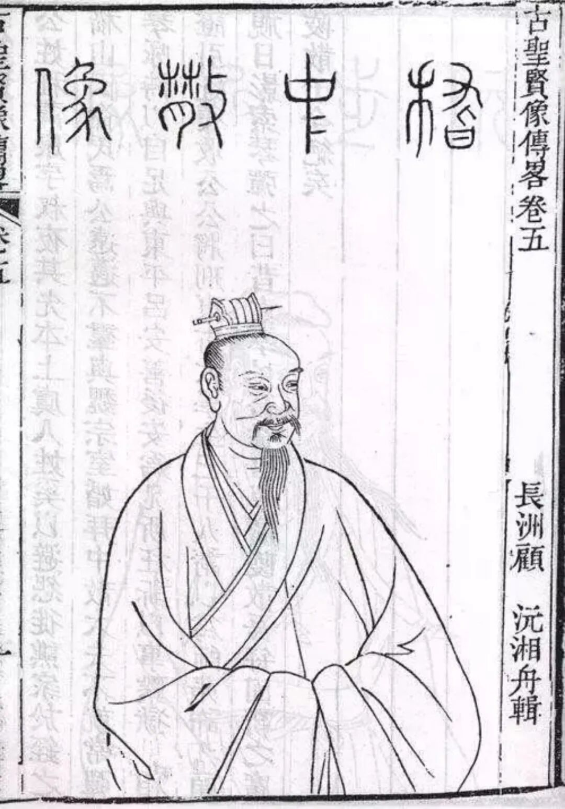
▲嵇康画像。图源：网络
枭雄也一样。桓温北征，路过金城，看见自己年轻时亲手种下的柳树，已经粗达十围。他攀着枝条，泫然落泪：“木犹如此，人何以堪！”一个几乎篡得江山的人，为一棵树哭出千古一叹。乱世里连野心都是悲凉的，所有人，都看得见时间的刀。

而后便是嵇康临刑的一幕。三千太学生聚集到刑场之下，恳请先生传授琴艺，嵇康没有应允。他抬眼望一望日影，估算剩余的时光，转头对兄长说，把我的琴取来。一曲《广陵散》弹奏完毕，他留下一句：“广陵散于今绝矣”，从容赴死。

这绝非刻意表演，是全然袒露的真心。可这个故事，还有后半段，也恰是这后半段，最是动人。

嵇康生前，写过一封《与山巨源绝交书》。好友山涛推荐他做官，他把这件事骂得酣畅淋漓，“非汤武而薄周孔”，字字如刀。天下人都以为这两人恩断义绝了。可嵇康临死前，对儿子嵇绍说的却是：“巨源在，汝不孤矣”，有山涛在，你不会孤单。

绝交书里没有一句私怨，骂的是官场，不是朋友。山涛懂，多年之后，是他举荐嵇绍入仕，把这个孩子培养成以身护卫天子的忠臣。
连绝交都来得光明磊落，连托孤都托付给绝交的人。魏晋人的“真”，不写在脸上，刻在骨头里。

鲁迅谈及魏晋风度，说它离不开药与酒。五石散本是有毒矿物药剂，服下浑身燥热，名士要出门“行散”散热，只能穿宽大破旧的衣衫，避免皮肤溃烂被布料磨伤。药性发作还不宜沐浴，于是“扪虱而谈”，一边捉虱子一边高谈阔论，竟成了名士的标志性姿态。药物只是生理引子，真正改变人的，是乱世留出的缝隙，容许一个人，活得不再像标准化的官僚模样。
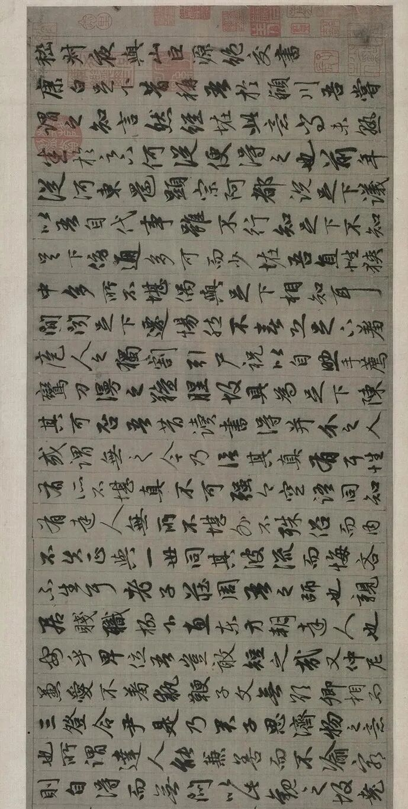
▲元赵孟頫《嵇康与山巨源绝交书》（局部）北京故宫博物馆藏
再来看书法。

太尉郗鉴派门生到王导家选女婿。王家子弟听说太尉来挑人，个个整衣正冠、矜持作态。唯有王羲之，敞着肚皮躺在东边床上，浑然不觉。门生回去一五一十报了，郗鉴一拍大腿：“正此佳婿邪！”“东床快婿”由此而来。

一个连选婿时刻都懒得表演的人，落笔时自然没有框架局限。

王羲之邀约谢安等一众名士集会兰亭，众人临曲水列坐，酒杯顺水漂流，停到谁面前，谁就要赋诗，做不出便罚酒。那一日王羲之微醺，提起鼠须笔，落笔写下“永和九年，岁在癸丑”。

全文三百二十四个字，二十一个“之”字，字字别构，无一雷同。有的像溪水打旋，有的像飞鸟掠过，有的像凝重的老松，又突然一转，轻盈如少年的一记浅笑。这不是千百次刻意练习的成果，那一刻他心中没有条条框框，手腕追随胸中意气而动，文字就此拥有生命。稿纸上留存的涂改痕迹，反倒印证了，这是即兴书写。

后人尊称它为天下第一行书。可《兰亭集序》最动人的并非精妙笔法，而是那股毫不刻意的松弛力量，好似孩童蹲在溪水边观鱼，全然忘却了时间悄然流逝。
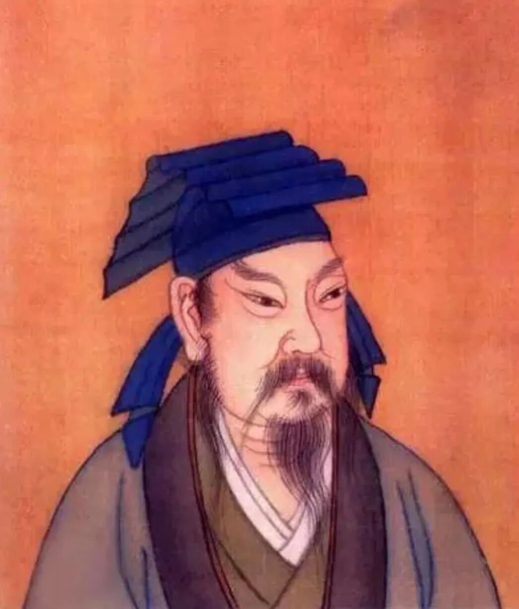
▲王羲之画像。图源：网络
再说到绘画。顾恺之谈论绘画的诀窍，留下一句“传神写照，正在阿堵中”，“阿堵”便是眼睛。他优先捕捉的，是人物眼神流动的神采。如今看不到顾恺之原作，流传的《洛神赋图》是宋代摹本，画中洛神回眸一望，仿佛下一刻便要隐入水波。

顾恺之为谢鲲画像，直接把人物安置在山石林木之间，说“此子宜置丘壑中”。所谓传神，不止描摹眉眼，人精神所向往的山水，也是人格的一部分。瓦官寺维摩诘壁画如今仅存文字记载，外来的佛教题材，被他化作魏晋士人憔悴清瘦的精神模样。这已经不单单是绘画技法，是把人当成鲜活的个体来打量了。

时代发现了“人”，也开始打量“人”。潘安年少时挟弹出洛阳道，妇人们手拉着手围住他，往他车里扔果子，满载而归，是为“掷果盈车”。同时代的左思，写《三都赋》弄得满城传抄、洛阳纸贵，他也学着潘安出游，换来的却是一顿唾沫，狼狈而归。

你看，同一段街上，一边把美男子围得水泄不通，一边让丑才子落荒而逃。时代刚刚学会欣赏人，就顺便发明了对人的挑剔。但这两件事放在一起，才是完整的魏晋。
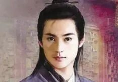
▲网传潘安复原图
陶渊明的选择，则更为决绝。四十岁出头，出任彭泽县令，督邮前来巡察，属下提醒他应当整束官服迎接。他长叹一声：“吾不能为五斗米折腰。”解下官印转身离去，这一年大约公元405年。归乡之后，写下“采菊东篱下，悠然见南山”。

归隐也并非全然逍遥。往后岁月，陶渊明困顿到“夏日抱长饥，寒夜无被眠”，却绝不回头。回头就要收敛眼底光亮，挤出逢迎的笑脸，那束内心的光，他舍不得丢弃。

再看向科学的世界。祖冲之推算出圆周率介于3.1415926与3.1415927之间，这项高精度纪录，世界保持九百余年。记录演算的《缀术》已经散佚，以当时条件，他依靠一根根算筹反复推演，耗尽无数灯火。乱世世事变幻，唯有数字恒定可信，便有人甘愿为一串数字熬干油灯。

还有山崖之上连绵不绝的石窟。

前秦建元二年，公元366年，僧人乐僔行至敦煌鸣沙山。暮色之中三危山金光漫卷，仿佛千佛显现，他跪拜发愿凿下第一座禅窟，莫高窟就此拉开序幕。这只是缘起的传说，并非现存最早的实物，但传说本身已经足够，乱世里的人，需要一座山来安放信念。

北魏崇信佛法，公元460年前后，昙曜和尚主持开凿昙曜五窟，以北魏五位帝王作为佛像精神原型，宣扬帝王即是当世佛陀。云冈大佛肩膀宽厚，衣纹带着西域印记，面容却是中原的温厚。人世间纷争喧嚣，世人便凿刻石壁，造出庄严面容安放内心。

佛门里也有魏晋风骨。高僧支遁养的鹤翅羽长成，被剪了翎，鹤垂头丧气。支遁叹道，“尔有凌霄之姿，宁肯为人作耳目近玩乎？”于是替鹤养好翅膀，放归云天。

连一只鹤，都不该被剪去飞翔的资格。这句话放在魏晋，与“做自己”是同一句话。
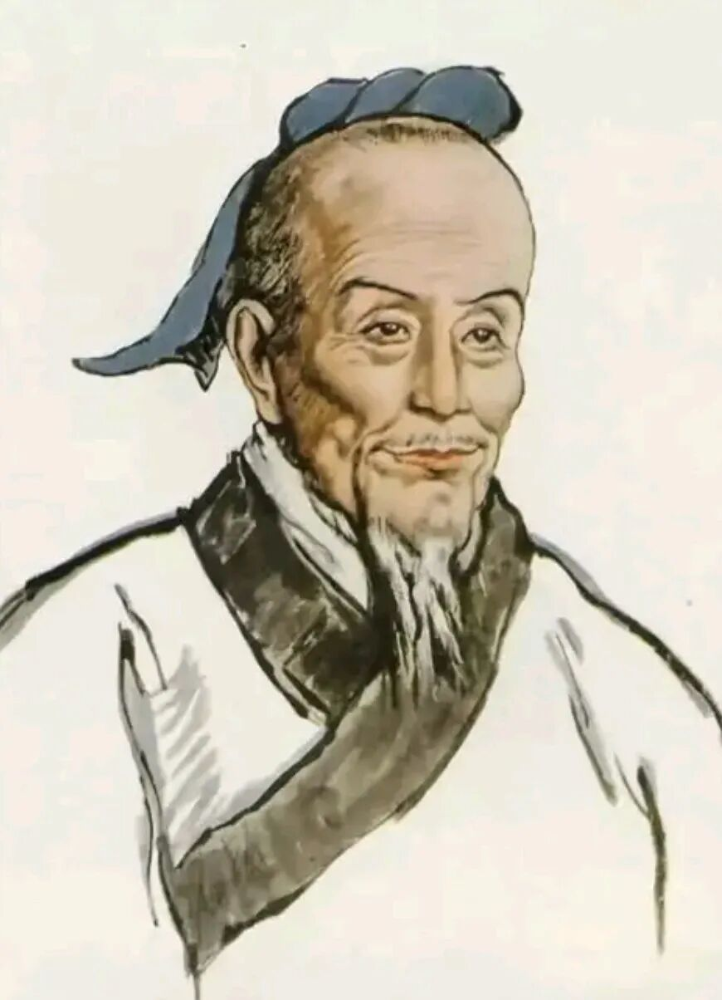
▲祖冲之画像。图源：网络
乱与繁盛不是简单的反义词，它们扎根同一片土地。庙堂不断崩塌，精神根须却向着泥土深处扎得愈发牢固。

魏晋时代格外流行人物品藻，评判标尺不再是官职高低，而是人的风度气韵。《世说新语》记下大量短故事，品评人的精神气息。这套风气原本服务选官，慢慢演变为审美。中国人第一次大规模将“人本身”当作艺术品欣赏。动人与否，不靠华贵官服，而在于姿态谈吐，在于苦难面前不肯躲闪的本心。正因如此，后世才有这么多带着体温的字画。

殷浩面对桓温咄咄逼人的发问“卿何如我”，淡淡回复：“我与我周旋久，宁作我。”不卑不亢，宁愿做真实的自己，这是魏晋自我意识的回响。

这种自我意识，甚至能把一个人整个重新写一遍。周处年少时凶强侠气，乡里把他与南山的虎、长桥下的蛟并称“三害”。他射虎斩蛟，追了三天三夜没回来，乡人以为他死了，张灯庆祝。周处杀蛟归来，撞见的正是自己死讯换来的欢腾。那一刻他幡然醒悟，去吴地寻名士陆机、陆云。陆云对他说，古人贵朝闻夕死，何况你的前路尚远。周处从此改励，终成忠臣名将，最后战死沙场。

旧的评价体系崩塌之后，一个人，居然可以亲手撕掉自己身上的标签。魏晋的人，第一次相信“我”是可以改写的。
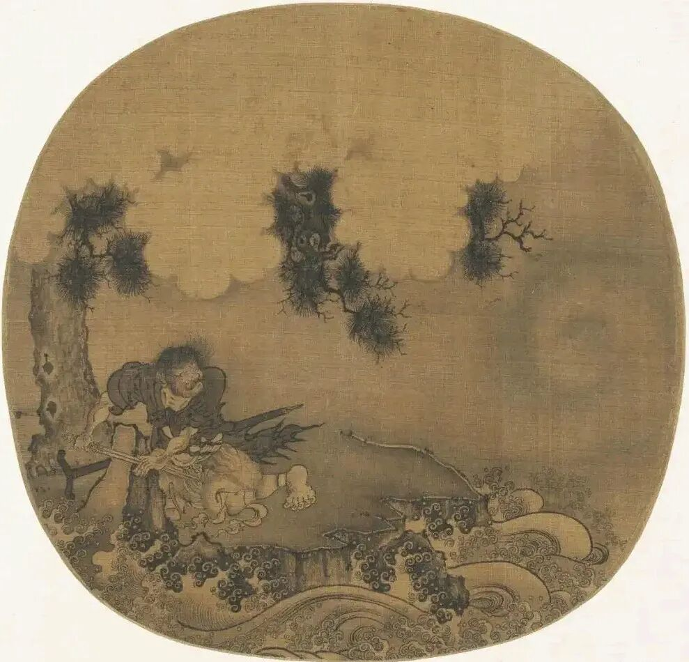
▲南宋《周处除害图》。图源：网络
王子猷大雪夜里想念戴安道，连夜坐船行了一夜水路，快到友人门前却掉头回家。旁人不解，他说“吾本乘兴而行，兴尽而返”。他奔赴的不只是戴安道，更是心中倏然升起的兴致，戴安道只是这份兴致的投射。

把碎片拼接起来，时代共通的质地便是追求“真”。不表演孝顺，不伪装忠诚，悲痛便痛哭，欢喜便大笑，把“真”举过头顶，不惜以性命守护。

刘伶醉酒出门，乘着鹿车，携一壶酒，吩咐仆人扛着锄头跟随，说“死便埋我”。在家醉酒赤身而坐，面对访客讥讽，他直言天地为屋宇，房舍是衣裤，诸位为何要钻到我的裤中来。他的《酒德颂》，写尽对虚伪礼法的嘲讽，这是佯狂避世的清醒。可西晋不少贵族子弟只模仿放浪的姿态，把不羁做成社交时髦，风流从来不是外在姿态，是心底不肯欺瞒自己。

“真”还有更朴素的写法。庾亮的坐骑中有一匹的卢，传说妨主的凶马，有人劝他卖掉。庾亮说，卖它，必有人买，那就是害了买主。宁可我自己承担，怎能嫁祸于人？

没有琴，没有酒，没有眼泪。一句话的厚道，同样是风度。
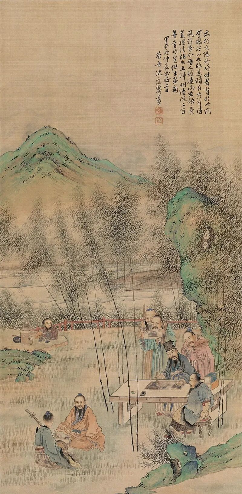
▲清 沈宗骞 竹林七贤。图源：网络
卫玠容貌清俊，南渡之后抵达建邺，京师人士久闻其名，围观者密不透风，如筑墙一般。他本就体弱，又饱经流离，不堪劳累，不久病重而逝，年方二十七岁，后世演绎为“看杀卫玠”。那个时代看重的从不只是皮囊，是人清逸的精神气韵。裴楷被称作玉人，旁人形容见他如同行走玉山，周身光华流转，这是把完整人格当成风景欣赏。

纸张普及也深刻改写了文化。东晋纸张取代笨重的竹简，心念一动便可提笔书写。书法不再只是抄写经文，转而书写自我心境，王羲之随手写下的书信，每一封都是一小块鲜活的心境。

战火屡次焚毁官学，文化藏进士族家学。父辈传授子侄，王导家族走出王羲之，谢安门下养育出谢道韫。可门阀筑起高墙，寒门成才格外艰难。刘孝标战乱中沦为奴隶，苦读成才，为《世说新语》作注，却终身不得高位，魏晋的文化盛宴，从来不是人人都可以轻易入场的。

永嘉南渡，北方移民给江南带去生产技艺与读书火种。江南经济慢慢积蓄厚度，才供养得起一批专注精神世界的士人。经济很少写进史书，却稳稳托举起漫天诗文。

佛教东传注入全新养分，胡汉、佛道、南北的审美在石窟壁画间彼此交融。魏晋文化不是单一民族的产物，是多方文明彼此浸润融合的结果。

我常常遐想，王羲之写完《兰亭集序》的那一刻，会不会心与手都在微微颤抖。他或许并不知晓作品会不朽，只是接住了眼前的一刻，晚风柔和，友人谈笑，酒意浅浅。

千万不要产生错觉，这份精神自由，不是制度赋予的权利，是旧秩序崩塌漏出来的缝隙自由。向外建功立业的大门被血统与屠刀锁死，人们才转而向内求索。可裂缝时刻暗藏危险，一旦触碰权贵的利益，屠刀便会落下。

嵇康离世时不到四十。谢灵运因兴兵抗命，在广州被处弃市。陆机兵败被谗，临刑慨叹，“华亭鹤唳，岂可复闻乎！”才女谢道韫遭遇战乱家破人亡，提刀抗争，被俘后才因气节得以保全，余生孤独度日。

他们并非不惧死亡，只是有些东西比性命贵重，一句不肯违心的话，一笔不愿涂改的文字。后世曹植七步成诗的故事不见正史，却写尽皇室骨肉相残的血色。
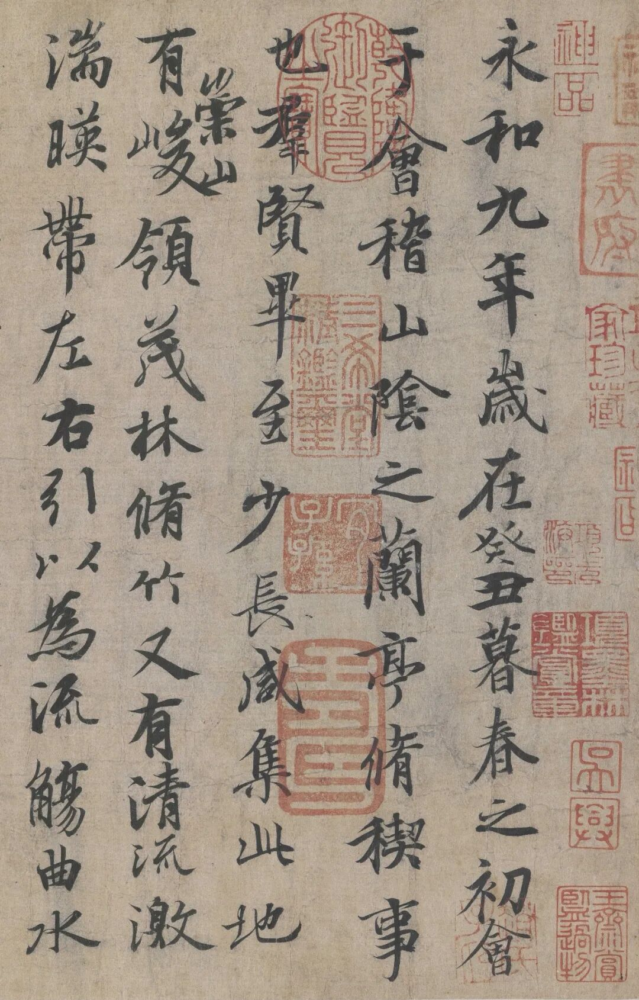
▲《兰亭序》神龙本。图源：网络
魏晋的光芒，也不只是少数天才造就。官学焚毁之后，世家庭院、寺院石窟成为文脉的避难仓。无数无名工匠、抄经僧人，在战火间隙默默接力，思想笔墨才得以留存。这接力者的名单里，还该写上一个小人物的名字。

北魏末年，洛阳经尔朱荣之乱，繁华都城化为丘墟。几十年后，一个叫杨衒之的小官重过洛阳，只见城郭崩毁，宫室倾覆，千余座佛寺尽成灰烬，墙蒿满目。他怕后世再无人知晓这座城曾有的模样，便凭记忆写下《洛阳伽蓝记》，把城里每一座佛塔的盛景，一座一座，用笔重新“造”了出来。

文字版的敦煌。一个人站在废墟上，不肯让一座城白白死去。

回望这三百多年，不该只记得走马灯的帝王。要记得那些不肯弯折的脊背，记得乱世里坦荡赤诚的眼神。
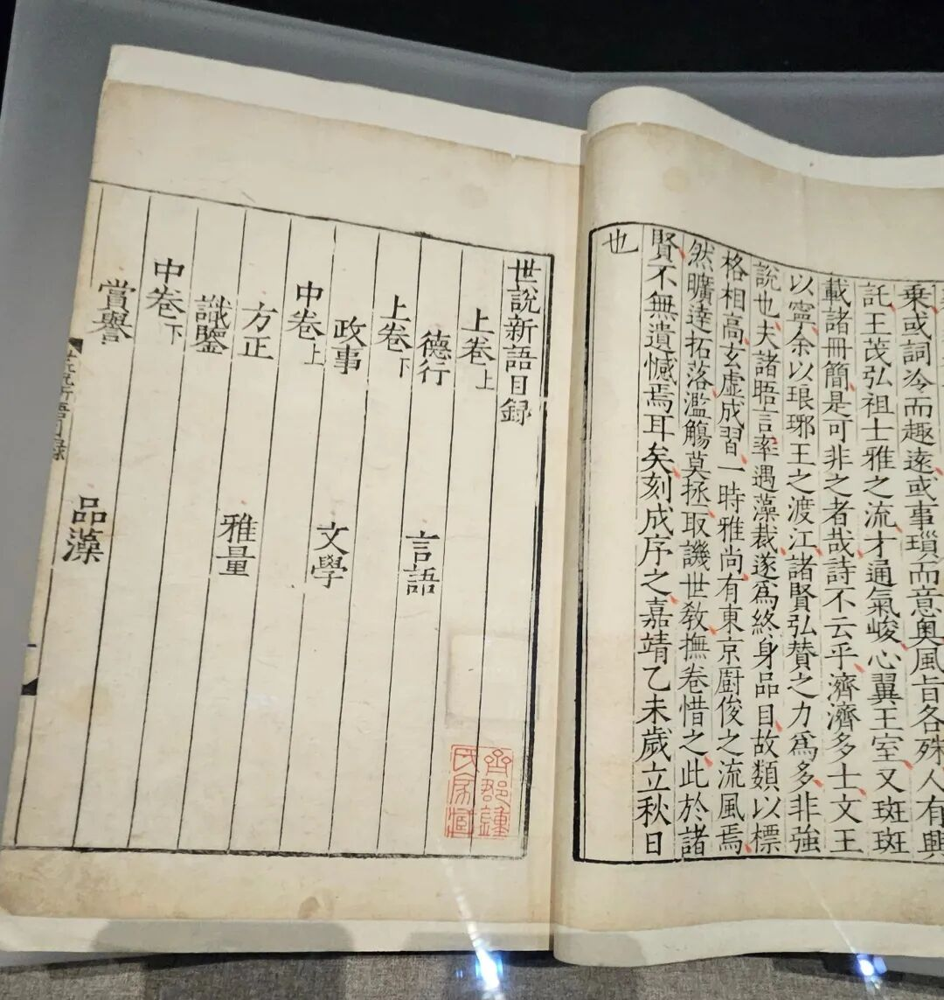
▲《世说新语》明嘉靖刻本。图源：网络
唐诗的风骨根植于魏晋，宋词细腻的情感也由此舒展，就连今天所说的“做自己”，都是那批乱世先辈亲身试炼过的。他们给出的答案简单又沉重，人活一世，可以没有高官厚禄，但不能丢失干净透亮的眼睛。眼睛澄澈，文字、诗歌连同落泪，都会坦荡干净。

不要简单以为战乱直接孕育美好。是旧秩序崩碎撕开巨大裂缝，光才得以照进，而裂缝之下，是无数普通人被碾碎的生命，精神绽放的底色是血泪。裂缝足够辽阔，光芒便足以照亮一千七百年后的今人。

编辑图文〉
