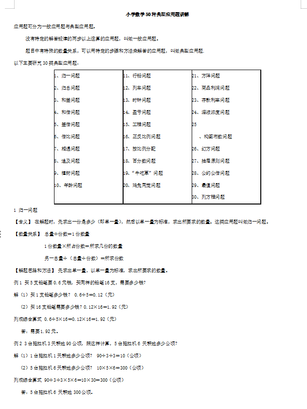
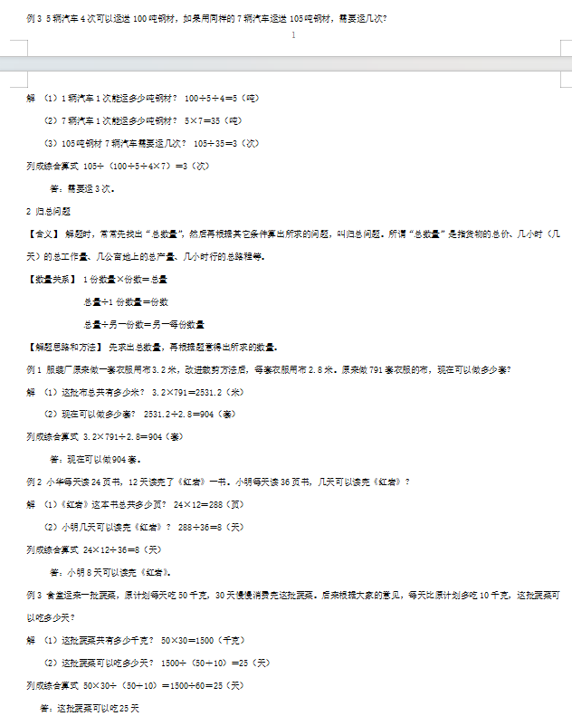

# 鸡兔同笼、植树行船…800道经典应用题汇总，学会考试不吃亏！
> 💡 备注属性未写入，可能是备注属性名称或者类型被修改了，建议将字段类型设置为 rich_text，可以在小程序-操作-修改文章数据库页面进行调整
> 💡 原文链接:[https://mp.weixin.qq.com/s?__biz=MzA5NDQ5OTU5NA==&mid=2247568353&idx=1&sn=14ba66a53cea7bd8f2dc4f1e684cd0aa&chksm=91a0bc6c9ab5130f4b6c930b966bbf63c1c6d0fd27e14b358cb8cda4269f783089831ed0ed93#rd](https://mp.weixin.qq.com/s?__biz=MzA5NDQ5OTU5NA%3D%3D&mid=2247568353&idx=1&sn=14ba66a53cea7bd8f2dc4f1e684cd0aa&chksm=91a0bc6c9ab5130f4b6c930b966bbf63c1c6d0fd27e14b358cb8cda4269f783089831ed0ed93#rd)
**鸡兔同笼、植树行船、牛吃草、归一、归总**......这些经典问题一直都是孩子数学学习的难点，学不明白很容易丢分。
这个暑假，为了帮助大家攻克这些难题，老师整理了**【800道经典数学应用题】含答案解析，涵盖小学应用题所有经典题型。**

扫码加老师微信即可免费领取**！**
经典数学应用题汇总
**3-9年级提升扫这里**

**1-2年级英语朗读扫这里**
**免费领取课程和资料**

**部分资料预览**

经典数学应用题汇总 ，**精选50类经典数学题型（含答案）等年级暑期精品资料汇总，资料定时更新。**想要孩子学习成绩逆袭，那么就赶快扫码加老师微信，领取精品独家资料吧！
**经典数学应用题汇总**
**3-9年级提升扫这里**

**1-2年级英语朗读扫这里**
**免费领取课程和资料**

声明：本文为广告推广信息。如内容有违规、侵权请联系我们，我们将及时处理。
