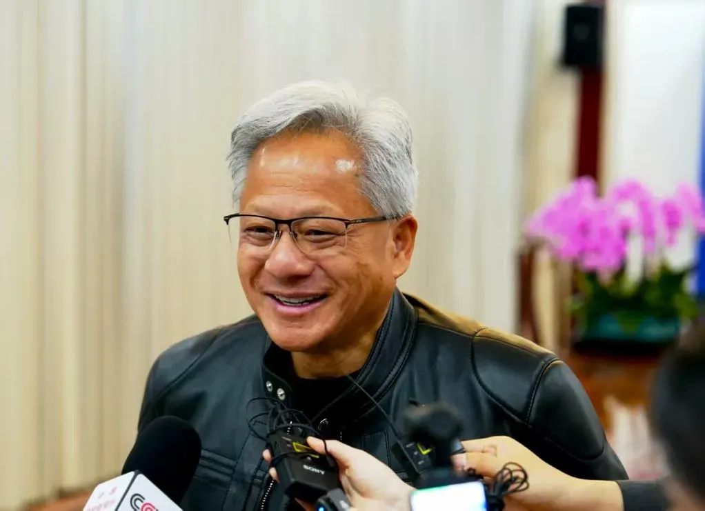
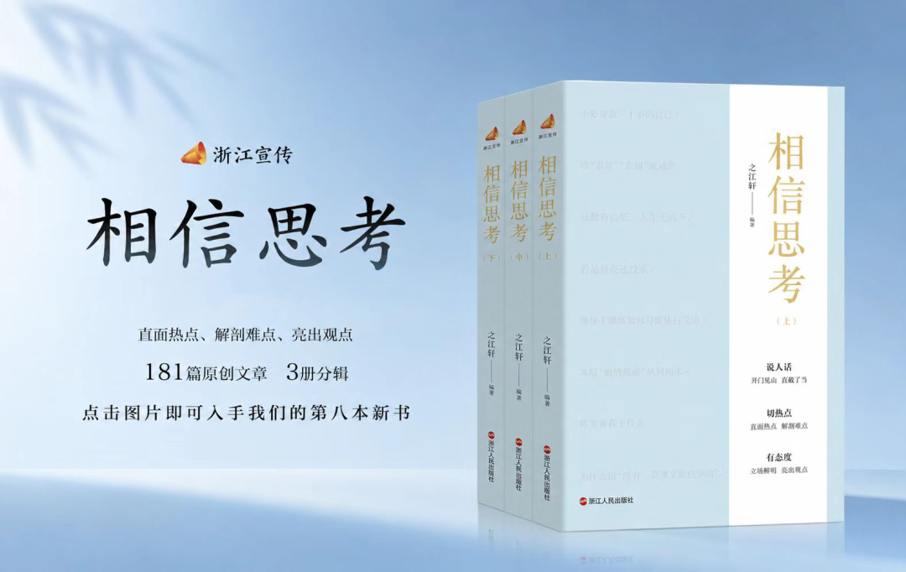

# 黄仁勋事件背后的美国AI焦虑
> 💡 备注属性未写入，可能是备注属性名称或者类型被修改了，建议将字段类型设置为 rich_text，可以在小程序-操作-修改文章数据库页面进行调整
> 原文链接:[https://mp.weixin.qq.com/s/tJrNH5UbtWod61STI-AbJg](https://mp.weixin.qq.com/s/tJrNH5UbtWod61STI-AbJg)
**▲ 戳蓝色字关注我们！**
这些天，黄仁勋承认出轨的消息在持续发酵。一桩本应止于个人私德的丑闻，在美国一些人和媒体的操作下，迅速被加工成一出“中国间谍渗透美国芯片巨头”的戏码。外交部对此回应得很干脆：“所谓‘中国间谍’的论调纯属捕风捉影，污蔑抹黑。”
在美国，黄仁勋出轨事件正在从私人问题上升成国内政治斗争与对华强硬的佐料。在这场舆论漩涡中心，更多人看到华人这个群体正在遭遇持续性的叙事异化。当间谍的帽子被随意扣到一个群体身上，这本身就意味着更严重的歧视正在发生。对此，有声音在追问：让华人背锅，真能治好美国的AI焦虑吗？

美国英伟达公司创始人兼首席执行官黄仁勋 图源：新华社
**一**
事件的时间线并不复杂。11月8日，黄仁勋向英伟达员工发送内部邮件，承认对妻子不忠，并向家人和公司道歉。英伟达董事会随即启动独立调查。到此为止，这是一家美国公司处理高管私德问题的内部事务。
但早在黄仁勋公开承认丑闻前，关于“中国间谍”的指控就已被媒体披露，为后续的舆论转向埋下了伏笔。据美媒报道，美国情报机构依据约一年的监控记录，认定出轨对象为中国国家安全部招募的人员，并称她可能试图通过私人关系影响黄仁勋在芯片出口管制上的立场。这些报道依赖匿名情报官员的说法，关键指控也未经独立核实。换言之，一个尚未被公开证据支撑的“认定”，在媒体放大和政客介入之后，已经被当作既定事实来使用。
值得深思的是，为什么是此时，为什么是黄仁勋？
其一，时间节点指向政治博弈。爆料出现在美国中期选举前后，民主党刚在选举中拿下国会两院多数席位，而黄仁勋是特朗普在AI议题上的重要顾问，特朗普本人已公开表示“相信黄仁勋”。拿下一个与特朗普关系密切的科技巨头掌门人，既能削弱对手的产业政策班底，又能在“对华强硬”的政治正确中得分。黄仁勋的华裔面孔，恰好为这套操作提供了最省力的符号。
其二，指向科技竞争的甩锅需要。这些年来，中国AI的进步让美国倍感压力。黄仁勋掌握着全球AI算力的核心命脉，英伟达的对华芯片出口政策本身就是中美科技博弈的焦点之一。将一起私生活事件与“中国情报”挂钩，客观上会为收紧对华芯片管制提供舆论弹药，而且还能污蔑中国的技术进步，将中国AI的发展扭曲成靠偷窃得来，对外转移焦点，减轻美国国内由AI引发的诸多社会矛盾带来的压力。

图源：视觉中国
**二**
**习惯从人员关联、身份背景里寻找威胁，用猎巫式审查约束科技从业者，本质是把竞争失利的隐忧，归咎于内部“防线失守”。这已经成为美国一些政客根深蒂固的套路。这种避重就轻、转移矛盾的套路，多年来在科技博弈领域反复上演。**
2018年，美国司法部启动“中国行动计划”，对华裔科研人员和学者发起一系列调查和追诉。其波及范围超出司法与移民部门，部分高校也牵涉在内，不少华人学者面临持续审查，甚至被举报。据媒体援引的数据，截至2021年该计划起诉148人，其中88%为华裔或华人。经济领域同样寒意逼人，针对华人资产持有者的司法打压与财产追缴层出不穷。眼下，黄仁勋正面临美国国会的国家安全调查。从学者到富豪，这种穷追猛打正在构成对美国华人精英的系统性伤害，所谓国家安全正在成为可以随意套用的口袋罪名。
事实上，每当对华议题升温，华人群体总被拉出来当作借题发挥的靶子。黄仁勋事件发酵后，马上就有美国议员以此为理由要求收紧对华科技制裁。部分反华政治人物心里有一套根深蒂固的逻辑：黄皮肤、华人面孔，就必然和中国有关系，就必然值得怀疑。这套逻辑落到普通人身上，意味着任何私人领域的活动都可能被拿来当政治攻击的佐料，个人也可能因此接受政治审查。
美国媒体曾多次报道，随着美中关系紧张，华裔美国人遭受歧视的现状日益突出。过去针对华人的歧视可能主要表现为“眯眯眼”等刻板印象，但在当下，华人群体面临的歧视压力更多源于政治层面。随着美国对华政治攻击的加剧，很多时候，一些华人不得不陷入无边界的忠诚测试中，甚至沦为种族歧视的鄙视链末端。比如部分美国州出台法案，直接禁止中国公民购买当地土地，这类法案也给本地华人带去不小的压力与实际伤害。有美国媒体也承认，对华强硬政策，将不可避免侵害华人实际利益。
这种套路不是单纯针对华人群体，而是一套成熟的风险转嫁与舆论博弈工具。许多与中国开展正常科研合作与学术交流的美国本土学者、其他族裔背景的科研人员乃至科技企业负责人，都曾遭遇同类审查与舆论构陷。
相比于直面复杂且漫长的硬核产业竞争，制造“内部渗透”“人员泄密”的叙事成本更低、收效更快，既能转移公众对美国自身创新短板、产业弊端的注意力，又能借机收割政治选票、推进强硬对华政策。但这种套路终究是治标不治本的自欺欺人，根本无法解决美国AI产业的深层困境。

8月12日，美国弗吉尼亚州斯通里奇，这张航拍图显示亚马逊网络服务（AWS）的数据中心毗邻独栋住宅 图源：视觉中国
**三**
当下，美国社会正围绕AI数据中心引发的诸多社会问题展开激烈讨论，AI科技的发展也成为两党党争的重要议题。这些现实都在放大美国政客的AI竞争焦虑。有些政治人物偏执地将中国AI进步视作对美国的挑战，时刻担忧美国AI输掉所谓的竞赛，但是这些人似乎从未想过，造成美国这些问题的根本原因是什么。
**美国AI发展遭遇质疑，首要原因不在别国竞争，而在民生困境。**媒体不断曝出AI数据中心被安置在居民区附近，噪音扰民之外，还导致用电用水紧张，居民的日常生活受到挤占，抗议此起彼伏，越来越多美国民众对政客鼓吹的AI竞争投下不信任票。面对电力缺口、电网老化、基础设施薄弱、配套设施跟不上等短板，美国政府却用牺牲居民权利来搪塞，把代价转嫁给普通社区。数据中心要电，居民区就停电；算力要扩张，老百姓的生活质量就得让路。这种发展路径，民众怎么可能买账？真正挡住美国AI发展的，不是别国的追赶，而是自己欠下的基础设施欠账和不肯正视的民生账单。绕开这些坎，再响亮的口号也落不了地。
**将华人当成甩锅对象，正在反噬美国自身。**把华人精英逼走，把人才通道堵死，最终伤的是美国自身发展的根基。比如“中国行动计划”虽已于2022年终止，但寒蝉效应远未消散。普林斯顿大学等机构的研究显示，2010年至2021年间有近两万名华裔科学家离开美国。竞争引发的焦虑，就无差别地怀疑华人。这套逻辑短期看是在对外示强，长期看，持续泛化安全审查、对科技精英进行身份化猜忌，会挤压本土科技企业的发展空间，损害跨国人才合作的生态，反而拖累自身创新活力。反华政客或许不在意这些代价，但美国的大学、企业和科研体系，未来很多年里都会为此买单。不少美国有识之士也不断警告，拒绝外国优秀人才，不会增强美国竞争力，只会适得其反。
**即便把门缝焊死，也无法阻止中国科技进步。**当前，美国政府正在把人工智能、半导体、量子技术统统划进“军民两用”的筐。高校实验室被当成科技战场，中国面孔的学者和学生则被预设为潜在的风险源。这些做法都是为了升级对华的科技封锁，从“小院高墙”进一步走向把门缝彻底焊死。美国很多政客无法理解，对华科技封锁与禁运搞了那么多年，却依旧不能阻止中国科学技术的发展。也正是这种无知，一旦中国进步的消息出现，都会让这些政客陷入无能狂怒，出台更多离谱措施。然而这种无能狂怒解决不了任何问题，最终只会给美国带来战略误判。

用歧视代替竞争，用甩锅代替自省，归根到底还是因为美国有些人只在乎嘴上的“赢学”，却看不到世界本该走另一条路。这条路上，人才不分肤色，合作不论出身，进步靠的是开放而非设防。

**本文播音：魏巍**
---
**各位读者：关注公号后可点击右上角“…”，设为星标，以免错过最新推文。留言在本文发布24小时内排在评论区首位者，将获赠一套《浙江宣传》书籍。如果您有选题建议，请留言或私信。**

**声明：稿件未经授权，不得转载。**
---
▼ 点击下方名片关注浙江宣传 ▼
往 期 精 彩 内 容
- [宣传干部不妨多些审美](https://mp.weixin.qq.com/s?__biz=Mzg5Mjc3NzQzMA%3D%3D&mid=2247583197&idx=1&sn=574679cac4f2aeb79fc4abd92fc9b41c&scene=21#wechat_redirect)
- [“榜单排名”究竟为谁排名](https://mp.weixin.qq.com/s?__biz=Mzg5Mjc3NzQzMA%3D%3D&mid=2247583165&idx=1&sn=25dd25e8f779da77087a7a82ef03daa4&scene=21#wechat_redirect)
- [伪史论花样翻新，为什么屡禁不止](https://mp.weixin.qq.com/s?__biz=Mzg5Mjc3NzQzMA%3D%3D&mid=2247583088&idx=1&sn=32d69fd468c9b48e40b378f902d1d462&scene=21#wechat_redirect)
---

