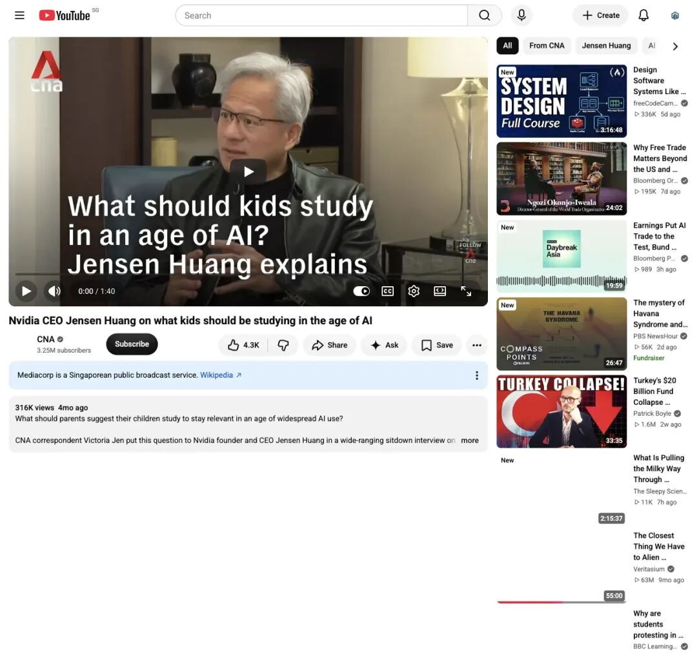
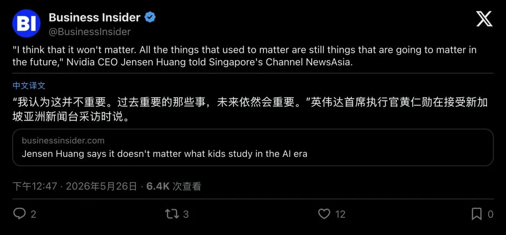
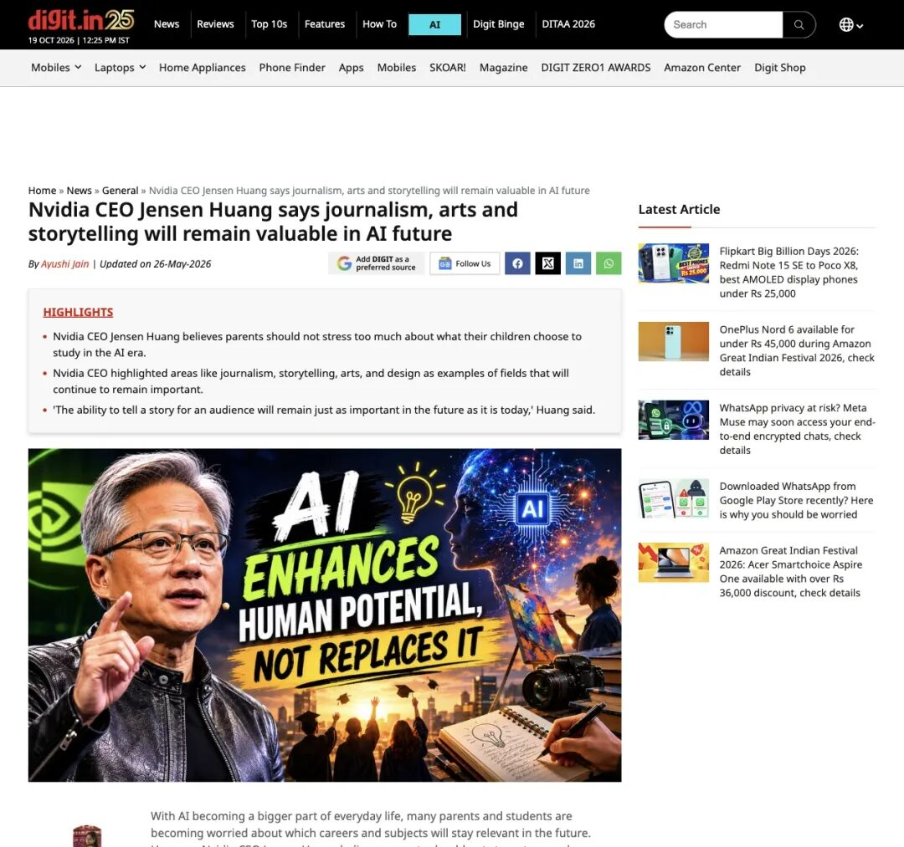
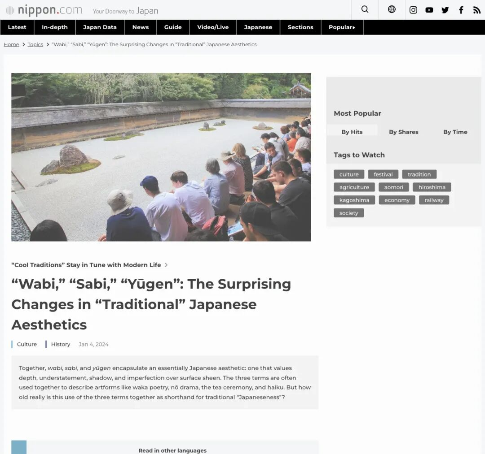
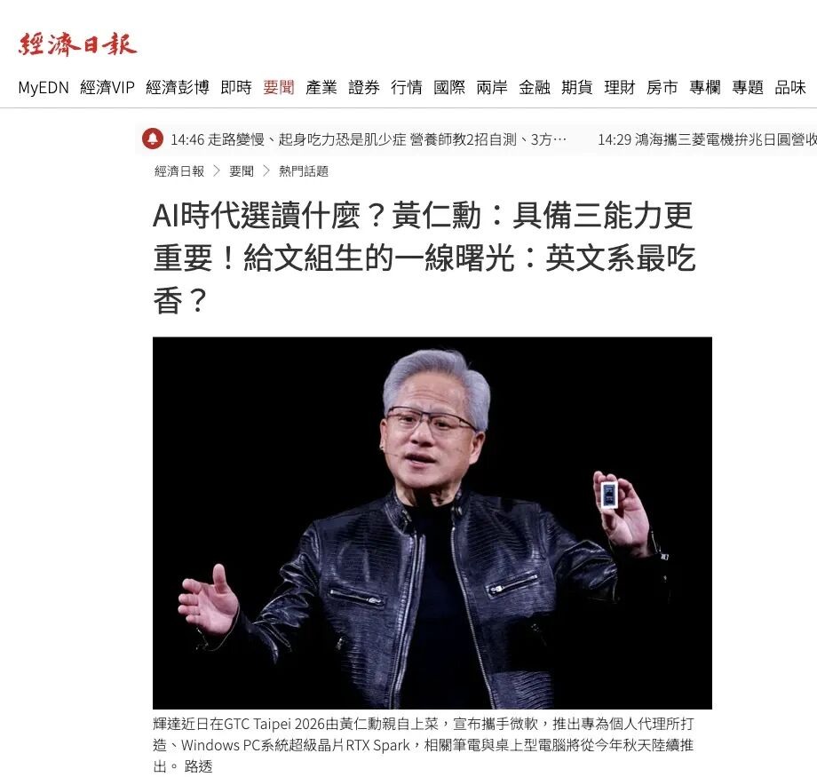
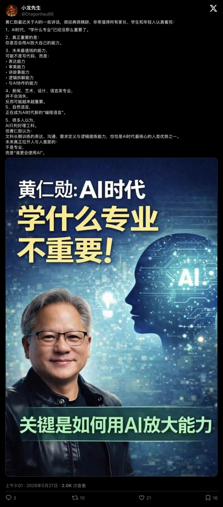
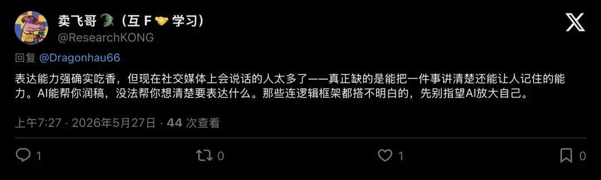
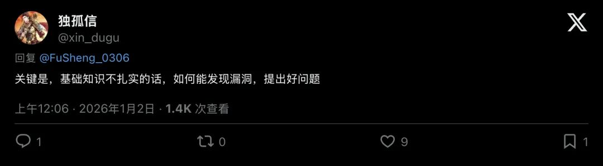
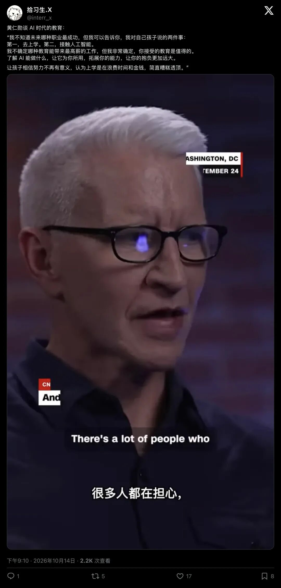

# 黄仁勋当头棒喝千万家长：AI时代选什么专业都不重要！真正稀缺的是这3种能力
> 💡 备注属性未写入，可能是备注属性名称或者类型被修改了，建议将字段类型设置为 rich_text，可以在小程序-操作-修改文章数据库页面进行调整
> 💡 原文链接:[https://mp.weixin.qq.com/s?__biz=MzcwMTM2MDQzMg==&mid=2247488401&idx=7&sn=170a27a5e259e9fc7609e4b74a03f3f3&chksm=f5fd8d416df8349cf2332920065bed09003bcca8bceddf78ce8998fa140b3f40765d0d8746a3#rd](https://mp.weixin.qq.com/s?__biz=MzcwMTM2MDQzMg%3D%3D&mid=2247488401&idx=7&sn=170a27a5e259e9fc7609e4b74a03f3f3&chksm=f5fd8d416df8349cf2332920065bed09003bcca8bceddf78ce8998fa140b3f40765d0d8746a3#rd)
2026年5月25日，新加坡亚洲新闻台（CNA）的演播室里，灯光柔和。
英伟达掌门人黄仁勋穿着那件标志性的黑色皮衣，坐在镜头前。
对面的记者Victoria Jen抛出了一个让全球无数父母夜不能寐的问题：**在AI无孔不入的今天，家长到底该劝孩子学什么专业，才不会被时代淘汰？**
所有人都在等一份“标准答案”
毕竟，坐在那里的可是亲手为AI淘金热打造算力铲子的男人。
大家以为他会说芯片工程、数学，或者某种高深的算法。
黄仁勋却轻轻一摊手，给出了一句出人意料的回答：
**“我认为这并不重要（I think that it won't matter）。”**

▲ CNA官方频道发布的专访原片，黄仁勋直言“学什么并不重要，过去重要的事未来依然重要”
一句话，直接把无数家庭苦心钻研的“高考志愿防淘汰指南”砸得粉碎。
第二天，商业内幕（Business Insider）、Digit、自由财经等全球媒体纷纷将这句话推上头条。
如果连最懂AI算力的人都说选什么科系无所谓，那我们寒窗苦读十几年，到底在争什么？
顺着这场专访的一手影像、多国媒体的交叉报道，以及社交网络上一浪高过一浪的争辩往下深挖，黄仁勋此番表态的核心，是在直面一个不可逆转的现实：当机器把“标准答案”变成廉价的自来水，人类社会的估值逻辑已经彻底翻盘。

▲ 国际商业媒体Business Insider将黄仁勋的这句核心引语提炼为报道海报
### 01第一阶证据：当AI学会写代码，为什么他却替“侘寂”和记者撑腰？
要听懂黄仁勋的潜台词，不能只看几秒钟的切片，得回到CNA专访的完整现场。
在回答完“读什么专业不重要”之后，黄仁勋紧接着补上了下半句：**“所有过去至关重要的能力，在未来依然至关重要。”**
哪些能力？
他在现场没有列举任何一个理工科代码名词，反而直接拿眼前的记者、艺术家和设计师举例。
多家英文与中文媒体的报道高度一致地还原了他的三个核心切口：
**第一，是为受众讲故事的能力（Storytelling）。**
黄仁勋直言，无论是今天还是未来，把一个故事讲进听众心里的能力永远不会贬值。
哪怕工具再强，机器也只能堆砌词藻；
而要把事实编织成意义、唤醒人类的共鸣，依然得靠人。
**第二，是临场倾听与“知道该问什么”的敏锐度。**
他看着面前的记者说，一个优秀的新闻采访者，绝不只是在采访前背熟题库。
高下之分的关键，在于**置身当下、全神贯注地倾听，并在电光石火之间敏锐承接对方的话题、追问出触及核心的真问题**。
这种带着呼吸感的临场判断，再强大的自动化脚本也无法替代。

▲ 科技媒体Digit提炼了专访三大核心：不必为选专业过度焦虑；新闻、艺术与设计依然保值；讲故事的能力未来同样关键
**第三，也是整场访谈最让人意外的词，日本美学里的“侘寂”（Wabi-sabi）。**
一个搞硬核芯片的工科大佬，为什么突然聊起了东方古典美学？
给不熟悉这个词的读者做个简单科普：**“侘寂”是日本茶道、俳句与传统艺术里的核心观念，意思是在不完美、不对称、带着岁月磨损痕迹的事物中看见美。**
它跟现代工业追求的“光洁、对称、零瑕疵”截然相反。

▲ 日本文化媒体Nippon.com曾专门解析“侘寂”美学：这一东方哲学推崇含蓄、阴影与带着岁月痕迹的深层质感，欣赏物哀与留白
黄仁勋在专访中借用这个词，洞察极其毒辣：**未来的世界，必然充斥着AI生成的图文、视频与方案。
但AI的产出有一个致命共性，太光滑、太标准、太正确了。**
物以稀为贵
当“算法式的完美”变成一分钱一筐的工业品，人类身上那些带着毛边、带着偏执、带着脆弱感与独特审美品味的“不完美”，不仅不会贬值，反而会摇身一变，成为AI时代最昂贵的奢侈品。
无论是拍电影、设计汽车还是做芯片，最终决定作品灵魂的，都是这种无法写进说明书的**判断力与创造力**。
至于大家害怕的“AI抢饭碗”，黄仁勋在现场打了一个极其形象的比方：**“任务篮子”（A basket of tasks）。**
在他看来，任何一份工作其实都是一个装满了各种琐碎任务的篮子。
AI自动化拿走的，是篮子里那些重复、枯燥的体力活；
留给我们的，则是篮子最底层、最难啃的硬骨头。
就像当年个人电脑、互联网和智能手机普及时一样，人类并没有变得无所事事，反而因为野心被工具放大，变得**比以前更忙了**。
那些拿AI当借口大搞裁员的公司，正如他在其他场合批评的那样，纯粹是因为管理层太懒惰、缺乏想象力。
### 02第二阶延展：文科生迎来“史诗级翻盘”？慢着，别被清单骗了
CNA专访一出，华文媒体和社交平台迅速沸腾。
经济日报等媒体立刻将这次访谈与黄仁勋在《All-In Podcast》等场合的言论串联起来，打出了“文组曙光”的醒目标题。
因为黄仁勋曾反复强调：**自然语言正在成为AI时代新的“编程语言”**，甚至直言长期训练逻辑表达与精准沟通的英文系学生，未来可能会非常成功。

▲ 经济日报将CNA专访与播客访谈并置，聚焦“说故事、创造力、判断力”与语言作为新编程语言的趋势
到了X（原推特）和短视频平台上，传播更是演化成了一场针对家长和学生的“要点清单狂欢”。
比如博主“小龙先生”发布的一条高赞视频帖，就将黄仁勋的观点打包成了极具冲击力的几条断言：学什么专业没那么关键；
未来最为抢手的核心转向了表达、审美、讲故事、逻辑拆解；
新闻、艺术、语言类专业展现出不可替代的独特价值……

▲ 社交平台上广泛流传的中文要点清单，将黄仁勋多场讲话浓缩为“文科能力优势论”
但站在证据阶梯上，我们必须帮读者踩一脚刹车。
这类爆款清单，实际上是把黄仁勋在CNA专访、过往学生问答以及播客里的多场讲话，做了**高浓度的二次缝合**。
它们读起来很爽，但也极其容易制造一种致命的幻觉，**仿佛只要我不再学数理化、每天练练嘴皮子、学会给AI写几句提示词（Prompt），就能在未来躺赢。**
真是这样吗？
评论区里的人间清醒们，很快泼出了两盆刺骨的冷水。
### 03第三阶交锋：没有硬核基本功，你连AI在胡说八道都看不出来
在中文互联网上，猎豹移动董事长傅盛等人也转发探讨了黄仁勋“最需要学的是如何向AI发问”的观点。
然而，在相关帖子的评论区里，两条高赞回复精准地刺破了“盲目崇拜表达与提问”的泡沫。
第一盆冷水，来自网友@ResearchKONG 对“表达能力吃香”的当头棒喝：

▲ 网友指出：AI能帮你润色文字，但无法替你构建底层逻辑框架
**“现在社交媒体上会表达的人太多了，难得的是能把一件事剖析透彻还能让人记住的能力。
AI能帮你润稿，没法替你理顺内核思路。
那些连逻辑框架都搭不明白的，先别指望AI放大自己。”**
话说得毫不留情，却字字见血
零乘以一万，结果依然是零
如果你脑子里是一团浆糊，AI最多帮你生成一团辞藻华丽的浆糊。
第二盆冷水，来自网友@xin_dugu 的灵魂反问：

▲ 评论区将“提问崇拜”拉回现实：没有扎实基础，根本无法发现漏洞、提出好问题
**“关键是，基础知识不扎实的话，如何能发现漏洞，提出好问题？”**
这句犀利的反诘，直接捅破了“提问艺术”的窗户纸！
黄仁勋在早前的英文访谈中谈到“与AI互动是一门技艺（expertise and artistry）”时，有一个被很多营销号故意忽略的前提，**你的竞争力，等于你的“领域专长”乘以你的“AI流畅度”**。
一个不懂医学解剖的普通人，只会拿AI当百度搜索框用；
而一个基本功极其扎实的主任医师，才能通过连环追问，逼着AI在几千份罕见病例里找出诊断线索，并在AI一本正经“胡编乱造”时，一眼揪出它的致命漏洞。
**好问题从来不会凭空产生，它深扎在厚重的专业土壤之中。**
把“专业名称不重要”曲解成“专业基本功不重要”，是AI时代最危险的自我阉割。
### 04终极追问：既然AI什么都能教，为什么他怒斥“退学无用论”？
故事到这里，还差最后一块、也是最深邃的一块拼图。
到了2026年10月前后，当硅谷和网络上再次泛起一股“既然AI是全知全能的24小时私人家教，上大学就是浪费时间和金钱”的论调时，黄仁勋在镜头前罕见地动了真格。
他严厉驳斥道，向孩子灌输“不用上学”是对社会的巨大伤害！随后，他给出了对自家孩子和所有年轻人最浓缩的两条忠告：
**“第一，去上学（Go to school）；
第二，接触人工智能（Engage AI）。”**

▲ 社交平台热传的黄仁勋教育忠告：严厉批评“上学无用论”，要求年轻人去上学并接触AI
这听起来是不是很矛盾？
既然读什么科系不重要，AI又能随时随地教人知识，为什么非得花几年青春、交着高昂学费，去实体的学校里坐着？
如果我们把镜头拉回黄仁勋在斯坦福大学商学院那场著名的演讲，再结合现代教育社会学的底层规律，真相会让你起一身鸡皮疙瘩。
在斯坦福的讲台上，面对台下一群天之骄子，黄仁勋曾说过一段发人深省的话：**“卓越源于品格，而非单纯的天资。
而品格必须经受苦难与挫折的磨砺方能铸就……我由衷希望你们能够经历充足的痛苦与磨难。”**
他为什么这么说？
因为那是他自己的来时路
少年时期的黄仁勋刚到美国，英语还不流利，就被送进了肯塔基州偏僻的奥奈达浸信会寄宿学校。
在那里，没有温情脉脉的算法呵护
他每天放学后要干的活，是**打扫整栋男生宿舍的厕所、亲手刷洗便池**。
他要面对同龄人的排挤与霸凌，还要在严苛的作息里，和同寝室满身刺青、不识字的室友打交道，甚至一点点教对方认字。
正是那段在现实泥泞里摸爬滚打的日子，锻造了他后来在芯片业九死一生却从不崩盘的惊人抗逆力（Resilience）。
百年前，社会学奠基人埃米尔·涂尔干在《教育与社会学》中早就指出：**学校的核心使命，在于充当青年迈向广阔社会的“次级社会化”练兵场，绝非单向接收课本内容。**
你想想看，屏幕里的AI是一个什么样的存在？
它是一个**绝对顺从、永远温和、24小时秒回、绝不会给你甩脸色的完美仆人**。
如果一个年轻人脱离了实体校园，整天只关在房间里跟百依百顺的AI对话，他的知识库或许会很满，但他的社会化人格会彻底萎缩！
**唯有在真实的学校里，你才会被迫走出家庭的温室。**
你得按时起床赶早八的考勤，为拖延付出代价；
你得在小组作业里，学会跟那个性格古怪、你甚至有点讨厌的同学硬着头皮达成妥协；
你得在操场的冲撞、辩论赛的冷场、考试失利的挫败中，给自己的心灵结出一层厚厚的老茧。
**AI能给你最丝滑的答案，但只有学校里真实的人际摩擦，能给你一副扛得住事的肩膀。**
### 05尾声：唯一需要问自己的那个问题
现在，我们可以把黄仁勋散落在2026年的所有话，拼成一张完整的藏宝图了。
为什么他说“选什么专业不重要”？
因为无论是文科还是理科，只要你只想做一个机械背诵知识、按部就班交差的工具人，AI都能分分钟把你替掉。
最终拉开人与人差距的内核，在于校园人际碰撞中淬炼出的**抗逆力**，在于深厚学识积淀所催生的**敏锐洞察与精准追问**，以及人类特有的、带着独特温度的**审美感受、判断力与讲故事的能力**。
黄仁勋在专访尾声给年轻一代留下了质朴的指引：不必困在挑选“AI安全专业”的焦虑里，先找准内心热爱的支点，每天清晨醒来，向自己抛出这个决定性的追问：
**“今天，我该如何利用AI，去抬升我的学习、精进我的手艺、成全我的抱负？”**

## 摘要

（待补充）

## 我的笔记

（待补充）
