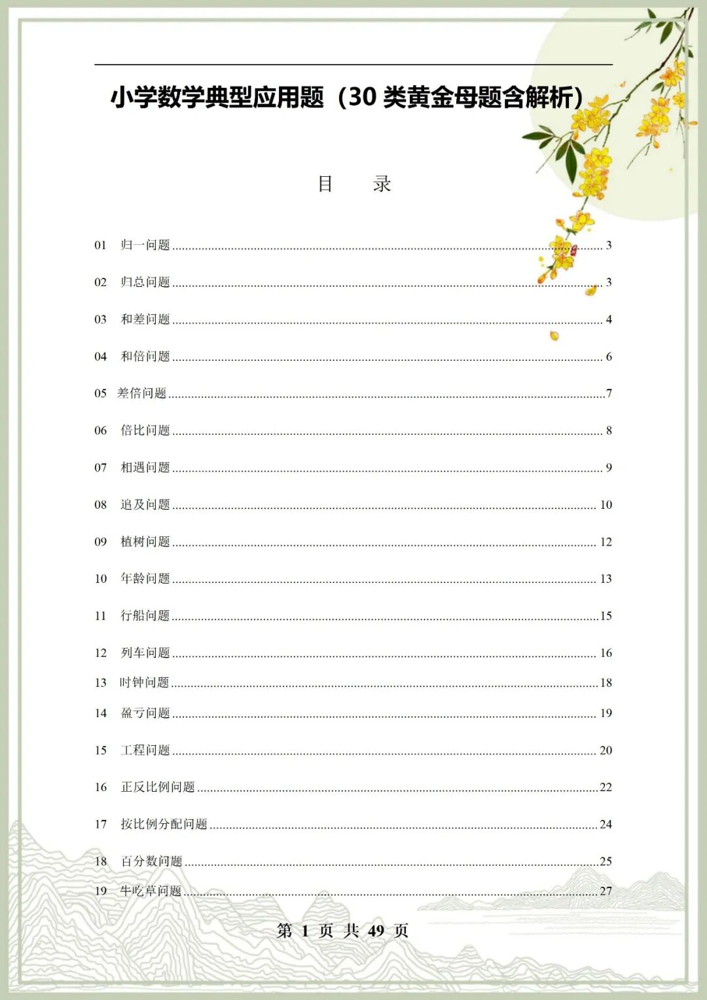
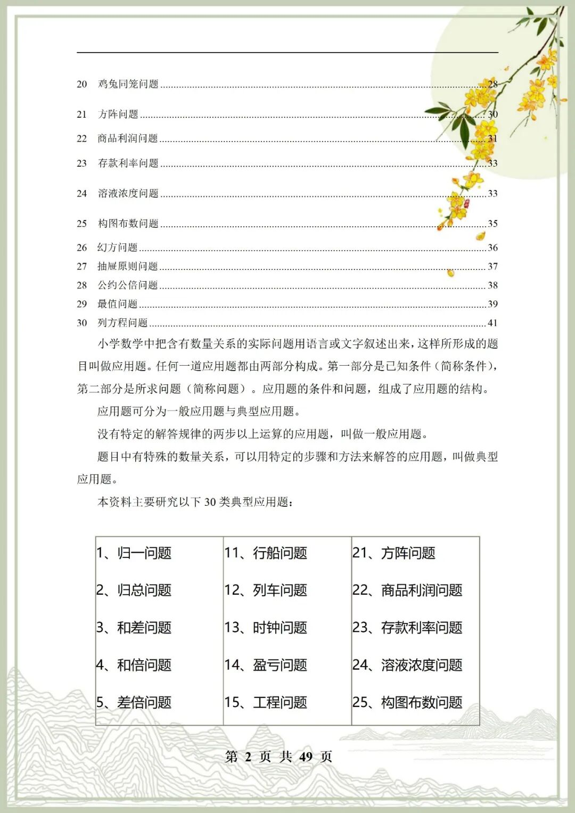
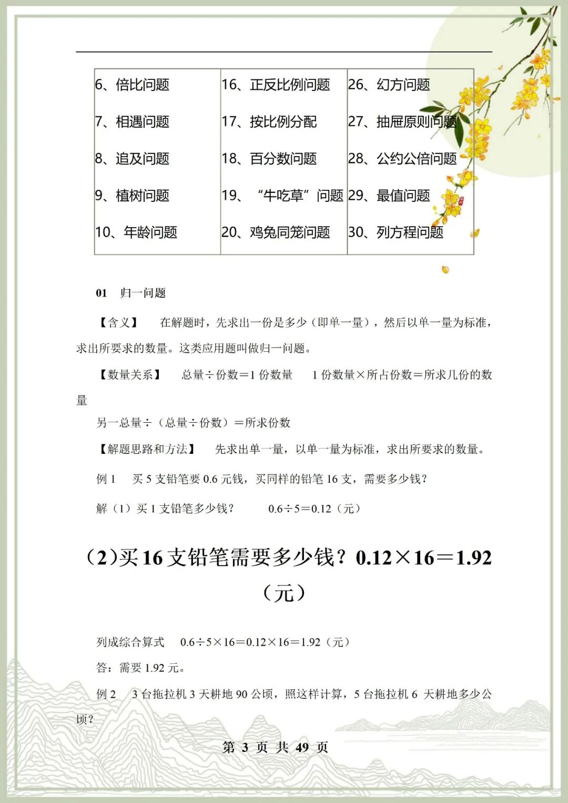
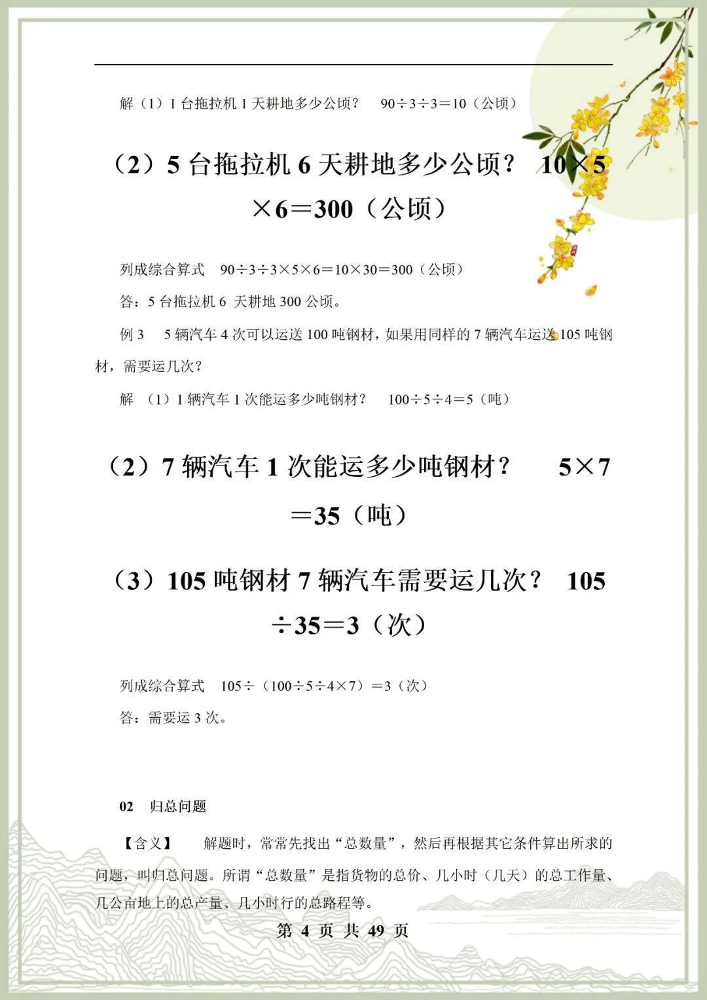
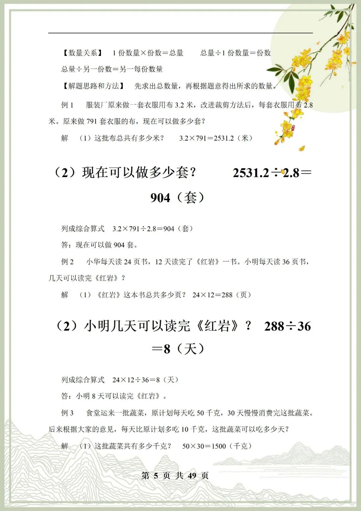
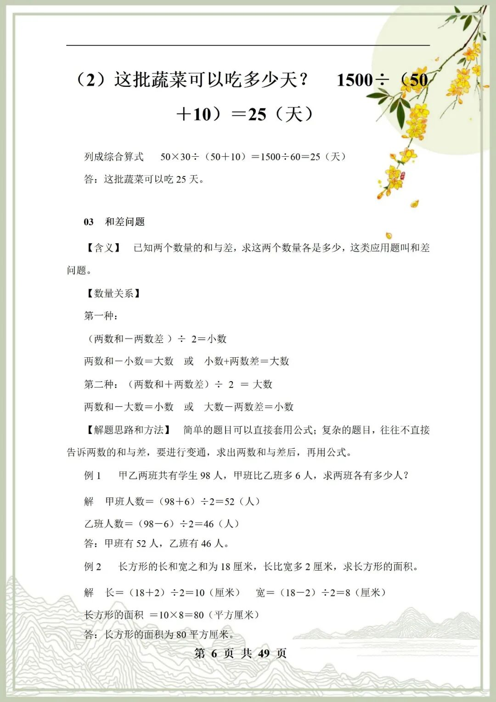
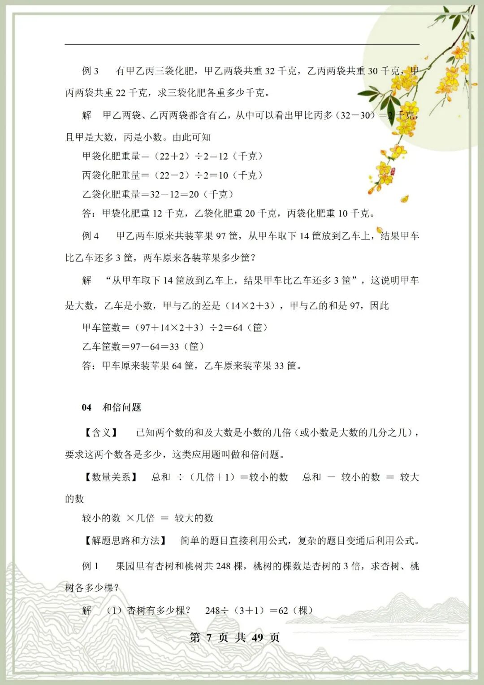
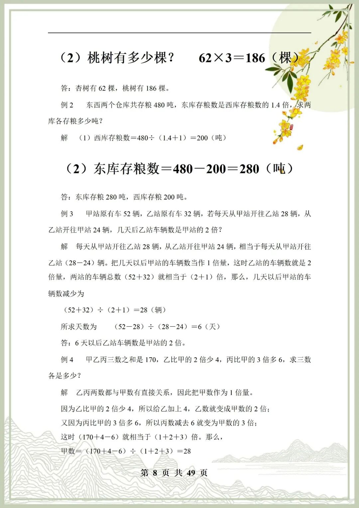
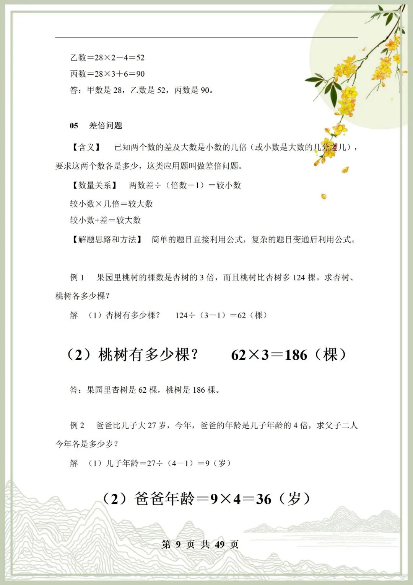

# 黄金母题合集！小学数学 30 类典型应用题，配套解析方便自学
> 💡 备注属性未写入，可能是备注属性名称或者类型被修改了，建议将字段类型设置为 rich_text，可以在小程序-操作-修改文章数据库页面进行调整
> 💡 原文链接:[https://mp.weixin.qq.com/s?__biz=MzI0NzE3NDk5NA==&mid=2247533567&idx=3&sn=1bc991b0f70bffb37a0e53549c33d119&chksm=e80d97bb45d19b238f8223705a4291d78c33ea86557234ef566be7ff21094b58ddbe2450f77d#rd](https://mp.weixin.qq.com/s?__biz=MzI0NzE3NDk5NA%3D%3D&mid=2247533567&idx=3&sn=1bc991b0f70bffb37a0e53549c33d119&chksm=e80d97bb45d19b238f8223705a4291d78c33ea86557234ef566be7ff21094b58ddbe2450f77d#rd)
黄金母题合集！小学数学 30 类典型应用题，配套解析方便自学
‍小学数学应用题题型繁杂，很多孩子盲目刷题，换个问法就不会做，核心原因就是没有吃透母题思路。这份资料整理了 30 类小学数学经典应用题母题，涵盖和差倍、年龄、行程、工程、鸡兔同笼、盈亏等必考类型，都是各类考试的原型题。每一类先讲清解题逻辑，搭配典型母题，附上详细步骤解析，不只是给答案，帮孩子弄懂底层方法。吃透一道母题，就能搞定同类型所有变式题，不用海量刷题。适合日常专项训练、考前复盘，孩子可以自主看解析自学，家长辅导也轻松，掌握应用题解题套路，不再害怕文字大题。

**领取方式：**
**①**：点一点右下角的“**赞**”和“**在看**
”，感谢
！
**②**：在公众号对话框中回复：**资料**
