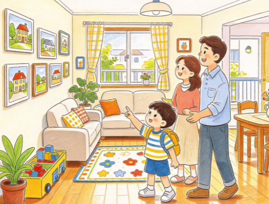

# （带音频）适合英语初学者的 350 篇英语短文，熟读 3500 核心词，读懂文章少踩坑
> 💡 备注属性未写入，可能是备注属性名称或者类型被修改了，建议将字段类型设置为 rich_text，可以在小程序-操作-修改文章数据库页面进行调整
> 💡 原文链接:[https://mp.weixin.qq.com/s?__biz=MzIxNTU5MzIwMA==&mid=2247498489&idx=1&sn=d5938d8bf8e40c3871caf7c9d228c230&chksm=96da9cb581a3e083499dee866177ac8d706a1cc8bba0d1a8dfbacfda83961c431970000448da#rd](https://mp.weixin.qq.com/s?__biz=MzIxNTU5MzIwMA%3D%3D&mid=2247498489&idx=1&sn=d5938d8bf8e40c3871caf7c9d228c230&chksm=96da9cb581a3e083499dee866177ac8d706a1cc8bba0d1a8dfbacfda83961c431970000448da#rd)
今天，我们全新推出 10 篇聚焦“职业、梦想、假设、创意”等主题的现实英语短文，全部采用第一人称叙事：每篇 80~100 词，以孩子视角记录“我”想当老师的初心、发明自动喂饭机的脑洞、假如拥有超能力的幻想、用纸箱做城堡的创意，搭配音频、中文译文与核心词汇解析。
没有空洞的理想说教，只有“我”帮同学讲题时的成就感、画下奇思妙想时的专注、扮演医生时的认真；没有复杂句式，只有初学者能读懂、能模仿、能用来描述自己梦想与创意的简单表达。原来，每一个小念头、每一次小创造，都可以用新的语言清晰表达。

**01**
**I Want to Be a Teacher（我想当老师）**
My favorite person is my English teacher. She is kind and patient. She teaches us to read and sing. Last week, I helped my classmate learn a new word. He smiled and said thank you. I felt happy. I want to be a teacher when I grow up. I want to help children learn new things.
我最喜欢的人是我的英语老师。她善良又有耐心。她教我们读书和唱歌。上周，我帮助同学学了一个新单词。他笑着说谢谢。我很开心。我长大后想当一名老师。我想帮助孩子们学习新东西。
重点词汇：**teacher** 老师；**patient** 有耐心的；**grow up** 成长；**help** 帮助；**learn** 学习
**金句语法：**“I want to be a teacher when I grow up.” — want to be 表“想成为”，when I grow up 表“当我长大后”，简洁表达职业梦想。
**02**
**My Dream House（我梦想中的房子）**
I have a dream house in my mind. It is a tree house in the forest. It has big windows and a small garden. I can see birds and flowers every day. There is a library in it. I can read books all afternoon. I hope my dream can come true one day.
我脑海里有一个梦想中的房子。它是森林里的一间树屋。它有大窗户和一个小花园。我每天都能看到鸟和花。里面有一个图书馆。我可以整个下午都读书。我希望有一天我的梦想能成真。
重点词汇：**dream** 梦想；**forest** 森林；**window** 窗户；**garden** 花园；**come true** 成真
**金句语法：**“I hope my dream can come true one day.” — hope 后接宾语从句，come true 表“成真”，简洁表达对梦想的期待。
**03**
**If I Were a Bird（假如我是一只鸟）**
If I were a bird, I would fly high in the sky. I would fly over mountains and rivers. I would sit on tall trees and sing songs. I could go to different places without walking. It would be free and fun. But I like being a child too. I can play with my friends.
假如我是一只鸟，我会在天空中高高飞翔。我会飞过高山和河流。我会坐在大树上唱歌。我可以不用走路就去不同的地方。那会很自由很有趣。但我也喜欢当小孩。我可以和朋友们一起玩。
重点词汇：**bird** 鸟；**fly** 飞翔；**mountain** 山；**river** 河流；**free** 自由的
**金句语法：**“If I were a bird, I would fly high in the sky.” — if 引导的虚拟语气，表对假设情景的想象，适合描述大胆假设。
**04**
**My Invention: The Homework Robot（我的发明：作业机器人）**
I want to invent a homework robot. It can help me finish my homework quickly. It knows math, English and Chinese. When I am tired, it can tell me stories. But Mom said I should do homework by myself. So I changed my idea. The robot can check my homework and teach me new things.
我想发明一个作业机器人。它可以帮助我快速完成作业。它懂数学、英语和语文。当我累了的时候，它可以给我讲故事。但妈妈说我应该自己写作业。所以我改变了我的想法。这个机器人可以检查我的作业，教我新东西。
重点词汇：**invent** 发明；**robot** 机器人；**finish** 完成；**tired** 累的；**check** 检查
**金句语法：**“I want to invent a homework robot.” — want to do sth. 表“想要做某事”，invent 表“发明”，简洁表达创意想法。
**05**
**The Cardboard Castle（纸箱城堡）**
Last weekend, I made a castle with big cardboard boxes. I cut windows and a door. I painted it blue and white. I put a flag on the top. My little sister played princess in it. We had tea parties inside. It was the best castle ever. Creativity makes playtime fun.
上周末，我用大纸箱做了一个城堡。我剪出了窗户和一扇门。我把它漆成了蓝白色。我在顶部放了一面旗子。我的小妹妹在里面扮演公主。我们在里面开茶话会。这是最棒的城堡。创造力让游戏时间变得有趣。
重点词汇：**cardboard** 纸板；**castle** 城堡；**cut** 剪切；**paint** 绘画；**creativity** 创造力
**金句语法：**“Creativity makes playtime fun.” — make sth. + adj. 表“使某物……”，creativity 表“创造力”，简洁总结创意游戏的意义。
**06**
**I Want to Be a Doctor（我想当医生）**
When I was sick last month, the doctor was very nice. She checked my temperature and gave me medicine. She smiled and told me to rest. I felt better soon. I want to be a doctor when I grow up. I want to help sick people feel better. It is a great job.
上个月我生病的时候，医生非常和蔼。她给我量体温，给我开药。她微笑着让我休息。我很快就感觉好多了。我长大后想当一名医生。我想帮助生病的人好起来。这是一份很棒的工作。
重点词汇：**doctor** 医生；**sick** 生病的；**temperature** 体温；**medicine** 药；**rest** 休息
**金句语法：**“I want to help sick people feel better.” — help sb. (to) do sth. 表“帮助某人做某事”，feel better 表“感觉好起来”，简洁表达职业理想。
**07**
**If I Had a Magic Pen（假如我有一支魔法笔）**
If I had a magic pen, I would draw many things. I would draw food for hungry children. I would draw books for students in poor areas. I would draw clean water for dry villages. Everyone would be happy. I know it is only a dream, but I want to help others in real life too.
假如我有一支魔法笔，我会画很多东西。我会为饥饿的孩子画食物。我会为贫困地区的学生画书。我会为干旱的村庄画干净的水。每个人都会开心。我知道这只是一个梦，但我也想在现实生活中帮助别人。
重点词汇：**magic** 魔法的；**hungry** 饥饿的；**poor** 贫困的；**dry** 干旱的；**real** 真实的
**金句语法：**“If I had a magic pen, I would draw many things.” — if 引导的虚拟语气，表对假设情景的想象，传递善良的愿望。
**08**
**My DIY Photo Frame（我的手工相框）**
I made a photo frame for Mom’s birthday. I used sticks, glue and colorful beads. I stuck the sticks together to make a square. Then I decorated it with beads. I put a photo of Mom and me in it. Mom loved it very much. She put it on her desk. Making things by hand is meaningful.
我为妈妈的生日做了一个相框。我用了树枝、胶水和彩色的珠子。我把树枝粘在一起做成了一个正方形。然后我用珠子装饰它。我放了一张妈妈和我的照片在里面。妈妈非常喜欢它。她把它放在了她的书桌上。亲手做东西很有意义。
重点词汇：**DIY** 自己动手做；**photo frame** 相框；**stick** 树枝；**glue** 胶水；**bead** 珠子
**金句语法：**“Making things by hand is meaningful.” — making things by hand 是动名词短语作主语，meaningful 表“有意义的”，简洁总结手工创作的价值。
**09**
**I Want to Be a Scientist（我想当科学家）**
I like doing small experiments at home. Last week, I made a rainbow with a glass of water and sunlight. It was beautiful. I read books about space and animals. I want to be a scientist when I grow up. I want to discover new things and make life better. Science is cool.
我喜欢在家做小实验。上周，我用一杯水和阳光制造了一道彩虹。它很漂亮。我读关于太空和动物的书。我长大后想当一名科学家。我想发现新事物，让生活更美好。科学很酷。
重点词汇：**scientist** 科学家；**experiment** 实验；**sunlight** 阳光；**discover** 发现；**cool** 酷的
**金句语法：**“I want to discover new things and make life better.” — want to do sth. 表“想要做某事”，discover 表“发现”，简洁表达科学梦想。
**10**
**If I Could Fly to the Moon（假如我能飞到月球）**
If I could fly to the moon, I would take my telescope with me. I would look at the Earth from the moon. It would look like a blue ball. I would jump high because there is less gravity. I would take photos and come back to tell my friends. It would be an amazing trip.
假如我能飞到月球，我会带上我的望远镜。我会从月球上看地球。它看起来会像一个蓝色的球。我会跳得很高，因为那里的引力更小。我会拍照，回来告诉我的朋友们。那会是一次很棒的旅行。
重点词汇：**fly** 飞；**moon** 月球；**telescope** 望远镜；**gravity** 引力；**amazing** 令人惊奇的
**金句语法：**“It would be an amazing trip.” — would 表对假设情景的推测，amazing 表“令人惊奇的”，简洁表达对太空探索的向往。
**总结**
这 10 篇短文没有空洞的说教，只有孩子真实的成就感、专注与善良。简单句式 + 第一人称叙事，让孩子**能读懂、能模仿、能表达自己的梦想与创意**——原来，每一个小念头、每一次小创造，都可以用新的语言清晰表达。
全文完，关注我，【
每晚8点
】持续更新英语启蒙资源
